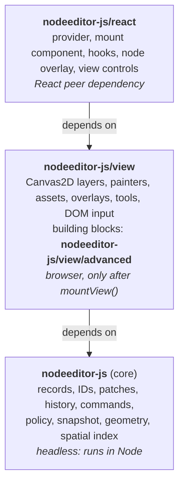
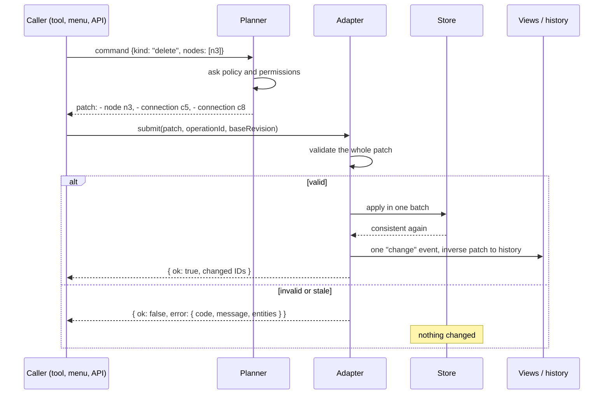
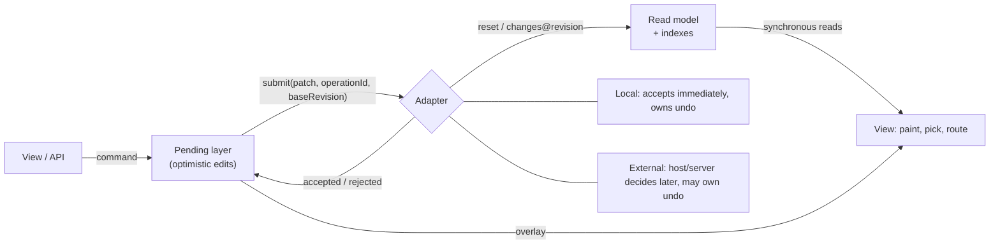
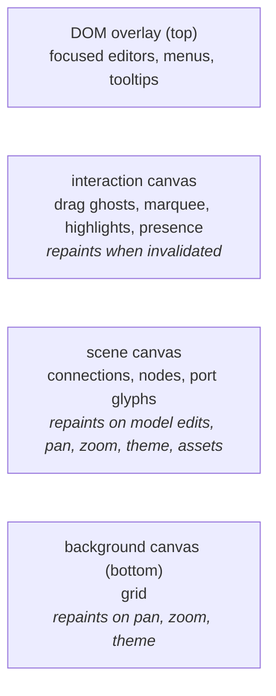
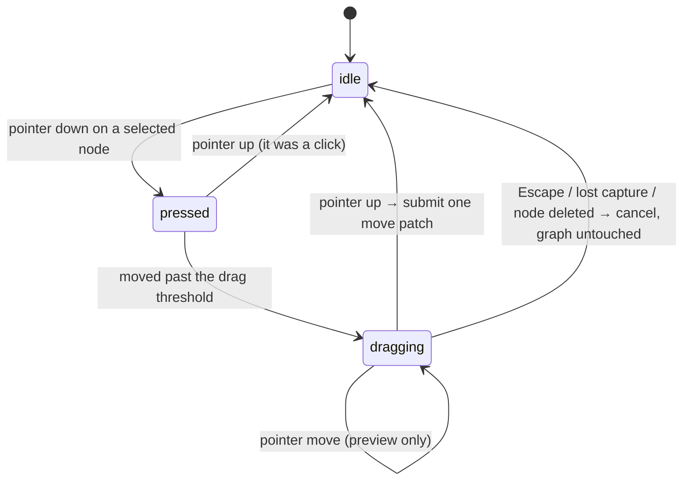
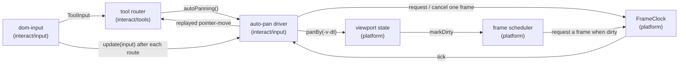
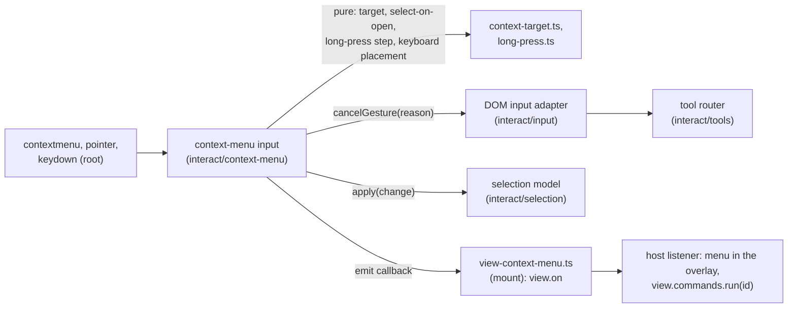
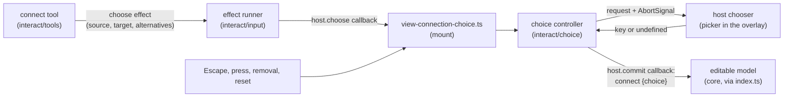
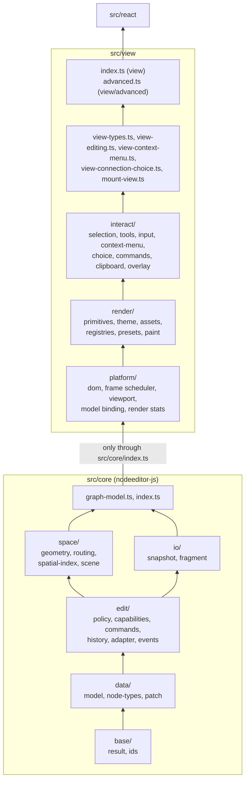
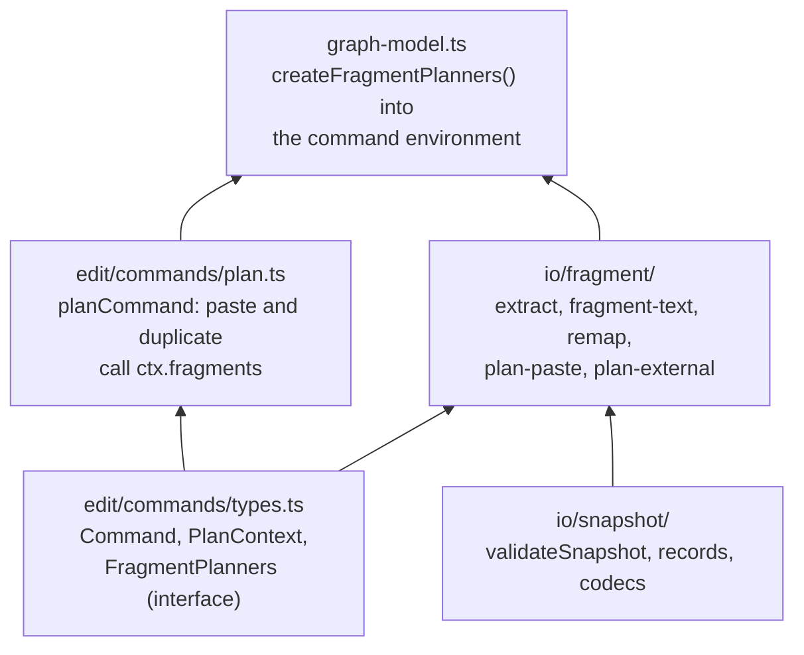

# Architecture

This document explains how nodeeditor-js is put together and why. It is written for
contributors, and for anyone who knows QtNodes (the C++/Qt predecessor) and wants to
map familiar ideas onto this code base.

Requirements live in `openspec/specs/` and are referenced here by their titles (Stable identities,
`the rule that patches are the core change primitive`, ...). Planned work lives in `openspec/changes/`. Where this document
describes something not implemented yet, it says **(planned)** and names the change.

## 1. The big picture



One npm package, three entry points. The rules that keep the layers honest are release
gates, not style preferences:

- **Core is headless**. It never touches the DOM, `window`, Canvas, or React.
  `npm run typecheck` compiles `src/core` with no DOM type definitions, so a stray
  `document` reference fails the build.
- **Nothing happens at import time**. Importing the view during server-side
  rendering is safe; browser work starts in `mountView()`.
- **Views never own data.** Everything a view shows is derived from the model and can be
  rebuilt from it.

## 2. QtNodes → nodeeditor-js

| QtNodes                                   | nodeeditor-js                                                     | Why it differs |
| ----------------------------------------- | ----------------------------------------------------------------- | -------------- |
| `AbstractGraphModel` (virtual base class) | `GraphReader` (read) + `ModelAdapter` (write authority)           | Hosts plug in an adapter; nobody inherits a base class. |
| `nodeData(id, NodeRole)` → `QVariant`     | Typed records: `NodeRecord`, `PortRecord`, `ConnectionRecord`     | No role enum, no variant unboxing; the compiler checks fields. |
| `NodeId` = `unsigned int`                 | Opaque branded strings (`"n12"`, or a host's UUID)                | Hosts can use their own database IDs. |
| `ConnectionId{out node, out port index, in node, in port index}` | `ConnectionRecord` with its own ID and `{node, port}` endpoints | Port *indices* shift when ports are inserted; port *IDs* never do. |
| `PortType::In / Out`                      | `direction: "input" \| "output" \| "undirected"`                  | Undirected ports have no direction; the policy decides what may connect. |
| `QUndoCommand` subclasses                 | **Patches**: plain data `+ add / - remove / ~ update`             | Undo is "apply the inverse patch"; the same patch feeds views and servers. |
| `QUndoStack`                              | Local history, or the host's history behind an external adapter   | A server can own undo without a second stack in the browser. |
| `QGraphicsScene` + BSP index              | Geometry scene + in-house spatial index (core)                    | Picking and culling are testable without a browser. |
| `QGraphicsView`                           | `mountView()`: stacked `<canvas>` layers                          | Drawing thousands of DOM elements is too slow. |
| Cubic built in `ConnectionPainter` / `ConnectionGraphicsObject` | Route registry per connection kind: straight, Bezier or orthogonal routers (core) | The path is a registration of its own, computed headlessly and shared by painting, picking and culling. |
| `NodeGeometry` / `AbstractNodePainter`    | Separate geometry and painter registrations per node type         | Change the look without touching hit-testing, and vice versa. |
| `NodeDelegateModelRegistry`               | Node type registry (`createNodeTypeRegistry`)                     | Model-level only: label, size, ports. Looks are registered separately. |
| `QGraphicsItem::DeviceCoordinateCache`    | Zoom-bucketed `ImageBitmap` cache for SVG/raster symbols (`createAssetService`) | Same idea: rasterize once, copy every frame. |

### Size, and what Qt gave QtNodes for free

Source without tests: QtNodes (`src/` and `include/`) is 60 files and about 8.0k lines;
nodeeditor-js (`src/`, without tests and the test-support files that
`src/architecture.test.ts` lists) is 167 files and about 17.5k lines, in eight layer
folders (five in core, three in view) plus the core facade and the view mount files.
Files here are kept small on purpose (100–300 lines), which inflates the file count, but
the line count is still more than twice as large. Most of the difference is
code that Qt (`QGraphicsView`, `QGraphicsScene`, `QUndoStack`) provides and the browser
does not:

| Qt provides                                         | Here                                                  |
| --------------------------------------------------- | ----------------------------------------------------- |
| BSP item index, `items(rect)`, `itemAt()`           | AABB tree, geometry scene, picking (`src/core/space/spatial-index`, `src/core/space/scene`) |
| `update()` coalescing, exposed-region repaint       | Frame scheduler and per-layer dirty flags             |
| Item mouse events, grabber item, `QDrag`            | DOM input adapter, tool router, tool state machines   |
| `devicePixelRatio` handled by the paint device      | Backing-store sizing, pixel-ratio changes, device matrix |
| `QUndoStack`                                        | Local history over inverse patches                    |

The rest is what QtNodes does not do at all: patches with operation IDs and base revisions
so that a server can be the authority, validated snapshot loading with versioned
documents, connection policy outcomes beyond yes/no (reason, choice, pending), and
routing per connection kind, including orthogonal routes.

The concepts a host actually uses are few:

1. `createGraphModel()`: the model, with history, events and the command API.
2. Commands (`Command`): intents such as `connect` or `moveNodes`, run with
   `model.execute`, or `view.commands.run` for editor commands by stable ID.
3. The model adapter (`ModelAdapter`): who decides whether an edit is accepted.
4. Node types and ports (`createNodeTypeRegistry`, `NodeTypeDefinition`).
5. Connection policy (`ConnectionPolicy`, `createDefaultConnectionPolicy`).
6. `mountView()`: puts a model on screen and returns the view handle.
7. Painters (`createPainterRegistries` and the presets): what nodes, ports and wires
   look like; node geometry is a separate registration.
8. Theme (`DEFAULT_THEME`, `mergeTheme`, `view.setTheme`).
9. Tools (`defaultToolSlots()` and the tool contract): how input becomes edits.
10. Selection (`view.selection`): view-local, never in the document.

Status: only the local adapter exists today. `createGraphModel()` wires it in; the
external, server-authoritative adapter is **(planned: Slice D)**, see section 5.

## 3. What the model stores

Three kinds of records, all plain immutable objects (`src/core/data/model/records.ts`):

```
NodeRecord        id, type, position, size, rotation (quarter turns), mirrored, z,
                  ports (ordered list of PortIds), title?, status?, payload, capabilities?
PortRecord        id, node, direction, typeKey, limit, label?, placement?
ConnectionRecord  id, kind, from {node, port}, to {node, port}
```

- **`payload`** is the host application's data. The library stores it and never interprets it.
  It must be JSON-compatible.
- **`typeKey`** is what the default connection policy compares, for example `"hydraulic"`
  or `"signal"`.
- **`ports` on the node** is the *presentation* order. Reordering ports changes this list
  only; connections still point at the same port IDs.
- **`z`** is the paint-order key. Ties are broken by insertion sequence (`seq`), so the
  order is always deterministic.

What the model deliberately does **not** store: hover, the current drag preview,
cached geometry, rendered bitmaps. Those live in views, and they never appear in a saved
document.

### Identity

IDs are opaque strings. The default generator mints `n1, n2, …` for nodes,
`p1, …` for ports, `c1, …` for connections. Its state, the *cursor*, is saved with the
document, so a deleted `n7` is never handed out again, even after save and reload.
A host can plug in its own generator (UUIDs, server IDs). The library never
parses or sorts IDs it did not mint.

## 4. How an edit flows

Every change to the graph — a drag, a menu action, an API call, an undo — goes through
one pipeline:



- **Commands** describe intent. A *planner* expands the intent into a complete patch.
  "Delete node" must also delete its connections; "connect" must ask the connection
  policy first.
- **Patches** are the core primitive. Each operation records the old and new
  value, so the inverse patch is mechanical, and a stale update (the old value no longer
  matches) is rejected as a conflict instead of overwriting someone else's edit.
- **Atomicity**: the whole patch is validated *before* anything changes. Then
  it lands in one store batch. Observers are notified once, after the graph is
  consistent again; nobody ever sees a connection pointing at a deleted node.
- **Results, not exceptions**: a rejected edit returns
  `{ ok: false, error: { code, message, entities } }`. Exceptions (`MisuseError`) are
  reserved for programmer mistakes, like calling an API in a state where it can never
  succeed.
- **One gesture = one history entry**. Dragging a node through 200 pointer
  moves produces one patch on release; the intermediate positions are a local preview.

## 5. Who owns the truth: read model, pending layer, adapters

The library **always** keeps its own read model: an indexed copy of the graph used for
painting, picking, and routing. A frame never waits on a server. *Who decides whether an
edit is accepted* is a separate question, answered by the adapter:



- **Local adapter**: the included in-memory document. Accepts synchronously and keeps
  the undo stack. This is what you get with zero configuration.
- **External adapter** **(planned: Slice D)**: the host application is the authority,
  for example a backend server. Edits show immediately in the **pending layer**
  (optimistic); a rejection rolls them back. Two modes:
  - *Snapshot mode*: the host pushes full snapshots (for example after every refetch),
    and the library diffs them against the read model, so selection, gestures and
    pending edits survive.
  - *Revisioned mode*: the host sends `changes@revision` and acknowledges operation IDs.
    A gap in revisions triggers resynchronization.
- **Collaboration** is server-authoritative. The library contains no merge or CRDT logic:
  other users' edits arrive as external changes, never enter the local user's undo,
  and pending local edits are re-applied on top of them. Presence (remote cursors and
  selections) is drawn on the interaction layer from data the host supplies
  (`view.setPresence`).

## 6. How things get drawn

Geometry, picking and the spatial index live in core. The Canvas2D view that uses them,
with its painters, layers and image cache, is implemented in `src/view`; see
[guide-view.md](guide-view.md) for a tutorial. `mountView(container, { model, ... })`
returns a handle; the view builds its own geometry scene over the model, subscribes to
committed changes, and repaints the layers they dirty.

### Geometry and painters are separate

For each node type, two independent registrations:

- **Geometry** (core): outline, hit shape, body/painted/hit bounds, and port anchors with
  outward normals, all in node-local coordinates. One transform (mirror → quarter-turn →
  translate) maps them to the world, and painting, picking, and anchors all use that same
  transform. Rotated symbols can't have ports that are drawn in one place and
  clickable in another.
- **Painter** (view): an object with `paint(ctx, input)` that draws into a Canvas2D context
  already transformed to the node's local space. The input carries the node record, its
  body bounds, the resolved style, the level-of-detail policy, an asset drawer, and the
  visual state (selected, hovered, diagnostics). Port glyph painters (keyed by port type
  key) and connection painters (keyed by connection kind) are separate registries, as is
  the background slot. An unregistered key falls back to a placeholder, a dot, a plain path.

Two presets ship: an **image-symbol node** (an SVG or raster picture with ports anywhere
on its outline; the primary preset) and a **card node** (title bar, rows of ports).

### Routing is its own registration

QtNodes has no routing step: its connection painter computes one cubic from the two
port positions each time it paints, and the connection's shape and bounding rectangle
come from the same code. Here the path is computed once, in core, by a **router** chosen
per connection kind from a route registry (straight, Bezier, or orthogonal with optional
rounded corners), and stored in the geometry scene. Painting, picking and culling all
read that one `PathGeometry`, so a rounded orthogonal corner is hit exactly where it is
drawn. Changing a kind's router recomputes only that kind's paths and is not an edit.
The orthogonal router checks a fixed set of about fifteen candidate shapes against the
two endpoint nodes, so it stays a constant-time function of the two ends; avoiding other
nodes is a later change ([geometry.md](geometry.md)).

### Finding what is under the mouse

Picking is pure geometry in core, never "read the pixel under the cursor":

1. **Broad phase**: an in-house dynamic AABB tree (like QGraphicsScene's BSP index)
   returns the few items whose bounding boxes contain the point. A wire is indexed as
   several pieces that follow the curve, not as one big box, so a long wire is returned
   only near its stroke ([geometry.md](geometry.md)).
2. **Narrow phase**: an exact test against each candidate's shape, or the distance to the
   nearby pieces of a path, with screen-space tolerances, so a thin wire stays as easy to
   hit at 10% zoom as at 400%. Below a zoom threshold ports are hidden and not picked.
3. Results come back in a deterministic order (topmost first, ties by sequence).

The same index answers "what is inside the viewport?" for culling. The view exposes this
as `view.pick(clientX, clientY)` and `view.clientToWorld(...)`.

### Stacked canvases, redrawn only when dirty



Each layer repaints only when marked dirty, at most once per animation frame. When
nothing changes, nothing runs: there is no render loop while idle. A tool preview repaints
the interaction layer, not the thousands of nodes underneath. Each canvas has a backing
store of `cssSize × devicePixelRatio`, resized when the container or the pixel ratio
changes. The scene layer asks the geometry scene for items in the visible rectangle
(culling), paints connections, nodes and port glyphs in the configured z-order, and then
always draws selection and diagnostic decorations, whatever a painter did.

Level of detail is a theme decision by zoom: painters are told to drop titles and labels
when zoomed out, ports disappear below `lodHidePortsBelow`, and below `lodOverviewBelow`
the scene layer draws nodes and wires itself in a few style batches, calling no painters.
An opt-in `gestureBitmap` mount option reuses the last frame as a picture during pans and
zooms of large visible sets, within limits on blur and uncovered area. The view guide
explains the trade-offs.

### Images

SVG symbols are screened for unsafe content, then rasterized into `ImageBitmap`s once per
zoom bucket (power-of-two multiples, 1/8× to 16×, of the picture's intrinsic size, chosen
from zoom × device pixel ratio) and copied each frame. When zoom crosses into a new
bucket, the nearest cached bitmap is drawn while a sharp one is prepared in the background.
Least-recently-used bitmaps are evicted under a byte budget. Raster images (PNG, WebP) use
the same service. The library never fetches anything by itself: the host supplies a
resolver, and a failed asset shows a placeholder while the node keeps its geometry.

## 7. Interaction tools

Each tool (select/move, marquee, connect, resize, pan, empty-canvas pan, plus wheel zoom) is an explicit state
machine; [interaction.md](interaction.md) lists the gestures, commands and keymap. The move
tool, for example:



In code it is a discriminated union of states plus a pure transition function:

```ts
type MoveState =
  | { kind: "idle" }
  | { kind: "pressed"; start: Point; nodes: NodeId[] }   // below the drag threshold
  | { kind: "dragging"; start: Point; nodes: NodeId[]; delta: Vec2 };

transition(state, input, context) → { state, effects }   // no DOM inside
```

Only `src/view/interact/input/` (and the context-menu input beside it, below) touches DOM
events and translates them into tool inputs. Tools can therefore be tested in Node. Escape, lost pointer capture, blur, or the dragged node being
deleted by someone else all lead to a well-defined cancel that leaves the graph untouched.

Tools are timeless, so **auto-pan** is not inside them. A tool only says which of
its states want it (`autoPans(state)`: the dragging states of move, connect, resize and
marquee). A DOM-free auto-pan driver in `interact/input/` runs beside the frame
scheduler, not inside it: after every routed input it asks the router, and while a drag
sits in an edge band it requests one animation frame at a time from the same frame clock,
pans the viewport and replays the last pointer-move so the tool's preview follows. When
the gesture ends the next routed input cancels the pending frame. The scheduler keeps its
simple guarantee (one frame per batch of dirty layers, never a loop), and the driver's
own guarantee (no frame once nothing pans) is tested on its own.



Every arrow points from a module to one in its own layer or below (`interact` uses
`platform`), or is a callback the mount wiring passes down.

**The context menu** sits beside the DOM input adapter, not inside it or the
router. It is not a tool: a right press is a press no tool accepts, and the result is an
event with a position, not a command. `interact/context-menu/context-menu-input.ts`
listens on the same root for `contextmenu`, the press (to know whether it is still below
its drag threshold), the touch long-press timer and the menu key. The decisions are pure
functions next to it (`context-target.ts`: target from the ordered hits, the
select-on-open rule and keyboard placement; `long-press.ts`: the touch state machine), so
they run in Node like the tools. The only thing it asks of the DOM input adapter is
`cancelGesture("context-menu")` for a press that has not started dragging. The mount file
`view-context-menu.ts` owns the typed emitter behind `view.on` and attaches the input
once `view-editing.ts` has built the router; with no listener registered the input does
nothing at all, so the browser's own menu keeps working. In QtNodes this is a
`contextMenuEvent` override on the scene or the item, and the menu is a `QMenu`; here the
host builds the menu in the overlay and runs registered commands.



**A pending connection choice** lives beside the router too, not in it. When the
policy offers several alternatives for the port a connection is dropped on, the connect
tool ends its gesture with a `choose` effect instead of a commit, and a small DOM-free
controller (`interact/choice/connection-choice.ts`) asks the host's async chooser and
waits. The router's unit is "a pointer that is down"; a choice has no pointer, and
keeping the tool non-idle after the release would bend the router's invariants (the
active pointer, capture release, auto-pan, no shortcuts during a gesture) for every tool.
The controller has two states, idle and pending with a token and an `AbortController`:
an answer counts only while its token is current, choosing commits one `connect` naming
the policy's key through the same command path as tool commits, and every other exit
aborts the signal and commits nothing. The mount file `view-connection-choice.ts` adds the
capture-phase Escape and press listeners and the model's removal and reset events. In
QtNodes terms this is a modal `QMenu::exec` at the drop point, made asynchronous and
cancellable, with the menu supplied by the host.



## 8. Code map

The source tree is grouped by layer, lowest first. A module may import from its own layer
and from any layer below it, never from above. `src/architecture.test.ts` holds the same
table and fails on a wrong-way import, on a runtime import cycle between files, and on
view code reaching core other than through `src/core/index.ts`.

```
src/core/                                                            (nodeeditor-js)
  base/       result.ts, ids/    Result, Rejection, MisuseError;     implemented
                                 branded IDs, counter generator
  data/       model/             records, validation, store,         implemented
                                 indexes, reader, frozen state
              node-types/        node type registry, diagnostics     implemented
              patch/             patches: apply, invert, integrity   implemented
  edit/       policy/            connection policy                   implemented
              capabilities/      permissions                         implemented
              commands/          command planners                    implemented
              adapter/ events/   adapter contract, local adapter,    implemented
              history/           change events, undo/redo
  space/      geometry/          transforms, shapes, node geometry,  implemented
                                 paths (line, cubic, polyline)
              routing/           routers, route registry,            implemented
                                 orthogonal candidates
              spatial-index/     AABB tree                           implemented
              scene/             geometry scene and picking          implemented
  io/         snapshot/          JSON snapshot shape, validator,     implemented
                                 diff, versioned document save/load
              fragment/          clipboard fragments: extract,       implemented
                                 envelope text, paste/duplicate
                                 planners
  graph-model.ts                 createGraphModel facade             implemented
  index.ts                       public entry
src/view/                                                     (nodeeditor-js/view)
  platform/   dom/               layer stack, container metrics      implemented
              frame-scheduler.ts, viewport-state.ts, model-binding.ts,
              render-stats.ts
  render/     primitives/        grid, path tracing, placeholder     implemented
              theme/             theme tokens, style resolution      implemented
              assets/            asset service, SVG screening,       implemented
                                 zoom buckets, bitmap cache
              registries/        painter contracts, registries,      implemented
                                 fallbacks
              presets/           image-symbol, card, port glyph and  implemented
                                 connection painters
              paint/             background, scene and interaction   implemented
                                 layers, LOD, overview, gesture
                                 bitmap, previews
  interact/   selection/         selection model                     implemented
              tools/             tool contract, router, tools        implemented
              input/             DOM input adapter, key input,       implemented
                                 effect runner, view events
              context-menu/      context-menu input, target and      implemented
                                 selection rule, touch long-press
              choice/            connection chooser types, options,  implemented
                                 pending-choice controller
              commands/          command registry, keymap, view      implemented
                                 commands
              clipboard/         clipboard service, native-event     implemented
                                 bridge, paste placement
              overlay/           DOM overlay host, presence          implemented
  view-types.ts, view-editing.ts, view-context-menu.ts,              implemented
  view-connection-choice.ts, mount-view.ts
  index.ts                       host API (nodeeditor-js/view)
  advanced.ts                    building blocks (nodeeditor-js/view/advanced)
src/react/                       provider, mount component, hooks,   implemented
                                 node overlay, view controls
```

How the layers depend on each other. An arrow means "may be imported by", and the test
checks it against the import statements. `space` and `io` are siblings: neither imports
the other. Inside a layer, folders may import each other as long as no runtime import
cycle between files appears.



Three things worth knowing about the layers, none of them a cycle between files:

- `edit/` is one layer because its folders lean on each other: `adapter/` creates the
  event hub and the local history, and `events/` and `history/` import back from
  `adapter/types.ts`, but only types (`Revision`, `OperationId`, `HistoryState`).
  `space/scene` listens to model changes, which is why `space/` sits above `edit/`.
  Inside `space/`, `routing/` imports `geometry/` (the polyline and Bezier builders) and
  `scene/` imports both; `geometry/` imports neither, so there is no cycle.
- Inside `render/`, `primitives/` holds the drawing helpers that registries, presets and
  paint layers share (`paintGrid`, `tracePath`, the placeholder painter, and the paint
  frame with `setMatrix`), so those three do not import each other at runtime. The
  preview data shapes (`ToolPreview` and the connect candidate types) live in
  `paint/previews/preview-types.ts`, and `interact/tools/tool-types.ts` re-exports them,
  so rendering never imports interaction.
- `interact/commands/` imports `capabilityProbe` from `interact/tools/`, and
  `interact/overlay/` paints presence through `render/paint/`. Both follow the layer
  order.

- `core/data/model/node-frame.ts` holds the quarter-turn and mirror map of the node
  frame (`frameVector`, `frameVectorInverse`, `anchoredPosition`, `mirroredRotation`).
  The `resizeNode` and `mirrorNodes` planners and the capability validator's compound
  rule (`edit/capabilities/compound-fields.ts`) need it, and `edit/` may not import
  `space/`, where `node-transform.ts` builds the full affine matrix. So the linear part
  lives one layer lower, and a test in `space/geometry/` asserts that both agree for all
  eight rotation and mirror states. The view's resize tool uses the exported
  `anchoredPosition`, so preview and commit run the same arithmetic.

- `paste` and `duplicate` are `Command` kinds declared in `edit/commands/`, but their
  planners need the snapshot validator, records mapping and codecs from `io/`. Rather
  than import upward, `PlanContext` has an optional `fragments: FragmentPlanners` slot
  (an interface declared in `edit/`). The facade, which may import everything below it,
  fills the slot with the planners from `io/fragment/`; without it `planCommand` rejects
  both kinds with `unsupported-command`. `io/fragment/` computes paste bounds from the
  snapshot entries itself, so it never imports its sibling `space/`.



Test-support files (fixtures, harnesses, builders) may reach across layers, and the test
lists each of them; for example `view/test-support/tool-harness.ts` imports
`core/space/scene/scene-fixtures.ts`. Production code never imports a test-support file.

Suggested reading order for the implemented code: `base/result.ts` → `base/ids/ids.ts` →
`base/ids/id-generator.ts` → `data/model/records.ts` → `data/model/store.ts` →
`data/model/reader.ts`.
[guide-core-model.md](guide-core-model.md) walks through them with examples.

To use the library rather than read it, start with
[guide-using-the-model.md](guide-using-the-model.md): creating a model, editing,
events, undo, patches, and save/load through the public API. To put a model on screen, continue with
[guide-view.md](guide-view.md): mounting a view, geometry and painter registrations,
assets, themes, overlays, picking and render statistics. The geometry and snapshot
formats are described in [geometry.md](geometry.md) and [format.md](format.md).
