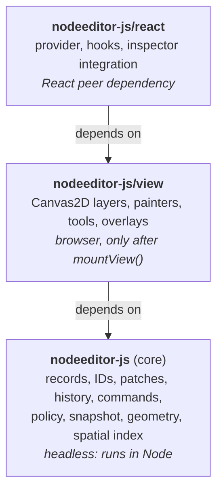
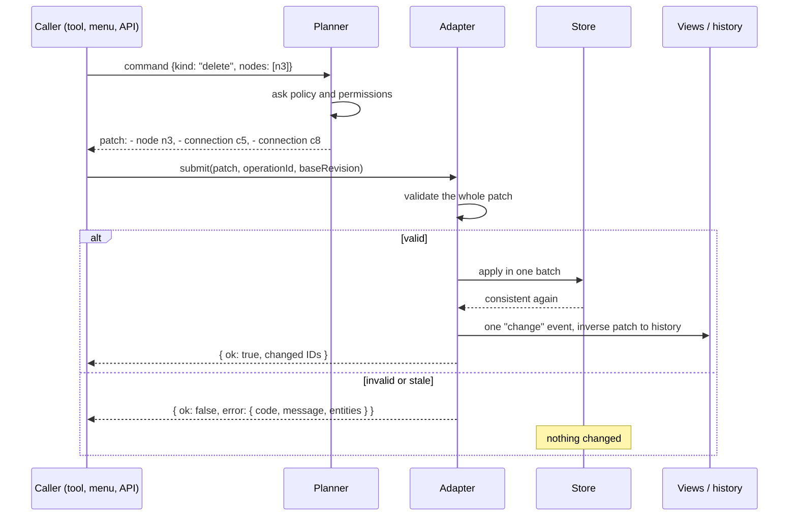
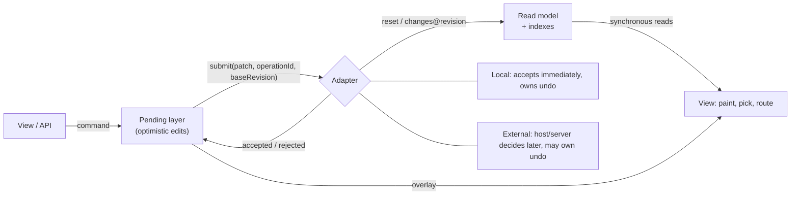
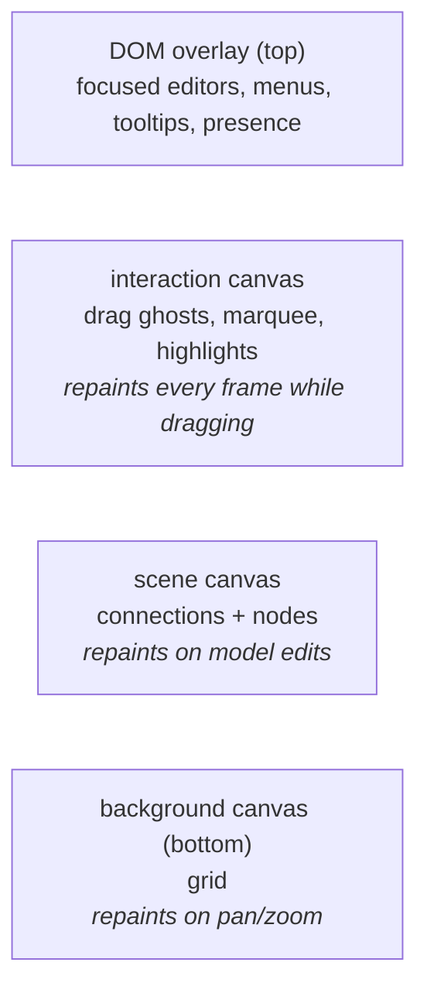
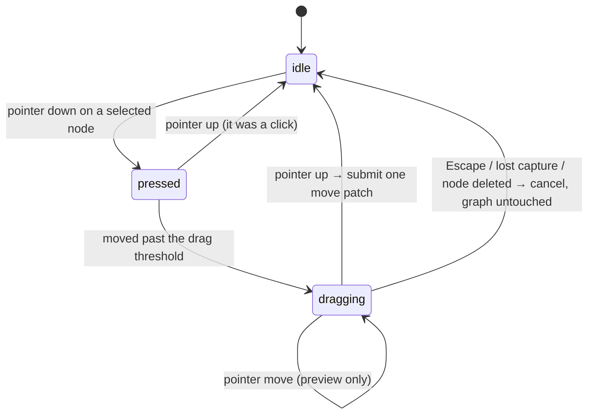

# Architecture

This document explains how nodeeditor-js is put together and why. It is written for
contributors, and for anyone who knows QtNodes (the C++/Qt predecessor) and wants to
map familiar ideas onto this code base.

Requirements live in `openspec/specs/` and are referenced here by ID (`MOD-03`,
`PAT-01`, ...). Planned work lives in `openspec/changes/`. Where this document
describes something not implemented yet, it says **(planned)** and names the change.

## 1. The big picture



One npm package, three entry points. The rules that keep the layers honest are release
gates, not style preferences:

- **Core is headless** (PKG-03). It never touches the DOM, `window`, Canvas, or React.
  `npm run typecheck` compiles `src/core` with no DOM type definitions, so a stray
  `document` reference fails the build.
- **Nothing happens at import time** (REA-06). Importing the view during server-side
  rendering is safe; browser work starts in `mountView()`.
- **Views never own data.** Everything a view shows is derived from the model and can be
  rebuilt from it.

## 2. QtNodes → nodeeditor-js

| QtNodes                                   | nodeeditor-js                                                     | Why it differs |
| ----------------------------------------- | ----------------------------------------------------------------- | -------------- |
| `AbstractGraphModel` (virtual base class) | `GraphReader` (read) + `ModelAdapter` (write authority)           | Hosts plug in an adapter; nobody inherits a base class. |
| `nodeData(id, NodeRole)` → `QVariant`     | Typed records: `NodeRecord`, `PortRecord`, `ConnectionRecord`     | No role enum, no variant unboxing; the compiler checks fields. |
| `NodeId` = `unsigned int`                 | Opaque branded strings (`"n12"`, or a host's UUID)                | Hosts can use their own database IDs. |
| `ConnectionId{out node, out port index, in node, in port index}` | `ConnectionRecord` with its own ID and `{node, port}` endpoints | Port *indices* shift when ports are inserted; port *IDs* never do (PRT-01). |
| `PortType::In / Out`                      | `direction: "input" \| "output" \| "undirected"`                  | Undirected ports have no direction; the policy decides what may connect. |
| `QUndoCommand` subclasses                 | **Patches**: plain data `+ add / - remove / ~ update`             | Undo is "apply the inverse patch"; the same patch feeds views and servers. |
| `QUndoStack`                              | Local history, or the host's history behind an external adapter   | A server can own undo without a second stack in the browser. |
| `QGraphicsScene` + BSP index              | Geometry scene + in-house spatial index (core)                    | Picking and culling are testable without a browser. |
| `QGraphicsView`                           | `mountView()`: stacked `<canvas>` layers                          | Drawing thousands of DOM elements is too slow. |
| `NodeGeometry` / `AbstractNodePainter`    | Separate geometry and painter registrations per node type         | Change the look without touching hit-testing, and vice versa. |
| `NodeDelegateModelRegistry`               | Node type registry (`createNodeTypeRegistry`)                     | Model-level only: label, size, ports. Looks are registered separately. |
| `QGraphicsItem::DeviceCoordinateCache`    | Zoom-bucketed `ImageBitmap` cache for SVG/raster symbols **(planned: add-canvas-view-foundation)** | Same idea: rasterize once, copy every frame. |

## 3. What the model stores

Three kinds of records, all plain immutable objects (`src/core/data/model/records.ts`):

```
NodeRecord        id, type, position, size, rotation (quarter turns), mirrored, z,
                  ports (ordered list of PortIds), title?, status?, payload, capabilities?
PortRecord        id, node, direction, typeKey, limit, label?, placement?
ConnectionRecord  id, kind, from {node, port}, to {node, port}
```

- **`payload`** is the host application's data. The library stores it and never interprets it.
  It must be JSON-compatible.
- **`typeKey`** is what the default connection policy compares, for example `"hydraulic"`
  or `"signal"`.
- **`ports` on the node** is the *presentation* order. Reordering ports changes this list
  only; connections still point at the same port IDs.
- **`z`** is the paint-order key. Ties are broken by insertion sequence (`seq`), so the
  order is always deterministic (MOD-08).

What the model deliberately does **not** store (MOD-04): hover, the current drag preview,
cached geometry, rendered bitmaps. Those live in views, and they never appear in a saved
document.

### Identity

IDs are opaque strings (MOD-03). The default generator mints `n1, n2, …` for nodes,
`p1, …` for ports, `c1, …` for connections. Its state, the *cursor*, is saved with the
document, so a deleted `n7` is never handed out again, even after save and reload
(MOD-03a). A host can plug in its own generator (UUIDs, server IDs). The library never
parses or sorts IDs it did not mint.

## 4. How an edit flows

Every change to the graph — a drag, a menu action, an API call, an undo — goes through
one pipeline:



- **Commands** describe intent. A *planner* expands the intent into a complete patch.
  "Delete node" must also delete its connections; "connect" must ask the connection
  policy first.
- **Patches** are the core primitive (PAT-01). Each operation records the old and new
  value, so the inverse patch is mechanical, and a stale update (the old value no longer
  matches) is rejected as a conflict instead of overwriting someone else's edit.
- **Atomicity** (MOD-05): the whole patch is validated *before* anything changes. Then
  it lands in one store batch. Observers are notified once, after the graph is
  consistent again; nobody ever sees a connection pointing at a deleted node.
- **Results, not exceptions**: a rejected edit returns
  `{ ok: false, error: { code, message, entities } }`. Exceptions (`MisuseError`) are
  reserved for programmer mistakes, like calling an API in a state where it can never
  succeed.
- **One gesture = one history entry** (INT-08). Dragging a node through 200 pointer
  moves produces one patch on release; the intermediate positions are a local preview.

## 5. Who owns the truth: read model, pending layer, adapters

The library **always** keeps its own read model: an indexed copy of the graph used for
painting, picking, and routing. A frame never waits on a server. *Who decides whether an
edit is accepted* is a separate question, answered by the adapter:



- **Local adapter**: the included in-memory document. Accepts synchronously and keeps
  the undo stack. This is what you get with zero configuration.
- **External adapter** **(planned: Slice D)**: the host application is the authority,
  for example a backend server. Edits show immediately in the **pending layer**
  (optimistic); a rejection rolls them back. Two modes:
  - *Snapshot mode*: the host pushes full snapshots (for example after every refetch),
    and the library diffs them against the read model, so selection, gestures and
    pending edits survive.
  - *Revisioned mode*: the host sends `changes@revision` and acknowledges operation IDs.
    A gap in revisions triggers resynchronization.
- **Collaboration** is server-authoritative. The library contains no merge or CRDT logic:
  other users' edits arrive as external changes, never enter the local user's undo,
  and pending local edits are re-applied on top of them. Presence (remote cursors) is
  drawn through an overlay hook with data the host supplies.

## 6. How things get drawn

Geometry, picking and the spatial index are implemented in core. The Canvas2D view that
uses them, with its painters, layers and image cache, is **(planned: add-canvas-view-foundation)**.

### Geometry and painters are separate (geometry implemented; painters planned)

For each node type, two independent registrations:

- **Geometry** (core): outline, hit shape, body/painted/hit bounds, and port anchors with
  outward normals, all in node-local coordinates. One transform (mirror → quarter-turn →
  translate) maps them to the world, and painting, picking, and anchors all use that same
  transform (GEO-02a). Rotated symbols can't have ports that are drawn in one place and
  clickable in another.
- **Painter** (view, **planned**): a function that draws into a Canvas2D context, given the node and
  its visual state (selected, hovered, level of detail).

Two presets ship: an **image-symbol node** (an SVG or raster picture with ports anywhere
on its outline; the primary preset) and a **card node** (title bar, rows of ports).

### Finding what is under the mouse (implemented in core)

Picking is pure geometry in core, never "read the pixel under the cursor":

1. **Broad phase**: an in-house dynamic AABB tree (like QGraphicsScene's BSP index)
   returns the few items whose bounding boxes contain the point.
2. **Narrow phase**: an exact test against each candidate's shape or path, with screen-space
   tolerances, so a thin wire stays as easy to hit at 10% zoom as at 400%.
3. Results come back in a deterministic order (topmost first, ties by sequence).

The same index answers "what is inside the viewport?" for culling.

### Stacked canvases, redrawn only when dirty **(planned)**



Each layer repaints only when marked dirty, at most once per animation frame. When
nothing changes, nothing runs: there is no render loop while idle. Dragging a node
repaints the interaction layer, not the thousands of nodes underneath.

### Images **(planned)**

SVG symbols are rasterized into `ImageBitmap`s once per zoom bucket (for example 1×, 2×,
4× the device pixel ratio) and copied each frame. When zoom crosses into a new bucket,
the nearest cached bitmap is drawn while a sharp one is prepared in the background.
Least-recently-used bitmaps are evicted to bound memory. Raster images (PNG, WebP) use
the same service. The library never fetches anything by itself: the host supplies a
resolver.

## 7. Interaction tools **(planned: add-basic-tools)**

Each tool (select, marquee, move, connect, pan, zoom) is an explicit state machine. The
move tool, for example:



In code it is a discriminated union of states plus a pure transition function:

```ts
type MoveState =
  | { kind: "idle" }
  | { kind: "pressed"; start: Point; nodes: NodeId[] }   // below the drag threshold
  | { kind: "dragging"; start: Point; nodes: NodeId[]; delta: Vec2 };

transition(state, input, context) → { state, effects }   // no DOM inside
```

Only `src/view/interact/input/` touches DOM events and translates them into tool inputs. Tools can
therefore be tested in Node. Escape, lost pointer capture, blur, or the dragged node being
deleted by someone else all lead to a well-defined cancel that leaves the graph untouched
(INT-05).

## 8. Code map

The source tree is grouped by layer, lowest first. A module may import from its own layer
and from any layer below it, never from above. `src/architecture.test.ts` holds the same
table and fails on a wrong-way import, on a runtime import cycle between files, and on
view code reaching core other than through `src/core/index.ts`.

```
src/core/                                                            (nodeeditor-js)
  base/       result.ts, ids/    Result, Rejection, MisuseError;     implemented
                                 branded IDs, counter generator
  data/       model/             records, validation, store,         implemented
                                 indexes, reader, frozen state
              node-types/        node type registry, diagnostics     implemented
              patch/             patches: apply, invert, integrity   implemented
  edit/       policy/            connection policy                   implemented
              capabilities/      permissions                         implemented
              commands/          command planners                    implemented
              adapter/ events/   adapter contract, local adapter,    implemented
              history/           change events, undo/redo
  space/      geometry/          transforms, shapes, node geometry   implemented
              spatial-index/     AABB tree                           implemented
              scene/             geometry scene and picking          implemented
  io/         snapshot/          JSON snapshot shape, validator,     implemented
                                 diff, versioned document save/load
  graph-model.ts                 createGraphModel facade             implemented
  index.ts                       public entry
src/view/                                                     (nodeeditor-js/view)
  platform/, render/, interact/  mountView, layers, painters,        planned
                                 assets, overlays, tools, input
src/react/                       provider and hooks                  planned (Slice B)
```

Suggested reading order for the implemented code: `base/result.ts` → `base/ids/ids.ts` →
`base/ids/id-generator.ts` → `data/model/records.ts` → `data/model/store.ts` →
`data/model/reader.ts`.
[guide-core-model.md](guide-core-model.md) walks through them with examples.

To use the library rather than read it, start with
[guide-using-the-model.md](guide-using-the-model.md): creating a model, editing,
events, undo, patches, and save/load through the public API. The geometry and snapshot
formats are described in [geometry.md](geometry.md) and [format.md](format.md).
