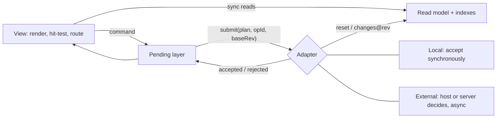
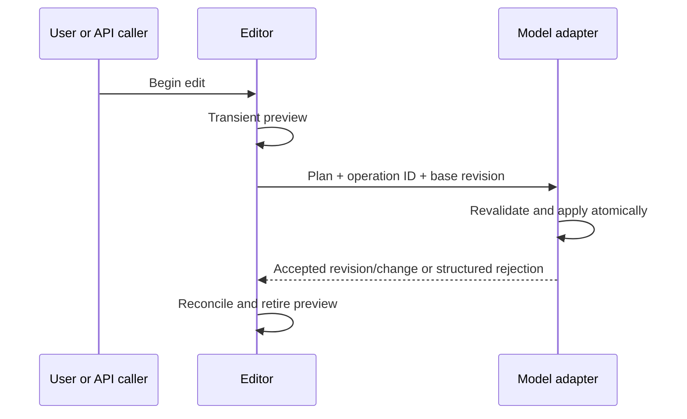

> **Archived (2026-10-29).** Historical input only. The source of truth is
> `openspec/specs/` (requirements) and `openspec/changes/` (planned work).

# General-Purpose Node Editor Library: Requirements and Use Cases

**Status:** Candidate requirements baseline, revision 2. Not an implemented API,
an accepted architecture decision, or a claim of measured performance.
**Updated:** 2026-10-29.
**Audience:** Library developers, application integrators, designers, and testers.
**Target:** A self-contained JavaScript/TypeScript graph-editing library with
first-class React integration and a framework-independent model.

## Introduction

A node editor lets people work with connected information directly: place
objects, expose their inputs and outputs, and draw relationships between them.
It can be the foundation of a workflow builder, a visual programming tool, an
image-processing pipeline, a device-connection diagram, or a dependency explorer.
These applications differ in what their nodes and connections mean, but share
the same need for precise, responsive, and predictable editing.

This library provides that shared editing foundation for JavaScript and
TypeScript applications. Developers define the objects, their appearance, and
the rules governing their connections. The library supplies the model/view
integration, viewport, selection, editing gestures, routing, and command
lifecycle. React applications can embed interactive node content without making
React a dependency of the underlying graph model.

Flexibility must extend beyond changing colors or drawing different boxes.
Nodes can have custom shapes, sizes, and dynamic ports. Connections can follow
custom geometry, carry several independently typed members through one visible
socket, or reference a value without creating an ordinary graph edge. Validation
and application meaning remain explicit host responsibilities.

The library must be useful on its own and fit applications that already own
their data. An included local document supports standalone editing, persistence,
and undo/redo; an external-model adapter integrates existing application state
and history. Both modes use the same editing behavior and extension contracts.

Responsiveness is part of the product contract, not an implementation slogan.
This specification defines separate workloads for lightweight drawn nodes and
interactive React content, together with measurable acceptance targets.

The sections below turn these goals into numbered requirements, detailed use
cases, and release criteria. They specify what users and integrators can rely
on without prescribing an application domain or a single rendering technology.

## 1. Product contract and reading guide

An application must be able to display and edit a graph with custom nodes,
ports, connections, geometry, and validation rules without implementing its
own viewport, selection system, connection gestures, or undo machinery.

The library must work in two equally supported modes:

1. **Local document:** an included in-memory model, commands, serialization,
   and undo/redo make a useful editor without a backend.
2. **External model:** an adapter connects an application's existing document,
   validation, commands, and history without creating a competing source of truth.

React is a supported integration surface, not a requirement for using the core.
Both canvas-drawn symbols and interactive React node content are supported,
with separately stated performance envelopes.

### 1.1 Requirement language

- **MUST** defines an R1 release gate. A missing MUST is an incomplete release.
- **SHOULD** defines a valuable capability that may be omitted with a documented
  reason and limitation. It is not silently advertised as supported.
- **MAY** describes an extension point, not a promised built-in feature.
- **R1** means the first usable library release, not the first prototype.
- IDs such as `MOD-01` are stable references for implementation and verification.
  Use-case IDs such as `UC-04` identify acceptance workflows.

Requirements are authoritative within this candidate baseline. Illustrative
TypeScript names and internal architecture suggestions are not frozen API.
Changes to MUST scope require an explicit revision of this baseline.

### 1.2 Navigation

| Reader goal | Sections |
|---|---|
| Understand the reusable model | 2-4 |
| Implement editing, connections, and routing | 5-9 |
| Integrate React or an external document | 10-12 |
| Evaluate UX, packaging, and speed | 13-15 |
| Follow concrete user workflows | 16 |
| Verify readiness and remaining decisions | 17-19 |

### 1.3 Explicit exclusions

The library does not execute workflow steps, propagate application values,
schedule jobs, interpret units, execute code imported with a graph, resolve
multi-author conflicts, authenticate users, or provide a backend. Hosts may
supply application behavior through documented policies and adapters. Trusted
renderers, codecs, and policy callbacks still execute as ordinary host code.

Full nested subgraph navigation, automatic capability negotiation, built-in
graph execution, a marketplace, mobile-first editing, and a complete
screen-reader representation of large graphs are not R1 promises. Flat visual
groups, dynamic ports, keyboard editing, and accessible DOM controls are in scope.
Automatic layout integration is separate from connection-path routing.

## 2. Design principles

| Principle | Consequence |
|---|---|
| Application-independent meaning | The host defines node payloads, connection semantics, and validation rules. The library does not require a particular execution model. |
| Model/view separation | Graph operations work without a renderer; multiple views can share one authoritative model. |
| Useful defaults, replaceable policies | A standalone editor works out of the box, while existing applications can replace storage, history, validation, and presentation. |
| Stable identity | Port insertion, reordering, renaming, and visual movement do not change what an existing connection references. |
| Independent extension contracts | Node appearance, geometry, port glyphs, routing, picking, and connection policy can change independently. |
| Explicit, reversible edits | A gesture produces an inspectable atomic command; failure or cancellation does not leave a partially changed graph. |
| Measurable responsiveness | Capacity claims identify the content profile, workload, hardware, and acceptance evidence. |
| Clear responsibility boundaries | Rendering displays state, commands request changes, and the active model adapter owns accepted state and history. |

Public interfaces use typed contracts rather than unstructured property lookups.
Customization must not require rewriting the viewport or reproducing built-in
editing tools.

The library is not restricted to input-left/output-right rectangular nodes.
That is a convenient default, not the graph model.

## 3. Shared vocabulary and invariants

| Term | Definition |
|---|---|
| Host | Application embedding the library; may be entirely local. |
| Graph model | Authoritative nodes, endpoints, connections, and application payloads. |
| View document | Persistent presentation: placement, sizes, grouping, and user route constraints. |
| Scene | Derived renderable projection plus indexes and caches. Not a second authoritative graph. |
| Node | Identifiable graph object with a type, payload, and zero or more ports. |
| Port | Stable endpoint belonging to a node. Direction, type, cardinality, and appearance are separate properties. |
| Member | Independently identified part of a composite port signature; an opaque typed member can represent an indivisible application-defined tuple. |
| Provided value | Host-owned, typed, read-only reference exposed at a node or a port. Not automatically an ordinary graph connection. |
| Connection | Identifiable binding between endpoints; independent of its rendered path. |
| Connection plan | Proposed atomic edit, including member mappings and any explicit auxiliary actions. |
| Assembly | User-visible bundle of member bindings treated as one edit unless explicitly unpacked. |
| Route | Drawable connection geometry. Automatic vertices are derived; user constraints are persistent intent. |
| Junction | Identifiable multi-way meeting point, materialized or mapped by the chosen host policy. |
| Group | Visual collection of nodes; not automatically an executable or nested graph. |
| Gesture | Temporary interaction from initial input to commit or cancellation. |
| Revision | Host-issued state token with a declared predecessor/order contract; not necessarily a number. |
| Capability | Permission to perform a particular edit, separate from selection or visibility. |

**Invariants:**

- IDs are not labels, array offsets, screen positions, or localized text.
- Direction is not geometry: an output can be drawn on any side of a node.
- Connection existence is independent of route length and visual overlap.
- A crossing is not a junction; hiding a path does not delete a connection.
- One visual cable can represent multiple bindings; each binding remains
  inspectable and addressable.
- Reading a provided value does not silently create an ordinary graph edge.
- Displaying the same model in two views does not duplicate its connections.
- Rendering and picking do not mutate application data or execute application logic.

## 4. Graph model and state ownership

| ID | Level | Requirement | Acceptance anchor |
|---|---|---|---|
| MOD-01 | MUST | Provide an in-memory graph/view model usable headlessly in JavaScript, with create, inspect, update, and delete operations. Attaching a renderer is optional. | UC-01, UC-19 |
| MOD-02 | MUST | Support an external-model adapter without requiring the host to adopt the included storage representation or history stack. | UC-13 |
| MOD-03 | MUST | Give nodes, ports, connections, groups, members, and provided values stable identities. Relabeling or reordering must not retarget references. Deleted IDs must not be reused for a different entity; undo may restore the same entity and its identity. | UC-07, UC-09 |
| MOD-04 | MUST | Distinguish application payloads, durable view data, ephemeral interaction state, and derived caches. Ephemeral previews must not appear in saved documents. | UC-02, UC-14 |
| MOD-05 | MUST | Accept atomic model changes and notify observers only after the change is internally consistent. Subscribers must not see a connection referencing a temporarily missing endpoint during a successful batch. | UC-06, UC-08 |
| MOD-06 | MUST | Support a complete reset and incremental changes with explicit revision continuity. A gap or out-of-order update must trigger rejection/resynchronization, not silent partial application. | UC-13 |
| MOD-07 | MUST | Expose indexed queries by entity ID, node adjacency, and endpoint attachment. Do not require hosts to scan every connection for ordinary node queries. | UC-07, UC-17 |
| MOD-08 | MUST | Specify deterministic ordering for painting, selection tie-breaks, port presentation, and serialization. Ordering changes are explicit, not incidental map iteration. | UC-03, UC-19 |
| MOD-09 | MUST | Report malformed IDs, non-finite geometry, dangling endpoints, and invalid transactions with structured errors. Reject an invalid local mutation before changing the document. | UC-14, UC-18 |
| MOD-10 | MUST | Permit different views of the same model with independent viewport, hover, local selection, detail level, and theme. Shared history belongs to the model adapter, not each view. | UC-15 |
| MOD-11 | MUST | Support read-only viewing and per-entity/per-action capabilities without disabling pan, inspect, or permitted selection. Model commands enforce capabilities as well as UI gestures; view-local restrictions may narrow but never relax adapter permissions. | UC-11 |
| MOD-12 | SHOULD | Support distinct view IDs mapping to the same host object for hosts that display aliases. Such aliases must not duplicate model bindings or cardinality counts. | UC-15 |
| MOD-13 | MUST | Declare ownership and lifetime of snapshots, descriptors, and subscription values. Callers must not be able to mutate committed state through an exposed writable reference; external adapters must announce changes rather than silently mutating shared records. | UC-13, UC-19 |

The local model is a convenience adapter, not an abstraction every host must
inherit from. Public contracts should use concrete typed queries, snapshots,
changes, and commands. No application must expose its full internal object tree
to render a graph.

Structural integrity and application validity are separate. A structurally
safe imported/external graph can contain an unresolved required value or an
application validation error and must remain inspectable. Imported dangling
endpoint IDs or duplicate identities are structural errors, not an excuse to
silently retarget bindings. Policies govern new edits; existing invalid-but-safe
state is diagnosed rather than automatically rewritten or dropped.

### 4.1 Q&A: Where does the model feeding the editor live?

**Q:** Should the model live (1) on the same page and be updated
synchronously by the host, (2) remotely with asynchronous updates, or (3) in
the library's own local model?

**A:** These are not alternatives. The library always keeps its own
**read model** (3). Which party is **authoritative** is chosen by plugging
in an adapter: options 1 and 2 are the two adapter flavours.

| Layer | Owner | Timing |
|---|---|---|
| Read model: indexed snapshot used by rendering, hit-testing, routing | Library, always | Synchronous; a frame never waits on the host |
| Pending layer: previews and submitted-but-unconfirmed edits | Library, separate from confirmed state (TXN-02) | Synchronous |
| Authority: accepting or rejecting edits | Adapter: **local** (accepts synchronously) or **external** (accepts later) | `submit(plan, opId, baseRevision)` returns a result or a promise (TXN-01) |
| Inbound changes | Adapter pushes `reset` or `changes@revision` | A revision gap triggers resynchronization (MOD-06) |
| History | Adapter: local undo stack, or host-owned history | TXN-07 / TXN-08 |



Why not pick one option:

- **Remote-only (2) without a local read model** would make paint, hit-testing
  and routing depend on a round trip — unacceptable at frame rate.
- **Library model as the authority (3 only)** would force hosts with their own
  authoritative store to keep two sources of truth (MOD-02 forbids this).
- **Host-synchronous (1)** is simply an external adapter that answers
  immediately; it needs no separate code path in the editing tools.

Editing tools are written once against the adapter contract and behave the
same whether acceptance is synchronous or delayed (§11.1).

## 5. Node, port, and appearance requirements

### 5.1 Nodes and dynamic endpoints

| ID | Level | Requirement | Acceptance anchor |
|---|---|---|---|
| NOD-01 | MUST | Support type registration with default payload creation, appearance, geometry, capability defaults, and optional property-editor integration. Changing one type must not require editing a central switch statement. | UC-01 |
| NOD-02 | MUST | Render both standard card nodes and arbitrary custom shapes with independently supplied bounds, precise hit shapes, labels, and anchor frames. A node may have no ports. | UC-01, UC-18 |
| NOD-03 | MUST | Support native non-square dimensions, independent per-node sizes, horizontal/vertical default port layouts, custom port positions, and arbitrary port counts. | UC-01, UC-07 |
| NOD-04 | MUST | Support movement, quarter-turn rotation, horizontal mirroring, and capability-gated resizing with minimum/maximum bounds. Painting, anchors, normals, and picking must share the same transform. | UC-02, UC-18 |
| NOD-05 | MUST | Expose node title, optional secondary label, port labels, tooltip/inspector metadata, validation state, and progress/status decorations independently. Updating status must not require replacing the node. | UC-10, UC-17 |
| NOD-06 | MUST | Support interactive React content in nodes and focused overlay editors, not only static text or images. Form input must not trigger graph-level delete, duplicate, or navigation commands. | UC-10 |
| NOD-07 | MUST | Provide unknown-type and missing-asset placeholders with identity, bounds, and diagnostics. Missing extensions must not make nodes silently disappear or destroy payloads. | UC-14 |
| NOD-08 | MUST | Permit node-body painting, port painting, connection painting, geometry, and tool behavior to be registered independently. Hosts may reuse a painter with different geometry or policy. | UC-01, UC-18 |
| NOD-09 | MUST | Expose registered creatable types and a create-at-world-position command usable by palettes, context menus, and the API. Type factories return structured failures; a failed factory leaves no partial node in the graph. | UC-01, UC-19 |

| ID | Level | Requirement | Acceptance anchor |
|---|---|---|---|
| PRT-01 | MUST | Address ports by stable IDs and members by stable keys, never by display index. Rename, reorder, and move preserve attachments. | UC-07 |
| PRT-02 | MUST | Add, remove, and change instance-level ports atomically with affected connections and geometry. Insertion must not redirect existing attachments. | UC-07, UC-08 |
| PRT-03 | MUST | Describe direction as input, output, or undirected; cardinality, type, and graphical side are independent. | UC-03 |
| PRT-04 | MUST | Support configurable attachment limits, including zero, one, a finite maximum, and unrestricted multiplicity. Zero prevents new attachments but does not silently delete existing ones. Limits may differ by port/member and connection kind. | UC-03, UC-04 |
| PRT-05 | MUST | Treat a port's visible glyph, interactive target, label, and anchor normal separately. A small glyph can have a larger screen-space capture area. | UC-03, UC-18 |
| PRT-06 | MUST | Represent unavailable, disabled, occupied, compatible, incompatible, and pending targets distinctly, with a reason where relevant. Occupied is not automatically incompatible when multiplicity allows more attachments. | UC-03, UC-04 |
| PRT-07 | MUST | Preview effects before removing or incompatibly changing connected ports. The resulting accepted transaction either removes/remaps affected bindings or rejects the edit; it never leaves hidden dangling references. | UC-07, UC-09 |

### 5.2 Theme and layout presentation

| ID | Level | Requirement | Acceptance anchor |
|---|---|---|---|
| VIS-01 | MUST | Provide per-instance theme tokens and per-type/per-entity overrides for colors, line widths, fonts, port shapes, selection, and diagnostics. No host CSS framework is mandatory. | UC-15, UC-18 |
| VIS-02 | MUST | Define default z-order and explicit overrides for routes, nodes, ports, labels, groups, decorations, and overlays. Picking must respect the documented interactive order. | UC-18 |
| VIS-03 | MUST | Distinguish body bounds, painted bounds, and hit bounds. Painted bounds include shadows, labels, arrowheads, and bundle lanes used for culling. | UC-17, UC-18 |
| VIS-04 | SHOULD | Offer alignment, equal spacing, and snap guides as explicit undoable commands. An external layout engine may propose a batch of positions without owning the editor. | UC-02, UC-12 |

## 6. Connections and extensible port signatures

### 6.1 Ordinary connection policy

The default simple-graph policy accepts output-to-input connections with equal
registered type keys, one attachment per input, and multiple per output.
It rejects self-loops and duplicate endpoint pairs by default, while allowing
cycles involving different nodes. These defaults are replaceable; they are not
structural restrictions on the model.

Undirected ports require an enabled host/type policy; drawing direction must
not change the meaning of an accepted undirected binding. Directed and undirected
connections may coexist in one graph.

| ID | Level | Requirement | Acceptance anchor |
|---|---|---|---|
| CON-01 | MUST | Ship a documented default policy and allow host replacement of type compatibility, direction, cardinality, detach permission, and connection kind. | UC-03, UC-11 |
| CON-02 | MUST | Support policy-controlled self-loops, parallel connections, directed cycles, and undirected connections. Parallel edges have distinct IDs and can be individually selected/reconnected. | UC-03, UC-18 |
| CON-03 | MUST | Use the same policy for pointer gestures, keyboard commands, programmatic edits, paste, and replacement. No input route may bypass required validation. | UC-03, UC-09, UC-19 |
| CON-04 | MUST | Return accept-with-plan, reject-with-reason, choice-required, or pending/unverified outcomes. A Boolean alone is insufficient for composite edits or explanations. | UC-04, UC-13 |
| CON-05 | MUST | Revalidate on commit against current entity/signature revisions and permissions. A locally acceptable preview is not a promise of application-wide validity. | UC-03, UC-13 |
| CON-06 | MUST | Make type conversion or auxiliary-node insertion explicit in a connection plan. Never invent casts, defaults, adapters, or extra nodes solely to make a connection fit. | UC-04 |
| CON-07 | MUST | Keep an existing binding intact until reconnection is accepted. A failed, cancelled, or prohibited detach leaves the old binding unchanged. | UC-06, UC-11 |
| CON-08 | MUST | Identify connections independently of path, paint style, endpoint order for undirected bindings, and optional labels. Restyling/rerouting does not recreate topology. | UC-05, UC-18 |

### 6.2 Composite ports: one socket, multiple typed members

A port can present multiple typed members through one visible socket. Members
may include indivisible application-defined structures and attached provided
values. The editor knows their keys, schema references, roles, and mapping rules;
it does not interpret their application meaning.

For example, a device node's socket exposes mandatory `video` and `control`
members and an additional `displayName` value. A compatible peer must match the
mandatory members. A peer requiring `displayName` also needs a provider; a peer
that does not use it may ignore the offered value.

Three concepts must remain separate:

1. A **required structural member** must bind as part of the assembly.
2. A **provided value** is offered and may remain unused.
3. A **required value** must resolve to one selected compatible provider.

A port may have only a single member, only value roles, or no composite
signature at all. The general-purpose library must not require every port to
contain a special mandatory member category.

| ID | Level | Requirement | Acceptance anchor |
|---|---|---|---|
| SIG-01 | MUST | Describe signatures through stable schema/version identifiers and member keys, independent of painter, label, port order, or application payload storage. | UC-04, UC-07 |
| SIG-02 | MUST | Support both opaque typed members and independently mapped members. An indivisible tuple cannot be partially bound by the default policy. | UC-04 |
| SIG-03 | MUST | Require every declared mandatory member on both ends to receive a permitted mapping. For full-match profiles, count and pairwise compatibility must match exactly. | UC-04 |
| SIG-04 | MUST | Resolve every required value on either side to exactly one compatible provider. Unused offered values are legal; two providers are not silently merged. | UC-04 |
| SIG-05 | MUST | Show member mappings, missing requirements, unbound optional offers, and auxiliary actions before committing a composite connection. Ambiguous mappings require a choice, not array-order selection. | UC-04 |
| SIG-06 | MUST | Create, delete, reconnect, copy, and undo an assembly atomically. Individual member editing requires an explicit unpack/member-edit action permitted by the host. | UC-04, UC-06, UC-09 |
| SIG-07 | MUST | Allow a collapsed cable/socket and expanded member lanes without changing logical bindings. Hidden members remain discoverable and individually inspectable. | UC-04 |
| SIG-08 | MUST | Separate signature description from compatibility policy. Hosts may add shape, format, version, or other checks without changing core geometry or adding node subclasses. | UC-04, UC-19 |

The strict composite policy can be summarized as:

```text
all mandatory members have allowed mappings
and requiredValues(A) are supplied by offeredValues(B)
and requiredValues(B) are supplied by offeredValues(A)
and direction, multiplicity, and host constraints pass
```

Different keys never match merely because their displayed labels are equal.
The schema/policy declares equality or an explicit mapping. "Optional" never
means a missing required value can silently acquire a default.

### 6.3 Provided values and reference connections

Applications often need to expose one value in an inspector, on a node, and
next to a specific port. These presentations can share one source reference
without duplicating storage or changing the role of ordinary connections.

| ID | Level | Requirement | Acceptance anchor |
|---|---|---|---|
| REF-01 | MUST | Represent a provided value with stable source identity, a type/schema key, and declared ownership at node or port level. The host chooses ownership; the editor must not infer it from labels or dependency counts. | UC-10, UC-19 |
| REF-02 | MUST | Support an explicit read-only reference binding distinct from ordinary connections. The two roles cannot be interchanged by styling or an implicit conversion. | UC-10 |
| REF-03 | MUST | Permit many consumers to reference one offered value subject to host limits; each required consumer binding has exactly one selected source. Document that readers can incur application processing cost. | UC-10, UC-17 |
| REF-04 | MUST | Allow a consumer binding to target an application field without requiring a visible input port. The target still has stable identity and participates in validation, persistence, deletion, and undo. | UC-10, UC-14 |
| REF-05 | MUST | Reuse a host's supplied source-reference scheme; do not require a second value registry or copy values into the scene to create references. Source unavailable, pending, and stale are explicit states. | UC-10, UC-13 |
| REF-06 | MUST | Preserve declared ownership and source identity across collapse, expansion, and port reorder. A node-owned summary must not be silently relabeled as a port-owned value. | UC-07, UC-10 |

For example, `ImportFile.rowCount` can be node-owned while `ImageOutput.width`
can be port-owned. The library does not inspect how either value was computed.
Displaying a number or animated preview does not create an executable binding;
that requires a successful reference/connection command accepted by the host.

## 7. Geometry, paths, and routing

### 7.1 Coordinate and picking contract

| ID | Level | Requirement | Acceptance anchor |
|---|---|---|---|
| GEO-01 | MUST | Name node-local, world, viewport-CSS-pixel, and device-pixel spaces in public geometry/input contracts, with conversion and inverse conversion operations. | UC-18 |
| GEO-02 | MUST | Use one documented transform convention for node drawing, bounds, anchor positions/normals, and hit tests. Persist world/local values, not rounded screen positions. | UC-02, UC-18 |
| GEO-03 | MUST | Remain correct under page scroll, nested container offsets, resize, fractional zoom, high-DPI displays, and moving between displays. | UC-15, UC-18 |
| GEO-04 | MUST | Broad-phase bounds checks followed by precise shape/distance tests must support nonrectangular nodes, thin/custom paths, bundled lanes, and off-screen endpoints. | UC-17, UC-18 |
| GEO-05 | MUST | Keep capture/hit tolerances in declared CSS-pixel units when configured as screen-space. Do not scale snapping radius unexpectedly with graph zoom or device pixel ratio. | UC-03, UC-18 |
| GEO-06 | MUST | Specify supported finite coordinate/zoom ranges and reject non-invertible transforms. Empty graphs, coincident anchors, and zero-size containers must not produce NaN transforms or crashes. | UC-18 |

### 7.2 Paths and route editing

| ID | Level | Requirement | Acceptance anchor |
|---|---|---|---|
| ROU-01 | MUST | Supply straight, cubic-Bezier, and orthogonal route modes. Routing, path painting, labels/decorations, and picking are separately replaceable. | UC-05, UC-18 |
| ROU-02 | MUST | Provide a documented custom-path contract with finite bounds, drawing data, endpoint tangents/normals as needed, and hit-testing/nearest-point support. No SVG-only or Canvas-only type may be mandatory in the headless model. | UC-18 |
| ROU-03 | MUST | Support manual waypoints and orthogonal segment movement. Persist user constraints separately from automatic route vertices, preserving constraints across save/load and endpoint movement. | UC-05, UC-14 |
| ROU-04 | MUST | Honor port escape direction and clearance. Endpoint-internal exceptions must not allow a path through unrelated node interiors. | UC-05 |
| ROU-05 | MUST | Provide obstacle-aware orthogonal routing or a packaged optional router satisfying the same contract. An unresolved route is explicitly marked, never advertised as obstacle-free. | UC-05, UC-17 |
| ROU-06 | MUST | Report complete, provisional, and unroutable outcomes. A route failure must not delete an accepted connection or change application data. | UC-05 |
| ROU-07 | MUST | Preserve unaffected locked constraints and favor route stability while nodes move. Identical inputs/options must yield deterministic output in the built-in router. | UC-05, UC-17 |
| ROU-08 | MUST | Invalidate incident routes and nonincident routes affected by a moved obstacle's old/new expanded bounds. Unrelated paths must not all recompute on every pointer event. | UC-17 |
| ROU-09 | MUST | Support labels, arrowheads, dashed lines, multiple lanes, and diagnostic decorations without embedding connection policy in the painter. Expanded painted bounds participate in culling. | UC-04, UC-18 |
| ROU-10 | MUST | If routing is asynchronous, bound pending work and discard superseded/out-of-order results by route and scene revision. Routing failure must not block pan, pick, or cancel. | UC-13, UC-17 |
| ROU-11 | SHOULD | Provide snap-to-segment, edge label positioning, and distinct crossing/bridge styles configurable independently of junction semantics. | UC-05, UC-08 |

Path length and bend count are presentation properties unless a host explicitly
turns a geometry change into an application-data command. Changing a painter
or rerouting must never invoke that behavior implicitly.

For a bundled path, selection can target the assembly or an expanded member.
The hit result must identify which was hit. Coincident and parallel paths need
a deterministic disambiguation mechanism, such as a candidate chooser.

## 8. Interaction, docking, and junctions

### 8.1 Input and editing behavior

| ID | Level | Requirement | Acceptance anchor |
|---|---|---|---|
| INT-01 | MUST | Provide pan, cursor-anchored zoom with limits, fit-all, fit-selection, reset view, and programmatic focus/reveal of an entity. Empty fit commands are safe no-ops. | UC-01, UC-17 |
| INT-02 | MUST | Support single/additive/toggle selection, clear selection, and marquee selection with documented containment/intersection behavior. Nodes and connections can be selected together. | UC-02, UC-09 |
| INT-03 | MUST | Move selected nodes as one gesture preserving relative positions; support optional grid snapping and a temporary snap-suppression modifier. Locked nodes follow their capability policy, with mixed-selection behavior explained. | UC-02, UC-11 |
| INT-04 | MUST | Support drag-to-connect and click-to-route, including finish, backtrack, cancel, and optional endpoint reconnection. Tool-specific right-click behavior must not disable ordinary context menus outside that tool. | UC-03, UC-05, UC-06 |
| INT-05 | MUST | Define drag thresholds, pointer capture, event ownership, and cancellation for pointercancel, lost capture, Escape, blur, hidden/unmounted view, and removed endpoints. | UC-06, UC-16 |
| INT-06 | MUST | Scope shortcuts and wheel handling to the active editor/context. Honor text fields, contentEditable, IME composition, platform modifiers, and permitted page scrolling. | UC-10, UC-15 |
| INT-07 | MUST | Offer the same identifiable commands for menus, shortcuts, toolbars, and programmatic callers, with capability/availability queries and error results. | UC-11, UC-19 |
| INT-08 | MUST | Emit one committed edit for a completed gesture, not a history entry or host request per pointer move. Render previews locally without making them authoritative. | UC-02, UC-13 |
| INT-09 | SHOULD | Auto-pan near viewport boundaries while moving/routing, with bounded speed, immediate cancellation, and no movement after gesture termination. | UC-05, UC-16 |

### 8.2 Direct docking

Docking means connecting nearby compatible ports while positioning their nodes
so the selected anchors coincide. It does not merge node identities or create
a parent/child relationship.

| ID | Level | Requirement | Acceptance anchor |
|---|---|---|---|
| DCK-01 | MUST | Preview compatible nearby docking candidates during placement/movement when docking is enabled. Ranking considers compatibility, screen distance, orientation, and stable tie-breaks, with hysteresis. | UC-02 |
| DCK-02 | MUST | Make docking opt-in per tool/host and suppressible per gesture. Moving near another node alone must not silently change existing topology. | UC-02, UC-11 |
| DCK-03 | MUST | Preview the snapped geometry and proposed binding, then commit position and connection changes atomically on confirmation/release. Failure restores the prior state. | UC-02, UC-13 |
| DCK-04 | MUST | Preserve a connection when previously docked nodes are moved apart by default, revealing a visible route. Only an explicit permitted disconnect action removes it. | UC-02, UC-06 |
| DCK-05 | MUST | Keep zero-length connections inspectable, selectable through an inspector/command, and undoable even when no path stroke is visible. | UC-02 |

### 8.3 Branching and identifiable junctions

| ID | Level | Requirement | Acceptance anchor |
|---|---|---|---|
| JNC-01 | MUST | Distinguish crossing from a logical meeting point. A filled meeting indicator may only appear when the model/host policy identifies a shared attachment. | UC-08, UC-18 |
| JNC-02 | MUST | Support dropping a connection onto a route to request a branch plan. The host may reject it, attach to an existing junction, or materialize an identifiable junction with dynamic ports. | UC-08 |
| JNC-03 | MUST | Apply junction creation, route split/replacement, port growth, and new bindings as one transaction and one history group. Do not use the first connected node as an invisible junction identity. | UC-08 |
| JNC-04 | MUST | Define a junction's appearance, compatibility, labels, port count, and limits through normal type/policy extension points. No built-in application interpretation of multi-way attachment is allowed. | UC-08 |
| JNC-05 | MUST | Require an explicit policy/command to remove or collapse an identifiable junction. Reducing it to two attachments must not erase a name, payload, or external reference automatically. | UC-08, UC-09 |
| JNC-06 | MUST | Evaluate branching separately for each composite member. A permitted fan-out member does not make every member branchable. Reject or require an explicit partial-unpack plan. | UC-04, UC-08 |

## 9. Groups, replacement, and clipboard

| ID | Level | Requirement | Acceptance anchor |
|---|---|---|---|
| GRP-01 | MUST | Support flat visual groups with stable ID, title, explicit membership, bounds, style, selection, movement, and undoable group/ungroup operations. | UC-12 |
| GRP-02 | MUST | Make group membership independent of mere visual overlap. Moving a group moves its member nodes once and updates incident routes without duplicating connection edits. | UC-12 |
| GRP-03 | SHOULD | Support group collapse/expand with stable proxy endpoints for external bindings. Collapse must not alter logical endpoints, lose selection references, or claim to create a nested executable graph. | UC-12 |
| GRP-04 | MAY | Provide hierarchical groups or nested graph navigation through a separately specified extension. R1 must reject cyclic group ownership if such metadata is imported. | UC-14 |
| EDT-01 | MUST | Support replace-node planning with explicit old-to-new port/member mapping. Preview retained, remapped, and disconnected bindings before confirmation. | UC-09 |
| EDT-02 | MUST | Delete a selection with its required incident bindings/reference effects as one atomic undoable operation. Locked/protected entities cause a documented rejection or explicit allowed-subset plan, never hidden partial deletion. | UC-09, UC-11 |
| EDT-03 | MUST | Provide duplicate and graph-fragment copy/paste including payloads, dynamic ports, internal bindings, route constraints, and selected groups. Allocate new identities and remap internal references consistently. | UC-09 |
| EDT-04 | MUST | Make external-reference handling explicit on paste: exclude, preserve by host approval, or request resolution. Copying one view of a source must not silently duplicate the external source itself. | UC-09, UC-14 |
| EDT-05 | MUST | Validate pasted/replaced fragments against type availability, permissions, size limits, and connection policy before applying them. Clipboard denial has an in-app fragment import/export fallback. | UC-09, UC-14 |

## 10. React integration and renderer boundaries

### 10.1 React behavior

| ID | Level | Requirement | Acceptance anchor |
|---|---|---|---|
| REA-01 | MUST | Provide a supported React mounting component/provider and hooks for instance access, selection, viewport, command availability, and entity-level subscriptions. | UC-01, UC-10 |
| REA-02 | MUST | Use React/ReactDOM as peer dependencies. Neither the core nor non-React mount must import React. | UC-01, UC-19 |
| REA-03 | MUST | Support React custom-node content with normal context, event, form, and portal behavior. Changes to content size update geometry through a bounded measurement path. | UC-10 |
| REA-04 | MUST | Avoid committing global React state updates for every raw pointer sample and avoid rerendering every node for an unrelated selection/status change. Document subscription granularity. | UC-17 |
| REA-05 | MUST | Survive development Strict Mode setup/cleanup/re-setup, prop updates, renderer remounts, and repeated view disposal without duplicate listeners, commands, or active gestures. | UC-15, UC-16 |
| REA-06 | MUST | Be importable during server rendering without accessing browser globals. Server output may be an inert accessible container; browser interactivity begins on mount. | UC-01, UC-16 |
| REA-07 | MUST | Keep focused React content stable across unrelated graph refreshes. If an edited entity disappears, close the editor and announce the reason rather than committing to a stale ID. | UC-10, UC-13 |

### 10.2 Rendering profiles and extension slots

The package must publish capabilities and limits for two profiles:

| Profile | Primary content | Contract |
|---|---|---|
| **Symbol** | Lightweight custom drawn nodes, paths, labels, and focused DOM overlays. | Large-graph performance profile in section 15. No per-node DOM requirement. |
| **React-content** | Interactive custom React node bodies with drawn connections. | Smaller documented workload; viewport culling, measurement, focus, and form correctness take priority over an unrealistic 10k-form promise. |

Both use the same model/command/policy contract. Switching profile must not
require rewriting graph identities, port policies, serialization, or history.
Arbitrary React content is not automatically rasterized or ported to a GPU.

| ID | Level | Requirement | Acceptance anchor |
|---|---|---|---|
| REN-01 | MUST | Expose node/port painters, node geometry, connection-path painter/picker, routing, themes, overlays, and interaction tools through independent typed extension contracts. | UC-18, UC-19 |
| REN-02 | MUST | Keep DOM, Canvas contexts, Path2D, GPU handles, and image objects out of the headless model/serialized document. Renderer-specific objects remain behind a renderer boundary. | UC-14, UC-19 |
| REN-03 | MUST | Share viewport transforms and explicit pointer/focus ownership between drawn content and DOM overlays. Prevent invisible overlays from intercepting unrelated graph input. | UC-10, UC-18 |
| REN-04 | MUST | Expose dirty/invalidation notifications for changes to geometry, style, content, and assets. Theme/value changes must not invalidate unrelated topology or routes. | UC-15, UC-17 |
| REN-05 | SHOULD | Provide PNG/SVG export or an export adapter with bounds and asset-readiness checks. Document unsupported custom content; never silently omit React-only bodies from a purported complete export. | UC-14 |

Initial implementation may start with Canvas2D. Choosing Canvas2D, WebGL,
SVG/DOM, a spatial-index package, or worker routing is an architecture decision
to validate against these contracts, not an intrinsic requirement.

## 11. Transactions, validation, history, and synchronization

### 11.1 One command lifecycle



In the local adapter, acceptance can be synchronous. In an external adapter,
confirmation can arrive later. The same editing tools must work in both cases.
No particular transport, cache, database, or notification technology is assumed.

| ID | Level | Requirement | Acceptance anchor |
|---|---|---|---|
| TXN-01 | MUST | Tag each edit with an operation ID and base revision. Atomically accept a complete plan or reject without persistent effects. Expose changed entity IDs and a structured result. | UC-04, UC-08, UC-13 |
| TXN-02 | MUST | Distinguish local preview, submitted/pending, accepted, rejected, and unknown-outcome states. A pending preview must not masquerade as saved authoritative state. | UC-13 |
| TXN-03 | MUST | Correlate acknowledgments and model changes independent of arrival order. Discard stale updates using the adapter's revision ordering, not lexical comparison of opaque tokens. | UC-13 |
| TXN-04 | MUST | Never blindly retry an unknown-outcome mutation. External adapters must declare deduplication/status-recovery support or require resynchronization before retry. | UC-13 |
| TXN-05 | MUST | Separate per-frame cached validation from authoritative commit validation. Async validation results carry candidate/signature/revision identity and cannot approve a different or superseded candidate. | UC-04, UC-13 |
| TXN-06 | MUST | Keep UI interaction responsive during slow host work. Pending conflicting edits are serialized or rejected according to a documented policy; unrelated view operations remain usable. | UC-13 |
| TXN-07 | MUST | Provide local undo/redo with one group per gesture/assembly, redo invalidation after a new local edit, and exact restoration of affected IDs, payloads, endpoints, and view constraints. | UC-09, UC-19 |
| TXN-08 | MUST | Allow host-owned history with no hidden local persistent undo stack. Surface undo/redo availability, descriptions, pending state, and rejection through the command contract. | UC-13 |
| TXN-09 | MUST | Treat changes originating outside the editor as authoritative updates, not as the current user's undo entries. Detect invalidated gestures/references and cancel or request explicit replanning. | UC-13, UC-15 |
| TXN-10 | MUST | Publish typed events for committed edits, selection, viewport, hover/activation, diagnostics, and failures. Event handlers must not observe a half-applied transaction or corrupt an in-progress dispatch through undocumented reentrancy. | UC-13, UC-19 |

A view gesture cancellation can discard an unsubmitted preview. It cannot
promise to cancel an already submitted external command. If the host cannot
cancel it, the UI waits for/reconciles the outcome; undo is a subsequent command.

## 12. Serialization, import, and application data

| ID | Level | Requirement | Acceptance anchor |
|---|---|---|---|
| SER-01 | MUST | Supply a versioned JSON-compatible local document format with stable IDs, ordered nodes/ports, connections/assemblies, reference bindings, view geometry, groups, and persistent route constraints. | UC-14 |
| SER-02 | MUST | Preserve application payloads through typed serialization hooks. The default accepts JSON-compatible data only; non-JSON values require an explicit codec or a clear rejection, not silent data loss. | UC-09, UC-14 |
| SER-03 | MUST | Exclude functions, executable source, DOM/GPU objects, caches, active gestures, and unconfirmed edits from standard serialized output. Viewport/selection inclusion is an explicit option, not required graph state. | UC-14 |
| SER-04 | MUST | Validate the entire import before replacing the current document. Duplicate IDs, dangling endpoints, bad coordinates, unsupported format versions, and oversized input produce structured errors and leave the old document intact. | UC-14 |
| SER-05 | MUST | Preserve unknown type/schema payloads in diagnostic placeholders when structurally safe. Distinguish unresolved extensions from structurally invalid input; unsupported document versions must not be guessed. | UC-14 |
| SER-06 | MUST | Round-trip documents deterministically for unchanged state, including dynamic port IDs and manual route intent. Support host-managed formats through adapters without requiring a duplicate local document. | UC-07, UC-14 |
| SER-07 | SHOULD | Provide explicit format-migration hooks and export options for selected fragments. Migrations return warnings/errors and never execute code supplied by the imported document. | UC-14 |

Asset references are explicit and resolved by the host/local resource provider.
The library must not contact a server merely to open a graph. A user-configured
asset provider is distinct from an unconditional startup fetch.

## 13. Accessibility, diagnostics, trust, and lifecycle

### 13.1 Usable controls and explanations

| ID | Level | Requirement | Acceptance anchor |
|---|---|---|---|
| UX-01 | MUST | Provide keyboard commands to focus/reveal entities, select, move selected nodes, delete, undo/redo, and open context actions. Connection creation must also have a keyboard-accessible endpoint chooser or equivalent command UI. | UC-03, UC-11 |
| UX-02 | MUST | Use accessible DOM controls for forms, menus, tooltips with actionable content, and dialogs, with visible focus and no keyboard trap. Reject/pending/error states are not color-only. | UC-10, UC-11 |
| UX-03 | MUST | Expose localizable messages and host-provided labels without using translated strings as IDs. Layout must tolerate long and Unicode labels, including editable text/IME. | UC-10, UC-18 |
| UX-04 | MUST | Represent diagnostics with code, severity, affected entity/member IDs, revision, and user-facing explanation. Local target rejection and whole-document validation errors must be distinguishable. | UC-04, UC-13 |
| UX-05 | MUST | Honor reduced-motion preference for optional animation. Animated decorations must not conceal connection direction, selection, or errors. | UC-17 |
| UX-06 | MUST | Keep application-data editing explicit: forms and property editors submit commands through the active adapter. The editor must not interpret a displayed value, formatted label, or host payload as an instruction to execute application code. | UC-10, UC-19 |

A complete screen-reader graph explorer is deferred, not a claim of full
accessibility conformance. The shipped interaction/accessibility coverage and
remaining barriers must be documented.

### 13.2 Imported content and resource ownership

| ID | Level | Requirement | Acceptance anchor |
|---|---|---|---|
| SAFE-01 | MUST | Treat imported graph data, URLs, and markup as untrusted. Do not execute document-provided scripts, handlers, or painter code. Built-in asset handling must reject active/external-fetching SVG/HTML content unless an explicit safe host policy resolves it. | UC-14, UC-16 |
| SAFE-02 | MUST | Make custom JavaScript/React renderers trusted host registrations, not automatically loaded executable content referenced by a document. Unknown registrations fall back to diagnostics. | UC-14, UC-19 |
| SAFE-03 | MUST | Enforce configurable document/fragment/resource limits and document the trusted-extension boundary. A thrown renderer error, rejected router request, or failed asset load must yield a bounded error state instead of an unhandled retry/render loop or corrupted model. | UC-16 |
| LIFE-01 | MUST | Have per-instance lifecycle ownership. Dispose releases listeners, capture, observers, workers, subscriptions, scheduled frames, and owned assets; disposal is safe more than once. | UC-15, UC-16 |
| LIFE-02 | MUST | Suspend unnecessary rendering when hidden or detached and safely resume with valid bounds. Reattach/reopen must not duplicate handlers or reuse invalid renderer resources. | UC-16 |
| LIFE-03 | MUST | Handle missing fonts/assets, unavailable optional workers, container resize, and renderer/context loss through documented fallback/retry or visible failure, with the document preserved. | UC-16 |

Trusted synchronous callbacks cannot be sandboxed or forcibly preempted by
ordinary error handling. Their cost and termination are the host developer's
responsibility; the library must not claim to isolate arbitrary executable
extensions merely because it catches exceptions.

## 14. Packaging, platform, and public API

| ID | Level | Requirement | Acceptance anchor |
|---|---|---|---|
| PKG-01 | MUST | Publish ESM JavaScript, TypeScript declarations, explicit exports, and non-React and React entry points. Plain JavaScript users must not require a TypeScript build step. | UC-01, UC-19 |
| PKG-02 | MUST | Require no application server, framework store, router, theme system, mandatory WASM, or startup network access. The minimal local example works from ordinary local static hosting. | UC-01 |
| PKG-03 | MUST | Keep the core importable/testable in Node without DOM/browser globals. Browser-only setup occurs during explicit view mounting. | UC-19 |
| PKG-04 | MUST | Supply small, complete examples for plain JavaScript, React custom content, custom geometry/policy, composite ports/references, and external-model/history integration. | UC-01, UC-04, UC-13, UC-19 |
| PKG-05 | MUST | Avoid global CSS resets, mandatory fonts, bundled React, application singletons, and implicit remote asset resolution. Style injection/scoping and any peer dependencies are documented. | UC-15 |
| PKG-06 | MUST | Publish tested browser/runtime support, feature detection/fallback behavior, license and dependency notices, bundle measurement, and API compatibility/versioning policy before R1. | UC-01, UC-16 |
| PKG-07 | MUST | Make optional workers/router/renderer assets explicitly configurable for bundlers, CSP, offline deployments, and embedded webviews. Do not require shared-memory features for ordinary editing. | UC-16 |
| PKG-08 | SHOULD | Provide tree-shakable optional features and a usable default preset rather than forcing consumers to assemble every basic tool manually. | UC-01 |

Candidate compatibility baseline for release planning: current and previous
stable Chromium, Firefox, and Safari; React 19; ES2022-capable JavaScript;
and Node 22 for headless tests/examples. These are **proposed targets pending
the decision in section 19**, not tested support claims. Touch/pen events should
not corrupt state, but touch-first/pinch/multitouch UX is not an R1 commitment.

## 15. Performance and capacity acceptance

"Very fast" means meeting published, reproducible budgets for an explicit
workload, not choosing a fashionable renderer. All numbers below are candidate
release targets, unmeasured until a reference-machine run is attached.

### 15.1 Workloads

| Fixture | Contents and visible workload |
|---|---|
| F-SMALL | 100 nodes, 200 connections; mixed shapes, transforms, dynamic/composite ports, references, groups, and labels. |
| F-TYPICAL | Symbol profile: 1k nodes, 2k connections, average four ports/node; all visible, mixed assets and routes. |
| F-LARGE | Symbol profile: 10k nodes, 20k connections; up to 1k nodes and 2k paths visible during navigation. |
| F-ALL | Same 10k/20k graph all visible with documented low-detail rendering. Report separately from the interactive large-graph target. |
| F-REACT | React-content profile: 1k total nodes, 100 visible, 200 visible paths, and at most one focused editor. Each visible body has a title, two text labels, one select, and one text input. |
| F-DENSE | High-degree hub (1k attachments), coincident/parallel paths, dense obstacles, 100-node multi-selection, and expanded composite lanes. Stress/correctness report; do not imply ordinary-drag budgets for this case. |
| F-LIVE | F-TYPICAL plus 1k visible status/value decorations updating at 30 Hz through the host adapter. Transport/host computation measured separately. |

### 15.2 Candidate budgets

The reference display runs at 60 Hz with a 1440-by-900 CSS-pixel viewport.
Measure device pixel ratios 1 and 2 separately; both are required results.

| Metric | Candidate R1 gate |
|---|---|
| Pan/zoom/single-node drag in F-TYPICAL, culled F-LARGE, and F-REACT | p95 frame interval <= 16.7 ms; p99 <= 33.3 ms. |
| Pointer-to-visible-preview latency, same fixtures | p95 <= 33 ms; measure event to presented frame, not only handler duration. |
| Candidate/picking query, same fixtures | p95 <= 2 ms; record candidate count and query bounds. |
| Small local patch: one moved node, <= 4 incident routes, no asset decoding | p95 <= 4 ms excluding deferred route refinement. |
| Settled obstacle-aware refinement, 20 affected routes in F-TYPICAL | p95 <= 100 ms; input must remain responsive during refinement. |
| F-LARGE initial model projection/index construction | <= 1 s after document parse; report asset loading/decoding and first usable frame separately. |
| F-ALL low-detail navigation | p95 frame interval <= 50 ms; do not advertise this as the 60 fps workload. |
| F-LIVE status updates while navigating | Same F-TYPICAL interaction targets; dropped/coalesced presentation updates reported explicitly. |
| Bundle size | Core <= 75 KiB gzip; core plus default symbol renderer/tools <= 150 KiB gzip. Measure optional React/router assets separately and include all required assets for each claimed profile. |
| Idle | No self-sustaining render loop/polling once dirty work and intentional animations finish. |
| Lifecycle | No retained disposed views/listeners/workers and no monotonic retained-heap growth across 30 mount/open/close cycles after warm-up and collection. |

The F-REACT gate concerns the defined controls, not arbitrary third-party forms.
Any always-mounted focused node outside the viewport counts in the measured
workload. An optional heavy-content profile must state its own limits.

### 15.3 Performance requirements

| ID | Level | Requirement | Acceptance anchor |
|---|---|---|---|
| PERF-01 | MUST | Publish reproducible fixtures, seeded generation, scripts, reference-machine provenance, raw samples, p50/p95/p99, visible counts, and production-build configuration. | UC-17 |
| PERF-02 | MUST | Meet the agreed section 15.2 gates on the approved reference machine before claiming R1 capacity. Until approved/measured, label numbers as targets. | UC-17 |
| PERF-03 | MUST | Use bounded, dirty-driven presentation work; ordinary pointer motion must not copy the full graph, scan every edge per visible edge, or reevaluate host application values. | UC-17 |
| PERF-04 | MUST | Index scene candidates and path segments, cull full painted bounds, and retain visible paths whose endpoints are outside the viewport. Index updates are incremental where possible. | UC-17, UC-18 |
| PERF-05 | MUST | Cache and bound geometry, route, text, and decoded-asset resources by revision/lifetime. Report high-degree/dense worst cases rather than claiming constant-time work. | UC-16, UC-17 |
| PERF-06 | MUST | Low-detail rendering may suppress nonessential text/decorations but must preserve attachment/junction distinctions, selected targets, and discoverable errors. | UC-17 |
| PERF-07 | MUST | Measure the same fixtures, visual detail, and assets against an established baseline editor. Explain workload-dependent benefits and regressions rather than making an unsupported global speed claim. | UC-17 |

Measure at least 30 seconds per interaction workload after warm-up, repeated
three times. Include allocation/long-task traces and route work counts. Do not
pool percentiles across machines, browsers, or device pixel ratios to hide a
failing configuration. Record idle and memory observations separately from
active animations. A numerical memory ceiling is set after the first actual
fixture run, before R1 capacity is approved.

## 16. Detailed use cases

Each case specifies successful behavior and meaningful failure paths. The
requirement tables identify the normative behavior; these cases make it concrete.

### UC-01: Embed a local editor without application infrastructure

**Actor/goal:** Application developer builds a graph editor in plain JavaScript
or React without a backend or pre-existing graph engine.

**Preconditions:** Library installed or locally bundled; static assets available.

**Flow:**
1. Create a local model and register `TextSource`, `Transform`, and `Preview`
   node types with typed ports.
2. Mount a view; React uses the same model through its adapter.
3. Add nodes through the palette/API, connect compatible ports, pan/zoom, and
   inspect a node.
4. Undo/redo, serialize the document, and mount another view of it.

**Result:** A usable editor with stable IDs and no server, global store,
startup fetch, or graph-execution dependency.

**Alternatives:** Empty graph renders normally; unknown node type shows a
diagnostic placeholder. Zero-size mount waits safely for measurable bounds.
Unregistering a type does not delete its document data.

### UC-02: Place, move, transform, and dock nodes

**Actor/goal:** End user arranges a diagram quickly without accidentally
changing connections.

**Preconditions:** Editable local/external model; docking enabled for the tool.

**Flow:**
1. Drag a palette item or existing selected node. Show ghost geometry, grid
   guides if enabled, and valid docking candidates.
2. Approach a compatible anchor; show the snapped position and proposed binding.
   Nearby incompatible anchors show reasons but do not capture the drag.
3. Release to submit one position/create/connect plan.
4. Move the docked node away: the connection remains and its path becomes visible.
5. Rotate/mirror a non-square node and move a multi-selection; all anchors
   and paths follow the same geometry transforms.

**Result:** Accepted movement/docking is one undo group; unrelated bindings
retain their IDs. Ordinary movement without confirmed docking changes no topology.

**Alternatives:** Modifier suppresses docking/snapping. Escape restores the
pre-gesture state. A rejected composite plan changes neither placement nor
bindings. Mixed locked selections follow an explicit permitted-subset preview.

### UC-03: Connect simple ports with custom rules

**Actor/goal:** End user creates a permitted link and understands rejected ones.

**Preconditions:** Nodes with input/output or explicitly supported undirected ports.

**Flow:**
1. Start at a port by pointer or keyboard endpoint chooser.
2. Inspect candidate highlights, type names, and occupancy.
3. Select a compatible target; commit revalidates the current plan.
4. Inspect the new connection and optionally change its visual style.

**Result:** One stable connection is created; style does not change policy.

**Alternatives:** Reject wrong direction/type, exhausted capacity, forbidden
self-loop, duplicate pair, or cycle when the active policy disallows it.
If parallel links are enabled, give each its own identity and selectable path.
An unavailable validator yields pending/unverified, not false acceptance.

### UC-04: Connect a composite socket with required and offered members

**Actor/goal:** End user makes one connection carrying several declared members.

**Preconditions:** Source socket offers `video`, `control`, and `displayName`.
Peer requires matching video/control members and may require displayName.

**Flow:**
1. Begin a connection at the collapsed socket.
2. Expand the preview to see the explicit member mapping and unused offers.
3. If two mappings are possible, select an alternative.
4. Confirm; all underlying bindings are accepted as one assembly.
5. Expand cable lanes and inspect one member without changing logical bindings.

**Result:** Every required member/value is satisfied; unused provided values
remain unused without error. One undo removes the whole assembly.

**Alternatives:** Missing required value, indivisible partial tuple, blocked
branching member, or a second source for one consumer rejects the plan with
member-specific detail. A host-proposed converter must appear explicitly before
confirmation. Partial success is never accepted as a completed cable.

### UC-05: Draw and revise a routed connection

**Actor/goal:** End user controls the path independently of what it connects.

**Preconditions:** Connectable endpoints and an available route mode.

**Flow:**
1. Start click-to-route, add corners, backtrack the last corner, and finish
   at a compatible endpoint.
2. Move an endpoint and observe a provisional path followed by settled routing.
3. Lock a waypoint or move an orthogonal segment.
4. Move an unrelated obstacle across the path; reroute affected free segments.
5. Save/reload and verify manual constraints survive.

**Result:** Endpoint identities and application payloads are unchanged by
route-only edits. Locked route intent remains visible and undoable.

**Alternatives:** Impossible clearance/constraints show unroutable status
without deleting the connection. Escape discards unfinished route edits.
Late asynchronous results cannot replace a newer route.

### UC-06: Reconnect or disconnect safely

**Actor/goal:** End user changes one connection endpoint without losing the
old binding when an edit fails.

**Preconditions:** Existing connection, permitted detach/reconnect capability.

**Flow:**
1. Pick an endpoint; retain the old binding while showing a temporary alternative.
2. Choose a new target and submit replacement.
3. Replace the old binding/assembly only after acceptance.
4. Undo once to restore the prior endpoints and route constraints.

**Result:** No transient persisted unconnected state or half-reconnected assembly.

**Alternatives:** Invalid drop, cancellation, locked endpoint, remote deletion,
or rejected host command restores/reconciles the authoritative state.
After submission, cancelling the UI does not claim to cancel host execution.

### UC-07: Change a node's dynamic port list

**Actor/goal:** End user/integrator adds another input to a `Merge` node or
reorders existing ports.

**Preconditions:** Editable node with connected dynamic ports.

**Flow:**
1. Insert a new port between existing visible ports.
2. Reorder and rename ports; existing connections keep their stable target IDs.
3. Request removal/type change of a connected port.
4. Review the disconnect/remap effects and accept the atomic plan.

**Result:** No index shift retargets a connection or provided-value reference.

**Alternatives:** Duplicate port/member ID, incompatible remapping, protected
attachment, or missing required member rejects the plan without partial mutation.
Geometry updates happen after the consistent model change.

### UC-08: Branch a route through an identifiable junction

**Actor/goal:** End user introduces a multi-way meeting point without manually
building a fixed-arity node.

**Preconditions:** Branchable connection kind and configured junction policy.

**Flow:**
1. Drop a new connection onto an existing route segment.
2. Preview the junction, split paths, and new/member bindings.
3. Commit one transaction creating or extending an identifiable junction.
4. Name/inspect the junction and add another attachment through a dynamic port.
5. Remove one branch; retain the junction's identity and external references.

**Result:** Logical branching is explicit and distinct from a crossing.
It does not depend on which connected object happened to be first.

**Alternatives:** Reject forbidden branches or composite members with
incompatible multiplicity. Do not silently flatten a named two-attachment
junction. A rejected host transaction leaves the original route/bindings intact.

### UC-09: Replace, delete, duplicate, and paste graph fragments

**Actor/goal:** End user restructures a graph without losing attachments or
creating invalid external references.

**Preconditions:** Selected nodes with internal/external bindings and view constraints.

**Flow:**
1. Replace one node type; review retained, remapped, and removed port bindings.
2. Duplicate a selected fragment with internal connections and group membership.
3. Paste with explicit external-reference handling and a placement offset.
4. Delete the result as one command; undo restores its complete prior state.

**Result:** New copies get new IDs; internal references remap once; the source
fragment is unchanged. Replacement/deletion effects are atomic.

**Alternatives:** Missing type, prohibited edit, malformed/oversized fragment,
or unresolved required source rejects before mutation. Clipboard denial permits
fragment export/import. No hidden partial deletion of protected selections.

### UC-10: Edit React content and consume a provided value

**Actor/goal:** End user edits a node form and binds a display/inspector field
to an existing provided value.

**Preconditions:** React-content view; `ImportFile.rowCount` is a node-owned
provided value, and `ImageOutput.width` is owned by a particular port.

**Flow:**
1. Focus a text input and edit using keyboard/IME without triggering graph shortcuts.
2. Open the source picker, inspect ownership/type, and select one value.
3. Create a reference binding to a stable display-field ID; no visible target
   port is required.
4. Bind a second reader to the same source and show pending/unavailable states.
5. Reorder ports and refresh unrelated model data; keep focus and source identity.

**Result:** Readers share the declared source without an ordinary graph edge
or duplicated source storage. The library does not compute the value.

**Alternatives:** Missing/stale source, incompatible type, multiple providers
for one target, or host rejection produces a diagnostic. Removing the edited
entity closes its editor safely. Node-owned summaries are not silently moved
onto an arbitrary port.

### UC-11: Respect read-only and fine-grained permissions

**Actor/goal:** Viewer inspects a graph while protected edits remain impossible.

**Preconditions:** Read-only view or selected nodes/edges/actions locked by policy.

**Flow:**
1. Pan, zoom, focus, select permitted entities, and inspect details.
2. Query/open available commands; disabled commands explain why.
3. Attempt a prohibited movement, detach, delete, or paste through pointer,
   keyboard, and programmatic API.

**Result:** Every entry point enforces capabilities; allowed view actions work.

**Alternatives:** Permissions change during a gesture; commit rejects or
replans explicitly. Mixed-selection commands never silently bypass protections.

### UC-12: Organize a graph visually

**Actor/goal:** End user groups related nodes and aligns their presentation.

**Preconditions:** Editable view document with a multi-node selection.

**Flow:**
1. Create and name a group with explicit membership.
2. Move/select it; member nodes move once and routes update.
3. Add/remove a member explicitly; overlap alone does not change membership.
4. If collapse is supported, hide internal presentation behind stable proxies,
   then expand without changing logical endpoints.
5. Ungroup or undo without deleting graph nodes.

**Result:** Organization is durable view data, not a newly executable graph.

**Alternatives:** Reject cyclic/unsupported hierarchy metadata. Referenced or
locked members retain their declared capabilities. Optional layout engines
submit an ordinary position-change batch.

### UC-13: Use an external authoritative model with slow/reordered replies

**Actor/goal:** Application integrator keeps one source of truth while edits
arrive asynchronously and other clients can change the document.

**Preconditions:** Adapter supplies snapshots/changes, revisions, command
submission, validation, and history capabilities.

**Flow:**
1. Preview a move/connection locally and submit an operation ID/base revision.
2. Display pending state without replacing committed graph data.
3. Receive acknowledgment and authoritative update in either order; reconcile once.
4. Receive an unrelated external edit without adding it to local undo.
5. Invoke adapter-owned undo and display its confirmed result.

**Result:** No duplicate commits, stale overwrite, or competing history stack.

**Alternatives:** Handle command rejection, revision gap, endpoint removal,
permission change, delayed validation, or lost acknowledgment. Unknown outcomes
require status recovery/resynchronization, not blind retries. Pan/cancel of
unsubmitted gestures remains available while host work is pending.

### UC-14: Save, load, and recover incomplete documents

**Actor/goal:** End user/integrator preserves a graph and opens it in another
session with a potentially different extension registry.

**Preconditions:** Serializable local document or host-provided codec.

**Flow:**
1. Export durable nodes, payloads, bindings, groups, and view/route constraints.
2. Reload into a fresh instance; verify stable identities and deterministic order.
3. Open a structurally valid document with an unavailable node/schema type.
4. Show placeholders while preserving opaque payloads for a future capable host.

**Result:** Durable intent survives; previews/caches/functions are absent.

**Alternatives:** Unsupported format version, invalid IDs/endpoints/coordinates,
malicious content, size limits, or codec failure rejects import without losing
the open document. Optional image export reports unsupported React content.

### UC-15: Share one model across independent views

**Actor/goal:** Integrator mounts two editors without global state collisions.

**Preconditions:** One model adapter, two view instances with different themes.

**Flow:**
1. Pan/select in one view; the other's local view state stays unchanged.
2. Edit the shared model; both reflect the same accepted change.
3. Give each view its own tool configuration/viewport.
4. Dispose one view; continue editing and undoing through the other.

**Result:** Model bindings/history are shared once; view state/resources remain
independent. No module-level "currently active graph" singleton is required.

**Alternatives:** Two entirely separate models are also isolated. An alias
presentation, if supported, does not create another model attachment.

### UC-16: Survive cancellation, failures, and repeated lifecycle changes

**Actor/goal:** End user/integrator never loses document integrity to view failure.

**Preconditions:** Mounted editor, optionally with workers/assets/React content.

**Flow:**
1. Start each editing tool and interrupt it by Escape, lost capture, blur,
   hidden container, endpoint removal, and unmount.
2. Exercise React Strict Mode setup/cleanup and repeated mount/dispose.
3. Simulate failed font/image load, router rejection, optional worker loss,
   or renderer/context loss.
4. Resume or remount with the same authoritative document.

**Result:** No stuck capture, ghost binding, duplicate handler, runaway work,
or persistent document corruption. Failure/fallback is visible and bounded.

**Alternatives:** Submitted external commands still reconcile their eventual
outcome. Failure of an untrusted import never registers executable code.

### UC-17: Navigate, edit, and update a large graph

**Actor/goal:** End user/integrator gets predictable responsiveness at stated scale.

**Preconditions:** Recorded production-build fixtures from section 15.

**Flow:**
1. Open F-LARGE, pan/zoom, pick nodes/ports/edges, and drag an ordinary node.
2. Move an obstacle through nonincident paths and observe bounded refinement.
3. Run F-LIVE without replacing the graph on every value/status update.
4. Repeat with F-REACT, F-ALL, and F-DENSE, recording their separate results.
5. Stop input/animation, then perform repeated mount/open/close cycles.

**Result:** Agreed budgets are met for their respective fixtures, idle work
stops, and resource lifetime is bounded. Stress limits are reported honestly.

**Alternatives:** Low-detail mode preserves connection/junction distinctions.
High-degree nodes do not inherit an unsupported ordinary-drag performance claim.
Routes crossing the viewport remain interactive with both endpoints off-screen.

### UC-18: Customize geometry, paths, and rendering independently

**Actor/goal:** Developer supplies a diamond node, round port glyphs, a custom
path, and a new connection policy without replacing the editor.

**Preconditions:** Standard model and extension registry.

**Flow:**
1. Register node geometry and a painter separately.
2. Add a path/router with finite bounds and corresponding picking/nearest-point support.
3. Test 25-by-49 node geometry across four rotations and mirror states,
   fractional zoom, DPR 1/2, nested offsets, and page scroll.
4. Test self/parallel edges, crossing versus junction, expanded lanes,
   coincident anchors, and off-screen endpoints.
5. Restyle labels/ports/paths without changing bindings.

**Result:** Drawing, picking, anchors, and transformed bounds coincide.
No custom renderer must reimplement selection or connection policy.

**Alternatives:** Reject non-finite/non-invertible geometry. Diagnose missing
picker/bounds contracts instead of silently drawing an unselectable custom path.

### UC-19: Drive the model headlessly and through typed commands

**Actor/goal:** Integrator/test author edits graphs without a browser or UI.

**Preconditions:** Core and local adapter imported in Node or application code.

**Flow:**
1. Register a type and policy, create nodes/ports, and execute a connection plan.
2. Query adjacency, receive ordered committed-change events, and inspect errors.
3. Undo/redo, serialize, reload, and compare the logical result.
4. Attach a browser view later without reconstructing the graph in another model.

**Result:** Core imports no React/DOM modules; policies and commands behave
identically to their interactive equivalents.

**Alternatives:** Invalid commands return structured errors with no partial
mutation. Event reentrancy follows the documented dispatch/queue contract.

## 17. Verification strategy and traceability

Each requirement row references at least one use case. Implementation work must
record the relevant requirement IDs in tests or acceptance evidence; completing
a use case does not waive unexercised clauses in a requirement.

| Verification layer | Evidence |
|---|---|
| Headless model tests | Identity, atomic mutation, validation, dynamic ports, clipboard closure, serialization, command/history parity, and revision handling. |
| Geometry/property tests | Transform/inverse round trips; attachment invariance under rename/reorder; topology invariance under route-only edits; undirected endpoint-order invariance; deterministic routing and picking. |
| React integration tests | Context/form behavior, subscriptions, Strict Mode, size updates, focus preservation, and disposal. |
| Real-browser interaction tests | Pointer capture/cancellation, keyboard chooser, clipboard fallback, scroll/DPR transforms, docking, routing, and lifecycle. |
| Failure injection | Rejected batches, lost/reordered acknowledgments, stale validation/worker results, missing extensions, and asset/renderer failures. |
| Visual checks | Representative standard/custom nodes and paths, themes, expanded composites, selection, and diagnostics. Visual snapshots alone do not prove model correctness. |
| Performance runs | Section 15 fixtures and budget provenance; compare baseline and library at equal detail. DOM emulators are not rendering-speed evidence. |
| Packaging checks | Plain-JS static example, React peer resolution, server/Node imports, offline/CSP assets, declarations, dependency licenses, and bundle output. |

### 17.1 Extension contract acceptance checklist

Before calling an extension surface stable, demonstrate:

- A new node kind and a new geometry using an existing painter.
- A new port glyph without changes to node-body or connection code.
- A new compatibility policy without changes to paint or pointer handling.
- A new custom path with correct picking and culling.
- Composite members and reference bindings using the normal command lifecycle.
- A junction type with instance-level port growth.
- An external model/history adapter with no mirrored authoritative store.
- A React form node and a non-React symbol view over the same graph.

## 18. R1 completion and implementation sequencing

This is a release checklist, not a mandate to build a particular internal
class hierarchy. Prototype work must not silently redefine R1 MUST scope.

| Slice | Deliverable | Exit evidence |
|---|---|---|
| A: Model and geometry contract | Headless local model, stable IDs, commands, simple policy, transforms, minimal plain-JS view. | UC-01/03/18/19 core flows; initial performance/bundle baseline. |
| B: Usable editing and React | Movement/selection, dynamic ports, route modes, node forms, clipboard/history, read-only/capabilities. | UC-02/05/06/07/09/10/11; React-content measurements. |
| C: Advanced connections | Composite signatures, provided-value references, docking, identifiable dynamic junctions, flat groups. | UC-04/08/12 plus cancellation and atomicity evidence. |
| D: External host and durability | External history/model adapter, revision reconciliation, import/export/diagnostics. | UC-13/14/15/16 including failure paths. |
| E: Release hardening | Obstacle-aware routing, profile budgets, packaging/docs, browser coverage, extension examples. | UC-17 and all section 17 layers; published limitations. |

R1 is complete only when:

1. Every MUST has linked evidence and passes on the approved support matrix.
2. All UC-01 through UC-19 success paths and applicable failure paths are covered.
3. Both local and external ownership modes work; neither depends on one host app.
4. Both rendering profiles publish measured limits and meet their agreed gates.
5. Open decisions affecting MUST behavior are resolved; SHOULD omissions are listed.
6. Examples, typed API docs, document-format docs, lifecycle rules, and migration/
   versioning policy ship with the package.

## 19. Explicit decisions still open

These are decisions, not permission to guess contradictory behavior. They must
be resolved before freezing the relevant API/release commitment.

| Decision | Candidate direction | What it blocks |
|---|---|---|
| Package/publication name and license | Small ESM distribution with core/view/React exports; no required monorepo package split. | Publication and dependency/license approval. |
| Exact public API shape | Typed model adapter, commands, policies, and narrow subscriptions; avoid role-based variant APIs. | API freeze, not requirements/use-case work. |
| Default renderer and router implementation | Start with Canvas2D for symbols; keep React content first-class; benchmark alternatives only where needed. | Renderer/router implementation selection. |
| Reference hardware and memory ceiling | Record a representative laptop/desktop configuration and first real fixture heap/resource baseline. | Quantitative release performance sign-off. |
| Browser/React/runtime support | Proposed matrix in section 14; confirm product support expectations and feasible fallbacks. | Compatibility promise and CI matrix. |
| Default junction materialization | Opt-in junction factory in the local preset; external hosts provide their own branch-plan policy. | Final default UX/preset configuration. |
| Optional group collapse and export scope | Keep flat groups required; document supported proxies and React export behavior if these SHOULDs ship. | Those optional capabilities only. |

Default simple connection rules, no-silent-conversion, stable endpoint identity,
atomic assemblies, and local/external state ownership are specified above, not
left as open questions.
