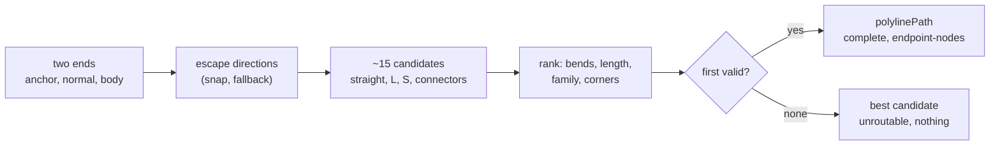
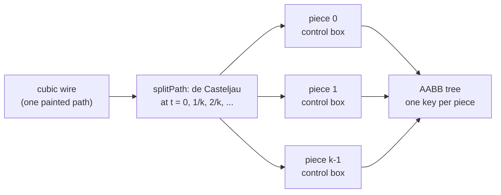
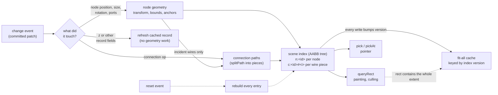

# Geometry, spatial index and picking

Everything here lives in `src/core` and is headless: no DOM, Canvas, or `Path2D` types.
The view layer consumes these contracts, so painting, bounds, anchors, and picking can
never disagree about where something is.

Requirement IDs in brackets point at the tests that assert each statement.

## Coordinate spaces

| Space      | Unit               | Origin                       | Used for                       |
| ---------- | ------------------ | ---------------------------- | ------------------------------ |
| `local`    | world units        | the node's **body center**   | outlines, hit shapes, anchors  |
| `world`    | world units        | document origin              | the only space the model stores |
| `viewport` | CSS pixels         | top-left of the view         | pointer input, DOM overlays    |
| `device`   | physical pixels    | top-left of the view         | canvas backing store           |

`Point<S>` and `Rect<S>` carry a phantom space brand, so the compiler rejects passing a
viewport point where a world point is expected. Persisted values are always world or
local values, never rounded screen positions.

`viewport = world * zoom + pan` and `device = viewport * dpr`. Page scroll and container
offsets are the view's job: it hands core viewport-relative points [the rule that geometry stays correct under layout and display changes; see
`clientToWorld` in [guide-view.md](guide-view.md)]. Cursor-anchored zoom is `zoomAt`.

## One transform convention

`Affine2` uses canvas `setTransform(a, b, c, d, e, f)` order:

```
x' = a*x + c*y + e
y' = b*x + d*y + f
```

A node maps local to world as `world = T(position) . R(quarterTurns) . M(mirrored)`:

1. Mirror (flip x) is applied first, about the local origin.
2. Rotate by `rotation` clockwise quarter turns (y points down).
3. Translate by the node's `position`.

The local origin is the body center, so `position` is the world location of the center and
rotation or mirroring never moves the node. Quarter turns use exact `0` and `+-1` matrix
entries, so four turns return a point bit-identical. Anchor normals use the linear part
only and stay unit length.

Bounds of a transformed rectangle are the axis-aligned box of its four corners
(`transformRect`).

`node-frame.ts` in `core/data` holds the same linear part, `L = R(rotation) . M(mirrored)`
(`frameVector`, `frameVectorInverse`), for planners and the capability validator, which
may not import `core/space`; a test asserts that both agree in all eight states.

### Mirrors in screen axes

A mirror command flips the node about its centre along a **screen** axis. With
`world = R(r) . M(m)`, the horizontal screen flip `H` (left and right swap) satisfies
`H . R(r) = R(-r) . H`, and the vertical flip is `V = R(2) . H`:

| Command | New `mirrored` | New `rotation` |
| --- | --- | --- |
| mirror horizontal | `!m` | `(4 - r) mod 4` |
| mirror vertical | `!m` | `(6 - r) mod 4` |
| rotate +-1 | `m` | `(r +- 1) mod 4` |

A vertical mirror is therefore stored as a horizontal mirror plus a half turn: one update
op, no data-format change.

### Anchored resize

Resizing from `size (w, h)` to `(w', h')` with the local point `fixed` (each coordinate
`-1`, `0` or `1`) kept in place moves the centre by

```
position' = position + L . ( -fixed.x * (w' - w) / 2 , -fixed.y * (h' - h) / 2 )
```

(`anchoredPosition`). The resize handle sits on the corner of the size box that is
bottom-right on screen: the four corners `(+-w/2, +-h/2)` go through `toWorld` and the
one with the largest `x + y` wins, unique for quarter turns. The tool resizes with the
diagonally opposite corner fixed. `GeometryScene.project(id, change)` builds the entry for
a hypothetical size and placement through the registered geometry, without touching the
index, so previews and commits use the same geometry.

## Supported ranges

| Quantity           | Range                          | Out of range                       |
| ------------------ | ------------------------------ | ---------------------------------- |
| World coordinate   | `|x|, |y| <= 1e7`              | `checkWorldPoint` rejects          |
| Zoom               | `1e-3 .. 1e3`                  | clamped by `clampZoom`/`createViewport` |
| Device pixel ratio | `0.1 .. 16`                    | `deviceMatrix` rejects             |
| Matrix determinant | `abs(det) >= 1e-12`            | `invert` returns `non-invertible`  |

Non-finite input is rejected with a `Rejection` (`non-finite`, `out-of-range`,
`non-invertible`). Zero-size rectangles, empty graphs, and coincident anchors are valid and
never produce NaN.

## Node geometry

A `NodeGeometry` answers, in local space and independent of any painter: `bodyBounds`,
`hitShape`, `paintedBounds` (a superset of the body with label and shadow margins
), and `anchors` (position plus outward unit normal, in model port order). The
`GeometryRegistry` maps a node type key to a geometry and falls back to the placeholder
(a rectangle of the stored size with evenly spaced ports) for unknown types.

Hit shapes: rectangle, rounded rectangle, ellipse, polygon, each with exact containment
and distance.

Presets:

- **Image-symbol**: rectangular body (or an outline polygon given as fractions of the
  body box). Port anchors resolve in order: the port's durable `placement`, then the
  type-level `typePlacement`, then even distribution by direction (inputs left, outputs
  right, undirected alternating). Without an explicit normal the normal points out of the
  nearest body edge.
- **Card**: title bar, then port rows below it (horizontal) or ports along the top and
  bottom edges (vertical); painted bounds add a label margin, the hit shape does not.

Anchors under resize: every preset computes anchors from the stored size, so a resize
moves them. Image-symbol placements are fractions of the body box, so edge ports stay on
their edge. Card rows in horizontal layout are a fixed distance below the top and clamp
to the bottom edge, so a card shorter than `titleHeight + rowPitch * rows` stacks its
lower ports on the bottom corner; declare that as the type's minimum height.

## Paths

`PathGeometry` is a `line`, a `cubic` or a `polyline`, in world space, with bounds,
nearest point, distance, end tangents and a finiteness check. Every member has `p0` and
`p1`, so endpoint readers (dots, arrowheads) need no switch.

- **Cubic**: exact bounds from the derivative roots; nearest point by 16-way subdivision
  plus Newton refinement. The Bezier builder puts control points at
  `anchor + normal * k`, `k = clamp(distance / 2, 20, 200)`.
- **Polyline** `{ p0, via, p1, radii? }`: interior vertices in order, and optionally an
  arc radius per interior vertex. `polylinePath(points, cornerRadius)` builds one and
  **fits** each radius so the arc's tangent length is at most half of each adjacent
  segment: neighbouring arcs never overlap, and a split at a segment midpoint never cuts
  an arc. The fitted radii are stored, not the requested one, so a piece of the path
  draws and picks exactly the arcs of the whole path. Arcs follow canvas `arcTo`
  semantics (tangent to both segments). Bounds are the vertex box (exact for sharp
  corners, and it contains rounded ones because arcs cut inside the corner). Nearest
  point and distance walk the straight parts and the arcs; `t` is the arc-length
  fraction. End tangents are the first and last non-zero segments; a fully coincident
  polyline reports +x. A polyline with no `via` behaves like a line.

The painted wire, the picked wire and the culled wire are the same geometry, rounded
corners included: a pointer 3 units inside a sharp corner of a radius-10 route
measures its distance to the arc, not to the corner point.

## Routing

A **router** turns the two ends of a connection into a path and an outcome:

```ts
interface RouteEnd { position; normal; body: Rect<"world"> | undefined } // body: the node's body box
interface ConnectionRouter { route(input: { from: RouteEnd; to: RouteEnd }): ConnectionRoute }
interface ConnectionRoute { path: PathGeometry; outcome: RouteOutcome }
interface RouteOutcome {
  status: "complete" | "provisional" | "unroutable";
  clearOf: "nothing" | "endpoint-nodes";
}
```

Routing is a pure, synchronous function of the two ends and the connection's stored
route constraints (`constraints`, empty when none). The input is a struct so a
later obstacle query needs no reshaping. A router that does not use constraints ignores
them and omits `realized`; they stay in the model.

Three built-in routers, each made by a factory so an unused one is not bundled:
`createStraightRouter()`, `createBezierRouter()` and
`createOrthogonalRouter({ clearance = 20, cornerRadius = 0 })`.

A **route registry** maps a connection kind to a router, like the painter registries:
`createRouteRegistry({ default? })` with `get(kind)`, `defaultRouter`, `has`,
`register` (rejects `duplicate-type`), `replace` and `onChange(kind)`. A kind without a
registration uses the default router, which is Bezier unless the host passes another, so
a host that registers nothing sees no change. The geometry scene takes the registry as
`routes` and routes each connection with `routes.get(record.kind)` and both endpoint
nodes' body boxes. A registration change recomputes only the connections of that kind:
no patch, no model event, no history entry. A node move, rotation, mirror or
resize already rebuilds its incident connections, which is all an endpoint-only router
depends on.

### The orthogonal router

No search grid and no state: a fixed list of about fifteen candidates is built from the
two ends, checked, and scored.

1. **Escape directions**. Each anchor normal is snapped to the nearer axis,
   horizontal on a tie (so a normal 30 degrees below +x leaves to the right). A zero or
   non-finite normal uses the outward side of the body box nearest the anchor (ties
   right, bottom, left, top); without a body, or with the anchor at the body centre, the
   dominant axis toward the other end, and +x when the ends coincide. Port direction is
   never read.
2. **Escape points** `E = anchor + direction * clearance`.
3. **Candidates**, in this family order:
   - *straight*: facing ports aligned within 1e-6 units, target ahead;
   - *L*: perpendicular escapes whose corner lies at least the clearance ahead of both;
   - *midpoint S*: facing ports, middle segment halfway between them (this is also how
     close facing ports work, the port escape and clearance rule: 16 units apart with clearance 20, the middle
     segment is 8 from each port);
   - *escape connectors*: `p0, E0, ..., E1, p1` with one corner, or a middle segment at a
     coordinate from a fixed set: either escape point's coordinate (the U shapes), their
     midpoint, the middle of the gap between the two bodies when it is wider than twice
     the clearance, and just outside the union of both bodies on each side (around
     above, below, left or right).
   Each candidate is simplified: repeated points dropped, straight-through vertices
   merged.
4. **Validity**. A candidate leaves along the source's escape direction,
   enters along the reverse of the target's, never turns back on itself, and no segment
   crosses the open interior of either endpoint body, except that the first segment is
   exempt from the source body and the last from the target body (a port may sit inside
   its own body box). For a connection to the same node both exemptions apply to it.
5. **Choice**: fewest bends, then shortest, then family order, then the corners ordered
   by `(y, x)` compared in turn, which puts a route above before one below and left
   before right. Candidates are ranked first and checked in that order, so usually only
   one or two are checked.
6. **Fallback**: with no valid candidate (for example overlapping endpoint
   nodes) the best candidate by the same keys is drawn anyway, reported `unroutable` and
   clear of `nothing`. The model is untouched.
7. **Corners**: the vertex list goes through `polylinePath(points, cornerRadius)`.



The two ends are put in a canonical order before routing and the result is reversed back,
so swapping `from` and `to` gives exactly the same vertices in reverse:
an undirected connection does not change shape with the stored end order.

#### Pinned segments

A connection may carry `route`: an ordered list (from `from` to `to`) of
`{ kind: "segment", orientation, at }`, a horizontal segment at world y or a vertical one
at world x. With no pins the router above is unchanged. With pins it skips the candidate
families and builds one path deterministically (`orthogonal-pins.ts`):

1. Escape points and directions as above; the ends go into the canonical order and the
   pin list is reversed with them, so end order does not matter.
2. The path is `p0, e0`, the pins in order, `e1, p1`. The stub `p0 -> e0` is fixed; the
   segment after it may continue along the escape direction or turn, never reverse, and
   the segment before `e1` must arrive along the reverse of the target escape.
3. Walking from `e0`, a vertical pin at `x = a` is reached by a horizontal move to
   `(a, y)`, a horizontal pin by a vertical move. When that move would run backwards
   along the current direction, or two pins of the same orientation follow each other, a
   free perpendicular segment is inserted first, at the midpoint between the current
   coordinate and the next fixed one (offset by the clearance when they coincide).
4. Collinear points merge, and `realized[k]` records which segment of
   `polylineVertices(path)` lies on pin `k` (-1 when a degenerate pin collapsed).

The outcome is `complete`; `clearOf` is `endpoint-nodes` when no segment crosses the open
interior of either end body and `nothing` otherwise: a pinned route that crosses its own
nodes is the user's choice and is drawn as such. A pin on a stub's own line is realized by
that stub. A pin on the first or last segment's line away from the stub gives a step
after the stub, so alternating pins reproduce any orthogonal staircase exactly. Editing the pins is the view's job (guide-view.md, route editors).

**What is not avoided yet.** Only the two endpoint nodes are obstacles. A wire may cross
an unrelated node, and its outcome says so: an orthogonal route is clear of
`endpoint-nodes`, never of all nodes. Avoiding other nodes and
jumps at crossings are later changes. Hosts that need avoidance now keep Bezier for those
kinds.

### Segment-indexed paths

A long wire's bounding box is mostly empty space: a cubic from the left edge of the graph
to the right edge has a box covering half the world, although its stroke touches only a
thin band. If the index held one box per wire, every pick and every culling query anywhere
in that box would return the wire, and zoomed out almost every query returns almost every
wire. So a path is indexed as **pieces**:

- `pieceCount(path)`: a line is one piece; a cubic gets `ceil(L / 800)` pieces, clamped to
  1..12, where `L` is the control-polygon length in world units (an upper bound of the
  arc length). Short wires stay one entry; the index grows by about 1.5x on F-LARGE.
- A polyline shorter than 800 units (its vertex length) is **one piece**, like a short
  cubic. A longer one is split at the midpoints of its interior segments, so **each
  piece holds one corner** with its arc and the half segments on either side; a segment
  longer than 800 units is also split at equal steps, moved outside any arc. Above 12
  pieces, consecutive pieces merge into evenly sized groups. Either way every corner
  lies whole inside one piece. Pieces are polylines carrying the fitted radii of their
  corners, so distances on a piece are exact; the box of a piece is its vertex box. A
  long L-shaped wire's overall box is mostly empty, and per-corner boxes stay tight
  around the stroke; for a short wire the extra index entries cost more than its loose
  box saves, and picking stays exact anyway because the box only narrows the
  candidates. With every F-LARGE wire orthogonal the index holds about 29k pieces
  (35k for Bezier); splitting every polyline per corner gave about 60k and a scene
  build 2.4x the Bezier one.
- `splitPath(path)` splits at equal parameter steps with de Casteljau subdivision, so each
  piece is an exact cubic with its own control points. By the convex hull property the box
  around a piece's four control points contains that piece, and the union of the piece
  boxes contains the whole path.
- The geometry scene indexes piece `i` of connection `c` under the key `c:<id>#<i>`, each
  box grown by the painted margin (stroke width, arrowheads).



The wire is still one entity everywhere else: it is painted once, picked as one
connection, and a query returns it once (the first matching piece wins, no set needed).

## Spatial index

`SpatialIndex<K>` supports insert, update, remove, rectangle query and point query with
boundary-inclusive intersection. `createAabbTree` is the default (fat boxes, rotation
balancing, O(1) update inside the fat box); `createBruteForceIndex` is the test reference.
Result order is unspecified; callers sort keys with `sortKeys` (code-unit comparison).

## Geometry scene

`createGeometryScene(model)` is a derived cache of node transforms, world bounds, anchors,
and connection paths. It follows `change` events: a moved node recomputes itself and its
incident connections only; z-order and other record-only changes recompute nothing;
`reset` rebuilds everything. `queryRect` returns culling sets by painted bounds in paint
order (layers bottom to top, default `connection, node, port`; nodes by `(z, seq)`).

The whole pipeline, from a committed change to the two consumers. Solid arrows are the
incremental path a typical edit takes; the split of a wire into pieces is drawn in
[Segment-indexed paths](#segment-indexed-paths-perf-04-idx-03) above.



In QtNodes `QGraphicsScene` does this bookkeeping itself: an item calls
`prepareGeometryChange()` and the BSP index updates that item. Here the scene is an
explicit cache that listens to the same `change` events as every other observer, which is
why it can be built and tested in Node.

For a path, the culling bounds are its margin-grown piece boxes: a path is drawn
when at least one piece box meets the view, and culled when none does, even if its overall
box overlaps the view. An S-curve that passes beside the viewport, with its box reaching
into it, is therefore not painted. This is tighter than before and never drops a visible
stroke, because the piece boxes together contain the whole stroke.

A query that contains every indexed box (the fit-all viewport) returns the whole scene in
paint order. Its result is cached and keyed by a counter that every index write bumps, so
repeated fit-all frames (an overview pan) do not re-sort 30k entries; any edit, move or
z change invalidates it.

## Picking

`scene.pick(worldPoint, { zoom, tolerancePx?, order?, ports? })`:

1. Broad phase: a point query with radius `max(tolerancePx, largest capture radius) / zoom`.
   It returns node entries and connection *pieces*.
2. Precise phase: port capture distance, node hit shape (the point mapped to local space),
   and path distance. Path distance is measured only on the returned pieces; a connection
   is a hit as soon as one of its pieces is within tolerance, and its other pieces are
   skipped. A long wire whose overall box contains the
   point but whose pieces do not costs no distance computation at all.
3. Tolerances are CSS pixels, divided by zoom, so they never scale with graph zoom. Port
   capture radius defaults to 8 CSS pixels.
4. Candidates are ordered by interactive layer (default: reverse of the paint layer order,
   so `port`, `node`, `connection`), then paint order descending, then nearest port, then
   ID. Hosts override the order per scene (`layerOrder`) or per call (`order`).

`ports: false` (default `true`) leaves ports out: capture radii no longer widen the broad
phase and no port candidate is returned, so a point on a port anchor yields the node under
it. The view passes `ports: false` while ports are hidden below the theme's
`lodHidePortsBelow` (see the view guide), so picking matches what is painted.

Hits are `{ kind: "port", nodeId, portId }`, `{ kind: "node", nodeId }`, or
`{ kind: "connection", connectionId }`; the `member` field is reserved for bundled paths.

### Compared with QtNodes

`QGraphicsScene` indexes each item by its `boundingRect()` in a BSP tree, and an item query
then tests `shape()`, a `QPainterPath`, for containment. For a wire that means one box per
wire (large and mostly empty for a long curve) and a path containment test against the
stroked outline. Here the two steps are:

- **Rough step: curve pieces in the index.** Each wire contributes several small boxes
  that follow the curve, so a query near the pointer or a view rectangle returns only the
  wires that actually pass nearby.
- **Exact step: curve distance on the nearby pieces.** Instead of building a stroked
  outline and testing containment, the picker computes the distance from the point to
  each returned piece (subdivision plus a Newton step) and compares it with the tolerance.
  For 20k wires that is cheaper than stroking paths, and the tolerance stays a number in
  CSS pixels (divided by the zoom), so a wire is as easy to hit at 10% zoom as at 400%. In
  Qt the equivalent needs a `QPainterPathStroker` whose width you rescale with the view
  transform.
