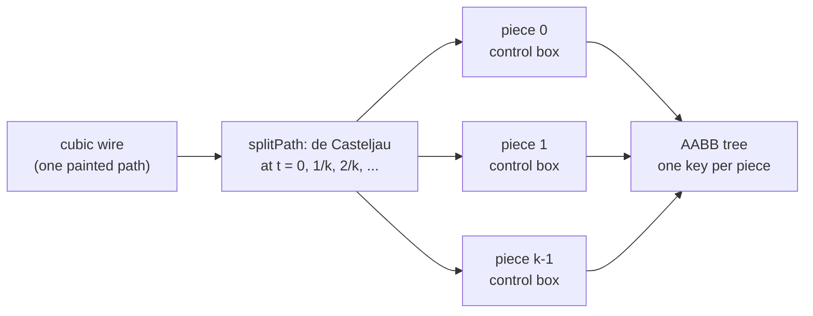

# Geometry, spatial index and picking

Everything here lives in `src/core` and is headless: no DOM, Canvas, or `Path2D` types.
The view layer consumes these contracts, so painting, bounds, anchors, and picking can
never disagree about where something is.

Requirement IDs in brackets point at the tests that assert each statement.

## Coordinate spaces [GEO-01]

| Space      | Unit               | Origin                       | Used for                       |
| ---------- | ------------------ | ---------------------------- | ------------------------------ |
| `local`    | world units        | the node's **body center**   | outlines, hit shapes, anchors  |
| `world`    | world units        | document origin              | the only space the model stores |
| `viewport` | CSS pixels         | top-left of the view         | pointer input, DOM overlays    |
| `device`   | physical pixels    | top-left of the view         | canvas backing store           |

`Point<S>` and `Rect<S>` carry a phantom space brand, so the compiler rejects passing a
viewport point where a world point is expected. Persisted values are always world or
local values, never rounded screen positions [GEO-02].

`viewport = world * zoom + pan` and `device = viewport * dpr`. Page scroll and container
offsets are the view's job: it hands core viewport-relative points [GEO-03; see
`clientToWorld` in [guide-view.md](guide-view.md)]. Cursor-anchored zoom is `zoomAt`.

## One transform convention [GEO-02, GEO-02a]

`Affine2` uses canvas `setTransform(a, b, c, d, e, f)` order:

```
x' = a*x + c*y + e
y' = b*x + d*y + f
```

A node maps local to world as `world = T(position) . R(quarterTurns) . M(mirrored)`:

1. Mirror (flip x) is applied first, about the local origin.
2. Rotate by `rotation` clockwise quarter turns (y points down).
3. Translate by the node's `position`.

The local origin is the body center, so `position` is the world location of the center and
rotation or mirroring never moves the node. Quarter turns use exact `0` and `+-1` matrix
entries, so four turns return a point bit-identical. Anchor normals use the linear part
only and stay unit length.

Bounds of a transformed rectangle are the axis-aligned box of its four corners
(`transformRect`).

## Supported ranges [GEO-06]

| Quantity           | Range                          | Out of range                       |
| ------------------ | ------------------------------ | ---------------------------------- |
| World coordinate   | `|x|, |y| <= 1e7`              | `checkWorldPoint` rejects          |
| Zoom               | `1e-3 .. 1e3`                  | clamped by `clampZoom`/`createViewport` |
| Device pixel ratio | `0.1 .. 16`                    | `deviceMatrix` rejects             |
| Matrix determinant | `abs(det) >= 1e-12`            | `invert` returns `non-invertible`  |

Non-finite input is rejected with a `Rejection` (`non-finite`, `out-of-range`,
`non-invertible`). Zero-size rectangles, empty graphs, and coincident anchors are valid and
never produce NaN.

## Node geometry [GEO-02b, NOD-02, NOD-03, NOD-07, NOD-08]

A `NodeGeometry` answers, in local space and independent of any painter: `bodyBounds`,
`hitShape`, `paintedBounds` (a superset of the body with label and shadow margins
[VIS-03]), and `anchors` (position plus outward unit normal, in model port order). The
`GeometryRegistry` maps a node type key to a geometry and falls back to the placeholder
(a rectangle of the stored size with evenly spaced ports) for unknown types.

Hit shapes: rectangle, rounded rectangle, ellipse, polygon, each with exact containment
and distance [GEO-04].

Presets:

- **Image-symbol**: rectangular body (or an outline polygon given as fractions of the
  body box). Port anchors resolve in order: the port's durable `placement`, then the
  type-level `typePlacement`, then even distribution by direction (inputs left, outputs
  right, undirected alternating). Without an explicit normal the normal points out of the
  nearest body edge.
- **Card**: title bar, then port rows below it (horizontal) or ports along the top and
  bottom edges (vertical); painted bounds add a label margin, the hit shape does not.

## Paths [ROU-01, ROU-02]

`PathGeometry` is a `line` or a `cubic`, in world space, with exact bounds, nearest point
(16-way subdivision plus Newton refinement), distance, and end tangents. The Bezier
builder puts control points at `anchor + normal * k`, `k = clamp(distance / 2, 20, 200)`.
Orthogonal routing is a later change.

### Segment-indexed paths [PERF-04, IDX-03]

A long wire's bounding box is mostly empty space: a cubic from the left edge of the graph
to the right edge has a box covering half the world, although its stroke touches only a
thin band. If the index held one box per wire, every pick and every culling query anywhere
in that box would return the wire, and zoomed out almost every query returns almost every
wire. So a path is indexed as **pieces**:

- `pieceCount(path)`: a line is one piece; a cubic gets `ceil(L / 800)` pieces, clamped to
  1..12, where `L` is the control-polygon length in world units (an upper bound of the
  arc length). Short wires stay one entry; the index grows by about 1.5x on F-LARGE.
- `splitPath(path)` splits at equal parameter steps with de Casteljau subdivision, so each
  piece is an exact cubic with its own control points. By the convex hull property the box
  around a piece's four control points contains that piece, and the union of the piece
  boxes contains the whole path.
- The geometry scene indexes piece `i` of connection `c` under the key `c:<id>#<i>`, each
  box grown by the painted margin (stroke width, arrowheads).



The wire is still one entity everywhere else: it is painted once, picked as one
connection, and a query returns it once (the first matching piece wins, no set needed).

## Spatial index [IDX-01, IDX-02, IDX-04]

`SpatialIndex<K>` supports insert, update, remove, rectangle query and point query with
boundary-inclusive intersection. `createAabbTree` is the default (fat boxes, rotation
balancing, O(1) update inside the fat box); `createBruteForceIndex` is the test reference.
Result order is unspecified; callers sort keys with `sortKeys` (code-unit comparison).

## Geometry scene [IDX-02, IDX-03]

`createGeometryScene(model)` is a derived cache of node transforms, world bounds, anchors,
and connection paths. It follows `change` events: a moved node recomputes itself and its
incident connections only; z-order and other record-only changes recompute nothing;
`reset` rebuilds everything. `queryRect` returns culling sets by painted bounds in paint
order (layers bottom to top, default `connection, node, port`; nodes by `(z, seq)`).

For a path, the culling bounds are its margin-grown piece boxes (IDX-03): a path is drawn
when at least one piece box meets the view, and culled when none does, even if its overall
box overlaps the view. An S-curve that passes beside the viewport, with its box reaching
into it, is therefore not painted. This is tighter than before and never drops a visible
stroke, because the piece boxes together contain the whole stroke.

A query that contains every indexed box (the fit-all viewport) returns the whole scene in
paint order. Its result is cached and keyed by a counter that every index write bumps, so
repeated fit-all frames (an overview pan) do not re-sort 30k entries; any edit, move or
z change invalidates it.

## Picking [GEO-04, GEO-04a, GEO-05, VIS-02]

`scene.pick(worldPoint, { zoom, tolerancePx?, order?, ports? })`:

1. Broad phase: a point query with radius `max(tolerancePx, largest capture radius) / zoom`.
   It returns node entries and connection *pieces*.
2. Precise phase: port capture distance, node hit shape (the point mapped to local space),
   and path distance. Path distance is measured only on the returned pieces; a connection
   is a hit as soon as one of its pieces is within tolerance, and its other pieces are
   skipped. A long wire whose overall box contains the
   point but whose pieces do not costs no distance computation at all.
3. Tolerances are CSS pixels, divided by zoom, so they never scale with graph zoom. Port
   capture radius defaults to 8 CSS pixels.
4. Candidates are ordered by interactive layer (default: reverse of the paint layer order,
   so `port`, `node`, `connection`), then paint order descending, then nearest port, then
   ID. Hosts override the order per scene (`layerOrder`) or per call (`order`).

`ports: false` (default `true`) leaves ports out: capture radii no longer widen the broad
phase and no port candidate is returned, so a point on a port anchor yields the node under
it. The view passes `ports: false` while ports are hidden below the theme's
`lodHidePortsBelow` (see the view guide), so picking matches what is painted.

Hits are `{ kind: "port", nodeId, portId }`, `{ kind: "node", nodeId }`, or
`{ kind: "connection", connectionId }`; the `member` field is reserved for bundled paths.

### Compared with QtNodes

`QGraphicsScene` indexes each item by its `boundingRect()` in a BSP tree, and an item query
then tests `shape()`, a `QPainterPath`, for containment. For a wire that means one box per
wire (large and mostly empty for a long curve) and a path containment test against the
stroked outline. Here the two steps are:

- **Rough step: curve pieces in the index.** Each wire contributes several small boxes
  that follow the curve, so a query near the pointer or a view rectangle returns only the
  wires that actually pass nearby.
- **Exact step: curve distance on the nearby pieces.** Instead of building a stroked
  outline and testing containment, the picker computes the distance from the point to
  each returned piece (subdivision plus a Newton step) and compares it with the tolerance.
  For 20k wires that is cheaper than stroking paths, and the tolerance stays a number in
  CSS pixels (divided by the zoom), so a wire is as easy to hit at 10% zoom as at 400%. In
  Qt the equivalent needs a `QPainterPathStroker` whose width you rescale with the view
  transform.
