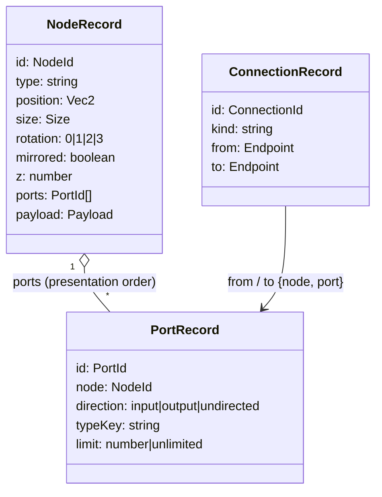
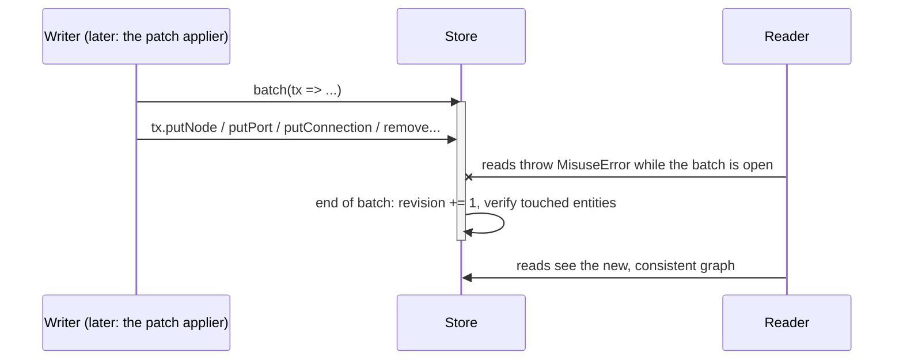

# Guide: the core graph model

A hands-on tour of the code implemented by the `add-graph-model-core` change:
results and errors, IDs, records, the store, and reading the graph. Read
[architecture.md](architecture.md) first for the big picture.

> **Audience.** This tour uses internal modules (`createGraphStore`, `createGraphReader`)
> because it explains what everything else is built on. Library users never call the store
> directly: they use the public API (`createGraphModel`, commands, patches, undo), which
> is covered in [guide-using-the-model.md](guide-using-the-model.md). Read that one first
> if you just want to build on the library.

All examples run as-is in a Vitest test inside `src/core/data/model/`.

## 1. Results instead of exceptions

Anything that can fail for an *expected* reason returns a `Result`:

```ts
type Result<T> =
  | { ok: true; value: T }
  | { ok: false; error: Rejection };   // { code, message, entities }
```

```ts
import { validateNodeRecord } from "./validate-records.js";

const result = validateNodeRecord({ id: "n1", position: { x: Number.NaN, y: 0 } });
if (!result.ok) {
  console.log(result.error.code);      // "malformed-record" — required fields are missing
}
```

`MisuseError` is *thrown*, but only for programmer mistakes, such as a malformed ID
literal or reading the graph in the middle of a write. If you catch `MisuseError` in
application code, something is wrong with the calling code, not with the user's input.

## 2. IDs

IDs are strings with a compile-time "brand", so you cannot pass a port ID where a node
ID is expected:

```ts
import { nodeId, portId } from "../../base/ids/ids.js";

const n = nodeId("n1");
const p = portId("p1");
// const wrong: NodeId = p;   // compile error: PortId is not a NodeId
```

New IDs come from a **generator**. The default one counts per kind. It is *pure*: it does
not keep hidden state but returns the next ID together with an updated **cursor**, and the
caller decides whether to keep it. A planner can therefore allocate IDs for a patch that
may still be rejected, without burning numbers.

```ts
import { createCounterIdGenerator, EMPTY_CURSOR } from "../../base/ids/id-generator.js";

const gen = createCounterIdGenerator();
const a = gen.next("node", EMPTY_CURSOR);   // a.id === "n1", a.cursor = { n: 1 }
const b = gen.next("node", a.cursor);       // b.id === "n2"
const c = gen.next("port", b.cursor);       // c.id === "p1", c.cursor = { n: 2, p: 1 }
```

The cursor is saved with the document. That is how a deleted `n2` stays retired forever.
When a document arrives with IDs the generator did not mint (a hand-edited file,
a server), `observe` moves the cursor past them:

```ts
const cursor = gen.observe?.("n41", c.cursor) ?? c.cursor;   // { n: 41, p: 1 }
gen.next("node", cursor).id;                                 // "n42"
```

The counters never wrap and never restart. `observe` ignores an ID whose counter is above
2^50, because counting from 1 can never reach it and tracking it would only use up the
counter. `next` throws `MisuseError` when the counter is not a non-negative safe integer or
the next one would pass `Number.MAX_SAFE_INTEGER`, instead of quietly starting again at 1
and reusing IDs. Cursor values in patches and snapshots must be text or safe integers.

When a patch commits, its cursor is merged into the model's. A host generator can do that
itself with an optional `merge(current, incoming)`. Without one, a number replaces a
smaller number and any other incoming value (text, or a change of type) replaces the
current one, since the generator built the patch's cursor from the one the planner read.

## 3. Records



Records are immutable. An update replaces the whole record object, which is what makes
cheap snapshots possible (section 6). A node lists its ports, and each port names its
node; the store checks that both sides agree.

## 4. Writing: batches

The store changes only inside `batch()`. Writes inside a batch are not visible to readers
until it ends, and when it ends the store checks that the touched entities are
consistent:



```ts
import { createGraphStore } from "./store.js";
import { createGraphReader } from "./reader.js";
import { mkConn, mkNode, mkPort } from "./test-helpers.js";
import { portId } from "../../base/ids/ids.js";

const store = createGraphStore();
const graph = createGraphReader(store);

store.batch((tx) => {
  tx.putNode(mkNode("n1", { ports: [portId("p1")] }));
  tx.putNode(mkNode("n2", { ports: [portId("p2")] }));
  tx.putPort(mkPort("p1", "n1", { typeKey: "hydraulic" }));
  tx.putPort(mkPort("p2", "n2", { typeKey: "hydraulic" }));
  tx.putConnection(mkConn("c1", "n1", "p1", "n2", "p2"));
});

graph.revision();   // 1 — one batch, one revision, however many operations it held
```

(`mkNode`, `mkPort`, `mkConn` are test helpers that fill in defaults.)

The store is deliberately simple: **it does not validate and cannot roll back**. Its
end-of-batch check is a safety net for bugs. If a batch leaves a connection pointing at a
removed port, the store throws `MisuseError`:

```ts
store.batch((tx) => void tx.removePort(portId("p2")));   // throws MisuseError
```

Validating *before* opening the batch is the job of the patch pipeline. The rule of thumb: validated data goes into a batch, and a batch never fails for
a user-caused reason.

Removing returns the removed record together with its insertion sequence `seq`, and
`put` accepts `{ seq }`. That is what lets undo put an entity back in exactly the order
it had before. A patch that adds an entity with an explicit `seq` is checked first: the
value must be an integer from 1 to 2^40 and must not be the `seq` of another live entity of
the same kind, otherwise the patch is rejected with `conflict` (`GraphReader.idWithSeq`
answers who holds a sequence). The bound keeps the automatic sequences, which count on from
the largest one seen, exact.

The batch also checks that no port is left without its node: the ports a node listed before
a replacement or removal are re-checked, so dropping `p2` from a node's `ports` without
removing `p2` throws. The patch pipeline refuses the same patch earlier with
`dangling-reference`.

## 5. Reading

`GraphReader` is the read API that views, policies, and planners use. Every list comes
back in a deterministic order:

```ts
import { nodeId } from "../../base/ids/ids.js";

graph.getNode(nodeId("n1"))?.position;          // { x: 0, y: 0 }
graph.portsOf(nodeId("n1")).map((p) => p.id);   // ["p1"] — the node's presentation order
graph.connectionsOfPort(portId("p1"));          // [c1] — from an index, not a scan
graph.neighbors(nodeId("n1")).map((n) => n.id); // ["n2"]
graph.paintOrder();                             // nodes by (z, seq): last one is on top
```

Adjacency queries use indexes kept up to date inside the batch, so asking for one port's
connections in a 20k-connection graph touches only that port's entries.

## 6. Snapshots and freezing

`graph.state()` returns the whole committed graph at the current revision. It is built
lazily, at most once per revision, and is cheap: it holds references to the immutable
records rather than copies.

```ts
const before = graph.state();
store.batch((tx) => {
  const n1 = tx.getNode(nodeId("n1"));
  if (n1) tx.putNode({ ...n1, position: { x: 100, y: 0 } });   // replace, don't mutate
});
before.nodes[0]?.position.x;          // 0   — the old snapshot still shows the old state
graph.state().nodes[0]?.position.x;   // 100
```

Records are frozen by default, so accidental mutation fails loudly:

```ts
const n1 = graph.getNode(nodeId("n1"));
(n1 as { z: number }).z = 5;   // TypeError in strict mode: the record is frozen
```

Production code may pass `createGraphStore({ freezeRecords: false })` to skip the
freezing cost. The `readonly` types still catch writes at compile time.

Records reach the store through validation (`validateNodeRecord` and its siblings), which
returns a new record holding only the record's own fields, with copies of positions, sizes,
port lists, endpoints, placements, overrides and route constraints. So a caller that changes
the object it submitted changes nothing in the model, and unknown keys are not stored. The
payload is the exception: it is application data of any size and is kept as given, which
means the model owns it after the submit (and, with freezing on, freezes it).

Validation also keeps records inside the supported world range: a node position coordinate
outside plus or minus 1e7, a node width or height above 2e7, or a route constraint outside
plus or minus 1e7 is rejected with `out-of-range`, and a connection holds at most 256 route
constraints (`limit-exceeded`). Snapshot load, paste, duplicate and raw patches all go
through these checks.

## Where next

- `src/core/data/model/*.test.ts`: each requirement ID has tests named after it.
- [guide-using-the-model.md](guide-using-the-model.md): the public API on top of this store.
- `openspec/changes/archive/2026-10-30-add-patches-and-history/design.md`: how patches, events and undo sit
  on top of this store.
