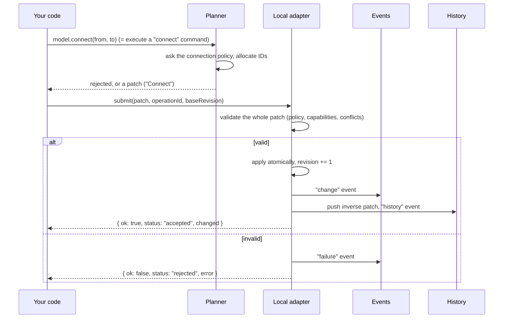
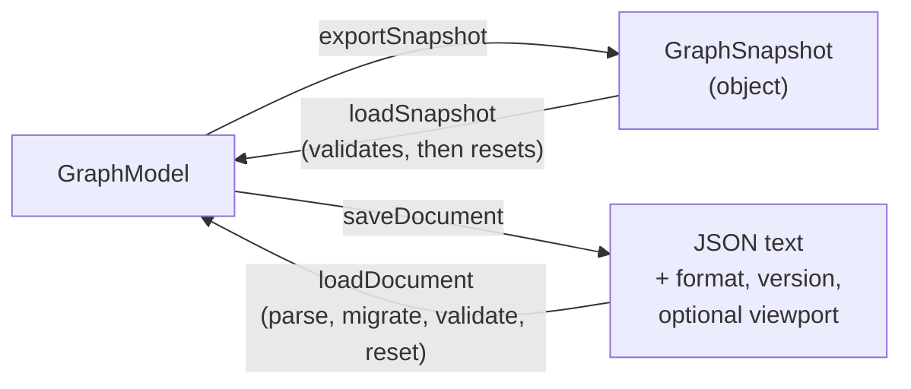

# Guide: using the model

A tutorial for application developers: create a graph, edit it, listen to changes, undo,
and save. Everything here uses only the public entry point, `nodeeditor-js`, and runs in
plain Node with no browser. For how the pieces fit together read
[architecture.md](architecture.md); for the internals behind them read
[guide-core-model.md](guide-core-model.md).

If you know QtNodes: `createGraphModel()` plays the role of your `AbstractGraphModel`
subclass plus `QUndoStack`, except that you do not subclass anything. You get a ready
in-memory model, and you edit it through commands that return `Result`-like objects instead
of calling virtual `setNodeData(...)` hooks.

All examples share these imports and one set of node types:

```ts
import {
  createGraphModel,
  createNodeTypeRegistry,
  createDefaultConnectionPolicy,
  exportSnapshot,
  invertPatch,
  loadDocument,
  loadSnapshot,
  saveDocument,
  type ChangeEvent,
  type Patch,
} from "nodeeditor-js";
```

## 1. Creating a model

A node type registry says which kinds of node exist and which ports a new node of that
kind gets (the counterpart of `NodeDelegateModelRegistry`). Types only describe the
model: label, default size, initial ports. Looks (painters, geometry) are registered
separately, later, in the view.

```ts
const registry = createNodeTypeRegistry();
registry.register({
  type: "pump",
  label: "Pump",
  defaultSize: { width: 80, height: 40 },
  ports: () => [
    { direction: "input", typeKey: "hydraulic", label: "in" },
    { direction: "output", typeKey: "hydraulic", label: "out" },
  ],
});
registry.register({
  type: "sensor",
  label: "Sensor",
  defaultSize: { width: 40, height: 40 },
  ports: () => [{ direction: "input", typeKey: "signal", label: "in" }],
});

const model = createGraphModel({ registry });
```

Both options are optional. Without a registry the model starts with an empty one (you can
still `model.registry.register(...)` later). Without a `connectionPolicy` you get the
default policy, which you can also build yourself to change its switches:

```ts
const strict = createGraphModel({
  registry,
  connectionPolicy: createDefaultConnectionPolicy({ parallel: false, selfLoops: false }),
});
```

The default policy connects an output to an input (or undirected to undirected), requires
equal `typeKey`s, and respects each port's attachment limit (inputs take one connection
by default). See the doc comment on `createDefaultConnectionPolicy` for the full rule list.

The model has two sides. You **read** through `model.reader` (synchronous, always the
committed state) and you **write** through commands and `submit`.

## 2. Creating nodes and ports

```ts
const made = model.createNode("pump", { x: 0, y: 0 }, { title: "P1" });
model.createNode("pump", { x: 200, y: 0 });
model.createNode("sensor", { x: 400, y: 0 });

made.status;   // "accepted"
if (made.status === "accepted") {
  made.changed.nodes;   // ["n1"]
  made.changed.ports;   // ["p1", "p2"], created by the registry's `ports` factory
}

const [a, b, s] = model.reader.nodes();   // creation order
model.reader.portsOf(a.id);
// [{ id: "p1", node: "n1", direction: "input",  typeKey: "hydraulic", limit: 1,           label: "in" },
//  { id: "p2", node: "n1", direction: "output", typeKey: "hydraulic", limit: "unlimited", label: "out" }]
```

IDs (`n1`, `p1`, ...) are opaque strings minted by the model and never reused, even after
a delete or a save and reload. Ports are addressed by ID, never by index: unlike QtNodes'
`(node, PortIndex)`, inserting a port later does not renumber anything.

Every command method returns a `SubmitResult` (section 3). `createNode` with an unknown
type, for example, is rejected with code `unknown-type` rather than throwing.

## 3. Connecting, and what a rejection looks like

```ts
const [aIn, aOut] = a.ports;
const [bIn, bOut] = b.ports;
const [sIn] = s.ports;

const ok = model.connect({ node: a.id, port: aOut }, { node: b.id, port: bIn });
ok.status;   // "accepted"
```

Anything that can fail for an expected reason returns an object instead of throwing. A
connection the policy refuses comes back like this:

```ts
// A hydraulic output into a signal input
const bad = model.connect({ node: b.id, port: bOut }, { node: s.id, port: sIn });

bad.status;   // "rejected"
if (bad.status === "rejected") {
  bad.ok;               // false
  bad.error.code;       // "type-mismatch"
  bad.error.message;    // 'Port types differ: "hydraulic" and "signal"'
  bad.error.entities;   // ["p4", "p5"], the ports involved
}
```

Nothing changed in the model, and no history entry was made. Other codes you will meet
are `direction-mismatch` (for example, input to input), `capacity-exhausted`,
`self-loop`, and `duplicate-connection`. All `Rejection` values have the same
`{ code, message, entities }` shape.

Check `status`, not just `ok`: a result can also be `queued` or `pending` (no `ok` field
at all), which happens when you edit from inside an event handler or, later, with an
external adapter. With the local model outside a handler you always get `accepted` or
`rejected`.

To ask without editing, use `can` or `plan`. `can` answers "would this be allowed?" for a
greyed-out menu item; `plan` also tells you what would happen:

```ts
model.can({ kind: "connect", from: { node: b.id, port: bOut }, to: { node: s.id, port: sIn } });
// { available: false, reason: { code: "type-mismatch", ... } }

const plan = model.plan({ kind: "deleteEntities", nodes: [a.id] });
if (plan.kind === "ready") {
  plan.label;                     // "Delete"
  plan.effects.removed.nodes;     // ["n1"]
  plan.effects.removed.connections;   // ["c1"]: deleting a node also removes its wires
}
```

The convenience methods (`connect`, `createNode`, ...) are shorthand for
`model.execute({ kind: "connect", ... })`; both give identical results.

## 4. Moving, updating, deleting

```ts
model.moveNodes([
  { node: a.id, position: { x: 10, y: 10 } },
  { node: b.id, position: { x: 210, y: 10 } },
]);

model.updateNode(a.id, { title: "Main pump", payload: { rpm: 1500 } });
model.reader.getNode(a.id)?.title;   // "Main pump"

model.deleteEntities({ nodes: [b.id] });   // also removes the connection to it
model.reader.connections();                // []
```

`payload` is your own JSON-compatible data attached to a node; the library stores it and
never interprets it. There are also `rotateNodes`, `mirrorNodes`, `reorderNodes`,
`reconnect`, `disconnect` and `setPorts`; see `ConvenienceMethods`.

## 5. Subscribing to events

```ts
model.on("change", (e: ChangeEvent) => {
  // e.revision, e.origin, e.operationId, e.changed (IDs touched), e.patch
});

model.on("failure", (f) => {
  if (f.source === "rejection") console.warn(f.rejection.code, f.rejection.message);
});

model.on("history", (h) => {
  // h.canUndo, h.canRedo, h.undoLabel, ...  (drive your Undo/Redo buttons)
});

model.on("reset", (e) => {
  // The whole document was replaced (a load). Discard derived state and re-read.
});
```

`on` returns an unsubscribe function. Events are delivered in commit order, once per
accepted patch, after the graph is consistent again; a handler never sees a connection
pointing at a deleted node. `origin` is `"local"`, `"undo"`, `"redo"`, or `"external"`.

A rejected command emits a `failure` event with `source: "rejection"`, so one central
handler can show every error instead of each call site checking its result. (A
`source: "handler"` failure means one of your own handlers threw; the model keeps going.)

Selection, hover and viewport events do not exist here: those belong to the view.

## 6. Undo and redo

```ts
model.historyState();
// { canUndo: true, canRedo: false, undoLabel: "Edit node", redoReason: "Nothing to redo" }

model.undo();
model.reader.getNode(a.id)?.title;   // "P1"
model.redo();
model.reader.getNode(a.id)?.title;   // "Main pump"
```

**One command is one patch is one history entry.** Moving two nodes in one `moveNodes`
call, or deleting a node together with its wires, is a single undo step, and the history
label says what it was (`"Move"`, `"Delete"`, `"Connect"`). A drag in the future view
behaves the same way: the intermediate positions are only a preview, and release submits
one `moveNodes`. Rejected commands, loads, and `history: "skip"` submissions leave no
entry.

Unlike `QUndoCommand`, there are no command objects with `redo()`/`undo()` methods. Undo
applies the inverse patch (section 8), and redo reapplies the original.



## 7. Saving and loading

Two levels are offered, and they differ in what they include:

| | `exportSnapshot` / `loadSnapshot` | `saveDocument` / `loadDocument` |
| --- | --- | --- |
| Data | A plain object (`GraphSnapshot`) | A JSON **string** with an envelope |
| Contains | nodes, ports, connections, ID cursor | the snapshot, plus optional viewport and selection you pass in |
| Versioning | `format` and `version` fields | `format`, `version`, and host-supplied migrations |
| Payload codecs | on load (option) | on both sides (option) |
| Use it for | sending graph data to a server, tests, diffing | files, local storage, import/export |

```ts
// Document: a string you can write to a file or localStorage.
const saved = saveDocument(model, { indent: 2 });
if (!saved.ok) throw new Error(saved.error[0]?.message);

const fresh = createGraphModel({ registry });
const loaded = loadDocument(fresh, saved.value);
if (loaded.ok) {
  loaded.value.revision;      // "r1"
  loaded.value.diagnostics;   // [], or "unresolved-type" entries for unregistered types
}
```

```ts
// Snapshot: just the graph, as a plain object.
const snapshot = exportSnapshot(model);
snapshot.format;   // "nodeeditor-js/graph"
snapshot.version;  // 1
loadSnapshot(fresh, snapshot);
```

Points to know:

- Both return `Result`s. Invalid input (wrong format, unsupported version, bad shape)
  returns `{ ok: false, error: [...] }` with codes such as `unsupported-format`, and the
  model is left untouched.
- **Loading is a reset, not an edit.** It replaces the whole document, clears undo
  history, and emits one `reset` event. You cannot undo a load.
- The ID counter is saved too, so after a reload new nodes continue where the old
  document left off and a deleted ID stays retired.
- Nodes whose type is not in the registry still load unchanged; they appear as
  `diagnostics`, not errors, so a file made with a plugin you lack is not lost.
- Previews, hover and caches are never saved. Viewport and selection are saved only if
  you pass them via `SaveOptions`.
- Payloads must be JSON-compatible, or have a codec registered (`createPayloadCodecRegistry`).



## 8. The patch underneath

Every command above ends as a patch: plain data listing `add`, `remove` and `update`
operations. Updates carry the old and new value of each field. You can submit one
yourself, which is how a server mirror or a script would drive the model:

```ts
const patch: Patch = {
  ops: [
    {
      op: "update",
      entity: "node",
      id: a.id,
      fields: { position: { old: { x: 10, y: 10 }, new: { x: 50, y: 50 } } },
    },
  ],
};

const r = model.submit(patch, { label: "Nudge" });
r.status;   // "accepted"
model.reader.getNode(a.id)?.position;   // { x: 50, y: 50 }

// The old value no longer matches, so a second submit is a conflict, not an overwrite:
const again = model.submit(patch);
again.status;   // "rejected"
if (again.status === "rejected") again.error.code;   // "conflict"

// The inverse swaps old and new (and reverses op order). Undo is exactly this.
model.submit(invertPatch(patch), { history: "skip" });
model.reader.getNode(a.id)?.position;   // { x: 10, y: 10 }
```

`invertPatch` needs adds that carry their `seq`, which is true of patches taken from
`change` events (`e.patch`) but not of ones you write by hand with `add` operations; it
throws `MisuseError` for those. Hand-written `add` is rarely what you want anyway: use
`createNode` so IDs and ports come from the registry.

`submit` takes the same validation path as commands (policy, capabilities, conflicts),
so a hand-built patch cannot corrupt the model. This is the same patch format a future
external adapter will send to and receive from a server.

## Where next

- [architecture.md](architecture.md): the pending layer, adapters, and the view.
- [guide-core-model.md](guide-core-model.md): the store, records, and IDs underneath.
- `src/core/uc-19-headless.test.ts`: a compact end-to-end example.
