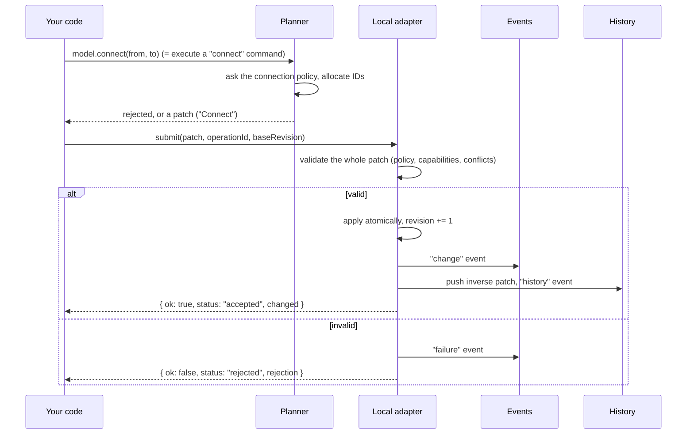
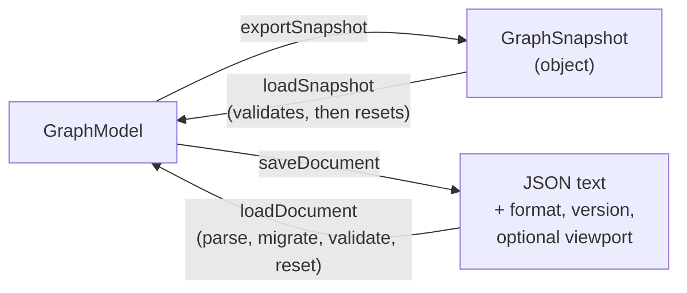

# Guide: using the model

A tutorial for application developers: create a graph, edit it, listen to changes, undo,
and save. Everything here uses only the public entry point, `@paceholder/nodeeditor-js`, and runs in
plain Node with no browser. For how the pieces fit together read
[architecture.md](architecture.md); for the internals behind them read
[guide-core-model.md](guide-core-model.md).

If you know QtNodes: `createGraphModel()` plays the role of your `AbstractGraphModel`
subclass plus `QUndoStack`, except that you do not subclass anything. You get a ready
in-memory model, and you edit it through commands that return `Result`-like objects instead
of calling virtual `setNodeData(...)` hooks.

All examples share these imports and one set of node types:

```ts
import {
  createGraphModel,
  createNodeTypeRegistry,
  createDefaultConnectionPolicy,
  exportSnapshot,
  extractFragment,
  fragmentToText,
  invertPatch,
  loadDocument,
  loadSnapshot,
  parseFragmentText,
  saveDocument,
  type ChangeEvent,
  type Patch,
} from "@paceholder/nodeeditor-js";
```

## 1. Creating a model

A node type registry says which kinds of node exist and which ports a new node of that
kind gets (the counterpart of `NodeDelegateModelRegistry`). Types only describe the
model: label, default size, initial ports. Looks (painters, geometry) are registered
separately, later, in the view.

```ts
const registry = createNodeTypeRegistry();
registry.register({
  type: "pump",
  label: "Pump",
  defaultSize: { width: 80, height: 40 },
  ports: () => [
    { direction: "input", typeKey: "hydraulic", label: "in" },
    { direction: "output", typeKey: "hydraulic", label: "out" },
  ],
});
registry.register({
  type: "sensor",
  label: "Sensor",
  defaultSize: { width: 40, height: 40 },
  ports: () => [{ direction: "input", typeKey: "signal", label: "in" }],
});

const model = createGraphModel({ registry });
```

Both options are optional. Without a registry the model starts with an empty one (you can
still `model.registry.register(...)` later). Without a `connectionPolicy` you get the
default policy, which you can also build yourself to change its switches:

```ts
const strict = createGraphModel({
  registry,
  connectionPolicy: createDefaultConnectionPolicy({ parallel: false, selfLoops: false }),
});
```

The default policy connects an output to an input (or undirected to undirected), requires
equal `typeKey`s, and respects each port's attachment limit (inputs take one connection
by default). See the doc comment on `createDefaultConnectionPolicy` for the full rule list.

The model has two sides. You **read** through `model.reader` (synchronous, always the
committed state) and you **write** through commands and `submit`.

## 2. Creating nodes and ports

```ts
const made = model.createNode("pump", { x: 0, y: 0 }, { title: "P1" });
model.createNode("pump", { x: 200, y: 0 });
model.createNode("sensor", { x: 400, y: 0 });

made.status;   // "accepted"
if (made.status === "accepted") {
  made.changed.nodes;   // ["n1"]
  made.changed.ports;   // ["p1", "p2"], created by the registry's `ports` factory
}

const [a, b, s] = model.reader.nodes();   // creation order
model.reader.portsOf(a.id);
// [{ id: "p1", node: "n1", direction: "input",  typeKey: "hydraulic", limit: 1,           label: "in" },
//  { id: "p2", node: "n1", direction: "output", typeKey: "hydraulic", limit: "unlimited", label: "out" }]
```

IDs (`n1`, `p1`, ...) are opaque strings minted by the model and never reused, even after
a delete or a save and reload. Ports are addressed by ID, never by index: unlike QtNodes'
`(node, PortIndex)`, inserting a port later does not renumber anything.

Every command method returns a `SubmitResult` (section 3). `createNode` with an unknown
type, for example, is rejected with code `unknown-type` rather than throwing.

## 3. Connecting, and what a rejection looks like

```ts
const [aIn, aOut] = a.ports;
const [bIn, bOut] = b.ports;
const [sIn] = s.ports;

const ok = model.connect({ node: a.id, port: aOut }, { node: b.id, port: bIn });
ok.status;   // "accepted"
```

Anything that can fail for an expected reason returns an object instead of throwing. A
connection the policy refuses comes back like this:

```ts
// A hydraulic output into a signal input
const bad = model.connect({ node: b.id, port: bOut }, { node: s.id, port: sIn });

bad.status;   // "rejected"
if (bad.status === "rejected") {
  bad.ok;               // false
  bad.rejection.code;       // "type-mismatch"
  bad.rejection.message;    // 'Port types differ: "hydraulic" and "signal"'
  bad.rejection.entities;   // ["p4", "p5"], the ports involved
}
```

Nothing changed in the model, and no history entry was made. Other codes you will meet
are `direction-mismatch` (for example, input to input), `capacity-exhausted`,
`self-loop`, and `duplicate-connection`. All `Rejection` values have the same
`{ code, message, entities }` shape.

Check `status`, not just `ok`: a result can also be `queued` or `pending` (no `ok` field
at all), which happens when you edit from inside an event handler or, later, with an
external adapter. With the local model outside a handler you always get `accepted` or
`rejected`.

To ask without editing, use `can` or `plan`. `can` answers "would this be allowed?" for a
greyed-out menu item; `plan` also tells you what would happen:

```ts
model.can({ kind: "connect", from: { node: b.id, port: bOut }, to: { node: s.id, port: sIn } });
// { available: false, rejection: { code: "type-mismatch", ... } }

const plan = model.plan({ kind: "deleteEntities", nodes: [a.id] });
if (plan.kind === "ready") {
  plan.label;                     // "Delete"
  plan.effects.removed.nodes;     // ["n1"]
  plan.effects.removed.connections;   // ["c1"]: deleting a node also removes its wires
}
```

The convenience methods (`connect`, `createNode`, ...) are shorthand for
`model.execute({ kind: "connect", ... })`; both give identical results.

`can` and `plan` run the same checks a commit runs, including validators you add later
with `model.addValidator(...)`. A validator receives the staged graph (as it would be after
the patch), the patch, and a context whose `before` is the committed graph the patch was
staged on.

### When the policy offers a choice

A connection policy can answer "several plans are valid" instead of accepting one, for
example two connection kinds for one port pair. Each alternative is a
`ConnectionAlternative`: the plan plus a stable `key` and an optional `label`. `connect`
then returns `choice-required` with the alternatives, and you name the one you want with
`choice`:

```ts
const r = model.connect(from, to);
if (r.status === "choice-required") {
  r.alternatives.map((a) => [a.key, a.label]);   // [["direct", "Direct link"], ["delayed", "Delayed link"]]
  model.execute({ kind: "connect", from, to, choice: "delayed" });   // one connection, one undo step
}
```

The command goes through the policy again with `choice` in the proposal, so the choice is
validated like any other connection; a key the policy does not know is rejected, and a
policy that answers `choice` again is rejected with `choice-required` rather than picked.
In the view a host chooser does this for the user (see guide-view.md).

A policy that returns `choice` (this is the **breaking** part for hand-written policies)
gives each alternative a key that is unique within the answer and the same on every
evaluation of the same proposal. Given `proposal.choice`, it accepts exactly that
alternative or rejects. And the accepted plan must record what tells it apart, usually
the connection kind: the commit validator re-checks the stored connection with
`{ from, to, kind }` and no `choice`, and must get `accept`:

```ts
const policy: ConnectionPolicy = {
  evaluate(proposal, graph) {
    const base = defaults.evaluate(proposal, graph);
    if (base.kind !== "accept" || !offersKinds(proposal, graph)) return base;
    const kind = proposal.choice ?? proposal.kind;   // a chosen key, or the stored kind
    if (kind === "direct" || kind === "delayed") {
      return { kind: "accept", plan: { ...base.plan, connectionKind: kind } };
    }
    return {
      kind: "choice",
      alternatives: [
        { ...base.plan, connectionKind: "direct", key: "direct", label: "Direct link" },
        { ...base.plan, connectionKind: "delayed", key: "delayed", label: "Delayed link" },
      ],
    };
  },
};
```

### When a host service has to approve a connection

Some rules live on a server: whether two ports may be joined can depend on state the
editor does not have. A host supplies one asynchronous validator, and the policy stays
synchronous:

```ts
const model = createGraphModel({
  connectionValidator: async ({ proposal, revision, signal }) => {
    const res = await fetch("/validate", { method: "POST", signal, body: JSON.stringify(proposal) });
    const answer = await res.json();
    return answer.ok
      ? { valid: true }
      : { valid: false, rejection: rejectionOf("capability-denied", answer.message, [proposal.to.port]) };
  },
  timeoutMs: 5000,   // there is no default: without it a silent server leaves the proposal pending
});
```

The validator is asked about the connection plan the base policy produced (the two ports and
the connection kind), once per plan: answers are kept in a cache the policy only **reads**,
which is `model.verdicts`. Evaluating a connection, asking `model.can(...)` (a toolbar does
that on every change) and undoing never call the validator. Until an answer is known the
policy says `pending`, and nothing is created:

```ts
const r = model.connect(from, to);       // no answer yet
r.status;                                // "unverified"
r.missing;                               // [{ from, to, kind }]: what the host would be asked
model.can({ kind: "connect", from, to });
// { available: false, rejection: { code: "pending-validation", message, entities } }

await model.verifyConnections(r.missing);   // asks for the missing answers, resolves when all settled
model.connect(from, to);                    // now accepted, or rejected with the validator's rejection
```

- **Who asks.** A request starts only from `verifyConnections` or from a connect gesture in a
  view (guide-view.md). Paste and duplicate of nodes with connections need an answer for each
  connection of the fragment too: they return `unverified` and list `missing`, and create
  nothing; verify, then repeat the command.
- **A commit uses up its answer.** Creating a connection changes its two ports, which makes
  the answer stale, so connecting the same pair again later (after a disconnect, say) needs
  verification again. Undo and redo are exempt: they restore connections that were accepted
  once, so a missing answer never refuses them; an answer that has since turned invalid
  still does.
- **Several connections in one command.** A command such as paste is checked connection by
  connection and stops at the first problem, so a fragment is reported `unverified` for its
  first connection that lacks an answer even when a later one would be refused outright. The
  refusal shows once the answers are in and the command is repeated.
- **Freshness.** An answer stays current while only other parts of the graph change. A change
  that touches one of its ports or their nodes makes it stale. A late answer for a stale
  request is dropped and asked for once more if the caller still wants it; a second time it
  is refused with `validator-stale`.
- **Failures.** A validator that throws, answers something that is not a verdict, or
  exceeds `timeoutMs` produces a rejection coded `validator-failed` or `validator-timeout`.
  A gesture keeps showing it while it runs; the next gesture asks again.
- **Rejections carry a code, a message and the affected IDs.** The code is one of the
  library's rejection codes; the message is free text for the host to show.
- **Choices.** An alternative the user picks from a policy `choice` is a connection nobody
  has judged yet. In a mounted view the pick asks for its answer and the connection is
  created when it settles (a refusal arrives as `connection-rejected`), so the chooser only
  answers. Code that connects programmatically uses `verifyConnections` as above.

`reset` (loading a document) aborts every request in flight and ignores answers that arrive
afterwards; `dispose` disposes the cache. A model created without `connectionValidator` has
no `verdicts` and behaves as before.

## 4. Moving, updating, deleting

```ts
model.moveNodes([
  { node: a.id, position: { x: 10, y: 10 } },
  { node: b.id, position: { x: 210, y: 10 } },
]);

model.updateNode(a.id, { title: "Main pump", payload: { rpm: 1500 } });
model.reader.getNode(a.id)?.title;   // "Main pump"

model.deleteEntities({ nodes: [b.id] });   // also removes the connection to it
model.reader.connections();                // []
```

`payload` is your own JSON-compatible data attached to a node; the library stores it and
never interprets it. There are also `rotateNodes`, `mirrorNodes`, `resizeNode`,
`reorderNodes`, `reconnect`, `disconnect` and `setPorts`; see `ConvenienceMethods`.

### Rotating and mirroring

```ts
model.rotateNodes([a.id], 1);               // a quarter turn clockwise on screen
model.mirrorNodes([a.id]);                  // axis "horizontal": left and right swap
model.mirrorNodes([a.id], "vertical");      // top and bottom swap
```

Each node turns or flips about its own centre, and each call is one patch and one history
entry. Both mirror axes are **screen** axes, whatever the node's rotation: a node stores
one `mirrored` flag and a quarter-turn `rotation`, so `mirrorNodes` toggles the flag and
sets the rotation that gives the requested screen flip (horizontal: `rotation` becomes
`-r`; vertical: `2 - r`, both mod 4). At `rotation` 0 or 2 a horizontal mirror only
toggles the flag; at 1 or 3 it also changes `rotation`. (Before this behaviour the
horizontal mirror flipped the node's own x axis, which is a vertical flip on screen for a
node at an odd quarter turn.) One undo restores both fields.

### Resizing

Resizing is **opt-in per node type**. Without an opinion anywhere, the `resize`
capability is denied, so a type declares it, and a record override can turn one instance
off again:

```ts
registry.register({
  type: "tank",
  label: "Tank",
  defaultSize: { width: 70, height: 110 },
  capabilities: { resize: true },
  sizeLimits: { min: { width: 40, height: 60 }, max: { width: 240, height: 360 } },
});

// One instance that must keep its size:
model.submit({
  ops: [{ op: "update", entity: "node", id: t.id,
          fields: { capabilities: { new: { resize: false } } } }],
});
```

Every other action (`move`, `rotate`, `mirror`, ...) stays allowed by default. A
`resizeNode` (or a local patch that changes `size`) on a node whose type did not opt in
is rejected with `capability-denied`, exactly like a locked node. External changes (an
external adapter, a host snapshot) are not checked: their authority already decided.

Every action of a patch is judged against the node as it was **before** the patch. One
operation that changes a locked node's type to an unlocked one and also moves it is still
refused, and so is a patch that clears an override in one operation and moves the node in
another. A lock that a patch adds does not judge that same patch; it applies from the next
edit on.

```ts
model.resizeNode(t.id, { width: 120, height: 80 });                  // about the centre
model.resizeNode(t.id, { width: 120, height: 80 }, { x: -1, y: -1 }); // top-left fixed
```

`fixed` names a point of the node's **local** body box, before rotation and mirroring:
`x` is `-1` (left edge), `0` (centre line) or `1` (right edge), `y` likewise for top and
bottom. The planner moves the centre so that point keeps its world position for any
rotation and mirroring, and emits one node update with `size` and, when it moved,
`position`. `anchoredPosition(record, size, fixed)` is the same arithmetic, exported for
hosts that want to preview a resize. An unchanged size plans nothing.

**Size limits.** A type's `sizeLimits` gives an optional `min` and `max` (full sizes);
each replaces the library default for its own bound only. The default minimum is
1 x 1 (a zero-width node can be neither seen nor picked; declare `min: { width: 0,
height: 0 }` to allow it) and the default maximum is unbounded. The registry rejects
negative or non-finite bounds (only `max` may be `Infinity`) and a minimum above the
maximum with `malformed-record`. A host hook refines the limits per node, for example
from the payload:

```ts
const model = createGraphModel({
  registry,
  // `fromType` holds the resolved type limits; return undefined to keep them.
  sizeLimits: (node, fromType) =>
    node.status === "fixed" ? { min: node.size, max: node.size } : undefined,
});
model.sizeLimits(t.id);   // { min, max }: default, then type, then hook
```

A hook result whose `min` exceeds its `max` is a host bug; the resolver widens `max` to
`min` instead of throwing during a gesture.

**Clamp in the gesture, reject at the API.** The view's resize handle clamps every
preview to the limits, so a drag never ends in a rejection. A `resizeNode` command
outside the limits is rejected with `out-of-range`, naming the node and the violated
bound; nothing is clamped silently, so the caller knows exactly what was stored. Read
`model.sizeLimits(id)` first to clamp yourself.

**Limits are not checked on patches, undo or load.** Only commands check them. A
document saved before a type tightened its limits still loads with its stored sizes, and
undo can always restore the previous size.

**Which capability a compound change needs.** An anchored resize moves the centre; that
position change is judged by `resize`, not `move`, as long as it is no larger (in the
node's local frame) than half the size change on each axis. So a node that may resize
but not move can still be resized from a corner. A larger position change also needs
`move`. Likewise the rotation change a screen-axis mirror implies is judged by `mirror`;
any other rotation change needs `rotate`. Raw patches and undo are judged the same way.

**Ports follow the size.** Anchors are computed from the body box, so a resize moves
them and incident connections follow. Image-symbol placements are fractions of the box,
so a port on an edge stays on that edge. Card ports in horizontal layout sit at a fixed
distance below the title (`titleHeight + rowPitch · (i + ½)`) and stack on the bottom
edge when the body is shorter than its rows; give card types a minimum height of
`titleHeight + rowPitch · rows`.

### Copy, paste and duplicate

A selection becomes a *fragment* with `extractFragment`; `paste` and `duplicate` are
ordinary commands, so `plan`, `can` and `execute` work on them and each is one patch and
one history entry.

```ts
const copied = extractFragment(model.reader, { nodes: [a.id, b.id] });
if (copied.ok) {
  const text = fragmentToText(copied.value.fragment);  // what a clipboard would hold
  copied.value.excluded;  // connections to unselected nodes: listed, not copied

  const parsed = parseFragmentText(text);              // untrusted text: validated
  if (parsed.ok) {
    model.execute({
      kind: "paste",
      fragment: parsed.value,
      placement: { kind: "center", at: { x: 400, y: 300 } },
    });
  }
}

// Extract and paste in one step, offset from the originals:
model.execute({
  kind: "duplicate",
  nodes: [a.id],
  placement: { kind: "offset", by: { x: 20, y: 20 } },
});
```

- **Placement.** `center` puts the bounding-box centre of the fragment's node bodies at
  `at`; `offset` adds `by` to every original position. Pasted nodes go on top of the
  paint order, keeping their relative order. (The view picks the placement: at the
  pointer, or a growing offset for repeated pastes.)
- **Fresh IDs.** Every node, port and connection gets a new ID and every internal
  endpoint is rewritten, so pasting twice gives two independent copies. Retired IDs are
  never reused.
- **What is copied.** Payloads, ports exactly as they are now (including ports changed by
  `setPorts`), titles, status, capability overrides (a copy of a locked node is locked),
  and every connection between two copied nodes, whether or not it was selected.
- **External connections.** A connection to a node outside the copy is excluded by
  default and reported in `plan.effects.excluded` as `{ connection, reason: "external" }`.
  Pass `external: "preserve"` to re-create each one from the copy to the same outside
  port; when that port is gone or the connection policy refuses, it is excluded with
  `endpoint-missing` or the policy's code instead.
- **Validation before anything changes.** The fragment is checked like a loaded file
  (shape, limits, codecs), every node type must be registered and creatable
  (`unknown-type` / `not-creatable` naming the types), and the patch is dry-run through
  the capability and connection-policy validators. Any refusal rejects the whole paste.
  A fragment without nodes is `empty-fragment`.
- **Why paste refuses unregistered types although load keeps them.** Load must not lose
  data, so it keeps such nodes as placeholders. A paste creates new nodes; a placeholder
  the host cannot edit is not a useful thing to create, so paste reports the missing type
  instead.
- **Codecs and limits.** `createGraphModel({ payloadCodecs, fragmentLimits })` sets the
  codecs and limits the planners use; pass the same codecs to `extractFragment` and
  `parseFragmentText` (`model.payloadCodecs` holds them).
- **Cut** is a copy followed by `deleteEntities`: one history entry, and one undo brings
  the originals back with their original IDs. Check `can({ kind: "deleteEntities", ... })`
  first, so a protected node rejects the cut before anything is copied.

A model assembled without the fragment planners (only `createGraphModel` supplies them)
rejects both commands with `unsupported-command`. The clipboard text format is described
in [format.md](format.md#9-clipboard-envelope).

## 5. Subscribing to events

```ts
model.on("change", (e: ChangeEvent) => {
  // e.revision, e.origin, e.operationId, e.changed (IDs touched), e.patch
});

model.on("failure", (f) => {
  if (f.source === "rejection") console.warn(f.rejection.code, f.rejection.message);
});

model.on("history", (h) => {
  // h.canUndo, h.canRedo, h.undoLabel, ...  (drive your Undo/Redo buttons)
});

model.on("reset", (e) => {
  // The whole document was replaced (a load). Discard derived state and re-read.
});
```

`on` returns an unsubscribe function. Events are delivered in commit order, once per
accepted patch, after the graph is consistent again; a handler never sees a connection
pointing at a deleted node. `origin` is `"local"`, `"undo"`, `"redo"`, or `"external"`.

An edit made from inside a handler is queued and comes back as `{ status: "queued",
operationId, settled }`. Queued edits run one after the other once the current dispatch is
done, and each one's events reach every handler before the next queued edit is applied.
Commands issued one after another from the same handler get distinct IDs, as if the first
had already committed. `model.replaceDocument` (and so `loadSnapshot`) cannot run inside a
handler: it throws `MisuseError`, because it returns the new revision at once; defer it
with `queueMicrotask` if you need to load in response to an event.

A rejected command emits a `failure` event with `source: "rejection"`, so one central
handler can show every error instead of each call site checking its result. (A
`source: "handler"` failure means one of your own handlers threw; the model keeps going.)

Selection, hover and viewport events do not exist here: those belong to the view.

## 6. Undo and redo

```ts
model.historyState();
// { canUndo: true, canRedo: false, undoLabel: "Edit node", redoReason: "Nothing to redo" }

model.undo();
model.reader.getNode(a.id)?.title;   // "P1"
model.redo();
model.reader.getNode(a.id)?.title;   // "Main pump"
```

**One command is one patch is one history entry.** Moving two nodes in one `moveNodes`
call, or deleting a node together with its wires, is a single undo step, and the history
label says what it was (`"Move"`, `"Delete"`, `"Connect"`). A drag in the future view
behaves the same way: the intermediate positions are only a preview, and release submits
one `moveNodes`. Rejected commands, loads, and `history: "skip"` submissions leave no
entry.

Unlike `QUndoCommand`, there are no command objects with `redo()`/`undo()` methods. Undo
applies the inverse patch (section 8), and redo reapplies the original.

Undo and redo go through the same checks as any edit, capabilities included. When one is
rejected (a `history: "skip"` edit changed the node since, or the inverse is refused by a
lock the entry itself set), that entry can never apply again, and neither can the entries
recorded under it. So the model drops that stack, publishes a `history` event, and
`historyState().undoReason` (or `redoReason`) says why, for example `"Undo is no longer
possible: Node n1 field position differs from the expected old value"`. The other stack
is kept.

The history keeps every entry unless you set a limit: `createGraphModel({ historyLimit:
200 })` keeps the 200 most recent undo steps and drops the oldest.



## 7. Saving and loading

Two levels are offered, and they differ in what they include:

| | `exportSnapshot` / `loadSnapshot` | `saveDocument` / `loadDocument` |
| --- | --- | --- |
| Data | A plain object (`GraphSnapshot`) | A JSON **string** with an envelope |
| Contains | nodes, ports, connections, ID cursor | the snapshot, plus optional viewport and selection you pass in |
| Versioning | `format` and `version` fields | `format`, `version`, and host-supplied migrations |
| Payload codecs | on load (option) | on both sides (option) |
| Use it for | sending graph data to a server, tests, diffing | files, local storage, import/export |

```ts
// Document: a string you can write to a file or localStorage.
const saved = saveDocument(model, { indent: 2 });
if (!saved.ok) throw new Error(saved.rejection[0]?.message);

const fresh = createGraphModel({ registry });
const loaded = loadDocument(fresh, saved.value);
if (loaded.ok) {
  loaded.value.revision;      // 1
  loaded.value.diagnostics;   // [], or "unresolved-type" entries for unregistered types
}
```

```ts
// Snapshot: just the graph, as a plain object.
const snapshot = exportSnapshot(model);
snapshot.format;   // "@paceholder/nodeeditor-js/graph"
snapshot.version;  // 1
loadSnapshot(fresh, snapshot);
```

Points to know:

- Both return `Result`s. Invalid input (wrong format, unsupported version, bad shape)
  returns `{ ok: false, rejection: [...] }` with codes such as `unsupported-format`, and the
  model is left untouched.
- **Loading is a reset, not an edit.** It replaces the whole document, clears undo
  history, and emits one `reset` event. You cannot undo a load.
- The ID counter is saved too, so after a reload new nodes continue where the old
  document left off and a deleted ID stays retired.
- Nodes whose type is not in the registry still load unchanged; they appear as
  `diagnostics`, not errors, so a file made with a plugin you lack is not lost.
- Previews, hover and caches are never saved. Viewport and selection are saved only if
  you pass them via `SaveOptions`.
- Payloads must be JSON-compatible, or have a codec registered (`createPayloadCodecRegistry`).
- Validation never throws for bad input, including a host migration or codec that throws.
  It reports at most 100 errors (`limits.maxErrors`) and then one more `limit-exceeded`
  entry saying how many were left out.
- Positions, sizes and route coordinates must lie in the supported world range (plus or
  minus 1e7); a file outside it fails to load with `out-of-range`.



## 8. The patch underneath

Every command above ends as a patch: plain data listing `add`, `remove` and `update`
operations. Updates carry the old and new value of each field. You can submit one
yourself, which is how a server mirror or a script would drive the model:

```ts
const patch: Patch = {
  ops: [
    {
      op: "update",
      entity: "node",
      id: a.id,
      fields: { position: { old: { x: 10, y: 10 }, new: { x: 50, y: 50 } } },
    },
  ],
};

const r = model.submit(patch, { label: "Nudge" });
r.status;   // "accepted"
model.reader.getNode(a.id)?.position;   // { x: 50, y: 50 }

// The old value no longer matches, so a second submit is a conflict, not an overwrite:
const again = model.submit(patch);
again.status;   // "rejected"
if (again.status === "rejected") again.rejection.code;   // "conflict"

// The inverse swaps old and new (and reverses op order). Undo is exactly this.
model.submit(invertPatch(patch), { history: "skip" });
model.reader.getNode(a.id)?.position;   // { x: 10, y: 10 }
```

`invertPatch` needs adds that carry their `seq`, which is true of patches taken from
`change` events (`e.patch`) but not of ones you write by hand with `add` operations; it
throws `MisuseError` for those. Hand-written `add` is rarely what you want anyway: use
`createNode` so IDs and ports come from the registry.

`submit` takes the same validation path as commands (policy, capabilities, conflicts),
so a hand-built patch cannot corrupt the model.

A revision is a plain integer: `model.revision()`, `model.reader.revision()`, the
`revision` of an accepted result and of every `change` or `reset` event are the same
number, 0 for a fresh model and one more per committed change or load. `submit` options
can name the revision the patch was planned against and the operation ID to tag it with:

```ts
import { operationId } from "@paceholder/nodeeditor-js";

const base = model.revision();      // read when the patch was planned
// ... a confirmation dialog later ...
const r2 = model.submit(patch, { baseRevision: base, operationId: operationId("save-1") });
// rejected with "stale-revision" if anything was committed since `base`, else accepted;
// r2.operationId and the change event's operationId are "save-1"
```

Without `baseRevision` the current revision is used, so the check never gets in the way.
An edit submitted from inside an event handler is checked when it is submitted, not
when the queued edit runs, so several edits from one handler do not refuse each other.
`operationId(text)` accepts the same IDs as `nodeId` (non-empty, no whitespace) and
throws `MisuseError` otherwise. This is the same patch format a future
external adapter will send to and receive from a server.

## Where next

- [architecture.md](architecture.md): the pending layer, adapters, and the view.
- [guide-core-model.md](guide-core-model.md): the store, records, and IDs underneath.
- `src/core/uc-19-headless.test.ts`: a compact end-to-end example.
