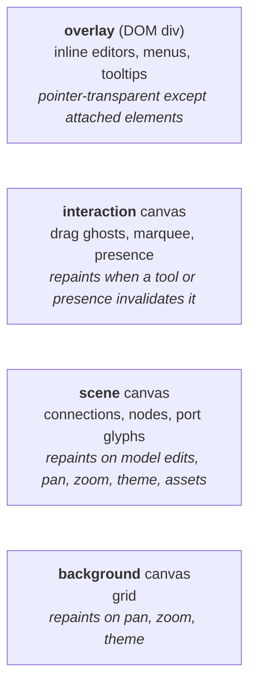
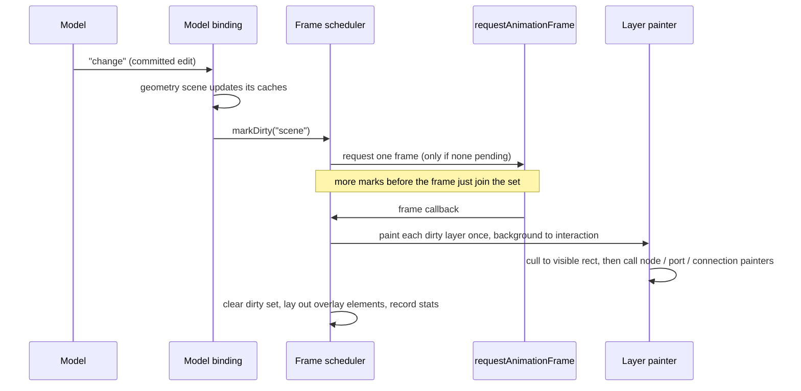
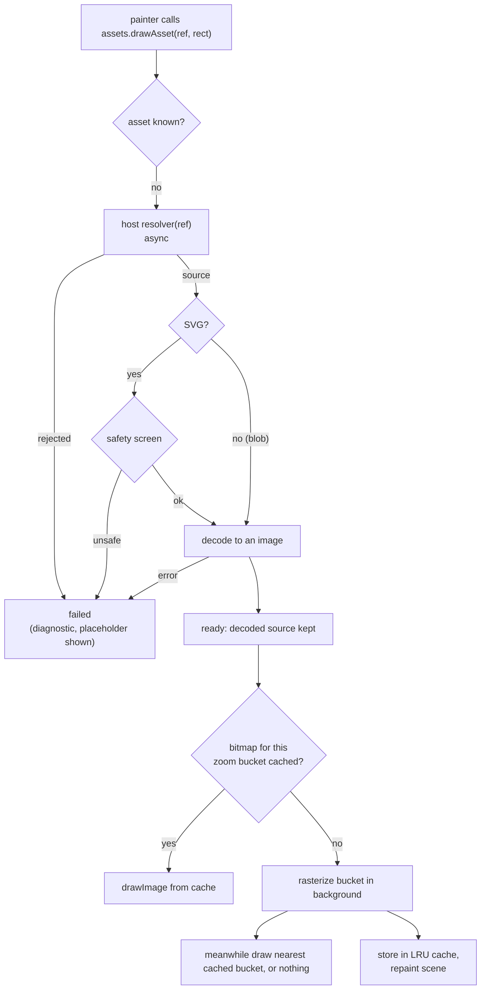
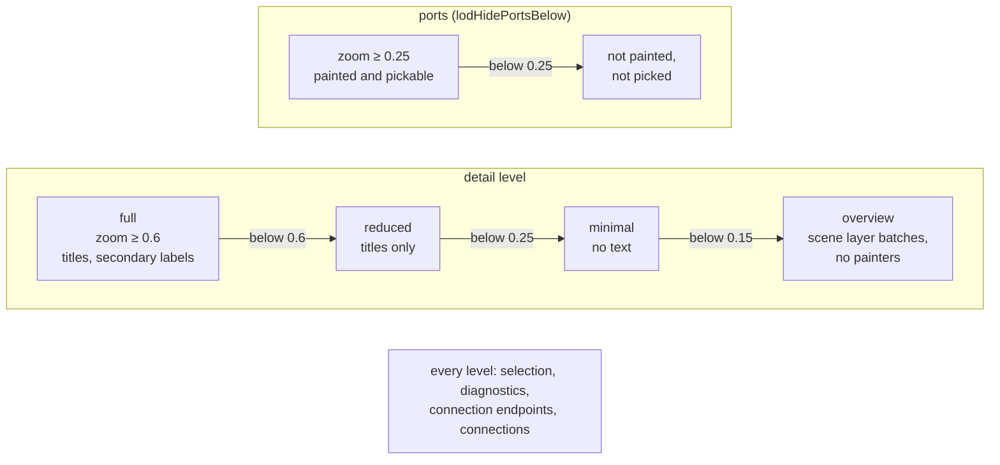

# Guide: rendering a model in the browser

A tutorial for application developers: show a graph model on screen, give node types a
look, load symbol pictures, theme the result, and read back what is under the pointer.
Everything here uses two entry points: `nodeeditor-js` for the model, geometry and other
core names, and `nodeeditor-js/view` for the browser view. Each name has exactly one
import path (PKG-01). The building blocks the view is assembled from (frame scheduler,
DOM input, tool router, layer painters, fallback painters) are in
`nodeeditor-js/view/advanced`; mounting and customizing an editor never needs them. For the model side read [guide-using-the-model.md](guide-using-the-model.md);
for how the layers fit together read [architecture.md](architecture.md); for the
coordinate spaces and picking rules read [geometry.md](geometry.md).

If you know QtNodes: `mountView()` plays the role of `QGraphicsView` plus the scene
setup around it, but the "scene" is not a list of `QGraphicsItem`s. It is a derived
projection of the model that the view builds and owns. A node painter is the counterpart
of `QGraphicsItem::paint()` (or QtNodes' `AbstractNodePainter`), and a node geometry is the
counterpart of `boundingRect()`/`shape()`. Interaction tools (selection, drag, connect,
shortcuts) are not part of this guide: see [interaction.md](interaction.md). This guide
covers the correct, fast, themeable *display*, panning, zooming and picking.

## 1. Mounting a view

```ts
import { createGraphModel } from "nodeeditor-js";
import { mountView } from "nodeeditor-js/view";

const model = createGraphModel();
const container = document.getElementById("editor");
if (!container) throw new Error("#editor is missing");

const view = mountView(container, {
  model,
  initialViewport: { zoom: 1, panX: 130, panY: 90 },
});
```

`mountView(container, options)` fills `container` with its own DOM and returns a
`ViewHandle`. Give the container a size (a block with a height, or a flex child); a
zero-size container is legal, it simply paints nothing until it has bounds.

All options are optional:

| Option            | Meaning |
| ----------------- | ------- |
| `model`           | Anything with the graph reader plus `change`/`reset` events (a `GraphModel` fits). Without it the scene stays empty. |
| `geometry`        | A `GeometryRegistry` (outline, hit shape, port anchors per node type). A fresh one is created if omitted. |
| `painters`        | A `PainterRegistries` set (node, port glyph, connection, background painters). A fresh one with fallbacks is created if omitted. |
| `theme`           | A theme patch applied over `DEFAULT_THEME` (section 6). |
| `assets`          | `{ resolve, budgetBytes?, maxSvgChars? }`: the host's asset resolver and cache budget (section 5). |
| `zOrder`          | Paint order of `"connection"`, `"node"`, `"port"`, bottom to top. Default: connections, nodes, ports. |
| `viewState`       | `{ isSelected(id), isHovered(id) }` merged with the view's own selection and hover. Default: nothing extra. |
| `input`           | Tools, keymap and platform, or `false` for none (see [interaction.md](interaction.md)). Default: the built-in tools and keymap. |
| `initialViewport` | `{ zoom, panX, panY }`. |
| `gestureBitmap`   | `{ minVisible?, settleMs?, maxZoomRatio?, maxUncovered? }`: reuse the last scene frame as a picture while panning or zooming a large visible set (section 7). Off when absent. |
| `frameClock`      | Test seam replacing `requestAnimationFrame`. |

Nothing touches the browser at import time, so you can import this module while
server-rendering; the DOM work starts inside `mountView()`.

The view never copies the graph. It subscribes to the model's *committed* changes, so
undo, redo, reloads and edits from any source repaint it with no extra code. Several views
may show one model; each owns its own viewport, theme and caches.

### Disposing

```ts
view.dispose(); // idempotent
```

`dispose()` removes every observer, event listener, pending frame request, model
subscription, cached bitmap and DOM node the view created. Call it when the host component
unmounts (the demo does it in its hot-reload hook). `view.disposed` tells you whether it
already happened. This is the web equivalent of destroying the `QGraphicsView` and its
scene: there is no garbage collector for a pending animation frame or a `ResizeObserver`,
so leaks are explicit.

## 2. Why Canvas2D, and why three canvases

You have two broad ways to draw a node editor in a browser:

- **DOM or SVG elements, one per node and wire.** Convenient: the browser does hit testing,
  styling and text layout, and it is the best fit for editable widgets. The cost is that
  every element is a retained object the browser must style, lay out and composite. Thousands
  of nodes with several ports and wires each means tens of thousands of elements, and a pan
  or zoom touches all of them. In Qt terms: it is as if every `QGraphicsItem` were a full
  `QWidget` with its own style sheet.
- **Canvas2D, immediate mode.** A `<canvas>` is a bitmap you paint into with a `QPainter`-like
  API (`ctx.fillRect`, `ctx.stroke`, `ctx.drawImage`, `ctx.setTransform`). There are no
  per-item objects, so cost scales with what you actually draw, and we only draw what is
  visible. The price: the browser knows nothing about your items, so hit testing, text
  editing and accessibility are your job. We answer those with the headless geometry
  scene (picking) and a DOM overlay (editors, menus).

This library uses Canvas2D for the graph and plain DOM only for the few elements that need
it.



Why split into layers? A Qt analogy is `QGraphicsView::setBackgroundBrush`/`drawForeground`
plus item caching: the expensive part must not be redrawn when only a cheap part changes.
Dragging a connection preview or a marquee repaints the interaction canvas, not the
thousands of nodes underneath. The stack is a `position: relative` root `div` with three
absolutely positioned canvases and the overlay `div`; you reach them as `view.element`,
`view.canvases` and `view.overlayElement` if you need to attach listeners.

### Redrawn only when dirty, once per frame, never when idle

A browser paints on a display refresh (usually 60 times a second) and offers
`requestAnimationFrame(cb)` to run code just before the next paint. The view uses it like
this:

1. Something changes (a model edit, a pan, a theme patch) and marks one or more layers
   *dirty*.
2. The first dirty mark requests one animation frame. Further marks before that frame only
   add to the dirty set.
3. In the frame, each dirty layer is painted once, in the order background, scene,
   interaction, and the set is cleared.
4. If nothing is dirty, no frame is requested. There is no render loop, so an idle editor
   uses no CPU.

Fifty model changes in one tick therefore cost one scene repaint. This is like
`QWidget::update()` coalescing into one paint event, except that here the layers are
separate.



What dirties what:

| Event                                   | Dirty layers |
| --------------------------------------- | ------------ |
| Committed model change, `reset`, geometry registration change | scene |
| Pan, zoom (`viewport.set/panBy/zoomAt`) | background, scene (interaction too while presence or a resize handle is shown) |
| `setTheme`                              | background, scene |
| Painter registry change                 | scene (background slot: background) |
| Asset became ready or failed            | scene |
| Container resized or pixel ratio changed | all three |
| `interaction.add/invalidate`, `setPresence` | interaction |
| Selection change; a committed change while a resize handle may show | interaction (the handle) |
| Auto-pan frame during a drag | background, scene (the pan), interaction (the preview) |

You can force a repaint with `view.invalidate("scene")` (any of `"background"`, `"scene"`,
`"interaction"`).

### Pixel ratio and Retina backing stores

A canvas has two sizes: the CSS size on the page and the *backing store*, the actual grid
of pixels. On a Retina/HiDPI display the device pixel ratio (DPR) is 2 or more: one CSS pixel
is a 2x2 block of physical pixels. If the backing store were only CSS-sized, the browser
would stretch it and everything would look blurry. The view therefore sizes every canvas to
`cssSize x dpr` and applies a device matrix, so you draw in CSS-pixel and world units while
the lines stay crisp. The DPR is watched: dragging the window to another monitor, or
browser zoom, resizes the backing stores and repaints. `view.metrics()` returns the current
`{ width, height, dpr }` if you want to check.

## 3. Geometry and painters are separate registrations

Following the QtNodes split between geometry and painter, a node type needs two independent
registrations. Neither requires the other to change.

```ts
import {
  createCardGeometry,
  createGeometryRegistry,
  createImageSymbolGeometry,
} from "nodeeditor-js";
import {
  createCardPainter,
  createConnectionPainter,
  createImageSymbolPainter,
  createPainterRegistries,
  createPortGlyphPainter,
} from "nodeeditor-js/view";

const geometry = createGeometryRegistry();
geometry.register("pump", createImageSymbolGeometry({ paintedMargin: 22 }));
geometry.register("controller", createCardGeometry());

const painters = createPainterRegistries();
painters.nodes.register("pump", createImageSymbolPainter());
painters.nodes.register("controller", createCardPainter());
painters.portGlyphs.replace("pipe", createPortGlyphPainter());
painters.connections.replace("default", createConnectionPainter({ arrowhead: true }));

const view = mountView(container, { model, geometry, painters });
```

- **Geometry** (core, headless) answers body bounds, hit shape, painted bounds and port
  anchors in node-local space. Picking and culling use it, so they work without a browser.
- **Painters** (view) only draw. There are four slots: `nodes` keyed by node type,
  `portGlyphs` keyed by the port's `typeKey`, `connections` keyed by connection `kind`, and a
  single `background` slot (default: the grid, `paintGrid` from `nodeeditor-js/view/advanced`).
- The default grid keeps a steady on-screen density. When zooming out brings its lines
  closer than 8 CSS px, it steps up by `gridMajorEvery` (with the defaults: 20, then 100,
  then 500 world units …), and the finer lines of each level fade in as they open up.
  QtNodes draws fixed 15 and 150 scene-unit grids and gets away with it because its
  default zoom range stops at 0.3; here the zoom goes far lower for large graphs, so the
  grid has to adapt.
- Lookups never fail. An unregistered node type gets the placeholder painter, an
  unregistered port type a round dot, an unregistered connection kind a plain stroked path.
- `register(key, painter)` returns a `Result` and rejects `duplicate-type`; `replace`
  overwrites. Changing a registration after mount repaints automatically (`view.painters`
  and `view.geometry` are the same objects you passed in).

Painters are *pure*: they write pixels and nothing else, keep no state between calls and
never write to the model. Any cache (such as text measurement) belongs to the painter
instance, not to a module.

### Routes: how a connection's path is shaped

The path itself comes from a third registration, separate from geometry and painters: a
**route registry** keyed by connection kind (core, so the headless scene uses it too).
Without one, every connection is a cubic Bezier as before.

```ts
import {
  createOrthogonalRouter,
  createRouteRegistry,
} from "nodeeditor-js";

const routes = createRouteRegistry(); // unregistered kinds: Bezier
routes.register("signal", createOrthogonalRouter({ cornerRadius: 6 }));
routes.register("bus", createOrthogonalRouter({ clearance: 40 }));

const view = mountView(container, { model, geometry, painters, routes });
```

- `createOrthogonalRouter({ clearance, cornerRadius })` draws horizontal and vertical
  segments with the fewest bends. `clearance` (default 20 world units) is how far a wire
  leaves and enters each port along its facing direction before turning; ports facing
  each other closer than twice that meet halfway. `cornerRadius` (default 0, sharp)
  rounds the corners; a radius too large for a short segment is reduced to fit. The
  rounded path is the one that is picked and culled, not only the one that is drawn.
- `createStraightRouter()` and `createBezierRouter()` are the other built-ins. A host
  that wants every unregistered kind orthogonal passes
  `createRouteRegistry({ default: createOrthogonalRouter() })`.
- `view.routes` is the registry (the one you passed, or a fresh one). Switching a kind
  live recomputes only that kind's paths and repaints the scene layer; it is not an
  edit, so nothing goes into the undo history:

  ```ts
  checkbox.addEventListener("change", () => {
    view.routes.replace(
      "default",
      checkbox.checked ? createOrthogonalRouter() : createBezierRouter(),
    );
  });
  ```

- Drag previews follow the same routes: a moved or resized node's wires keep their
  kind's shape on every frame. The provisional wire of a connection drag uses
  `routes.defaultRouter`, because the kind is decided only when the connection is
  committed (sometimes by a chooser); set the default to orthogonal if all your wires
  are.
- An orthogonal wire keeps clear of its own two nodes (around them, or between them when
  they are far enough apart) but not of other nodes yet. Each path carries an outcome,
  passed to connection painters as `route` in `ConnectionPaintInput`:
  `{ status: "complete" | "provisional" | "unroutable", clearOf: "nothing" |
  "endpoint-nodes" }`. When no shape avoids both endpoint nodes (for example when they
  overlap) the best one is drawn anyway with status `unroutable`; the library draws no
  mark for it, so a custom painter can, for instance with a dash:

  ```ts
  painters.connections.replace("signal", {
    paint(ctx, input) {
      if (input.route.status === "unroutable") ctx.setLineDash([2, 2]);
      base.paint(ctx, input); // e.g. createConnectionPainter()
    },
  });
  ```

The connection painter needs no change for orthogonal wires: `tracePath` draws a
polyline with `lineTo` and `arcTo`, endpoint dots sit on the ports, the arrowhead points
along the last segment and a dash runs continuously around the corners.

### Route editors: shaping a wire segment by segment

Pointer mechanics for reshaping a wire are a fourth registration, per connection kind
and independent of the router and the path painter. A **route editor** says which
handles a connection offers, how a press finds one, which constraints a drag produces
and what a double-click does. The library supplies one for orthogonal wires:

```ts
import {
  createOrthogonalSegmentEditor,
  createRouteEditorRegistry,
  mountView,
} from "nodeeditor-js/view";

const routes = createRouteRegistry();
routes.register("signal", createOrthogonalRouter({ cornerRadius: 6 }));
const routeEditors = createRouteEditorRegistry();
routeEditors.register("signal", createOrthogonalSegmentEditor());

mountView(container, { model, routes, routeEditors });
```

- Select an orthogonal wire: a small square grip appears on **every** segment, the first
  and the last included. A grip is filled when the segment is pinned and outlined when it
  is free. Hovering a segment shows the resize cursor.
- Drag a segment perpendicular to its direction. The wire is re-routed live (the preview
  lives on the interaction layer, like move previews); on release one history entry
  "Edit route" stores a **pinned segment** at the new coordinate. Earlier pins are kept.
  Escape cancels. A press on a handle never moves nodes or changes the selection. The
  short stub at each port stays fixed: dragging the first or last segment (or the only
  segment of a straight wire) makes the router add a step after the stub.
- A **diamond** next to a square (16 CSS px along the segment toward its later end) shows
  on segments at least 48 CSS px long on screen (`splitMinPx` in the editor options).
  Dragging it breaks the segment at the diamond into a step: the part before stays, a
  new perpendicular segment appears, the part after follows the pointer. One entry adds
  two bends; repeated breaks can build any orthogonal path between the two stubs. The
  diamond shows the move cursor.
- On release the editor drops every pin whose removal leaves the routed path unchanged,
  so dragging a step back into line removes its bends, and a drag that ends where it
  started stores nothing and adds no history entry. The editor learns about routing
  through the `reroute` callback of its context, not through the route registry.
- The orthogonal router then runs the wire through its pins in order and only adapts the
  free segments. A pin keeps its coordinate when a node moves; if that puts it behind a
  port, the wire gains bends to reach the port from its facing direction.
- Double-click a pinned segment to free it (one history entry, other pins stay). The
  second press must come within `toolOptions.doubleClickMs` (default 500) and the drag
  threshold of the first. Double-clicking a free segment does nothing.
- `route.reset` (no default key; "Reset route" in the plain demo's context menu) removes
  every pin from the selected wires in one entry. It is unavailable when none of them has
  a pin.
- Pins follow the wire: copy, paste and duplicate shift them by the placement offset,
  and a move that carries both end nodes shifts them too (one end alone leaves them).
- A kind without a registered editor behaves as before: a press selects, a drag does
  nothing. A host can register its own editor for a kind (`routeEditors.replace`) and its
  router and painter stay untouched. `RouteEditor` is `handles`, `hit`, `drag`,
  `activate` and `cursor` (handles carry a `role`, `move` or `split`; `handles` and `hit`
  get the zoom, `drag` also gets `reroute`); constraints are `{ kind: "segment", orientation, at }` in
  world coordinates, ordered from the `from` end.
- Limits: there are no waypoints, no snapping of segments, and Bezier or straight kinds have no
  editor. Pinned routes ignore the bodies of unrelated nodes, like automatic routing.

### The image-symbol preset

An image-symbol node is a picture (SVG or raster) with ports placed anywhere on it. This is
the primary preset, meant for physical-system schematics. Three pieces cooperate:

1. The node type declares its ports with a `placement`: fractions of the body box, `0..1`,
   in the *unrotated* frame. `{ x: 0, y: 0.5 }` is the middle of the left edge,
   `{ x: 1, y: 0.8 }` is on the right edge near the bottom.
2. The geometry (`createImageSymbolGeometry`) turns placements into anchors, with an
   outward normal pointing away from the nearest edge unless the placement gives one.
3. The painter (`createImageSymbolPainter`) draws the picture to fill the node's body box.

```ts
model.registry.register({
  type: "tank",
  label: "Tank",
  defaultSize: { width: 70, height: 110 },
  ports: () => [
    { direction: "input", typeKey: "pipe", placement: { x: 0, y: 0.25 } },
    { direction: "output", typeKey: "pipe", placement: { x: 1, y: 0.8 } },
  ],
});
model.createNode("tank", { x: 130, y: 250 }, {
  title: "Feed tank",
  payload: { asset: "tank-symbol" },
});
```

The painter finds the picture through the node's payload field `asset` by default; pass
`createImageSymbolPainter({ assetOf: (node) => ... })` to read it elsewhere. The value is an
opaque reference your asset resolver understands (section 5), never a URL the library
fetches itself.

**Rotation and mirroring.** The node's `rotation` (quarter turns) and `mirrored` flag are
model fields set by `model.rotateNodes([id], 1)` and `model.mirrorNodes([id])`. Painting,
anchors and picking all use *one* transform (mirror, then rotate, then translate), and the
painter draws in node-local space under that transform, so the picture and its ports can
never disagree. The title is the exception by design: it is drawn upright below the node's
on-screen extent whatever the rotation. Reserve room for it with `paintedMargin`, which
extends the painted bounds (used for culling) without changing the hit shape.

If the picture is still loading, the painter draws nothing for it. If it failed, a
placeholder with a "missing image" label is drawn over the real bounds, so the node keeps
its ports and connections.

### The card preset

A card is a rounded body with a title bar and port rows below it (or ports along the top and
bottom edges when vertical): the conventional QtNodes look. `createCardGeometry()` and
`createCardPainter()` ship as a pair; the painter reads an optional secondary label from the
payload field `subtitle` (override with `secondaryOf`), fits text with a cached measurer, and
hides the secondary label at reduced detail. Keep the bar heights in agreement: the painter's
`titleHeight` option and the geometry's `titleHeight` both default to 28.

### Placeholders

`placeholderNodePainter` (a hatched, dashed box with a "?" and the title or type name) is the
fallback for node types without a painter, so a document that contains a type your app does
not know still opens and stays editable (NOD-07). `drawPlaceholder(...)` is exported for
painters that want the same look for their own error state. `boxNodePainter` is a plain
rounded box with a centered title, handy while prototyping. All three come from
`nodeeditor-js/view/advanced`.

### Writing a custom node painter

A `NodePainter` is an object with one method. The context transform is already set to
*node-local* space (origin at the body center, one unit per world unit), and the context is
saved and restored around the call, so you do not need to undo your changes. This is
`QGraphicsItem::paint()` with the painter already translated, rotated and clipped.

```ts
import type { Payload } from "nodeeditor-js";
import type { NodePainter } from "nodeeditor-js/view";

// The payload is host data (JSON); read the one field this painter understands.
function levelOf(payload: Payload): number {
  if (typeof payload !== "object" || payload === null || Array.isArray(payload)) return 0;
  const v = (payload as { readonly [k: string]: Payload }).level;
  return typeof v === "number" ? Math.min(1, Math.max(0, v)) : 0;
}

// A tank body with a level bar.
const levelTankPainter: NodePainter = {
  paint(ctx, { node, bounds, style, detail, unit }) {
    ctx.beginPath();
    ctx.roundRect(bounds.x, bounds.y, bounds.w, bounds.h, style.nodeRadius);
    ctx.fillStyle = style.nodeFill;
    ctx.fill();

    const h = bounds.h * levelOf(node.payload);
    ctx.fillStyle = style.connectionColor;
    ctx.fillRect(bounds.x, bounds.y + bounds.h - h, bounds.w, h);

    // nodeLineWidth is in CSS pixels when theme.screenSpaceLines is on: multiply by unit.
    ctx.lineWidth = style.nodeLineWidth * unit;
    ctx.strokeStyle = style.nodeStroke;
    ctx.stroke();

    if (detail.title && node.title) {
      ctx.fillStyle = style.textColor;
      ctx.font = style.font;
      ctx.textAlign = "center";
      ctx.textBaseline = "middle";
      ctx.fillText(node.title, 0, 0);
    }
  },
};

painters.nodes.replace("tank", levelTankPainter);
```

The input object (`NodePaintInput`) carries:

| Field      | Meaning |
| ---------- | ------- |
| `node`     | The `NodeRecord` (type, title, payload, status, ...). Read-only. |
| `bounds`   | Body box in node-local space. |
| `style`    | `ResolvedStyle`: theme tokens after type and entity overrides (section 6). |
| `detail`   | `DetailPolicy`: whether to draw the title and secondary labels (section 7). |
| `unit`     | Local units per CSS pixel when line widths are screen-space, else 1. Multiply pixel-sized strokes by it. |
| `assets`   | `AssetDrawer`; `assets.drawAsset(ref, rect)` returns `"drawn"`, `"pending"` or `"failed"`. |
| `state`    | `{ selected, hovered, diagnostics }` from the view state and the node's `status`. |

Port glyph painters run in *world* space and receive `port`, `position`, an outward unit
`normal`, `style`, `detail` and `unit`. Unlike node and connection painters they are **not**
wrapped in their own `save`/`restore`: a canvas `save`/`restore` pair copies and restores
the whole drawing state (transform, clip, colors, line style, font, shadow, ...), and with
tens of thousands of ports on screen that copy was a measurable part of the frame. The
scene layer sets `fillStyle` (the port fill), `strokeStyle` (the port stroke) and
`lineWidth` (`unit`) before every glyph and restores once after all ports. A glyph painter
may change those three freely; if it changes anything else (the transform, a clip, line
dash, global alpha, a shadow), it must restore that itself before returning, or wrap its
own body in `ctx.save()`/`ctx.restore()`. Connection painters also run in world space and
receive the `connection`, its `path` (`PathGeometry`), `style`, `detail`, `unit` and
`selected`. Selection outlines and error/warning badges are drawn by the scene layer *after*
your painter, so no painter or detail level can hide them.

Painters should not load images or fetch anything themselves. Ask the `assets` drawer.

## 4. The coordinate chain, in one paragraph

Per painted node the scene layer sets one matrix, `device . viewport . node`, then calls
your painter. So inside a node painter you work in node-local units; inside port and
connection painters in world units; in the background painter in CSS pixels
(`frame.viewportToDevice`). The same chain feeds picking and anchors, which is why a
rotated symbol cannot have a port drawn in one place and clickable in another. The
spaces are described in [geometry.md](geometry.md).

## 5. Assets: pictures without the library fetching anything

Painters refer to pictures by an opaque *reference* string (for example `"pump-symbol"`).
The host decides what it means by supplying a resolver. The library never fetches a URL
on its own, so it cannot be turned into a request proxy, and hosts keep full control over
authentication, caching and storage.

```ts
const view = mountView(container, {
  model,
  assets: { resolve: resolveAsset },
});

async function resolveAsset(ref: string) {
  const url = ASSET_URLS[ref];
  if (!url) throw new Error(`unknown asset ${ref}`);
  const res = await fetch(url);
  if (!res.ok) throw new Error(`asset ${ref}: HTTP ${res.status}`);
  return { kind: "svg", text: await res.text() } as const;
}
```

The resolver returns an `AssetSource`: `{ kind: "svg", text }` or `{ kind: "blob", blob }`
(PNG, WebP and so on). A URL is deliberately not a source kind. A rejection marks the asset
failed.



Key behaviors:

- **Non-blocking.** `drawAsset` never waits. It returns `"pending"` while the request is in
  flight (the painter draws nothing or a lower-resolution bucket), and the scene repaints
  by itself when the asset becomes ready or fails.
- **SVG safety screening.** SVG is markup, and markup can carry active content. Before
  decoding, the text is parsed and rejected if it is larger than `maxSvgChars` (default
  1 MiB), declares entities, is not well-formed, or contains `script`, `foreignObject`,
  `iframe`, `object`, `embed`, `link`, `meta`, `base` and similar elements, `on*` event
  attributes, or any reference other than an in-document `#fragment` or inline
  `data:image/` (including external `url(...)` and `@import`). A rejected asset gets code
  `"unsafe"`. If your host needs a different policy, sanitize inside your resolver.
  `screenSvg(text)` is exported if you want to run the same check yourself.
- **Why bitmaps.** Drawing an SVG through Canvas2D means decoding and rasterizing its vector
  data. Doing that for every node on every frame during a pan would be far too slow. Instead
  each SVG is rasterized once into an `ImageBitmap` (a ready-to-blit pixel buffer in the
  browser's own memory) and each frame just copies it with `drawImage`. This is the web
  counterpart of `QGraphicsItem::DeviceCoordinateCache`: render once, blit many times, and
  invalidate when the scale changes.
- **Zoom buckets.** Re-rasterizing at every zoom step would defeat the cache, so bitmaps are
  rendered only at power-of-two multiples (1/8x to 16x) of the picture's intrinsic size,
  chosen from `zoom * devicePixelRatio`, and capped at 4096 pixels on the long side. Smooth
  zooming reuses a handful of bitmaps. When zoom crosses into a new bucket the nearest
  cached bitmap is drawn scaled while the sharper one is prepared, so there is no blank
  flash.
- **Bounded memory.** Bitmaps live in a least-recently-used cache with a byte budget
  (`budgetBytes`, default 64 MiB, counted as `width x height x 4`, with decoded sources
  included). Evicted bitmaps are `close()`d immediately so their memory returns at once.
- **Failures are sticky.** A failed asset is not retried every frame. Inspect and recover
  through the handle:

```ts
view.assets.status("pump-symbol");   // "unrequested" | "resolving" | "decoding" | "ready" | "failed"
view.assets.diagnostics();           // [{ ref, code, message }], code: "no-resolver" | "resolve-failed" | "unsafe" | "decode-failed"
view.assets.retry("pump-symbol");    // forget the failure and load again
view.assets.setResolver(newResolve); // failed assets become eligible again; undefined removes the resolver
view.assets.stats();                 // { resolves, rasterizations, cacheBytes, cacheEntries, sourceBytes }
```

Without a resolver nothing is loaded and every asset reads as failed with `"no-resolver"`.

## 6. Themes and overrides

A theme is plain data (`ThemeTokens`): colors, line widths, fonts, grid spacing, selection
color, port shape, and the level-of-detail thresholds. There is no style-sheet machinery;
think of it as a `QPalette` that painters read through `style`. Each view owns its theme,
so two views of one model can look different.

```ts
const view = mountView(container, {
  model,
  theme: { background: "#101418", nodeStroke: "#9fb3c8" },
});

view.theme().connectionColor;                // read the current tokens
view.setTheme({ gridSpacing: 40 });          // patch; scalars replace
```

`setTheme` repaints the background and scene layers and never touches geometry.

Overrides tailor individual node types, port types, connection kinds or single entities:

- `typeOverrides` is keyed by node type, port `typeKey`, or connection `kind`.
- `entityOverrides` is keyed by entity ID and wins over a type override.
- Resolution order: theme defaults, then the type override, then the entity override.

```ts
view.setTheme({
  typeOverrides: {
    pump: { nodeStroke: "#4caf50" },
    signal: { connectionColor: "#ffb454" }, // connections of kind "signal"
  },
  entityOverrides: { n7: { nodeFill: "#5a2d2d" } },
});

// Override tables merge per key, so the call above did not drop anything else.
// To remove an override, set its key to undefined:
view.setTheme({ typeOverrides: { pump: undefined } });
```

Style values are in the units named in `tokens.ts`: with `screenSpaceLines: true` (the
default) line widths and port radii are CSS pixels and stay constant on screen at any zoom;
set it to `false` to let them scale with the graph.

## 7. Level of detail

At low zoom, text is unreadable noise and costs time. The view derives a `DetailPolicy`
from the zoom and three theme thresholds: `lodReducedBelow` (default 0.6),
`lodMinimalBelow` (default 0.25) and `lodOverviewBelow` (default 0.15).

| Level      | Zoom (defaults) | `title` | `secondaryLabels` | Who draws |
| ---------- | --------------- | ------- | ----------------- | --------- |
| `full`     | >= 0.6          | yes     | yes | your painters |
| `reduced`  | 0.25 .. 0.6     | yes     | no  | your painters |
| `minimal`  | 0.15 .. 0.25    | no      | no  | your painters |
| `overview` | < 0.15          | no      | no  | the scene layer, in batches |

Painters receive the policy as `detail` and decide what to skip. Selection, diagnostics and
connection endpoints are typed as the literal `true` in every level: they can never be
switched off by zoom. `detailLevel(zoom, theme)` and `detailPolicy(zoom, theme)` are exported
from `nodeeditor-js/view/advanced` if your own code needs the same decision.

The same thresholds as a strip, zooming out from left to right. Ports follow a fourth,
separate token, `lodHidePortsBelow`; its default happens to equal `lodMinimalBelow`, but
the two can be set independently.



`DetailLevel` is the union `"full" | "reduced" | "minimal" | "overview"`. If your code has an
exhaustive `switch` over it (with a `never` check in the default branch), adding `overview`
made that switch fail to compile until you add the case. That is intended: the compiler
points at every place that has to decide what the new level means. A painter itself never
sees `overview`, because no painter is called at that level.

### The overview level

When the whole graph fits on screen, F-LARGE (10k nodes, 20k wires) puts every entity in
the visible set, and even a trivial painter call per entity adds up. Below
`lodOverviewBelow` the scene layer therefore stops calling node and connection painters and
draws the graph itself:

- **Nodes** are their hit bounds (a plain rectangle), grouped by resolved fill, stroke and
  line width. Each group becomes one path that is filled once and stroked once.
- **Connections** are grouped by resolved stroke style and stroked once per group. A cubic
  only a few CSS pixels long on screen (under 3) becomes a straight line. An orthogonal
  wire is drawn with sharp corners, and one whose box is under 12 CSS pixels on screen
  becomes a straight line from its start to its end: it would otherwise stroke three to
  five segments that are too small to read. Paths still end at the port anchors.
- **Selection outlines and diagnostic badges** are drawn per entity after each layer's
  batches, so they stay visible on top.

Why batch? In Canvas2D every `fill()` or `stroke()` call is a separate rasterization
request with its own fixed cost, comparable to issuing one `QPainter::drawPath` per item
instead of one per style. Adding thousands of rectangles to one path and filling it once
lets the browser rasterize them in one go, and the state (colors, line width) is set once
per group instead of per entity. Groups keep the order in which their first member
appears in the paint order, so the output is deterministic; the price is that, inside the
overview, z-order holds between the node and connection layers but not across style
groups. At that zoom nodes are a few pixels big, so overlaps are not readable anyway.

Theme overrides still apply (a type override that changes `nodeFill` gives that type its
own group). The overview does not look like your custom painter output: icons, rounded
corners and titles are gone. Set `lodOverviewBelow` to 0 to keep your painters at every
zoom, at the cost of slower fit-all frames.

### Ports hidden when zoomed out

Below `lodHidePortsBelow` (default 0.25) ports disappear: no glyph is painted, and picking
skips them. A port glyph is a few CSS pixels wide, so far out it is not a usable target
anyway, and every visible port costs a painter call.

Picking follows the picture. A press on a spot where a hidden port would be does not start a
connection; the tools see what lies underneath instead: the node (the press selects and
moves it) or, outside the node's body, the empty canvas (the press pans). `view.pick` does
the same unless you pass `ports: true` (section 9). Zooming back in brings the ports back.

Setting `lodHidePortsBelow` to 0 keeps ports painted and pickable at every zoom, for hosts
whose users connect while zoomed far out. Connections stay visible at every level.

### Reusing the last frame during a gesture (opt-in)

Even batched, an exact frame with 30k visible entities takes longer than one display
period. Interactive drawing programs hide that cost with a trick: while the user is panning
or zooming, they move a picture of the last frame instead of redrawing, and redraw properly
when the gesture rests. `gestureBitmap` enables this:

```ts
const view = mountView(container, { model, gestureBitmap: {} }); // defaults
```

How it works:

1. After each exact scene paint with at least `minVisible` (default 3000) visible nodes
   plus connections, the scene canvas is copied into an offscreen canvas together with the
   viewport it was painted with.
2. A frame whose only reason to repaint the scene is a viewport change draws that copy,
   shifted and scaled to the new viewport (one `drawImage`), instead of painting every
   entity.
3. A timer, restarted on every viewport change, asks for an exact repaint once the
   viewport has rested for `settleMs` (default 120 ms). After that the view is idle again
   and requests no frames.
4. Anything other than the viewport (a model edit, selection, hover, theme, an asset, a
   resize) forces an exact frame at once. Picking never looks at the copy; it always uses
   the geometry.

The trade-off is fidelity during the gesture:

- **Blur.** Zooming in scales the copy up, so lines and text get soft. `maxZoomRatio`
  (default 1.25) bounds that: once the zoom differs from the copy's zoom by more than this
  factor either way (0.8 to 1.25 by default), the frame is exact and becomes the new copy.
- **Uncovered areas.** Panning moves the copy, and the strip that scrolls into view was
  never painted; it shows only the background grid. `maxUncovered` (default 0.25) bounds
  that: once more than this fraction of the view would be uncovered, the frame is exact.
  Zooming out leaves an uncovered border in the same way.

A gesture that never rests (a long continuous pan or zoom sweep) therefore alternates:
cheap reused frames between bound crossings, an exact frame at each crossing. Raising the
limits gives more reused frames and a staler picture; lowering them gives sharper frames
and more exact paints. With fewer than `minVisible` entities on screen the exact paint is
fast anyway and the copy is not used.

It is off by default, because what the user sees mid-gesture is then not an exact
rendering of the model. Turn it on when large visible sets are common and a brief blur is
acceptable. `renderStats().scenePaints` counts `{ exact, reused }` scene frames so you can
see how often it engages.

## 8. Interaction layer, overlays and presence

**Interaction painters** draw transient things (a connection preview, a marquee, candidate
highlights). They are ordered and run in world space; change `ctx.setTransform` to
`frame.viewportToDevice` to draw in CSS pixels.

```ts
const remove = view.interaction.add({
  order: 10, // lower paints first; default 0
  paint(ctx, frame) {
    ctx.strokeStyle = frame.theme.selection;
    ctx.lineWidth = 2 / frame.viewport.zoom;
    ctx.strokeRect(0, 0, 100, 60);
  },
});
view.interaction.invalidate(); // repaint just this layer after your state changed
remove();                      // adding and removing both request a repaint
```

**Overlay elements** are real DOM nodes (an inline text editor, a context menu) that follow
the viewport. They sit in a div above the canvases that ignores pointer input, while an
attached element accepts it.

```ts
const input = document.createElement("input");
const handle = view.overlay.attach(input, { kind: "node", node: pump.id });
// Anchors: { kind: "world", point, scale? }, { kind: "node", node, scale? }, or
// { kind: "viewport", point } for a fixed spot on screen (a context menu).
// A node anchor is the top-left of the node's body bounds and hides while the node is absent.
handle.setVisible(false); // display: none, so it cannot block input
handle.setAnchor({ kind: "world", point: point<"world">(100, 40), scale: true });
handle.dispose();
```

By default an element keeps its size on screen; `scale: true` scales it with zoom. A
`viewport` anchor ignores pan and zoom entirely, which is what a menu wants. The view
repositions overlay elements once per painted frame, only if any are attached.

Overlay content handles its own input: presses on it start no gesture, and keys pressed
in it (a button in a host menu, a text field) run no graph shortcut or clipboard command.
So Escape or Delete in a host menu reaches only the menu; close it and call
`view.element.focus()` to give the keyboard back to the editor.

### Context menus: a hook, not a component

The library ships no menu. `view.on("context-menu", handler)` fires on a right-click, a
touch long-press and the menu key or Shift+F10, and returns an unsubscribe function. While
any listener is registered the browser's own menu is suppressed; without one nothing
changes. An unselected entity under the pointer becomes the selection first, so a menu
item is just a command run on the selection
([interaction.md](interaction.md#7a-context-menu-int-11) has the full rules).

```ts
view.on("context-menu", (e) => {
  // e.target: node | port | connection | canvas, by stable IDs; e.hits: every hit, topmost first
  // e.selection: { nodes, connections } after the select-on-open rule
  // e.invocation: "mouse" | "pen" | "touch" | "keyboard"; e.modifiers
  // e.client, e.viewport, e.world: where to put the menu
  const menu = document.createElement("div");
  for (const { id, labelKey } of view.commands.list()) {
    const args = id === "edit.paste" ? { at: e.world } : undefined; // "Paste here"
    const state = view.commands.availability(id, args);
    const item = document.createElement("button");
    item.textContent = myLabels[labelKey] ?? id;
    item.disabled = !state.available;
    if (!state.available) item.title = state.reason.message; // why it is unavailable
    item.onclick = () => {
      view.commands.run(id, args); // same patch and undo step as the shortcut
      handle.dispose();
      view.element.focus();
    };
    menu.append(item);
  }
  const handle = view.overlay.attach(menu, { kind: "viewport", point: e.viewport });
});
```

`edit.paste` with `{ at }` centres the pasted fragment at that world point instead of at
the pointer, which also covers touch, where there is no hover pointer. A real menu skips
commands that need arguments it cannot supply (`nodes.nudge`, `view.reveal`) and those
without a label; `examples/plain-js/context-menu.ts` is a complete one with arrow keys,
Escape and click-away. Touch long-press waits `toolOptions.longPressMs` (default 500;
`false` turns it off).

### Connection choices: a chooser, not a picker

When a connection is released on a port for which the policy offers several
alternatives (see guide-using-the-model.md, "When the policy offers a choice"), the view
asks one host function and waits. Without one it commits nothing and the port shows a
fork glyph. Which port was hit is never asked: the usual nearest-first order decides
([interaction.md](interaction.md#4b-choosing-between-policy-alternatives-int-12)).

```ts
view.setConnectionChooser(async ({ options, world, signal }) => {
  // options: [{ key, connectionKind, label, plan }], in policy order
  const picker = buildPickerList(options);           // host DOM
  const handle = view.overlay.attach(picker, { kind: "world", point: world });
  try {
    return await new Promise<string | undefined>((resolve) => {
      picker.onpick = (key) => resolve(key);         // a key commits one connect
      signal.addEventListener("abort", () => resolve(undefined)); // Escape, a press elsewhere, dispose
    });
  } finally {
    handle.dispose();
    view.element.focus();
  }
});
view.setConnectionChooser(undefined); // remove it again (cancels a pending choice)
```

The same function can go in `input.chooseConnection` at mount. While it is pending, the
preview stays, graph shortcuts do nothing, and the chosen connection is validated again
when it is committed. A thrown error, a rejected promise, an unknown key or `undefined`
commit nothing. `examples/plain-js/choice-picker.ts` is a complete picker with a demo
policy.

**Presence** shows other users' cursors and selections. The host supplies the data in world
coordinates; the view draws it on the interaction layer and never touches the model or its
history.

```ts
view.setPresence([
  { id: "u1", kind: "cursor", at: point<"world">(220, 140), color: "#e91e63", label: "Ann" },
  { id: "u2", kind: "selection", nodes: [pump.id], color: "#03a9f4" },
]);
view.setPresence([]); // clear
```

Cursor glyphs keep their size on screen; selection outlines are dashed boxes around the
nodes' bodies. (`point` comes from `nodeeditor-js`.)

**The resize handle** is a built-in interaction painter at order 20: above gesture
previews (10), below presence (100). It draws an 8 x 8 CSS-pixel grip inside the screen
bottom-right corner of the single selected node whose type opted in to resizing
(`capabilities: { resize: true }`), follows the preview frame while that node is being
resized, and hides during a move. Its geometry (`resizeHandleOf` in
`nodeeditor-js/view/advanced`) is the same function the resize tool picks with, so the
`nwse-resize` hover cursor, the drawing and the press always agree. A host assembling its
own view from building blocks adds it with `createResizeHandlePainter(source)` or wires
selection, probe and preview in one call with `createResizeHandles(deps)`.

**Auto-pan** during node, connection, marquee and resize drags is on by default. Tune or
turn it off through the tool options, at mount or later:

```ts
mountView(container, {
  model,
  input: { toolOptions: { autoPan: { edgePx: 48, maxSpeedPxPerSecond: 900 } } },
});
view.setToolOptions({ autoPan: false });
```

It requests animation frames through the view's frame clock (`frameClock`) only while a
drag sits in an edge band, and none once the drag ends; see
[interaction.md](interaction.md#5a-auto-pan-int-09).

### Clipboard: copy, cut, paste, duplicate

With an editable model the keyboard does it all (Mod+C, X, V, D; see
[interaction.md](interaction.md#clipboard-shortcuts-the-native-route)).
`view.clipboard` covers what a host adds around it:

```ts
// Export / import dialog: the path that works when the browser denies clipboard access.
const exported = view.clipboard.exportText();      // Result<string>: the selection as text
if (exported.ok) textarea.value = exported.value;
view.clipboard.importText(textarea.value);         // PasteOutcome, like a paste

// A toolbar Paste button: the async Clipboard API, which may prompt.
const outcome = await view.clipboard.pasteFromSystem();
if (!outcome.ok && outcome.error.code === "clipboard-unavailable") showImportDialog();

// Every paste and duplicate, from any route: what was created and what was left out.
view.clipboard.on("paste", (o) => {
  if (o.ok && o.value.excluded.length > 0) notify(o.value.excluded);
});
view.clipboard.on("clipboard-error", (e) => console.warn(e.message));
```

`view.commands.run("edit.copy")` and the other clipboard commands also work from code.
Copy from code fills the view's in-app buffer at once and starts
`navigator.clipboard.writeText` best-effort; a refusal comes back through
`on("clipboard-error")`, never as an exception. `edit.paste` from code pastes the in-app
buffer. `navigator.clipboard` is read when the view mounts, never at import, and
`input.clipboard.system: false` keeps everything in-app.

The trade-offs, for a reader coming from `QClipboard`: the only prompt-free way to read
the clipboard is the browser's own `paste` event, which fires only for a real key press,
so the keyboard shortcuts use it. The async API is fine for writing but makes reading
prompt (Chromium) or show a "Paste" button (Firefox, Safari). Custom MIME types are not
portable, so the fragment travels as JSON text with a format marker
([format.md](format.md#9-clipboard-envelope)); that same text pastes into another tab and
serves as the export format. Each view owns its own buffer; the system clipboard is the
shared channel.

## 9. Viewport, picking and coordinate conversion

```ts
view.viewport.get();                                 // { zoom, panX, panY }
view.viewport.set({ zoom: 1, panX: 0, panY: 0 });
view.viewport.panBy(dx, dy);                         // CSS pixels
view.viewport.zoomAt(point<"viewport">(x, y), 1.1);  // factor, anchored at a viewport point
```

The setters return a `Result` and reject non-finite input; zoom is clamped to the supported
range. They repaint by themselves. The viewport is `viewport = world * zoom + pan`.

Pointer events give you *client* coordinates (relative to the browser window). Convert them
with `clientToWorld`, which reads the container's bounding rect at call time, so page
scroll and nested offsets are handled correctly:

```ts
view.element.addEventListener("pointerdown", (e) => {
  const at = view.clientToWorld(e.clientX, e.clientY);
  if (!at.ok) return; // container has zero size: a Result, never NaN
  console.log(at.value.x, at.value.y);
});
```

`pick` answers "what is under this pointer position?" using the geometry scene, not by
reading pixels (the counterpart of `QGraphicsScene::items(pos)`):

```ts
const hits = view.pick(e.clientX, e.clientY, { tolerancePx: 6 });
const top = hits[0];
if (top?.kind === "port") console.log("port", top.nodeId, top.portId);
else if (top?.kind === "node") console.log("node", top.nodeId);
else if (top?.kind === "connection") console.log("wire", top.connectionId);
```

Candidates come best first (default order: ports, then nodes, then connections; topmost
within a kind). An empty array means nothing is there, or the view is not measurable, or no
model is bound. **Tolerances are CSS pixels** and are divided by the current zoom
internally, so a thin wire is as easy to hit at 10% zoom as at 400%. `tolerancePx` (default
4) is the connection hit distance; port capture radius comes from the geometry (default 8).
Pass `order` to change the interactive priority per call. You do not pass `zoom`; the view
supplies it. Below the theme's `lodHidePortsBelow` the view also passes `ports: false`, so
hidden ports are never returned; pass `{ ports: true }` to score them anyway (for example,
for a tooltip that names the port under the pointer at any zoom).

## 10. Render statistics

```ts
const s = view.renderStats();
s.layers.scene.lastPaintMs;      // duration of the last paint of each layer
s.nodes;                         // { painted, culled } at the last scene paint
s.paths;                         // { painted, culled } for connections
s.scenePaints;                   // { exact, reused } scene frames (reused: gestureBitmap)
s.framesPainted;                 // frames in which at least one layer painted
s.lastPaintedInputSeq;           // see noteInput
```

`renderStats()` is cheap and contains counts and timings only, never scene data.
"Culled" means in the model but outside the visible rectangle, so it shows that off-screen
nodes cost nothing to paint. To measure latency from input to pixels, tag the input you
are handling with `view.noteInput(seq)`; `lastPaintedInputSeq` reports it once a frame
that began after the call has painted. `view.geometryStats()` reports the geometry scene's
work counters (useful to check that a theme change recomputed no geometry), and
`view.invalidate(...)` plus `view.assets.stats()` complete the debugging surface.

## 11. A complete minimal example

[examples/plain-js/main.ts](../examples/plain-js/main.ts) is a runnable demo: it builds a
small physical-system schematic with three image-symbol node types and a card node, resolves
SVG files through a host resolver, mounts the view, and adds panning (pointer drag) and
cursor-anchored zoom (wheel) with a few lines of listeners:

```ts
view.element.addEventListener(
  "wheel",
  (e) => {
    e.preventDefault();
    const box = view.element.getBoundingClientRect();
    view.viewport.zoomAt(
      point<"viewport">(e.clientX - box.left, e.clientY - box.top),
      Math.exp(-e.deltaY * 0.0015),
    );
  },
  { passive: false },
);
```

Run it with `npm run demo` (dev server with live reload), `npm run demo:build` (static
build), or `npm run demo:preview` (serve the build). The demo also edits the model from
the keyboard (`m` moves a node, `e` toggles an error status, `z`/`y` undo/redo) to show
that the view repaints from committed changes alone.
