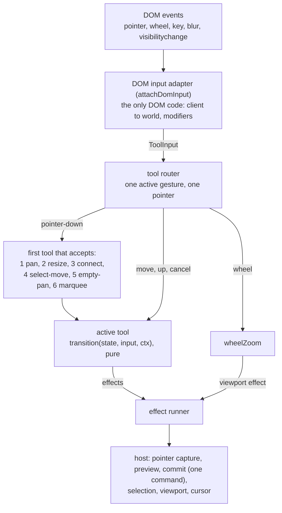
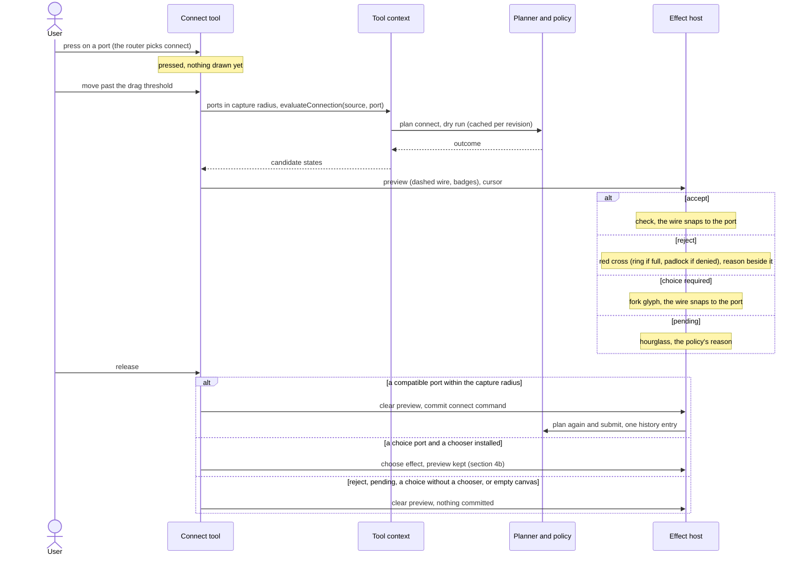
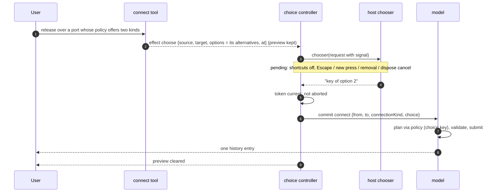
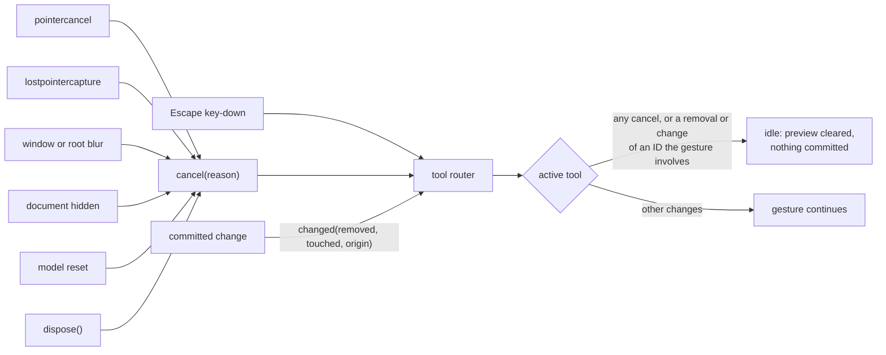
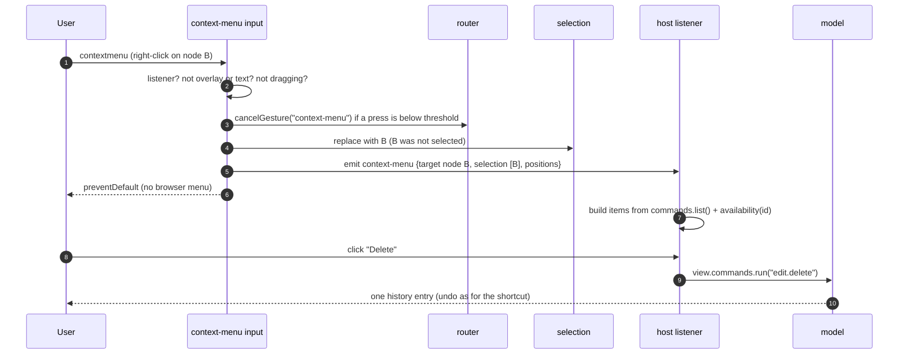

# Interaction: tools, gestures and shortcuts

How a mounted view turns pointer, wheel and keyboard input into selections, moves,
connections and viewport changes. Everything here ships with `mountView()` on by default;
`input: false` turns it off. For rendering see [guide-view.md](guide-view.md), for the
model side [guide-using-the-model.md](guide-using-the-model.md), for the layering
[architecture.md](architecture.md).

If you know QtNodes: there is no `QGraphicsItem` event handling. A *tool* is a small
state machine that receives normalized input and returns *effects*; a runner executes them.
The tool never touches the DOM or the model, so every tool is tested headlessly. A drag is
a preview on the interaction layer until release, then one command (one patch, one undo
step), like a `QUndoCommand` pushed once per mouse release instead of once per move.

## 1. The pieces

| Piece | Role |
| ----- | ---- |
| DOM input adapter (`attachDomInput`) | The only code that sees DOM events. Converts them to `ToolInput`, executes the effects, maps every cancellation source to `cancel`. |
| Tool router (`createToolRouter`) | Holds the single active gesture, picks the tool on press by fixed precedence, ignores other pointers while a gesture runs. |
| Tools | `pan`, `resize`, `connect`, `select-move`, `empty-pan`, `marquee`: `{ idle, accepts, transition, isIdle, autoPans? }` over a discriminated-union state. |
| Auto-pan driver (`createAutoPanDriver`) | Pans the view by animation frames while a drag is near an edge, and replays the last pointer-move so the preview follows (section 5a). |
| Effect runner (`createEffectRunner`) | Executes `capture`/`release`, `preview`, `commit`, `select`, `viewport` and `cursor` effects in order. |
| Selection model | View-local, ordered, with a primary entry. Dropped entities leave it when the model commits their removal. |
| Command registry | Stable command IDs shared by shortcuts, the API and host menus. |
| Context-menu input (`attachContextMenuInput`) | Beside the DOM input adapter: turns right-click, touch long-press and the menu key into the `context-menu` event (section 7a). |

How one input travels through them. On a press the router asks the tools in precedence
order (`defaultToolSlots()`, section 8) and the first one that accepts owns the gesture
until it returns to idle; moves and releases of that pointer go straight to it. The wheel
bypasses the tools, so zooming also works in the middle of a drag.



A press nobody accepts (the right button, by default) returns `handled: false`, and the
adapter leaves the browser's default alone. The right button belongs to the context menu
(section 7a): either the host's, through `view.on("context-menu")`, or the browser's.

## 2. Gestures

| Gesture | What happens |
| ------- | ------------ |
| Click a node or connection | Replace the selection. |
| Shift+click | Add to the selection. |
| Ctrl/Cmd+click | Toggle in the selection. |
| Click empty canvas | Clear the selection (Shift or Ctrl/Cmd keeps it). |
| Drag a node | Move it, or the whole selection if it was selected. Moves snap to `gridStep` when set; hold Alt to suppress snapping. Locked nodes in the selection stay put and are marked with a padlock. |
| Click or drag a group's title strip or border | Select the group, or move all its members. The blank interior of a frame behaves as empty canvas. See `guide-groups.md`. |
| Drag a node onto a group frame, or a member clear of it | The node joins or leaves the group on release, in the same undo step as the move. |
| Click a group's padlock; double-click its title | Lock or unlock; edit the title in place. |
| Drag from a port | Connect (section 4). |
| Drag the resize handle | Resize the single selected node with the opposite screen corner fixed (section 4a). Shift keeps the aspect ratio. |
| Drag empty canvas | Pan. |
| Shift or Ctrl/Cmd + drag empty canvas | Marquee selection (section 3). |
| Middle-button drag, or Space + drag | Pan, also over nodes. |
| Wheel | Zoom around the cursor (section 5). |
| Right button | Not claimed: the browser's context menu works as usual. |

People pan far more often than they rubber-band, so a plain drag on empty canvas pans, as
in React Flow and QtNodes, and the marquee takes a modifier. `emptyDrag: "marquee"`
switches to the CAD-style convention instead: a plain drag draws the marquee and panning
needs Space or the middle button.

Pressing a port without dragging selects its node. A press that moves less than the drag
threshold (3 CSS px for a mouse, 6 for touch and pen) is a click, not a drag.

Escape during a gesture cancels it; nothing is committed and previews clear. Pressing
Escape with no gesture clears the selection.

One completed gesture is one history entry: dragging three nodes over 200 pointer moves
submits one `moveNodes` command; a connection drag submits one `connect`; a resize drag
submits one `resizeNode`.

## 3. Marquee convention

The marquee follows the CAD convention, and its outline says which mode is active so the
mode never depends on color alone:

- **Left to right** (solid outline): selects entities *fully contained* in the rectangle.
- **Right to left** (dashed outline): selects entities the rectangle *touches*.
- Shift adds to the selection; Ctrl/Cmd toggles. Either one also starts the marquee
  while `emptyDrag` is `"pan"` (the default); without a modifier the marquee replaces the
  selection, which only happens with `emptyDrag: "marquee"`.

The `marquee` tool option fixes one mode for every drag: `"direction"` (default),
`"contain"` or `"intersect"`.

## 4. Connecting ports

The connect tool arms on a press on a port and starts after the drag threshold. A dashed
provisional wire follows the pointer. Ports inside their capture radius (a CSS-pixel
distance, so it looks the same at every zoom and pixel ratio) are *candidates*. Each is
asked to the connection policy, and the answer is drawn next to the port with its own
glyph, so the state never depends on color alone:

| State | Glyph | Meaning |
| ----- | ----- | ------- |
| compatible | check | The policy accepts. A small dot on the badge marks a port that already has connections its limit still allows. |
| incompatible | cross | The policy rejects (type, direction, self-loop, duplicate...). The reason is printed beside the hovered port. |
| occupied | ring | The port's attachment limit is used up. |
| unavailable | padlock | A capability denies connecting. |
| pending | hourglass | The policy has not decided yet: a host validator has not answered (section 4c). |
| choice | fork | The policy offers several alternatives (for example two connection kinds); a host chooser picks one (section 4b). |

The wire snaps to the nearest candidate that is compatible, a choice, or (when a host
validator is installed) pending (screen distance, ties by pick order). Releasing on a compatible port submits exactly one `connect`
command; the planner checks it again at submission. Releasing anywhere else, pressing Escape, losing the pointer or
removing the source port cancels the gesture and submits nothing, so no dangling
connection can exist. The cursor turns to `not-allowed` while the nearest candidate is
refused or undecided.

Policy answers are cached per candidate for the current model revision, so moving the
pointer over a dense cluster of ports does not re-run the policy.

The whole gesture as a sequence. The tool asks through the tool context, which runs the
model's dry-run planner (`model.plan`), and the planner asks the connection policy, so the
preview and the final commit apply the same rules. The policy's four outcomes
(`PolicyOutcome` in `src/core/edit/policy/types.ts`) map to the states above:



## 4b. Choosing between policy alternatives

Sometimes the policy cannot pick for the user: one port pair allows two connection kinds,
or a connection with or without a converter node. It then answers `choice` with keyed
alternatives. The library ships no picker; a host installs one async function:

```ts
mountView(container, { model, input: { chooseConnection: myChooser } });
view.setConnectionChooser(myChooser); // or later; undefined removes it
```

**Which port is never a question.** As in QtNodes, where the topmost item under the
cursor wins, the existing deterministic order decides the target: ports in the capture
radius, nearest first, ties in pick order, and the first one that is compatible or a
choice is the target. Overlapping ports therefore resolve without a dialog, exactly as
before. The chooser is asked only when that target's policy answer is `choice`, and its
options are that target's alternatives, in policy order, under the policy's own keys.

**Pending.** After the release the gesture is over (the pointer is up, capture released)
but the choice is pending: the preview stays frozen on the ports, nothing is committed,
and graph shortcuts do nothing, the same rule as during a drag. The chooser gets
`{ source, target, options, client, viewport, world, signal }` and returns an option key,
or `undefined` to decline, synchronously or as a promise. Choosing commits one `connect`
command that names the key (`choice`), planned and validated again like any other,
so it is one history entry; if the graph changed meanwhile, for example the
target's last slot was taken, it is rejected and nothing is created.

**Cancelling.** Escape (from the editor or from the host's picker in the overlay), a press
on the canvas outside overlay content (consumed, so it starts no pan or selection),
removal of the source or target node or port, a document reset, replacing the chooser,
and `dispose()` cancel it: the signal aborts, the preview clears, and a later answer is
ignored. A declined, failing or unknown answer also commits nothing. Blur does not
cancel, because the picker may take focus. There is no timeout; a host that wants one
combines `AbortSignal.timeout` with the signal and resolves `undefined`.

**Without a chooser** a choice is never picked silently. The target shows the fork glyph,
and releasing there commits nothing. A port the policy accepts directly connects as
always, chooser or not.



**With a host validator** the picked alternative is a plan nobody has judged, so the
controller does not commit at once. If the model plans the pick as pending it enters a
`verifying` state of the same choice (same token, abort signal and cancellations, which
include the rule above for the ports and nodes of the picked connection, reported as
`gesture-cancelled`; the choice's own commit is not a cancellation): it
redraws the preview with the target pending, asks the verdict driver for the picked plan
(`requestCommand`) and waits. When a verdict settles it plans again; once the plan is no
longer pending it clears the preview and commits the one `connect`. A refusal is then
reported by the model's result as a `connection-rejected` event, like any other commit.
Only afterwards does it tell the driver the wait is over, because ending forgets failed
verdicts and the commit must still see them. The router already ended the connect gesture
at the release, so the mount layer does not end the driver's gesture while a choice is open.

The plain demo's policy offers a "direct" and a "delayed" link between the level sensor
and the controller; `examples/plain-js/choice-picker.ts` is the picker.

## 4c. Waiting for a host verdict

With a host validator (guide-using-the-model.md), a target whose answer is unknown is
`pending`. The connect tool asks the host once per pair through a `request-verdict` effect
(the mount layer calls the model's verdict service; tools stay pure), and a `verdict` input
re-reads the target whenever any answer settles, so the badge changes with no pointer move.

A release on a pending target moves the tool to `awaiting`: no pointer is down (the router
reports none, hover resumes, capture is released), the preview stays at the release point,
nothing is committed, and a `validate-wait` effect makes sure the pair has been asked. The
answer decides:

| Answer | Result |
| ------ | ------ |
| accepted | one `connect` command, validated again at commit, one history entry |
| refused or failed | nothing committed, preview cleared, `connection-rejected` event |
| still unknown | the wait continues |

Escape, a press (which cancels the wait and then starts normally), a lock, a reset,
disposal and the removal of either port (`involved` of the awaiting state) cancel the
wait, abort the request when no one else wants it, and ignore a later answer. Blur, a hidden
tab, a lost pointer capture and a pointer cancel do not, since no pointer is down. When a
gesture ends, any way, failed answers are forgotten, so the next drag over the same pair asks
again.

## 4a. Resizing a node

Resizing is opt-in per node type (`capabilities: { resize: true }`, see
[guide-using-the-model.md](guide-using-the-model.md#resizing)). When exactly one node is
selected (and no connection), and the capability probe says it may resize, the view
draws **one handle**: an 8 x 8 CSS-pixel square inside the body at the corner that is
bottom-right on screen, whatever the rotation and mirroring. Hovering it shows the
`nwse-resize` cursor. Two selected nodes, or a type that did not opt in, show no handle,
and a press on the corner moves as usual.

| Step | What happens |
| --- | --- |
| Press on the handle | The `resize` tool claims it (it comes before `connect`), cursor `nwse-resize`. |
| Drag past the threshold | The pointer delta is mapped into the node's local frame; the opposite screen corner stays put. With `gridStep` set the moving corner snaps to the grid (Alt skips it); Shift keeps the start width-to-height ratio; the size is clamped to the node's limits, so the preview never leaves them. |
| Preview | The node and its connections leave the scene layer and are drawn at the preview size on the interaction layer, with the handle on the new corner. |
| Release | One `resizeNode` with the opposite corner fixed: one history entry. Below the threshold nothing is committed and the selection is unchanged. |
| Escape, lost capture, blur, removal | The preview is discarded, nothing is committed. |

**Why the handle never competes with ports.** There is a single handle, on one corner of
one selected node whose type asked for it, and ports normally sit on edges. If a port
does sit on that corner, the handle wins inside its 8 px square (the router asks the
resize tool first) and the port still connects from the rest of its capture circle. A
press never starts both. This follows the predecessor Qt editor, which also has one
corner grip on resizable nodes only, instead of eight handles on every node.

## 5. Navigation

- **Wheel** zooms around the cursor by `exp(-deltaY * wheelSensitivity)`, clamped to the
  zoom limits (the supported range, narrowed by the view's `zoomLimits` option). Line and page wheel deltas are normalized to pixels.
- The `wheel` option picks what a plain wheel does: `"zoom"` (default; horizontal delta is
  ignored), `"scroll-page-unless-modifier"`, which leaves the wheel to the page and zooms
  only while Ctrl/Cmd is held, or `"pan"`, which pans by both deltas (two-finger trackpad
  scrolling) and zooms with Ctrl/Cmd.
- **Pinch.** Browsers report a trackpad pinch as a wheel with the Control key, on macOS even
  when no key is held. A Control-wheel therefore zooms in every mode, by
  `exp(-deltaY * pinchSensitivity)` (default 0.01) with each event's delta clamped to ±10, so
  a mouse notch with Control zooms by about 10 %. It is always consumed over the canvas, even
  at a zoom limit, so the browser never zooms the page instead. The sensitivity has not been
  tuned on a physical trackpad yet; adjust `pinchSensitivity` if pinching feels slow.
- Other wheel events are consumed (`preventDefault`) only when the viewport really changed.
  At a zoom limit, or in scroll mode without the modifier, the page scrolls normally.
- **Touch pinch.** A second finger on the view cancels the gesture the first one started
  (a node drag, a pan) and the two fingers zoom about their midpoint and pan with it, within
  the zoom limits. Lifting either finger ends the pinch; the finger left does nothing until
  it lifts too.
- **Pan** only changes the viewport, never the model.
- **Hover** is reported through `view.on("hover", ...)` (guide-view, section 8): one pick per
  frame, nothing while a gesture is in flight, and a recompute when it ends.
- `view.fitAll`, `view.fitSelection`, `view.resetView`, `view.reveal`, `view.zoomIn` and `view.zoomOut` are commands
  (section 6); an empty graph or an empty selection is a successful no-op.

### 5a. Auto-pan

While a node drag, connection drag, marquee or resize is active and the pointer is inside
the 32 px band along an edge of the view (or outside the view, where capture keeps the
gesture alive), the view pans toward that edge. The speed rises linearly across the band
to 600 CSS px per second at the edge and stays there beyond it; in a corner both axes
pan. Pan gestures (middle button, Space, plain drags on empty canvas) never auto-pan.

- **Arming.** A gesture that starts inside a band does not pan until the pointer has left
  every band once, or moved closer to an edge than where it was pressed. Grabbing a node
  near the edge therefore does not scroll the view.
- **The preview follows.** Each frame pans by `-v * dt` (`dt` capped at 50 ms) and
  replays the last pointer-move with the same screen point and the world point recomputed,
  so the dragged node, wire end or marquee corner stays under the pointer.
- **Stops at once, leaves no frames.** Release, Escape, lost capture, blur and dispose all
  reach the router synchronously; the driver then cancels its pending frame before the
  browser can deliver it. With nothing to pan, no animation frame is requested, and the
  viewport keeps the position it reached.
- **History.** Auto-pan changes only the viewport and never commits: the gesture still
  commits once on release.
- **Options.** `toolOptions.autoPan: { edgePx, maxSpeedPxPerSecond }`, on by default;
  `autoPan: false` turns it off.

## 6. Commands and the default keymap

Every command has a stable ID and a localizable `labelKey` (`command.<id>`). The view
exposes them as `view.commands.run(id, args?)`, `availability(id, args?)`, `list()` and
`register(command)`. A shortcut and an API call run the same command, so they produce the
same patches. `run` returns `{ ok: true, value: { changed } }` or `{ ok: false, rejection }`;
an unavailable command returns the reason (for example a capability denial).

| Command ID | Does |
| ---------- | ---- |
| `edit.delete` | Delete the selected nodes and connections (and the connections of deleted nodes) as one history entry. Unavailable with an empty selection, or when a capability protects an entity. |
| `history.undo` | Undo the last history entry. Unavailable when there is none. |
| `history.redo` | Redo. |
| `selection.selectAll` | Select every node and connection. |
| `selection.clear` | Clear the selection. |
| `nodes.nudge` | Move the selected, movable nodes by `{ dx, dy }` world units: one move command. |
| `route.reset` | Remove all pinned route segments of the selected connections: one command. Unavailable when none of them has any (see [guide-view.md](guide-view.md#route-editors-dragging-a-wires-middle-segments)). |
| `nodes.rotate` | Turn the selected nodes a quarter turn, `{ turns: 1 }` clockwise or `{ turns: -1 }`, each about its own centre: one command. Nodes that may not rotate are left out; with none left it is unavailable with the capability reason. |
| `nodes.mirror` | Mirror the selected nodes in screen axes, `{ axis: "horizontal" }` (left and right swap) or `{ axis: "vertical" }` (top and bottom), each about its own centre: one command. Locked nodes are left out as for rotate. |
| `view.fitAll` | Fit the whole graph in view. |
| `view.fitSelection` | Fit the selection in view. |
| `view.zoomIn`, `view.zoomOut` | Zoom about the centre of the view by one step, `{ factor: 1.25 }` by default. Unavailable at the maximum or minimum zoom of the view. They work while the view is locked. |
| `view.resetView` | Zoom 1, origin at the top-left. |
| `view.reveal` | Pan, and zoom out if needed, so one node or connection (a bare ID) is fully visible. |
| `edit.copy` | Copy the selected nodes (and every connection between them) as a fragment. Unavailable without a selected node. Adds no history entry. |
| `edit.cut` | Copy, then delete like `edit.delete`: one history entry. Unavailable when the delete would be refused; then nothing is copied. |
| `edit.paste` | Paste `{ text }` from a native paste event, or else the in-app buffer, as one history entry; the new entities become the selection. Unavailable with an empty buffer, or when the dry run refuses (read-only, policy, types). |
| `edit.duplicate` | Copy the selected nodes one placement step away, as one history entry; the copy becomes the selection. |

Default keymap (`DEFAULT_KEYMAP`). `Mod` is Cmd on macOS and Ctrl elsewhere; the platform
is detected once at mount, or set with `input.platform`:

| Keys | Command |
| ---- | ------- |
| Delete, Backspace | `edit.delete` |
| Mod+Z | `history.undo` |
| Mod+Shift+Z, Ctrl+Y | `history.redo` |
| Mod+A | `selection.selectAll` |
| Escape | cancel the gesture, otherwise `selection.clear` |
| Arrow keys | `nodes.nudge` by the grid step (1 world unit without a grid), once per press |
| Shift+Arrow keys | `nodes.nudge` by ten steps, once per press |
| R | `nodes.rotate` `{ turns: 1 }` (clockwise) |
| Shift+R | `nodes.rotate` `{ turns: -1 }` |
| M | `nodes.mirror` `{ axis: "horizontal" }` |
| Shift+M | `nodes.mirror` `{ axis: "vertical" }` |
| Mod+C | `edit.copy` (native route, below) |
| Mod+X | `edit.cut` (native route) |
| Mod+V | `edit.paste` (native route) |
| Mod+D | `edit.duplicate` (also stops the browser's bookmark shortcut) |
| Mod+G | `group.create`: group the selected nodes and edit the new title |
| Mod+Shift+G | `group.ungroup` |
| F2 | `group.rename`: edit the title of the one selected group |

Single-letter keys are safe: text fields, contentEditable and IME composition never reach
the keymap (section 7), and Mod+R stays the browser's reload. Replace or extend the map
with `input.keymap`, for example
`[...DEFAULT_KEYMAP, { chord: "F", command: "view.fitAll" }]`. Chords are `+`-joined
modifiers (`Mod`, `Ctrl`, `Shift`, `Alt`) then a key. Keys are ignored while a gesture is
running: one gesture is one history entry.

The keymap is the single source of truth for the keyboard and the browser's Edit menu.
Remove a binding and that command has no key, including the clipboard commands (see the
native route below). The command API (`view.commands.run`) and host menus still run it.

A command registered under an existing ID replaces the built-in one for every route that
runs the ID: its shortcut, the native clipboard event and any menu. This is how a host
takes over `edit.copy`, `edit.cut`, `edit.paste` or `edit.duplicate` (recipe in
[guide-view.md](guide-view.md#clipboard-copy-cut-paste-duplicate)). The remover returned by
`register` leaves the ID empty; it does not bring the built-in back. Remount the view for
that. A command receives a context with `model`, `reader`, `selection`, `view` and, while
a mouse or pen pointer is over the view, `pointer`: its world position, the point the
built-in paste centres on.

A binding with `repeat: false` runs once per press: the key-downs a held key repeats are
consumed and run nothing. The default nudge, rotate, mirror and duplicate bindings say so,
so holding an arrow key moves one step and adds one history entry (set `repeat: true` on
your own bindings for continuous nudging). Chords match the character a key produces, so a
Latin layout such as AZERTY keeps its own letters; when the character is not an ASCII letter
or digit (Cyrillic, Greek), the physical key (`KeyZ`, `Digit1`) is matched instead, so
Mod+Z still undoes there.

### Clipboard shortcuts: the native route

Reading and writing the clipboard works differently in browsers than in Qt, where
`QClipboard` is always there:

| Route | Read (paste) | Write (copy) | Prompt | Where it works |
| --- | --- | --- | --- | --- |
| `copy`/`cut`/`paste` events | `clipboardData.getData("text/plain")`, synchronous | `setData` + `preventDefault()`, synchronous | none | all supported browsers |
| Async Clipboard API (`navigator.clipboard`) | `readText()` | `writeText()` | read: Chromium asks for permission; Firefox and Safari show a "Paste" button to click | secure context and a recent user gesture |
| In-app buffer | yes | yes | none | always, but only inside this view |

So Mod+C, Mod+X and Mod+V are bound with `native: true` in `DEFAULT_KEYMAP`: their
key-down is not default-prevented, the browser fires its `copy`, `cut` or `paste` event,
and the view's clipboard bridge runs `edit.copy`, `edit.cut` or `edit.paste` with the
event's data. No prompt appears. `native: true` only means something on a binding for `edit.copy`, `edit.cut` or
`edit.paste`; on any other command it is ignored and the key-down runs that command
like any other binding.

The bridge runs a command only while the keymap binds at least one chord to it. Unbind
`edit.cut` and a `cut` event runs nothing and keeps the browser's default, whether it came
from Mod+X, the Edit menu, or another platform chord such as Shift+Delete. A host no longer
needs to stop these events itself. A paste event's text decides what happens:

1. Text that carries the fragment marker is pasted.
2. Other text pastes nothing and the result is `not-a-fragment`. The in-app buffer is not
   used: the user evidently copied something else since.

There is no timed fallback. The browser reads the system clipboard asynchronously before
it fires `paste`, so "no event came within N ms" can never be told apart from "the event is
slow", and guessing wrong pastes twice. The key-down alone therefore does nothing; the
event alone runs the command, so one shortcut is always one command. A browser or
embedding page that fires no clipboard event on a focused non-editable element gets no
keyboard copy and paste; the host can still call `view.clipboard` (`copy()`, `paste()` from the
in-app buffer, `pasteFromSystem()`, `exportText`/`importText`).

Browsers aim clipboard events at the focused element only when it is editable, so the
bridge listens on the document and acts only while focus is inside this editor's root and
not in a text field. A text field in the overlay therefore keeps its own copy and paste.

Without a pointer over the view, repeated pastes land at the original position plus one,
two, three placement steps (default 20 world units, `input.clipboard.step`). With the
pointer over the view the copy is centred at the pointer; pasting again without moving
the mouse adds the growing step, so copies cascade instead of stacking.

## 7. Scoping: which events belong to the editor

- The view root is focusable (`tabindex=0`) and takes focus when pressed. Keyboard
  listeners sit on the root, not on `window`, so two editors on one page never share
  shortcuts: only the focused one reacts.
- Key events from `input`, `textarea`, `select` and `contentEditable` elements (overlay
  editors included) are left alone, and so are keys during IME composition.
- Pointer presses on host DOM placed in the overlay start no gesture, and key presses
  there (a button in a host menu) run no tool key, no shortcut and no clipboard command.
  Escape or Delete in a host menu therefore never clears or deletes the selection; the
  host closes its menu and returns focus with `view.element.focus()`.
- Cancellation sources: `pointercancel`, `lostpointercapture`, Escape, window `blur`, the
  document becoming hidden, a model `reset` (the whole document replaced, for example by
  `loadSnapshot`), a `contextmenu` event on a press that has not started dragging
  (`"context-menu"`, whether or not a menu listener is registered, section 7a), a move of
  the gesture's mouse that no longer holds its button (`"button-released"`: the browser never
  delivered the release, as when a native menu takes the mouse-up after a macOS
  Control-click), a second touch (`"pinch"`), and `dispose()`. Each ends the gesture with
  nothing committed. A lost release is a cancel, not a release: committing at a guessed
  position could write an edit the user did not make.
- With no gesture running, the cursor of a resting mouse (a scene pick and the resize-handle
  test) is chosen at most once per frame, however many moves arrive.
- The adapter attaches during `mountView()` and `dispose()` removes every listener.

All cancellation sources meet in the router, and they only matter while a gesture runs.
Model reset and change are not DOM events: the view forwards them from the model's
`reset` and `change` events (`view-editing.ts`). A reset cancels any gesture. A committed
change is judged by what the gesture involves: each tool says which nodes, ports and
connections its running gesture involves (`Tool.involved(state)`), and the router cancels
the gesture when one of them is removed or changed, from any origin: a local edit by the
host, an undo or redo, or an external change. Tools compute what they write from the
gesture's start, so a change they did not make would otherwise be overwritten on release.
The reason is `"entity-removed"`, `"external-change"` for an external change, or
`"entity-changed"` for the rest. A change of anything else leaves the gesture running, and
the gesture's own commit never cancels it (the gesture has ended when its commit runs). A
host that streams local updates to the node being dragged therefore cancels the drag. A lock
ends a gesture with the reason `"locked"`.



## 7a. Context menu

The library ships no menu. It raises an event with everything a host needs to build and
place its own, the way React Flow offers `onNodeContextMenu` and Cytoscape a separate menu
plugin. A menu item is then just a command: `view.commands.run(id, args)`, with the same
availability text, patch and undo step as the shortcut.

```ts
const off = view.on("context-menu", (e) => {
  // e.target: { kind: "node", node } | { kind: "port", node, port }
  //         | { kind: "connection", connection, member? } | { kind: "canvas" }
  // e.hits (ordered, topmost first), e.selection, e.invocation, e.modifiers,
  // e.client / e.viewport / e.world
});
```

**Triggers.** The browser's `contextmenu` event (a right-click, Ctrl+click on macOS, a
pen's barrel button), a touch held still for `longPressMs` (default 500 ms), and the menu
key or Shift+F10 while the editor has focus. Each invocation raises exactly one event,
even where the browser also reports it (Windows sends a native `contextmenu` after the
menu key, Chrome on Android after a long touch).

**Target.** The first hit of the normal pick at the point, the same pick and order a
click uses (ports hidden at low zoom are not hit), so a menu and a click always
agree. `hits` holds the whole ordered list for a host that wants to offer "which one?"
on coincident wires.

**Selection rule.** A right-click or long-press on an entity that is not selected makes
it the only selection first (on a port, its node); modifiers do not change this. On a
selected entity the selection stays, so a menu can act on a multi-selection. On empty
canvas it stays too, so "Paste here" or "Select all" keep what was selected. Built-in
commands act on the selection, which is why no target-based command API is needed.

**Only with a listener.** While no listener is registered, the view does nothing extra:
the browser's own menu opens, the selection is untouched and no long-press timer runs.
With one or more listeners the browser's menu is suppressed; there is no per-event
pass-through.

**Gestures.** A right press starts no tool. A press that has not passed its drag
threshold when the menu opens (a macOS Ctrl+click, a long-press) is cancelled with the
`"context-menu"` reason, so it neither selects on release nor drags. During a drag past
the threshold no event is raised and the drag continues. Events from text fields, IME
composition and host overlay content raise nothing (section 7).

**Touch and pan-first.** The long-press is armed only for touch (pens report their
barrel button through `contextmenu`). Moving beyond the touch drag threshold (6 px)
disarms it, so the two outcomes exclude each other: before the threshold nothing has
moved, after it the view pans or the node moves and the long-press is gone. A second
finger disarms it too. The root turns off the iOS touch callout and text selection, so a
hold shows nothing of the browser's own. `toolOptions: { longPressMs: false }` turns
long-press off.

**Keyboard placement.** The menu key and Shift+F10 target the primary selected node or
connection (never a port, ports are not selectable), or the canvas when nothing is
selected. The position is the centre of the entity's bounds clamped into the visible
area, or the view centre; the selection does not change.

**Placing the menu.** `client` is for page DOM outside the view, `viewport` for an overlay
element anchored `{ kind: "viewport", point }` (it stays put while the view pans and
zooms), and `world` for a world anchor or for "paste here":
`view.commands.run("edit.paste", { at: e.world })`.



The plain demo (`examples/plain-js/context-menu.ts`) is a complete host menu in about a
hundred lines: items from `view.commands.list()` with disabled entries showing the
availability reason, arrow keys, Escape and click-away.

## 7b. The view lock

A view can be locked (`locked: true` at mount, `view.setLocked(value)` later; the `"lock"`
event reports changes, see [guide-view.md](guide-view.md#the-view-lock)). A locked view
refuses editing and keeps viewing: the move, resize, connect and route-editing gestures
start nothing, `edit.delete`, `edit.cut`, `edit.paste`, `edit.duplicate` and every command
that edits are unavailable with the reason "The view is locked", while selection, copy,
fit, reset, pan, zoom and hover work as before. Locking cancels a gesture in progress (and a
pending connection choice) without committing; unlocking cancels nothing. A command
registered with `allowWhenLocked: true` runs while locked; any other registered command is
refused, so a host command that edits stays blocked by default.

## 8. Options

```ts
mountView(container, {
  model,
  input: {
    toolOptions: { gridStep: 20, emptyDrag: "pan", marquee: "direction", wheel: "zoom" },
    keymap: [...DEFAULT_KEYMAP],
    platform: "other",
    clipboard: { step: { x: 20, y: 20 }, external: "exclude" }, // system: false = in-app only
  },
});
```

`toolOptions` also holds `dragThresholdPx`, `pickTolerancePx`, `wheelSensitivity`,
`pinchSensitivity` (section 5),
`autoPan` (section 5a; `false` turns it off), `doubleClickMs` (the gap that makes two
presses on a route handle a double-click, default 500) and `longPressMs` (section 7a; `false` turns
the touch long-press off).
Snapping is off unless `gridStep` is set. Options can change while the view runs:
`view.setToolOptions({ gridStep: undefined })` turns snapping off from the next input
event, patches merge key by key, and `view.toolOptions()` returns what is in effect (the
plain demo's "Snap to grid" checkbox and G key do exactly this).

`input.tools` replaces the tool list (router precedence order); `defaultToolSlots()` gives
the built-in order: pan, resize, connect, select-move, empty-pan, marquee. Resize sits
before connect so a press on the resize handle never connects (section 4a); connect sits
before select-move so a press on a port connects instead of moving the node; empty-pan only sees
presses nothing else claimed, and lets Shift or Ctrl/Cmd presses fall through to the
marquee. Editing needs a model that offers
the command API (a `GraphModel` does); a read-only model still allows selection, pan and
zoom. The `view.selection` handle reads and changes the selection by entity kind and ID
(guide-view, "The selection: entities, not keys"), and the `"selection"` event reports every
change.

## 9. Writing a tool

A tool is `Tool<S>`: `idle` state, `accepts(press, ctx)`, `transition(state, input, ctx)`
returning `{ state, effects }`, `isIdle(state)`, and optionally `autoPans(state)` (true
in the states that drag something the view should auto-pan for), and `involved(state)`: the
IDs of the nodes, ports and connections a gesture in that state reads or will write, so the
router can cancel it when one of them is removed or changed. The tool context is
read-only: `pick`, `reader`, `scene`, `selection`, `zoom`, `can(action, id)`,
`sizeLimits(id)`, `evaluateConnection(from, to)` and `options`. Commit at most one command per gesture and always return to idle on
commit or cancel; the router cancels for you when an entity you listed in `involved` goes away. Pointer input carries `buttons`, the held buttons as DOM pointer events report them (1 primary, 2 secondary, 4 middle).
The tool contract (`Tool`, `ToolContext`, `ToolInput`, `ToolEffect`, `toolSlot`, the built-in
tools) is exported from `@paceholder/nodeeditor-js/view/advanced` and may change before 1.0;
the main view entry keeps `ToolSlot`, `defaultToolSlots` and the options. The headless harness
(`src/view/test-support/tool-harness.ts`) drives tools against a real model and scene.
