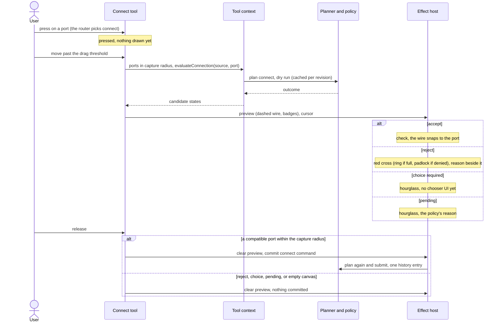
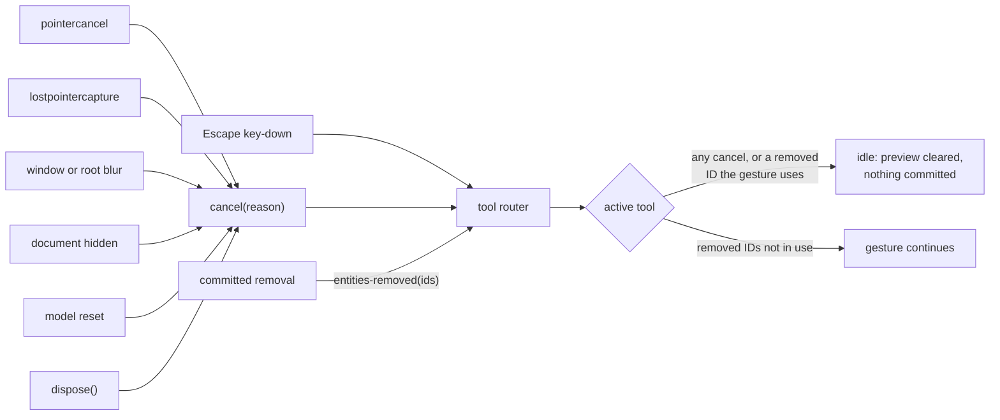

# Interaction: tools, gestures and shortcuts

How a mounted view turns pointer, wheel and keyboard input into selections, moves,
connections and viewport changes. Everything here ships with `mountView()` on by default;
`input: false` turns it off. For rendering see [guide-view.md](guide-view.md), for the
model side [guide-using-the-model.md](guide-using-the-model.md), for the layering
[architecture.md](architecture.md).

If you know QtNodes: there is no `QGraphicsItem` event handling. A *tool* is a small
state machine that receives normalized input and returns *effects*; a runner executes them.
The tool never touches the DOM or the model, so every tool is tested headlessly. A drag is
a preview on the interaction layer until release, then one command (one patch, one undo
step), like a `QUndoCommand` pushed once per mouse release instead of once per move.

## 1. The pieces

| Piece | Role |
| ----- | ---- |
| DOM input adapter (`attachDomInput`) | The only code that sees DOM events. Converts them to `ToolInput`, executes the effects, maps every cancellation source to `cancel`. |
| Tool router (`createToolRouter`) | Holds the single active gesture, picks the tool on press by fixed precedence, ignores other pointers while a gesture runs. |
| Tools | `pan`, `connect`, `select-move`, `empty-pan`, `marquee`: `{ idle, accepts, transition, isIdle }` over a discriminated-union state. |
| Effect runner (`createEffectRunner`) | Executes `capture`/`release`, `preview`, `commit`, `select`, `viewport` and `cursor` effects in order. |
| Selection model | View-local, ordered, with a primary entry. Dropped entities leave it when the model commits their removal. |
| Command registry | Stable command IDs shared by shortcuts, the API and (later) menus. |

How one input travels through them. On a press the router asks the tools in precedence
order (`defaultToolSlots()`, section 8) and the first one that accepts owns the gesture
until it returns to idle; moves and releases of that pointer go straight to it. The wheel
bypasses the tools, so zooming also works in the middle of a drag.


A press nobody accepts (the right button, by default) returns `handled: false`, and the
adapter leaves the browser's default alone.

## 2. Gestures

| Gesture | What happens |
| ------- | ------------ |
| Click a node or connection | Replace the selection. |
| Shift+click | Add to the selection. |
| Ctrl/Cmd+click | Toggle in the selection. |
| Click empty canvas | Clear the selection (Shift or Ctrl/Cmd keeps it). |
| Drag a node | Move it, or the whole selection if it was selected. Moves snap to `gridStep` when set; hold Alt to suppress snapping. Locked nodes in the selection stay put and are marked with a padlock. |
| Drag from a port | Connect (section 4). |
| Drag empty canvas | Pan. |
| Shift or Ctrl/Cmd + drag empty canvas | Marquee selection (section 3). |
| Middle-button drag, or Space + drag | Pan, also over nodes. |
| Wheel | Zoom around the cursor (section 5). |
| Right button | Not claimed: the browser's context menu works as usual. |

People pan far more often than they rubber-band, so a plain drag on empty canvas pans, as
in React Flow and QtNodes, and the marquee takes a modifier. `emptyDrag: "marquee"`
switches to the CAD-style convention instead: a plain drag draws the marquee and panning
needs Space or the middle button.

Pressing a port without dragging selects its node. A press that moves less than the drag
threshold (3 CSS px for a mouse, 6 for touch and pen) is a click, not a drag.

Escape during a gesture cancels it; nothing is committed and previews clear. Pressing
Escape with no gesture clears the selection.

One completed gesture is one history entry: dragging three nodes over 200 pointer moves
submits one `moveNodes` command; a connection drag submits one `connect`.

## 3. Marquee convention

The marquee follows the CAD convention, and its outline says which mode is active so the
mode never depends on color alone:

- **Left to right** (solid outline): selects entities *fully contained* in the rectangle.
- **Right to left** (dashed outline): selects entities the rectangle *touches*.
- Shift adds to the selection; Ctrl/Cmd toggles. Either one also starts the marquee
  while `emptyDrag` is `"pan"` (the default); without a modifier the marquee replaces the
  selection, which only happens with `emptyDrag: "marquee"`.

The `marquee` tool option fixes one mode for every drag: `"direction"` (default),
`"contain"` or `"intersect"`.

## 4. Connecting ports

The connect tool arms on a press on a port and starts after the drag threshold. A dashed
provisional wire follows the pointer. Ports inside their capture radius (a CSS-pixel
distance, so it looks the same at every zoom and pixel ratio) are *candidates*. Each is
asked to the connection policy, and the answer is drawn next to the port with its own
glyph, so the state never depends on color alone:

| State | Glyph | Meaning |
| ----- | ----- | ------- |
| compatible | check | The policy accepts. A small dot on the badge marks a port that already has connections its limit still allows. |
| incompatible | cross | The policy rejects (type, direction, self-loop, duplicate...). The reason is printed beside the hovered port. |
| occupied | ring | The port's attachment limit is used up. |
| unavailable | padlock | A capability denies connecting. |
| pending | hourglass | The policy has not decided yet, or needs a choice between alternatives. |

The wire snaps to the nearest compatible candidate (screen distance, ties by pick order).
Releasing on a compatible port submits exactly one `connect` command; the planner checks
it again at submission. Releasing anywhere else, pressing Escape, losing the pointer or
removing the source port cancels the gesture and submits nothing, so no dangling
connection can exist. The cursor turns to `not-allowed` while the nearest candidate is
refused.

Policy answers are cached per candidate for the current model revision, so moving the
pointer over a dense cluster of ports does not re-run the policy.

The whole gesture as a sequence. The tool asks through the tool context, which runs the
model's dry-run planner (`model.plan`), and the planner asks the connection policy, so the
preview and the final commit apply the same rules. The policy's four outcomes
(`PolicyOutcome` in `src/core/edit/policy/types.ts`) map to the states above:



Choice-required (the policy offers several alternative plans, for example with or without
a converter node) currently commits nothing on release: picking between alternatives
needs a chooser UI that a later change adds. Until then it is drawn like pending.

## 5. Navigation

- **Wheel** zooms around the cursor by `exp(-deltaY * wheelSensitivity)`, clamped to the
  zoom limits. Line and page wheel deltas are normalized to pixels.
- The `wheel` option picks the behavior: `"zoom"` (default) or
  `"scroll-page-unless-modifier"`, which zooms only while Ctrl/Cmd is held.
- The wheel event is consumed (`preventDefault`) only when the viewport really changed.
  At a zoom limit, or in scroll mode without the modifier, the page scrolls normally.
- **Pan** only changes the viewport, never the model.
- `view.fitAll`, `view.fitSelection`, `view.resetView` and `view.reveal` are commands
  (section 6); an empty graph or an empty selection is a successful no-op.

## 6. Commands and the default keymap

Every command has a stable ID and a localizable `labelKey` (`command.<id>`). The view
exposes them as `view.commands.run(id, args?)`, `availability(id, args?)`, `list()` and
`register(command)`. A shortcut and an API call run the same command, so they produce the
same patches. `run` returns `{ ok: true, value: { changed } }` or `{ ok: false, error }`;
an unavailable command returns the reason (for example a capability denial).

| Command ID | Does |
| ---------- | ---- |
| `edit.delete` | Delete the selected nodes and connections (and the connections of deleted nodes) as one history entry. Unavailable with an empty selection, or when a capability protects an entity. |
| `history.undo` | Undo the last history entry. Unavailable when there is none. |
| `history.redo` | Redo. |
| `selection.selectAll` | Select every node and connection. |
| `selection.clear` | Clear the selection. |
| `nodes.nudge` | Move the selected, movable nodes by `{ dx, dy }` world units: one move command. |
| `view.fitAll` | Fit the whole graph in view. |
| `view.fitSelection` | Fit the selection in view. |
| `view.resetView` | Zoom 1, origin at the top-left. |
| `view.reveal` | Pan, and zoom out if needed, so one node or connection (a bare ID) is fully visible. |

Default keymap (`DEFAULT_KEYMAP`). `Mod` is Cmd on macOS and Ctrl elsewhere; the platform
is detected once at mount, or set with `input.platform`:

| Keys | Command |
| ---- | ------- |
| Delete, Backspace | `edit.delete` |
| Mod+Z | `history.undo` |
| Mod+Shift+Z, Ctrl+Y | `history.redo` |
| Mod+A | `selection.selectAll` |
| Escape | cancel the gesture, otherwise `selection.clear` |
| Arrow keys | `nodes.nudge` by the grid step (1 world unit without a grid) |
| Shift+Arrow keys | `nodes.nudge` by ten steps |

Replace or extend the map with `input.keymap`, for example
`[...DEFAULT_KEYMAP, { chord: "F", command: "view.fitAll" }]`. Chords are `+`-joined
modifiers (`Mod`, `Ctrl`, `Shift`, `Alt`) then a key. Keys are ignored while a gesture is
running: one gesture is one history entry.

## 7. Scoping: which events belong to the editor

- The view root is focusable (`tabindex=0`) and takes focus when pressed. Keyboard
  listeners sit on the root, not on `window`, so two editors on one page never share
  shortcuts: only the focused one reacts.
- Key events from `input`, `textarea`, `select` and `contentEditable` elements (overlay
  editors included) are left alone, and so are keys during IME composition.
- Pointer presses on host DOM placed in the overlay start no gesture.
- Cancellation sources: `pointercancel`, `lostpointercapture`, Escape, window `blur`, the
  document becoming hidden, a model `reset` (the whole document replaced, for example by
  `loadSnapshot`), and `dispose()`. Each ends the gesture with nothing committed.
  A committed removal is different: the tool is told which IDs left the model and cancels
  only if its gesture uses one of them.
- The adapter attaches during `mountView()` and `dispose()` removes every listener.

All cancellation sources meet in the router, and they only matter while a gesture runs.
Model reset and removal are not DOM events: the view forwards them from the model's
`reset` and `change` events (`view-editing.ts`).



## 8. Options

```ts
mountView(container, {
  model,
  input: {
    toolOptions: { gridStep: 20, emptyDrag: "pan", marquee: "direction", wheel: "zoom" },
    keymap: [...DEFAULT_KEYMAP],
    platform: "other",
  },
});
```

`toolOptions` also holds `dragThresholdPx`, `pickTolerancePx` and `wheelSensitivity`.
Snapping is off unless `gridStep` is set. Options can change while the view runs:
`view.setToolOptions({ gridStep: undefined })` turns snapping off from the next input
event, patches merge key by key, and `view.toolOptions()` returns what is in effect (the
plain demo's "Snap to grid" checkbox and G key do exactly this).

`input.tools` replaces the tool list (router precedence order); `defaultToolSlots()` gives
the built-in order: pan, connect, select-move, empty-pan, marquee. Connect sits before
select-move so a press on a port connects instead of moving the node; empty-pan only sees
presses nothing else claimed, and lets Shift or Ctrl/Cmd presses fall through to the
marquee. Editing needs a model that offers
the command API (a `GraphModel` does); a read-only model still allows selection, pan and
zoom. The `view.selection` handle reads and changes the selection, and fires events the
view uses to repaint outlines.

## 9. Writing a tool

A tool is `Tool<S>`: `idle` state, `accepts(press, ctx)`, `transition(state, input, ctx)`
returning `{ state, effects }`, and `isIdle(state)`. The tool context is read-only: `pick`,
`reader`, `scene`, `selection`, `zoom`, `can(action, id)`, `evaluateConnection(from, to)`
and `options`. Commit at most one command per gesture and always return to idle on
commit, cancel or removal of an entity the gesture uses. The tool contract is public but
experimental until Slice B adds routing tools. The headless harness
(`src/view/test-support/tool-harness.ts`) drives tools against a real model and scene.
