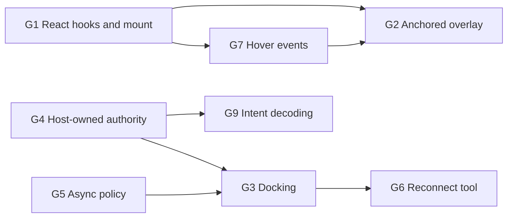

# nodeeditor-js as the schematic editor: gap analysis

**Purpose.** The host application's schematic editor uses React Flow today. We want to replace it with
`nodeeditor-js` (sibling repository `../nodeeditor-js`) because we own that library and can
extend it. This document lists what the library lacks for that replacement. It is written
so that an agent working in `nodeeditor-js` can act on it without reading the host's code.

**Method.** Read the library's `openspec/specs`, `docs/`, `AGENTS.md` and `openspec/config.yaml`,
then checked the source for each claim below (as of commit `4dda999`). "Verified" means the
code was checked. "Unverified" means only the spec or guide was read; confirm by running
`npm run demo`.

**Library rule that applies to the fixes.** Library files stay application-neutral: no
product names, no host backend details. Requirements below are therefore phrased in terms of
a *host*. The host's concrete scenario is in [section 2](#2-the-host-scenario) only, and must
not be copied into library files. New requirements follow the library's ID and OpenSpec
conventions (stable IDs, a test naming each ID, one change per folder in `openspec/changes/`).

## 1. Summary

The design fits: Canvas2D rendering (chosen for performance), a narrow model interface
(`ViewModel` = reads plus `change`/`reset` events; `EditableModel` adds `plan`, `execute`,
`can`, `undo`, `redo`, `historyState`), a DOM overlay layer anchored to nodes (enough for a hover popover), the image-symbol
node preset with rotate and mirror, an orthogonal router with segment editing, and a command
registry. These match the schematic use case. The library lacks the following.

| # | Gap | Severity | Status in library |
|---|-----|----------|-------------------|
| G1 | React integration (mount component, provider, hooks) | Blocker | Not implemented. `src/react/index.ts` only re-exports `view`. Spec REA-01 to REA-07 exist. |
| G2 | Single anchored overlay for a hover popover or inline rename (not React in every node) | Optional | The raw overlay primitive exists. No React wrapper, no placement options. |
| G3 | Docking: connect by dragging a node next to compatible ports | Blocker | Spec only (DCK-01 to DCK-05). No code. |
| G4 | Host-owned authority: external adapter and an adapting-model recipe | Blocker | Adapter contract has `pending`/`queued`/`unknown` outcomes. No external adapter, no pending layer, no guide. |
| G5 | Connection policy cannot await a host validator | High | Policy is synchronous. A `pending` outcome exists but nothing resolves it. |
| G6 | Reconnect a connection endpoint by dragging | High | Core `connect` supports `replacing`. No view tool drives it. |
| G7 | Hover and pointer-enter events for nodes, ports and connections | High | `ViewEventMap` has only `context-menu`. |
| G8 | Per-node and per-connection style from the host | Medium | Unverified. |
| G9 | Gesture-level host callbacks (move end, delete, connect) | Medium | Only committed `change` events. See G4. |
| G10 | Fit-to-content and zoom controls for hosts | Low | `view.fitAll` command exists. No React control. |
| G11 | Packaging and consumption | Low | Package is `private`, version `0.0.0`. |
| G12 | Port hit-targets and port-direction normals | Verify | Unverified. |
| G13 | Palette drop and screen-to-world conversion | Verify | `clientToWorld` exists. Unverified in a WebView. |

Items marked **Verify** are probably fine and need a demo check, not new work.

## 2. The host scenario

The host's schematic shows physical components as images (SVG icons) with ports at fixed
positions on the icon. This is what the library calls an image-symbol node.

- **The backend owns the document.** The browser never holds an authoritative copy. Every edit
  (move, rotate, flip, create or delete a component, create or delete a connection) is sent
  to a server. The server then publishes a change notification and the browser re-reads the
  whole schematic. Between the edit and the refresh the UI shows an optimistic result.
- **IDs are server-issued UUIDs** for components, ports and connections.
- **Connection rules are domain rules** (two ports connect only if their physical domain
  matches) and are checked by the server, asynchronously.
- **Nodes carry live content.** Hovering a node for one second opens a popover with its last
  simulation values (React component, Radix popover).
- **Components are dropped from a palette** onto the canvas by pointer, not by HTML5 drag and
  drop (which is unreliable in an embedded desktop WebView).
- **Proximity connect.** Dragging a component so that a port comes within about 40 px of a
  compatible, unconnected port shows a dashed preview line. Releasing creates the connection.
- **Selection is shared** with a tree view and a properties panel. Selecting in either one
  updates the other.
- **Keyboard:** R rotates and F flips the selection; Delete removes it. These apply only when
  the schematic was the last panel clicked.
- **Style:** wires are coloured by domain and can be dashed or solid by user setting. Selected
  nodes get a glow in the domain colour. Dark mode and a corporate theme apply.

## 3. Gaps in detail

### G1. React integration

**Problem.** The `react` entry point re-exports the `view` entry point and contains nothing
else. A React host must hand-write mounting, cleanup and every subscription.

**Required.** Implement the existing requirements REA-01 to REA-07 (spec:
`openspec/specs/react-integration/spec.md`; planned as Slice B in `docs/architecture.md`).
Concretely:

- A mount component that owns one `ViewHandle`. It creates the view on mount and disposes it on
  unmount. It must survive React Strict Mode (setup, cleanup, setup) with exactly one set of
  input listeners (REA-05). It must accept updated options without remounting where the view
  supports it (`setTheme`, `setToolOptions`), and remount cleanly where it does not.
- A provider and a hook returning the `ViewHandle` (and the model) to descendants.
- Hooks, each built on `useSyncExternalStore` with stable snapshots:
  - selection (`view.selection`): selected keys, primary key;
  - viewport (`view.viewport`): zoom and pan, throttled so a pan does not re-render per pointer
    sample (REA-04);
  - command availability (`view.commands.availability`): enabled flag plus reason (REA-01);
  - history state (`undoLabel`, `redoLabel`, `canUndo`, `canRedo`);
  - entity subscription by ID: a node or connection record. Only components subscribed to that
    ID re-render when it changes. Unrelated changes, selection changes and drags of other
    nodes must not re-render it (REA-04, with a render-count test);
  - hover (depends on G7).
- Server-rendering safety: importing and rendering to string in Node touches no browser global
  and yields an inert container (REA-06). `sideEffects: false` stays true.
- Document the subscription granularity (REA-04 requires this).

**Acceptance.** The scenarios in REA-01, REA-04, REA-05 and REA-06, each as a test that names
its requirement ID. Add a React example under `examples/` next to `plain-js`.

### G2. Anchored overlay for a few nodes (optional)

**Decision.** Node bodies stay canvas-only: an SVG icon, ports and a label, all painted by the
image-symbol painter. The host does not need React components inside every node. Per-node React
content (forms, live widgets; NOD-06 and REA-03) would need a React root per node, a size
measurement loop and focus handling across many nodes. That cost works against the reason for
choosing canvas, so it is out of scope (see section 6).

**What the host still needs.** One DOM element at a time next to a node: a hover popover, or an
inline rename field. The library has the primitive, `view.overlay.attach(element, anchor)`,
with a `{ kind: "node" }` anchor at the node's top-left corner.

**Required** (small, builds on G1 and G7):

1. A React hook or component, for example `useNodeOverlay(nodeId)` or `NodeOverlay`, that portals
   children into one overlay slot anchored to a node. It attaches on mount, detaches on
   unmount, and hides while the node is absent from the model.
2. Anchoring beyond the top-left corner: placement relative to the body bounds (above, below,
   centred), and the node's on-screen rectangle as a value. A popover library such as Radix or
   floating-ui can then use it as an anchor.
3. The overlay is meant for a handful of nodes (the hovered or selected one). Document this and
   do not add per-node mounting for the whole graph.
4. Input isolation: Delete or a letter key typed in an overlay input must not run a graph
   shortcut. The overlay guide says this works at DOM level; add a React-level test with a text
   field. Pointer presses on overlay content start no canvas gesture.
5. React context from the host tree is available inside the overlay content (portals do this
   by default; add a test).

**Open question for the library owner.** The overlay layer ignores pointer input except on
attached elements. Check that the wheel over a popover does not zoom the canvas, and that
zooming still works over the empty area of the overlay.

**Acceptance.** A test where a text input in the overlay receives Delete without deleting the
selected node, and a test that the overlay follows the node while panning, zooming and moving.

### G3. Docking

**Problem.** The spec describes docking (`openspec/specs/docking/spec.md`, DCK-01 to DCK-05). A
search of `src` finds no implementation.

**Required behaviour** (as the spec states it, with the host's needs added):

- While a node is dragged, find compatible nearby ports within a configurable radius and rank
  them: compatibility first, then screen distance, orientation, and a stable tie-break, with
  hysteresis so the choice does not flicker (DCK-01).
- Preview the proposal in the interaction layer: a line between the two ports, or a snapped ghost
  position. The preview is never serialized (INT-08).
- Docking is opt-in per tool or host and suppressible by a modifier key (DCK-02).
- Commit as one patch and one history entry: the move plus the new connection (DCK-03).
- The host must choose between two modes:
  - **snap and connect** (the spec's mode): node position changes so anchors coincide;
  - **connect without moving** (the host's current behaviour): the node stays where the user
    dropped it and a connection is created between ports within the radius.
  Make this an option. The second mode is the one the host needs first.
- Compatibility is decided by the connection policy (including G5), not by docking code.
- An incompatible nearby port must show a reason and must not capture the drag (DCK-01).
- Moving docked nodes apart keeps the connection (DCK-04). Connections with coincident anchors
  stay selectable (DCK-05).
- Exclude ports that already have a connection when the port's attachment limit says so (PRT-04).

**Acceptance.** All DCK-01 to DCK-05 scenarios; a browser test that drags a node next to another
and asserts a single undo removes both the move and the connection.

### G4. Host-owned authority

**Problem.** The architecture says edits go to an adapter that decides whether they are accepted.
Only the local adapter exists. The external adapter, the pending layer for optimistic edits and
the revision and snapshot synchronisation modes are planned (Slice D, ADP-03 to ADP-06, TXN-02
to TXN-09). The narrow `EditableModel` interface lets a host write its own model today, but
there is no guide, no helper and no tests for that path.

**What the host needs.** A server owns the document. The editor must:

1. Show a user's edit immediately (optimistic) and keep it visible until the server answers.
2. Roll back cleanly if the server rejects the edit (TXN-02).
3. Accept a full refreshed snapshot from the host *without* resetting the view: no selection
   loss, no viewport change, no history clearing, no stuck gesture. Today `loadSnapshot` is a
   reset: it clears history and emits `reset`. The host refreshes on every server notification,
   so this must be a diff-based update (ADP-05 "Snapshot synchronization mode": the host pushes
   full snapshots and the library diffs them into a normal `change` event).
4. Re-apply pending local edits on top of an incoming change (ADP-03).
5. Let the host own undo and redo, or disable them (TXN-08, TXN-09).

**Required.**

- Implement the external adapter with both synchronisation modes, or at least snapshot mode
  first. Snapshot mode is the one the host can use at once.
- Provide a documented *model-wrapping recipe*: a guide section and an example that adapts an
  existing store (two lists of nodes and edges, or a remote backend) to `EditableModel`,
  including what `plan` and `execute` must return.
- Specify what a diff produces when IDs are stable: unchanged nodes emit no change; a moved node
  emits an update; a removed node removes its connections in the same patch.
- Specify behaviour when a snapshot arrives *during* a drag. The gesture must not be cancelled
  by an unrelated refresh. If the dragged node itself changes, the gesture ends with a reason.
- Specify behaviour for an unknown outcome (TXN-04): the edit may or may not have applied. The
  view must show a state the host can map to a message, and must not retry blindly.

**Acceptance.** ADP-03, ADP-05, TXN-02 and TXN-04 scenarios as tests; a browser test that pushes
a snapshot while a node is selected and while another is being dragged and asserts that
selection, viewport and gesture survive.

### G5. Asynchronous connection validation

**Problem.** `ConnectionPolicy.evaluate(proposal, graph)` is synchronous and returns `accept`,
`reject`, `choice` or `pending`. The `pending` outcome is defined but nothing resumes it.

**What the host needs.** Connection validity is decided by a server. The editor must be able to
show "checking", then become accepted or rejected, without blocking input.

**Required.**

- Define how a `pending` outcome is resolved: the policy (or a host validator, see TXN-05)
  returns a promise or a token, and the connect tool, docking (G3) and the commit path wait for
  it, show a pending state (PRT-06 "distinct target states") and then continue or roll back.
- The gesture must stay responsive while waiting (TXN-06). A second gesture may start or the
  first is cancelled; specify which.
- Provide a cache hook so a host can answer repeated proposals (the same two ports) without a
  round trip during one drag.
- Rejection reasons are structured (`Rejection`) and reach a host callback or the view, so the
  host can show them in its own toast.

**Acceptance.** Tests for the pending, accepted and rejected paths in the connect tool, with a
fake async validator.

### G6. Reconnect by dragging an endpoint

**Problem.** Core supports `replacing` in `ConnectionProposal` and the connect command (a
reconnect plans a remove and an add). No tool in `src/view/interact/tools` starts a reconnect.

**Required.** A tool or a mode of `connectTool`: with a connection selected, dragging near one of
its endpoints detaches that end and lets the user drop it on another compatible port. Dropping
on empty space cancels (the connection stays) or deletes it, by option. One gesture is one
history entry (INT-08). The policy sees `replacing` so occupancy checks ignore the old
connection. Add a visible endpoint grip, in the style of the route-edit grips.

**Acceptance.** Tests in the style of `connect-tool.test.ts`: reconnect to a valid port, to an
invalid port (rejected, original kept), to empty space, and cancel with Escape.

### G7. Hover events

**Problem.** `ViewEventMap` contains only `context-menu`. There is no way for a host to learn
that the pointer entered or left a node, port or connection. Hosts need this for delayed
tooltips and popovers, highlights in other panels, and cursor changes.

**Required.** A `"hover"` event on `view.on` carrying the entity kind, its ID and, for nodes,
its screen rectangle, plus a `null`/leave form. Requirements:

- It reuses the view's existing hit-testing and spatial index (no pixel lookups, GEO rules).
- It is coalesced to at most one event per animation frame and fires only when the hovered
  entity changes.
- It does not fire during a gesture (drag, marquee, pan).
- It respects the level-of-detail rule that hides ports when zoomed out.
- The React layer exposes it as a hook (G1). A delay (such as 1 s) stays in the host.
- Also expose `view.hover` state so `viewState.isHovered` can be fed by default.

**Acceptance.** Browser test: move the pointer over a node, assert one event; move within the
node, assert none; leave, assert the leave event; during a drag, assert none.

### G8. Per-node and per-connection style from the host

**Status.** Unverified. Check each item in the demo and fix what is missing.

**Required.**

- Connections: stroke colour, width and dash pattern per connection (or per connection kind),
  from the record's payload or a host function. The host colours wires by physical domain and
  switches dash style from a user setting at runtime without rebuilding the model.
- Selected and hovered styling per node: the host wants a glow in an entity-specific colour.
  Check whether `NodePaintInput.state` plus a host painter wrapper is enough, and document the
  pattern.
- Port glyph visibility: the schematic hides port glyphs (the picture shows the port) but needs
  large invisible hit targets (about 12 px). Check `createPortGlyphPainter` options and port
  target size independent of glyph size (PRT-05).
- Theme: map a host design-token set onto `ThemeTokens` (`setTheme`), including a dark and a
  light variant switched at runtime without remounting.

### G9. Gesture-level host callbacks

**Problem.** The host learns about edits only through committed `change` events with a patch.
For a backend-owned document the host also needs to *intercept* edits to translate them into
server calls (for example "node 7 moved to x, y", "connection created between these ports").

**Required.** Either document that an external adapter's `submit` (G4) is the single interception
point and show how to map each patch operation to a host call, or add a thin helper that
decodes a `Submission` into named intents (move, resize, rotate, mirror, create, delete,
connect, disconnect, reconnect). The helper must keep one gesture as one submission (INT-08), so
a multi-select move becomes one call.

### G10. Fit and zoom controls

**Required.** The `view.fitAll` and `view.fitSelection` commands exist. Provide a way to fit on
first load with padding (a `FitOptions` option is present in `view-fit.ts`; expose it through
the mount options, for example `initialFit`), and an optional small React control set (zoom in,
zoom out, fit) that hosts can restyle. Minimum and maximum zoom must be configurable (the host
uses 0.1 to 2). Verify these are options on `ViewportState`.

### G11. Packaging

The package is `private` with version `0.0.0` and the exports point to `dist/`. The host needs
a consumption path: a workspace or `file:` link plus a documented build step, or a registry
publication. Verify that `npm run build` output (`dist/core`, `dist/view`, `dist/view/advanced`,
`dist/react`) works with the host's bundler (Vite) and its TypeScript settings, and that
React 19 is declared as a peer dependency. Keep `sideEffects: false`.

### G12. Port hit targets and normals (verify)

The image-symbol preset takes `placement` as fractions (0 to 1) of the unrotated body and
derives an outward normal from the nearest edge unless one is given. Verify:

- A port at a corner or in the interior of an icon gets the normal the host expects. Allow the
  host to give an explicit normal per port (the spec says a placement may carry one).
- Rotation and mirror move the normal with the node (one transform, per the guide).
- The orthogonal router leaves a port along its normal.
- The hit radius of a port is configurable in CSS pixels and is independent of the glyph.

### G13. Palette drop and coordinate conversion (verify)

`view.clientToWorld(x, y)` returns world coordinates. Verify it with the view inside a scrolled
or transformed container and in a WebView. Provide one example that creates a node at a
pointer-up position from outside the view (a palette drag implemented with pointer events).
No HTML5 drag-and-drop dependency.

## 4. Additional checks to run in the demo

These need a quick manual or browser-test confirmation; open an issue per failure.

1. Marquee selection that selects partly covered nodes (the host uses partial overlap).
2. Programmatic selection by ID from outside, without an event loop (the host sets selection
   from a tree and must tell its own echo apart from a user click). Check that
   `selection.on` events carry enough information (a source or origin) to filter an echo.
3. Delete key removes selected nodes and connections as one history entry, and a delete of a
   node also removes its connections in the same patch.
4. Keyboard shortcuts can be scoped: the host wants shortcuts active only when the editor has
   focus. Check `InputOptions`/`Keymap` for a focus-scope option and that unbinding a key (for
   example the host binds R and F to its own handlers) is possible.
5. Pointer capture and drag behaviour inside a WebView, and with a touch pen.
6. A very large schematic: the performance suite compares against React Flow (PERF-07). Run it
   for the host's typical size (50 to 500 nodes) and record the result.
7. Rounded bends on the orthogonal router, and an offset from the port before the first bend.
   The host currently uses a corner radius of 8 px.
8. Accessibility: the library reduces it to keyboard shortcuts for select, move, delete and
   undo. Record this as a known limit.

## 5. Suggested order

1. **G1** React hooks and mount component: everything else in the browser builds on it.
2. **G4** Snapshot-mode external adapter plus the model-wrapping guide: the host cannot adopt the
   editor without it.
3. **G7** Hover events, then **G2** the small anchored overlay (optional).
4. **G5** Asynchronous policy, then **G3** Docking, then **G6** Reconnect.
5. **G8**, **G9**, **G10**, **G11** and the checks in section 4 alongside.

Each item should become its own OpenSpec change with requirement IDs, scoped as the library's
`config.yaml` asks: list the IDs implemented, state what is out of scope, and give every task a
named verification.

## 6. Out of scope for the library

- React components inside every node (NOD-06, REA-03). Nodes stay canvas-painted. Revisit only
  if a host needs forms or live widgets on many nodes.
- The domain-specific rules (which physical domains connect). The host supplies them as a policy.
- The backend protocol, SSE notifications and server-issued IDs. The library sees only the
  adapter contract.
- The host's popover content, theme tokens and keyboard-scope rules. The library exposes hooks;
  the host implements them.
- Collaboration logic (merging, CRDTs). The library already rules this out (ADP-04).
