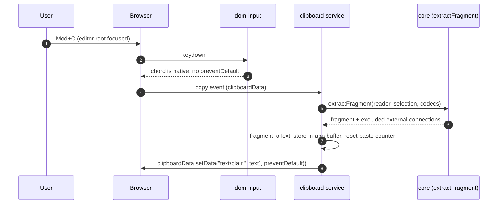
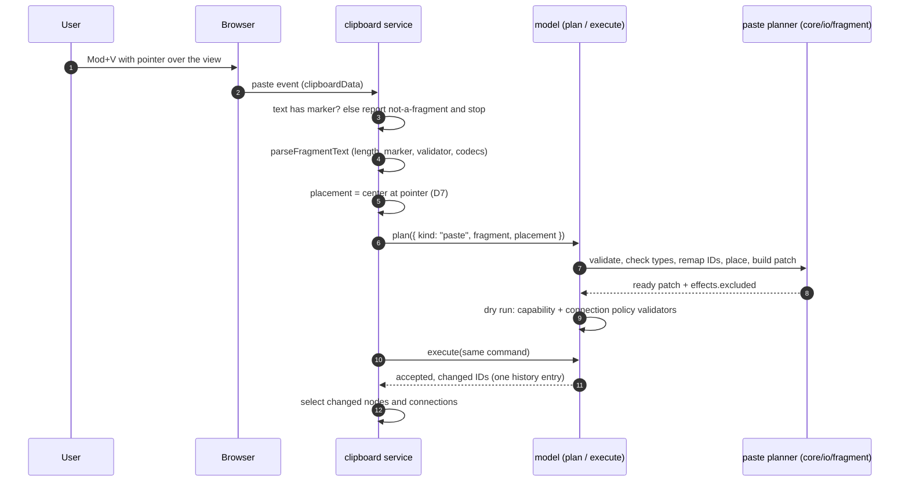

# Design

## Context

See proposal.md for the motivation. These are the parts of today's code this change
builds on:

- **Snapshot (`src/core/io/snapshot/`).** `GraphSnapshot` is the one plain-JSON shape. A
  fragment is a snapshot without `idCursor`. `validateSnapshot(input, { fragment: true,
  limits })` already runs the shape pass and the reference pass (duplicate IDs, dangling
  endpoints, port-owner mismatch, size limits) and collects every error sorted by JSON path.
  `records.ts` maps snapshot entries to and from records (`nodeToSnapshot`,
  `nodeToRecord`, `portToRecord`, `connectionToRecord`). `json-value.ts` has `checkJson` and
  `cloneJson`; `snapshot-errors.ts` has `SnapshotLimits`, `DEFAULT_SNAPSHOT_LIMITS` and the
  payload codec registry. `exportSnapshot` walks the whole reader; there is no
  selection-based export yet.
- **Commands (`src/core/edit/commands/`).** `Command` is a discriminated union. `planCommand`
  in `plan.ts` dispatches exhaustively to planners (`PlannerFor<K>`), which read a
  `PlanContext` (reader, `IdAllocator`, registry, policy) and return a `PlanResult`.
  `createCommandApi` (`api.ts`) runs `plan` → `dryRun` against the capability and policy
  validators → `submit` with the plan's label, so one command is one patch and one history
  entry. `planDeleteEntities` is the atomic delete. `ready()` in `ops.ts` attaches
  the advanced ID cursor to the patch and computes `PlanEffects`.
- **Capabilities.** The capability validator never checks a node `add`; it checks
  `connect` on the endpoint nodes of an added connection, and read-only mode refuses any
  non-empty patch. So paste inherits read-only refusal and connect capabilities from the
  existing dry run.
- **Layers.** `core/edit` (rank 2) must not import `core/io` (rank 3). `core/io` may import
  `core/edit` (`load.ts` already imports `edit/adapter`). `core/io` and `core/space` never
  import each other. View code reaches core only through `src/core/index.ts`.
- **View commands.** `createCommandRegistry` holds `EditorCommand`s with synchronous
  `availability` and `run`. `builtin-commands.ts` wraps model commands with `modelEdit`;
  `keymap.ts` resolves chords to command IDs; `view-editing.ts` wires the keymap into
  `attachDomInput`, whose `onKeyDown` calls `preventDefault()` for every bound chord.
  `EditableModel` is `ViewModel` plus `plan`, `execute`, `can`, `undo`, `redo`,
  `historyState`.
- **Node frame.** A node's `position` is the world location of its body centre
  (docs/geometry.md); `size` is the unrotated body size; odd quarter turns swap width and
  height of the axis-aligned frame.

## Goals / Non-Goals

**Goals:**

- One fragment format for copy, cut, paste, duplicate and the export/import fallback,
  validated by the existing snapshot validator.
- Paste and duplicate are ordinary model commands: `plan`, `can` and `execute` work on
  them, external adapters see a normal patch, and shortcut and API produce identical
  patches.
- Keyboard copy, cut and paste work in current Chromium, Firefox and Safari without a
  permission prompt.
- The core part is fully testable headlessly; the view part is testable in Vitest browser
  mode in Chrome.

**Non-Goals:**

- Merging clipboard content from other node editors or other formats.
- Undo of a copy (copy changes no document state and adds no history entry).
- Clipboard history, multiple buffers, or sharing the in-app buffer between views. Each
  view owns its own buffer; the system clipboard is the shared channel.

## Decisions

### D1. Fragment logic lives in `core/io/fragment/`, injected into command dispatch

New folder `src/core/io/fragment/`, in the `core/io` layer next to `snapshot/`:

| File | Contents |
| --- | --- |
| `fragment-types.ts` | `ClipboardFragment` (envelope), `ExternalConnection`, `ExcludedReference`, `FRAGMENT_FORMAT` |
| `extract.ts` | `extractFragment(reader, selection, options)` |
| `fragment-text.ts` | `fragmentToText`, `parseFragmentText` |
| `bounds.ts` | fragment bounding box from node centre, size and quarter turns |
| `remap.ts` | old-to-new ID maps and remapped records |
| `plan-paste.ts` | the `paste` and `duplicate` planners |

Fragment code needs the snapshot validator, records mapping and codecs (all `core/io`) and
the command types, `IdAllocator` and `ready()` (all `core/edit`). `core/io` may import
`core/edit`, so the planners live in `core/io`. The dispatcher in `core/edit` cannot import
them, so `PlanContext` gains an optional `fragments: FragmentPlanners` slot, an interface
declared in `core/edit/commands/types.ts`:

```ts
export interface FragmentPlanners {
  readonly paste: PlannerFor<"paste">;
  readonly duplicate: PlannerFor<"duplicate">;
}
```

`CommandEnvironment` passes it through; `graph-model.ts` (the facade, rank 4) supplies
the implementation from `core/io/fragment`. Without the slot, `planCommand` rejects
`paste`/`duplicate` with a new code `unsupported-command`. Bounds are computed from the
records (`bounds.ts`), not from `core/space` geometry, so `core/io` keeps away from its
sibling. The bounding box is the axis-aligned union of node frames, which ignores port
glyphs and painter overhang; it is only used to centre a paste, so that is precise enough.
No new folder is added to the layer table: both new folders sit under paths
`src/architecture.test.ts` already maps.

Alternatives considered:

- **Planners in `core/edit/commands/`.** They would need `validateSnapshot` from `core/io`,
  which is an upward import.
- **Moving the validator down into `core/data`.** Large churn for one consumer, and it
  would mix import/export concerns into the data layer.
- **Facade-only methods (`model.paste(...)`) outside the `Command` union.** Breaks the
  single command path: `can`/`plan` would not cover paste, `EditableModel` would need a new
  member, and external adapters would need a second entry point.

### D2. `paste` and `duplicate` are `Command` kinds; the fragment is `unknown`

```ts
| { kind: "paste"; fragment: unknown; placement: Placement; external?: "exclude" | "preserve" }
| { kind: "duplicate"; nodes: readonly NodeId[]; placement: Placement; external?: "exclude" | "preserve" }

type Placement =
  | { kind: "center"; at: Vec2 }   // bounding-box centre goes here
  | { kind: "offset"; by: Vec2 };  // added to every original position
```

The paste fragment is typed `unknown` on purpose, like `loadSnapshot(input: unknown)`:
whatever comes in (parsed clipboard text, a host's own object) is untrusted and is
validated inside the planner. `duplicate` takes node IDs and plans extract-then-paste in one
step against the current reader, so it never goes through text. Copy is not a model
command: it reads and writes no document state, so it is the plain function
`extractFragment` (core) plus the view's clipboard service.

Alternative: a typed `fragment: ClipboardFragment` field. Rejected because the `Command`
type lives in `core/edit` and the fragment type in `core/io`; `unknown` keeps the layering
and states honestly that the planner validates.

### D3. What a fragment contains

`extractFragment(reader, { nodes, connections }, { codecs? })` returns
`Result<{ fragment: ClipboardFragment; excluded: readonly ExcludedReference[] }>`:

- **Nodes:** the selected nodes in paint order, each as `nodeToSnapshot` gives it:
  type, position, size, rotation, mirror, `z`, title, status, capability overrides, ports in
  presentation order (dynamic ports included), payload. Payloads go through the type's codec
  when one is registered, otherwise `checkJson` must pass, exactly as `saveDocument` does;
  a non-JSON payload without a codec fails the copy with `non-json-payload`.
- **Connections:** every connection whose two endpoint nodes are both in the node set,
  selected or not, in collection order (the duplicate and paste fragments rule "internal connection copied without being
  selected").
- **External connections:** connections incident to exactly one copied node, plus selected
  connections with an endpoint outside the set. They are recorded in the envelope's
  `external` list (`{ id, kind?, from, to }`, plain IDs) and reported by copy. They never go
  into `fragment.connections`, so the fragment stays valid under the snapshot validator.
- **Original IDs are kept** inside the fragment. Remapping happens at paste time, so one
  fragment can be pasted any number of times.
- Reserved sections (groups, routes, references, assemblies) stay absent until those
  capabilities land; the fragment then picks them up through the same snapshot shape.

A selection with no nodes yields no fragment: a connection alone cannot be copied, because
both of its endpoints would be external. Copy then reports `empty-fragment`.

### D4. Clipboard text: a JSON envelope with a format marker, as `text/plain`

```json
{ "format": "nodeeditor-js/fragment", "version": 1,
  "fragment": { "format": "nodeeditor-js/graph", "version": 1, "nodes": [...], "connections": [...] },
  "external": [ { "id": "c7", "from": { "node": "n3", "port": "p9" }, "to": { "node": "n5", "port": "p2" } } ] }
```

`fragmentToText` writes it with the fixed key order of `records.ts`, so equal selections
give equal text. `parseFragmentText(text, { limits, codecs })` checks the length
against `maxDocumentChars` before `JSON.parse`, then checks the envelope's `format` and
`version` (wrong marker → new code `not-a-fragment`, newer version →
`unsupported-version`), runs `validateSnapshot(fragment, { fragment: true, limits })`,
checks the `external` entries' shape, and decodes payloads with the codecs. It returns
`Result<ClipboardFragment, readonly SnapshotError[]>` with every error, sorted by path.

Why plain text with a marker rather than a custom MIME type, for a reader coming from Qt
(where `QMimeData` with an `application/x-…` type is the norm):

- The **async Clipboard API** (`navigator.clipboard`) only guarantees `text/plain`,
  `text/html` and `image/png`. Arbitrary types need the newer "web custom formats"
  (`"web application/x-…"`), which only Chromium supports.
- The **clipboard events** (`copy`/`paste` with `event.clipboardData`) accept custom types,
  but Safari only hands them back to pages of the same origin, and no browser offers them
  to other applications.
- Text works in every supported browser, across tabs and origins, and the same text is the
  export/import format: a user can paste it into a file or chat and back.
- The marker is what keeps it safe: text without `"format": "nodeeditor-js/fragment"` is
  never treated as a graph (the validated paste with fallback rule "Foreign clipboard text"), and text with it still goes
  through the full validator and limits.

The cost is that pasting into a text editor shows JSON. That is acceptable and even useful.

### D5. Paste planning: validate, remap, place, one add-only patch

`planPaste(command, ctx)`:

1. **Validate.** `parseFragmentValue` (the object half of `parseFragmentText`) with the
   model's `fragmentLimits` and `payloadCodecs`. A failure rejects with the first error by
   path; its message counts the rest. Hosts that need every error call
   `parseFragmentText` first, as the view does.
2. **Types.** Every node type must be registered (`unknown-type`, naming each missing type)
   and creatable (`not-creatable`), matching `planCreateNode`. Unlike `loadSnapshot`, paste
   does not keep unregistered types as placeholders: the validated paste with fallback rule asks for type availability, and
   a placeholder created by paste would be a new node the host cannot edit.
3. **Remap.** Allocate fresh IDs from `ctx.ids` in a fixed order (nodes in fragment order,
   each node's ports in presentation order, then connections), building `Map`s old → new
   that are only read by key, never iterated for output. Endpoints are rewritten
   through the maps. Deleted IDs are never reused because the allocator advances the cursor.
4. **Place.** `center`: translate by `at − centre(bounds)`. `offset`: translate by `by`.
   `z`: pasted nodes go in front of the current top (`frontZ`, as `planCreateNode` does),
   keeping their relative order.
5. **External references** (D6).
6. **Patch.** Node adds with their port adds, then connection adds, in one patch built by
   `ready()` with label "Paste" or "Duplicate". `PlanEffects` gains an optional `excluded`
   list (D6).

`api.ts` then dry-runs the patch through the capability and policy validators like any
other command. Any refusal rejects the whole paste and changes
nothing. The capability overrides stored on copied nodes are kept, so a copy of a
locked node is locked too.

`planDuplicate` builds the fragment with `extractFragment` from `ctx.reader` and hands it to
the same steps 2–6, so duplicate and paste can never diverge.

### D6. External references: exclude by default, preserve on host approval

Default `external: "exclude"`: no external connection is created, and each appears in
`effects.excluded` as `{ connection, reason: "external" }`. With
`external: "preserve"` the planner re-creates each external connection between the
remapped inside endpoint and the original outside endpoint, when the outside node and port
still exist in the target reader and `ctx.policy.evaluate` accepts it against the graph
plus the paste. Otherwise the connection is excluded with reason `endpoint-missing` or the
policy's rejection code. Preserved connections are part of the same patch, so they share
the paste's single history entry. "Host approval" is the option itself: the default keymap
never preserves; a host opts in through the clipboard options or by calling the command.

Alternative: a resolution callback per reference. Deferred: no current use case needs a
per-connection choice, and the option can grow into one later without breaking.

### D7. Placement rule

The view decides the `Placement`; core only applies it.

- **Pointer over the view** (the DOM input saw a pointer inside the root and no
  `pointerleave` since): `center` at the pointer's world position.
- **Otherwise:** `offset` by `n × step`, where `n` counts pastes of this fragment since it
  was copied (first paste `n = 1`), and `step` defaults to `{ x: 20, y: 20 }` world units.
- **Same pointer position again:** a paste of the same fragment at exactly the world point
  of the previous paste gets `center` at that point plus `(n − 1) × step`, so repeated
  Mod+V without moving the mouse does not stack copies on top of each other (keeps the duplicate and paste fragments rule
  "Paste twice").
- **Duplicate:** `offset` by one `step`. Pressing Mod+D again acts on the new selection,
  so copies cascade naturally.

"Same fragment" is tracked by the clipboard service: a new copy or cut resets `n`, and so
does a paste of different text. `step` is a clipboard option.

### D8. Commands, keymap and native clipboard events

New command IDs: `edit.copy`, `edit.cut`, `edit.paste`, `edit.duplicate`, bound to
`Mod+C`, `Mod+X`, `Mod+V`, `Mod+D` in `DEFAULT_KEYMAP`.

The browser routes for reading and writing the clipboard differ a lot; the rules are:

| Route | Read (paste) | Write (copy) | Prompt | Where it works |
| --- | --- | --- | --- | --- |
| `copy`/`cut`/`paste` events on the focused element | `event.clipboardData.getData("text/plain")`, synchronous | `setData` + `preventDefault()`, synchronous | none | all supported browsers; any context |
| Async Clipboard API | `navigator.clipboard.readText()` | `writeText()` | read: Chromium permission prompt, Firefox and Safari show a "Paste" button the user must click | secure context (HTTPS or localhost) and a recent user gesture; iframes need `allow="clipboard-read; clipboard-write"` |
| In-app buffer | yes | yes | none | always, but only inside this view |

So keyboard copy, cut and paste use the **native events**: when the clipboard service is
attached, `dom-input.ts` does not `preventDefault()` the three clipboard chords (the keymap
marks them `native: true`). The browser then fires `copy`/`cut`/`paste` on the focused
editor root (it already has `tabindex`). The bridge (`clipboard-events.ts`) handles those
events: it runs the same editor command with the event's `DataTransfer`, which reads or
writes text synchronously. Scoping comes for free: a focused text field in the overlay
receives its own clipboard events, and the existing `shouldHandleKey` check stays in front.
Mod+D is not a clipboard action; its keydown is consumed as usual, which also
stops the browser's bookmark shortcut.

Programmatic calls (`view.commands.run("edit.copy")`, a host toolbar) write the in-app
buffer synchronously and start `navigator.clipboard.writeText` best-effort; a failure is
reported through the service's `on("clipboard-error")` callback, never thrown. Synchronous
`edit.paste` from the API pastes the in-app buffer. `view.clipboard.pasteFromSystem()`
is the async path for a toolbar Paste button: it calls `readText` and resolves to a
`PasteOutcome`, with `clipboard-unavailable` when the browser refuses.

Paste sources in priority order:

1. A native `paste` event whose text has the marker: paste that text.
2. A native `paste` event whose text lacks the marker: paste nothing and report
   `not-a-fragment`. The in-app buffer is **not** used, because the user evidently copied
   something else since.
3. No native event (API call, or the browser never fired one): the in-app buffer.

Cut = availability of both copy and `deleteEntities` for the selection → extract → execute
`deleteEntities` → on `accepted` (or `pending` for an external adapter) write the clipboard.
The rejection path writes nothing. Copy adds no history entry, so cut is exactly
the delete's single entry.

After an accepted paste or duplicate the view replaces its selection with the nodes and
connections in the result's `changed` IDs; a pending result selects them when
`settled` resolves accepted.

Alternatives considered:

- **Async Clipboard API for the shortcuts too.** Paste would prompt in every browser, and
  Firefox and Safari would show their "Paste" button on every Mod+V.
- **A hidden `<textarea>` focused during the shortcut.** The classic workaround, but it
  steals focus, interferes with IME and screen readers, and is unnecessary now that clipboard
  events fire on any focused element.
- **In-app buffer only.** Fails "copy in one tab, paste in another" and the fallback
  scenario would be the only path.

### D9. View module `src/view/interact/clipboard/`

| File | Contents |
| --- | --- |
| `clipboard-service.ts` | `createClipboardService(deps)`: in-app buffer, paste counter, `copy`, `cut`, `paste`, `duplicate`, `exportText`, `importText`, `pasteFromSystem`, `on`, `dispose` |
| `placement.ts` | pure `pastePlacement(state, pointer, step)` (D7) |
| `clipboard-events.ts` | attach/detach `copy`/`cut`/`paste` listeners on the root |
| `clipboard-commands.ts` | the four `EditorCommand`s over the service |

The service is per view (no singletons) and needs `EditableModel`, the selection, the
pointer tracker and an injected `SystemClipboard` (`{ writeText, readText }` or `undefined`)
so headless tests run without `navigator`. `navigator.clipboard` is read only at mount.
`PasteOutcome` is `Result<{ created: ChangedIds; excluded: readonly
ExcludedReference[] }>`; the editor command maps it to the registry's `CommandOutcome`.
The service runs `model.plan` once (for the report) and then `model.execute`; IDs are
deterministic for an unchanged cursor, so both see the same patch.

`ViewHandle` gains `clipboard: { exportText(), importText(text, placement?),
pasteFromSystem(), on(...) }`, and `InputOptions` gains `clipboard?: { step?: Vec2;
external?: "exclude" | "preserve"; system?: false }` (`false` disables the system
clipboard for hosts that want in-app only).

### D10. Model options for codecs and limits

`GraphModelOptions` gains `payloadCodecs?: PayloadCodecRegistry` and `fragmentLimits?:
Partial<SnapshotLimits>` (defaults: `DEFAULT_SNAPSHOT_LIMITS`). They live on the model
because the planner runs inside `plan()`, and the limits and bounded failure rule calls for configurable fragment
limits. `extractFragment` and `parseFragmentText` take the same values explicitly, so they
stay pure functions.

### Flows





## Risks / Trade-offs

- [Safari or an embedding page does not fire `paste` on a focused non-editable element] →
  After a native clipboard chord, the bridge waits one task (`setTimeout(0)`); if no
  clipboard event arrived it runs the command on the in-app buffer. A manual check in
  Safari and Firefox is a task (6.5); the automated browser tests run in Chrome only.
- [Clipboard text is attacker-controlled (pasted from a web page or chat)] → Length check
  before parsing, the marker, the full snapshot validator with limits, codecs that return
  Results, and the normal capability and policy dry run. No code from the text is run.
- [Double planning in the view (plan for the report, then execute)] → One extra dry run per
  user paste; fragments are small. A later `executePlanned` could remove it if profiling
  ever shows a cost.
- [Bounding box from node frames ignores port glyphs and rotation details] → Only affects
  where the paste is centred, by a few pixels; documented.
- [Copies of locked nodes stay locked] → Intended: capability overrides are part of the
  record. A host that wants otherwise strips them in a `CapabilityPolicy`.
- [Paste rejects unregistered types although load keeps them] → Intended difference (D5,
  step 2), named in docs/guide-using-the-model.md.
- [Native chords no longer `preventDefault`ed] → Only the three clipboard chords, and only
  when the clipboard service is attached; the browser's default copy/paste on a
  non-editable element does nothing visible.

## Migration Plan

Additive. `Command` gains two kinds: host code with an exhaustive `switch` over
`Command["kind"]` needs two more branches (pre-release, no consumers). `PlanEffects`
gains an optional field. `RejectionCode` gains `unsupported-command`, `empty-fragment`,
`not-a-fragment` and `clipboard-unavailable`. `KeyBinding` gains an optional `native` flag.
No data migration; the snapshot format is unchanged.

## Resolved Questions

Answered by the user on 2026-10-31:

- Repeated paste at an unmoved pointer adds the growing offset each time, so copies
  cascade instead of stacking (D7 as written).
- Paste rejects unregistered and non-creatable node types and names them in the error;
  load keeps placeholders because a document must not lose data (D5 as written).
- Excluded external connections are reported in the paste result and the service event
  only; the library shows no built-in notice, and the host decides how to surface it.
