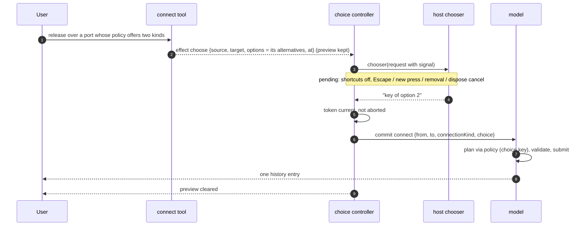

# Design

## Context

See proposal.md for the motivation. These are the parts of today's code this change
builds on:

- **Router and gestures.** `createToolRouter` holds one gesture per pointer. It ends
  when the tool returns to idle, which releases capture. `dom-input.ts` runs no shortcut
  while `router.activePointer` is set. Keyboard events from overlay content run no graph
  shortcut (`add-context-menu-hook`).
- **Connection release.** `connect-tool.ts` recomputes `connectPreview` at release and
  commits `connect` to `target`, the first candidate whose evaluation is `compatible`.
  Candidates are the ports in the capture radius, nearest first in screen distance, with
  ties in pick order. `connect-evaluation.ts` maps a planner `choice` to the `pending`
  state ("Choosing between alternatives needs UI a later change adds; release does
  nothing"), so a release on such a port commits nothing.
- **Choices in core.** `PolicyOutcome.choice.alternatives` is a list of `ConnectionPlan`
  without identity. `planConnect` turns it into `PlanResult.choice` with
  `ChoiceAlternative { label: "n1.p1 to n2.p2", plan }`, and `execute` returns
  `{ status: "choice-required", alternatives }`. The command cannot say which
  alternative it means. The commit validator (`policy/validator.ts`) re-evaluates the
  record with `{ from, to, kind }` and rejects `choice` with `choice-required`. Neither
  default preset returns `choice`. Paste (`paste-commit.ts`) and external planning
  (`plan-external.ts`) treat `choice` as a refusal.

## Goals / Non-Goals

**Goals:**

- A hook, no UI: a connection chooser that a host answers asynchronously.
- Each connection gesture ends as exactly one history entry or none, however long the
  choice takes (INT-08).
- Without a chooser, behavior is the same as today, except that a policy choice now
  shows its own cue.
- Pure logic stays headless: option building and the pending-choice controller run in
  Node tests.
- Minimal: no options beyond the spec, and the chooser code stays in its own files, so
  it could be removed cleanly if trying it in the demo shows it is not worth its size.

**Non-Goals:**

- Picker components or a keyboard connection chooser.
- Choices for reconnect, paste or composite member mappings.
- Anything about context menus (`add-context-menu-hook`).

## Decisions

### D1. Core: alternative keys and choosing one

```ts
interface ConnectionAlternative extends ConnectionPlan { readonly key: string; readonly label?: string }
type PolicyOutcome = … | { kind: "choice"; alternatives: readonly ConnectionAlternative[] } | …;
interface ConnectionProposal { …; readonly choice?: string }
// Command connect gains   choice?: string
// ChoiceAlternative gains key: string   (label: policy label ?? today's "n1.p1 to n2.p2")
```

`planConnect` copies `command.choice` into the proposal. If the outcome is still
`choice` while `command.choice` is set, the planner returns `rejected` with
`choice-required`, naming the key, so a policy that ignores `choice` cannot cause a
loop. Policy contract, documented in the guide: given a `choice` key, the policy accepts
exactly that alternative or rejects it. The accepted plan must record what tells it apart
(connection kind, endpoints or auxiliary entities), because the commit validator
re-evaluates the stored record without a `choice` and must get `accept`. Alternatives
that differ only in data the record does not store, such as composite member mappings,
are left to the composite-signature slice. That slice will give the record a place for
them.

**BREAKING:** a host policy that returns `choice` must give each alternative a `key`. The
default presets never return `choice`. Core tests that build `choice` outcomes gain keys.

### D2. The release target is picked as today; only its policy alternatives are offered

Which port a drop lands on is never a question for the host. As in QtNodes, where the
topmost item under the cursor wins, the existing deterministic order decides. The scene
pick orders hits by interactive (paint) order, `connectPreview` sorts the ports in the
capture radius nearest first, with equal distances kept in pick order, and the release
target is the first candidate in that list that the policy accepts or answers with
`choice`. Overlapping or coincident ports therefore resolve exactly as they do today,
without a dialog. The one difference from today is that a `choice` port can now be the
target. Before, it was mapped to `pending` and skipped, so a farther compatible port could
win.

`connect-evaluation.ts` maps planner `choice` to the new `choice` `CandidateState` and
keeps the alternatives (`ConnectionEvaluation.alternatives`), so building the request
needs no second policy call. `connect-glyphs.ts` draws a distinct glyph for the state
(UX-02). A small pure `src/view/interact/choice/choice-request.ts` turns the target's
alternatives into options `{ key, connectionKind, label, plan }` in policy order. The
option key is the policy's alternative key (CON-04), so the host gets the same key the
policy accepts back.

Decision at release in `connect-tool.ts`, with `ctx.chooserInstalled` (new
`ToolContext` flag):

- No target: nothing is committed (as today).
- Target accepted directly: one `connect` is committed (as today), and the chooser is
  never called.
- Target needs a choice, no chooser: nothing is committed (INT-12b).
- Target needs a choice, with a chooser: emit the new effect
  `{ type: "choose", request: { source, target, options, at } }` with the cursor reset
  and **without** clearing the preview. The tool goes idle, so the router releases
  capture.

Alternative considered and rejected after review: **asking the host when several ports
are tied under the release point** (with a tie distance option). It would add a dialog
where QtNodes users expect the topmost port to win, and the pick order is already
deterministic and documented (GEO-04a).

### D3. The chooser: one async function with an `AbortSignal`

```ts
type ConnectionChooser = (request: ConnectionChoiceRequest) =>
  string | undefined | Promise<string | undefined>;
interface ConnectionChoiceRequest {
  readonly source: Endpoint;
  readonly target: Endpoint;
  readonly options: readonly ConnectionChoiceOption[];   // the target's policy alternatives
  readonly client: { x: number; y: number };
  readonly viewport: Point<"viewport">;
  readonly world: Point<"world">;
  readonly signal: AbortSignal;
}
// InputOptions.chooseConnection?: ConnectionChooser
// ViewHandle.setConnectionChooser(chooser: ConnectionChooser | undefined): void
```

It returns the chosen option's key, or `undefined` to decline. A synchronous return
resolves within the same input event (useful for host rules and tests). A rejected
promise, a thrown error or an unknown key counts as declining. Replacing or removing the
chooser cancels a pending choice.

Why this form:

- **One responder.** A choice needs exactly one answer. An event with
  `event.resolve()` invites zero or several listeners answering, and "nobody listened"
  becomes a race. A single hook makes "no chooser" a plain, testable state (INT-12b).
- **Promise in, key out** is the natural shape for "open a picker, wait for a click".
  It is what `window.showOpenFilePicker` and most async UI APIs use, and `async`/`await`
  keeps host code short.
- **`AbortSignal`** is the web-standard way to tell the host to close its picker, and
  works with `addEventListener("abort")` and `AbortSignal.any`. The library has no
  timeout of its own: a user may read a picker for as long as they like. A host that
  wants one combines its own `AbortSignal.timeout` and resolves `undefined`. A promise
  that never settles is still safe, because Escape, a new press or dispose ends the
  choice.
- **Callback pair (`resolve`, `reject` arguments).** Same power as a promise, more
  ceremony, rejected.

Default without a chooser: never pick among policy alternatives. The spec already forbids silent picks of policy
alternatives (CON-04, SIG-04 "not an automatic pick", SIG-05 "rather than array-order
selection"). Cancelling is the only safe default. The library cannot know which
alternative is the host's "usual" one, and a silent wrong connection kind is worse than
none.

### D4. The pending choice lives outside the router

`src/view/interact/choice/connection-choice.ts` is a DOM-free controller:

```ts
type ChoiceState =
  | { kind: "idle" }
  | { kind: "pending"; token: number; request: ConnectionChoiceRequest; controller: AbortController; ids: ReadonlySet<string> };
// open(request) | cancel(reason) | entitiesRemoved(ids) | pending(): boolean | dispose()
```

- `open` (run for the `choose` effect by the effect runner's new `choose` host method)
  calls the chooser with a fresh `AbortController`'s signal and a token. When the result
  arrives, it is applied only if the token is still current and the signal is not
  aborted.
- **Resolve:** clear the preview, then `host.commit({ kind: "connect", from: source,
  to: request.target, connectionKind: option.connectionKind, choice: option.key })`. The commit goes through the same `editable.execute` path
  as tool commits: one command, one history entry, with policy and capability validation
  (CON-03, CON-05). A rejection is reported like any failed tool commit.
- **Cancel:** abort, clear the preview, back to idle. No history entry. The triggers
  are wired in `view-connection-choice.ts`:
  - Escape on the root `keydown` in the *capture* phase, so it works from the host's
    picker in the overlay and stops the event before `selection.clear`;
  - a `pointerdown` on the root (capture phase) outside overlay content, which is
    consumed with `stopPropagation` and `preventDefault`, so the click that dismisses a
    picker does not also start a pan or select;
  - `entitiesRemoved` with the source or target node or port (from
    the model `change` listener `view-editing.ts` already has);
  - model `reset`, chooser replacement, and dispose.
- **Keys while pending.** The same capture-phase `keydown` listener swallows every other
  key whose target is not overlay content (`stopImmediatePropagation`), so no graph
  shortcut runs, the same rule as during a drag. Keys inside the host's picker reach it,
  and they run no graph shortcut because overlay content never does
  (`add-context-menu-hook`).
  Blur and a hidden document do **not** cancel: the host's picker may take focus or
  open a native control, and the pointer part of the gesture is already over.
- **Preview.** The connect preview from the release frame stays on the interaction
  layer. It is world-anchored, so wheel zoom and panning keep it on the right ports. It
  is cleared on every exit.

Why outside the router: the router's unit is "a pointer that is down". A pending choice
has no pointer, and keeping a tool non-idle after `pointer-up` would break the router's
invariants (`activePointer`, capture release, auto-pan, the "no shortcut during a
gesture" check) for every tool. A small controller with its own union is easier to test
than special states in the router.

### D5. Files and layering

| Layer | New or changed file |
| --- | --- |
| core/edit | `policy/types.ts`, `commands/types.ts`, `commands/connect.ts` |
| core/facade | `index.ts` (export `ConnectionAlternative`) |
| view/render | `paint/previews/preview-types.ts` (`choice` state, `alternatives`), `connect-glyphs.ts` |
| view/interact | new `choice/choice-types.ts`, `choice-request.ts`, `connection-choice.ts`; changed `tools/connect-tool.ts`, `connect-evaluation.ts`, `tool-types.ts` (`choose` effect, `chooserInstalled`), `input/effect-runner.ts` |
| view/mount | new `view-connection-choice.ts` (choice controller and its listeners, wired from `view-editing.ts`); `view-types.ts` (`setConnectionChooser`, `InputOptions.chooseConnection`); `mount-view.ts` (one delegating member); `index.ts`, `advanced.ts` |

`src/view/interact/` already matches every subfolder in `src/architecture.test.ts`, so
the new `choice/` folder needs no table change. `view-connection-choice.ts` is a new
mount-layer file and is added to the mount rows deliberately. Removing the chooser means
deleting `choice/`, `view-connection-choice.ts` and a few lines in the changed files.

**Dependency.** This change is applied after `add-context-menu-hook` and relies on one
thing from it: overlay content runs no graph shortcut, so keys pressed in the host's
picker never reach the graph. It uses nothing else from that change.

### Flows



## Risks / Trade-offs

- [A chooser that never settles] → The choice stays pending, but any press, Escape or
  dispose ends it, and nothing is committed until then.
- [A policy that accepts a chosen key with a record the validator then refuses]
  → The commit is rejected with a reason (no partial state). The guide states the
  contract, and a core test pins it with a kind-based policy.
- [Pending preview while the model changes] → Removal of an involved port cancels.
  Other changes leave the frozen preview slightly stale until the answer, and the commit
  is revalidated (CON-05).
- [The mechanism may be more than hosts need] → The user wants it built minimally,
  tried in the demo, and then decided on; the size is recorded in notes.md.

## Migration Plan

Additive except one **breaking** contract change: `PolicyOutcome.choice` alternatives
need a `key` (D1). Host code with an exhaustive `switch` over `CandidateState` or
`ToolEffect["type"]` needs one more branch. `Command.connect`, `ConnectionProposal`,
`ChoiceAlternative`, `ToolContext`, `InputOptions` and `ViewHandle` gain members. No data
migration, and the snapshot format is unchanged.

## Resolved Questions

Answered by the user on 2026-11-01, before the proposal:

- **No shipped UI.** The library ships no picker, only a hook.
- **Connection-choice hook.** Releasing over several valid alternatives raises a choose
  request with the candidates and keeps the gesture pending. The host resolves with one
  candidate or cancels, and the gesture ends as one history entry or none. Timeouts,
  disposal and Escape cancel cleanly. The canonical form and the no-listener default
  were left to the proposal (D3).
- **Demo.** The plain-js demo gets a small example choice picker as example code,
  application-neutral.

Answered by the user on 2026-11-01, after reviewing the proposal:

- **No port-tie choice.** The tie-distance idea (`choiceTiePx`, asking about several
  ports near the release point) is dropped. As in QtNodes, the topmost element wins: the
  existing pick order (interactive paint order, then nearest port) decides the target
  deterministically, and the host is never asked which port. The chooser is asked only
  when the policy returns a `choice` with several alternatives for the picked target,
  and the request's options are that target's alternatives (D2).

Answered by the user on 2026-11-01, before implementation:

- **Separate change.** "Context menu is a separate concern, has nothing to do with
  connections." The chooser moved out of the context-menu change into this one.
- **Build, try, then decide.** The user doubts the chooser is worth its machinery. It
  is built as minimally as the spec allows, kept separable, tried in the demo, and its
  size is recorded in notes.md before deciding whether to keep it.

No open questions remain.
