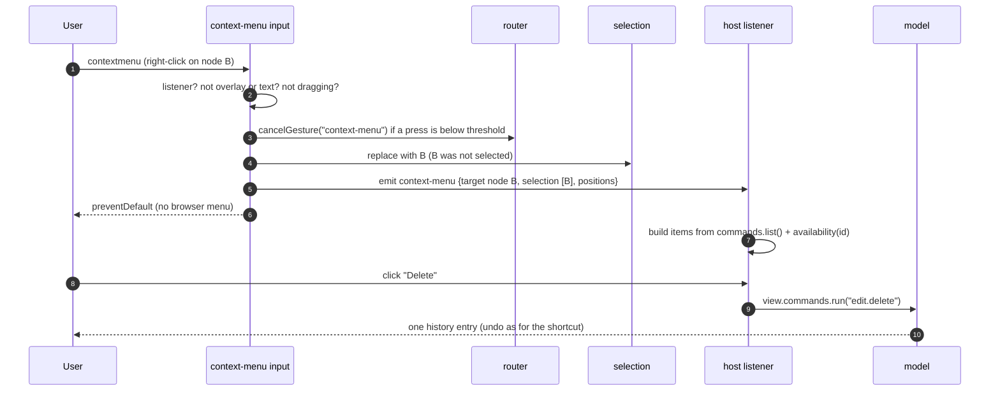
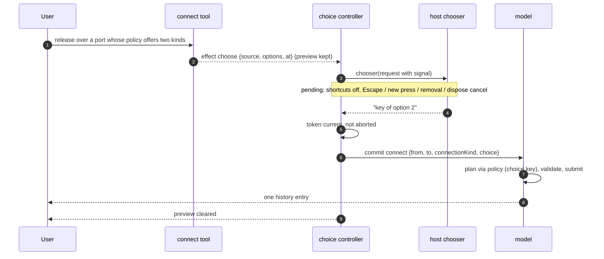

# Design

## Context

See proposal.md for the motivation. These are the parts of today's code this change
builds on:

- **Pointer buttons.** `pointer-input.ts` passes buttons 0, 1 and 2 to the router, and
  every built-in tool accepts only button 0 (and pan also accepts 1). So a right press is
  `IGNORED`, and `dom-input.ts` leaves its default alone ("Unclaimed presses (right
  button) keep the browser's default, e.g. the context menu"). The root is focused on
  every press, right presses included. Nothing listens for the DOM `contextmenu` event.
  On macOS a Ctrl+click arrives as a button-0 `pointerdown` with `ctrlKey` (Ctrl is not
  the primary modifier there), so select-move or connect enters `pressed` before the
  browser sends `contextmenu`.
- **Touch.** The root has `touch-action:none`. A touch press goes through the same
  router: the touch drag threshold is 6 CSS px against 3 for a mouse, and with the
  default `emptyDrag: "pan"` a drag on empty canvas pans and a drag on a node moves it
  (pan-first). A second pointer cannot start a gesture while one is active (no pinch
  yet). Nothing measures how long a press is held.
- **Router and gestures.** `createToolRouter` holds one gesture per pointer. It ends
  when the tool returns to idle, which releases capture. `dom-input.ts` runs no shortcut
  while `router.activePointer` is set. Its `cancel(reason)` is internal. `CancelReason`
  has no context-menu entry.
- **Connection release.** `connect-tool.ts` recomputes `connectPreview` at release and
  commits `connect` to `target`, the first candidate whose evaluation is `compatible`.
  Candidates are the ports in the capture radius, nearest first in screen distance, with
  ties in pick order. `connect-evaluation.ts` maps a planner `choice` to the `pending`
  state ("Choosing between alternatives needs UI a later change adds; release does
  nothing"), so a release on such a port commits nothing.
- **Choices in core.** `PolicyOutcome.choice.alternatives` is a list of `ConnectionPlan`
  without identity. `planConnect` turns it into `PlanResult.choice` with
  `ChoiceAlternative { label: "n1.p1 to n2.p2", plan }`, and `execute` returns
  `{ status: "choice-required", alternatives }`. The command cannot say which
  alternative it means. The commit validator (`policy/validator.ts`) re-evaluates the
  record with `{ from, to, kind }` and rejects `choice` with `choice-required`. Neither
  default preset returns `choice`. Paste (`paste-commit.ts`) and external planning
  (`plan-external.ts`) treat `choice` as a refusal.
- **Commands.** `view.commands` exposes `run`, `availability`, `list` (`id`, `labelKey`
  in registration order) and `register`. Built-in commands act on the selection
  (`edit.delete`, `nodes.rotate`, `edit.copy`, …). `edit.paste` places the fragment at
  `deps.pointer()`, the last mouse or pen position over the view; there is none for
  touch.
- **Events.** The view handle has no general `on`. `view.clipboard.on(type, handler)`
  returns an unsubscribe function and is the only event API, so its shape is the model
  to follow.
- **Overlay.** `overlay-host.ts` anchors elements to a world point or a node, and
  `isOverlayContent` keeps overlay content from starting gestures. Keyboard events from
  non-text overlay content (a menu button) still bubble to the root's `keydown`. There
  `Escape` is bound to `selection.clear`, so pressing Escape in a host menu would clear
  the selection today.
- **File sizes.** `dom-input.ts` 298 lines, `mount-view.ts` 336, `view-editing.ts` 267,
  `connect-tool.ts` 144, `examples/plain-js/main.ts` 276. New logic goes into new files.

## Goals / Non-Goals

**Goals:**

- Two hooks, no UI: a context-menu event with everything needed to build and place a
  menu, and a connection chooser that a host answers asynchronously.
- One code path for running a menu item: `view.commands.run`, so availability, patches
  and undo match the shortcuts.
- Each connection gesture ends as exactly one history entry or none, however long the
  choice takes.
- Without listeners or a chooser, behavior is the same as today, except that a policy
  choice now shows its own cue.
- Pure logic stays headless: target resolution, the selection rule, the long-press
  machine, option building and the pending-choice controller run in Node tests.

**Non-Goals:**

- Menu, submenu or picker components, menu keyboard navigation, or focus trapping.
- A command query for targets other than the selection.
- Choices for reconnect, paste or composite member mappings.

## Decisions

### D1. The context-menu event is `view.on("context-menu", handler)`

```ts
interface ViewEventMap { "context-menu": ContextMenuEvent }
on<K extends keyof ViewEventMap>(type: K, handler: (e: ViewEventMap[K]) => void): () => void;
```

A small typed emitter (`src/view/interact/input/view-events.ts`) holds listeners in
insertion order, reports `count(type)`, isolates a throwing handler (the others still
run, and the error is rethrown asynchronously, as the clipboard events do), and is
cleared on dispose. The DOM side asks `count("context-menu") > 0` to decide whether to
suppress the browser's menu and arm long-presses.

Why: it matches `view.clipboard.on` and `selection.on` (same return value). It lets
several parts of a host listen, for example a menu and an analytics hook, and lets a
host subscribe and unsubscribe after mount.

Alternatives considered:

- **A mount option `onContextMenu`** (React Flow style). It allows one handler only, set
  at mount. The react slice can map a prop onto `on` later.
- **Dispatching a DOM `CustomEvent` on the root.** It is untyped, ties the payload to
  the DOM, and makes "is anyone listening?" impossible to answer, which the suppression
  rule needs.

### D2. Payload: plain data, no DOM event

```ts
type ContextMenuTarget =
  | { kind: "node"; node: NodeId }
  | { kind: "port"; node: NodeId; port: PortId }
  | { kind: "connection"; connection: ConnectionId; member?: string }
  | { kind: "canvas" };
interface ContextMenuEvent {
  readonly target: ContextMenuTarget;
  readonly hits: readonly HitCandidate[];          // empty for keyboard invocation
  readonly selection: { readonly nodes: readonly NodeId[]; readonly connections: readonly ConnectionId[] };
  readonly invocation: "mouse" | "pen" | "touch" | "keyboard";
  readonly modifiers: Modifiers;
  readonly client: { readonly x: number; readonly y: number };
  readonly viewport: Point<"viewport">;
  readonly world: Point<"world">;
}
```

The target is the first hit of the view's normal pick at that point, the same pick and
order that `view.pick` and the tools use (ports hidden at low zoom stay unpickable,
the level of detail rule), so a menu and a click always agree. `hits` lets a host offer "which one?" for
coincident paths. `selection` is in selection order, after D3. The three
positions save the host from converting: `client` for host DOM outside the view,
`viewport` for an overlay `viewport` anchor (D10), and `world` for a world anchor or for
"create/paste here". The DOM event is not exposed. Keyboard and touch invocations have
none that means anything, and a typed payload keeps hosts off browser quirks. A host
that needs a DOM detail can listen on `view.element` itself.

### D3. Selection rule: select-on-open for unselected entities

A pointer or touch invocation applies `{ mode: "replace", keys: [key] }` when the target
entity (a port's node for a port) is not selected. It leaves the selection alone when the
target is already selected or is the canvas. Modifiers do not change the rule. Keyboard
invocation never changes the selection.

Why: built-in commands act on the selection, so after this rule a menu item is exactly
`view.commands.run(id)`, with the same availability text as the shortcut. This is what
most desktop editors and file managers do. Keeping a multi-selection when the click lands inside it is what makes
"delete these three" possible from a menu. The rule runs only when a listener exists, so
a host without a menu sees no change.

Alternatives considered: **never select** (React Flow). The host must then pass the
target to every command, which needs a second, target-based command API (the gap
the unified commands rule would otherwise need), and the selection highlight disagrees with what the menu
acts on. **Select also on empty canvas (clear)**. That loses a selection the user may
want to "paste here" next to, or align, so it is rejected.

### D4. Pointer triggers and gesture interplay

`src/view/interact/context-menu/context-menu-input.ts` attaches at mount and
listens on the root for `contextmenu`, `pointerdown`/`pointermove`/`pointerup`/
`pointercancel` (to track the current press and long-presses), and `keydown` (D6):

- **Right-click.** `contextmenu` is the only trigger for mouse and pen. It already covers
  the secondary button, Ctrl+click on macOS and a pen barrel button, and it fires on
  press on macOS and on release on Windows. Both timings work because a right press
  starts no tool.
- **Scoping.** An event whose target is overlay content or a text field is ignored with
  its default kept.
- **No listener.** Return before anything else: no `preventDefault`, no selection
  change, no cancel.
- **Active press.** If the router has a gesture on the same pointer that has not moved
  past its drag threshold (tracked here from the press point, with the same
  `dragThreshold` helper), the gesture is cancelled with the new `CancelReason`
  `"context-menu"` through a new `DomInput.cancelGesture(reason)`. A `pressed` state
  emits no effects on cancel, so the macOS Ctrl+click neither selects on release nor
  drags. If the gesture has passed the threshold, the event is not raised and the native
  menu is suppressed, so a drag is never disturbed.
- **Pending choice.** A right press is a new press, so it cancels a pending choice first
  (D9).
- Then the selection rule (D3) runs, `preventDefault()` is called, and the event is
  emitted.

`dom-input.ts` needs only `cancelGesture` and the overlay keyboard gate of D10. To stay
under 300 lines it first moves its key handling into a new `input/key-input.ts`, as a
pure refactor in its own commit.

### D5. Touch long-press is a pure state machine beside the router

```ts
type LongPressState =
  | { kind: "idle" }
  | { kind: "armed"; pointerId: number; start: Point<"viewport">; at: Point<"world"> }
  | { kind: "fired"; pointerId: number };    // swallow the rest of this touch
// inputs: down(touch) | move | up | cancel | second-down | timeout | native-contextmenu
```

`long-press.ts` is DOM-free: it says when to start or clear the timer and when to fire.
`context-menu-input.ts` runs the timer with the root window's `setTimeout`, which it
reads at mount. Rules:

- Arm only for `pointerType === "touch"`, only while a listener is registered, and only
  when `longPressMs !== false` (a new `ToolOptions.longPressMs`, default 500, the
  common platform value).
- **Pan-first compatibility.** Movement beyond the *touch drag threshold* (the same 6 px
  the tools use) disarms. So the two outcomes are exclusive by construction: before the
  threshold the gesture is still `pressed` and nothing has moved; after it the tool is
  panning, moving or connecting and the long-press is gone. A drag that starts after the
  long-press fired does nothing, because the router gesture was cancelled.
- A second touch (`pointerdown` with another ID) disarms, so a future pinch never opens a
  menu. `pointerup`, `pointercancel`, blur, hidden and dispose disarm.
- On fire: cancel the router gesture (`"context-menu"`), apply D3, and emit with
  invocation `touch` at the press point.
- Chrome on Android also sends a native `contextmenu` for a long touch. iOS Safari sends
  none. While a touch is armed or fired, a native `contextmenu` from it is
  default-prevented. If it arrives before our timer, it counts as the fire (one event).
  After our fire, it is swallowed. So the host gets exactly one event on every platform,
  and the timer covers Safari.
- `layer-stack.ts` adds `-webkit-touch-callout:none; user-select:none;
  -webkit-user-select:none` to the root, so iOS shows no callout or text selection
  during the hold. Overlay content can set its own `user-select`.

Pen long-press is not armed, because pens report their barrel button through
`contextmenu` (see Open Questions).

### D6. Keyboard invocation

The menu key (`key === "ContextMenu"`) and Shift+F10 on the root's `keydown`, when
`shouldHandleKey` allows it, the target is not overlay content, no gesture is active, no
choice is pending, and a listener exists. Then:

- The target is the primary selected entity (`selection.primary()`): a node or a
  connection, or the canvas when nothing is selected. Ports are never selected, so a
  keyboard target is never a port.
- The position is the centre of the entity's world bounds from the geometry scene,
  clamped into the visible world rectangle, or the view centre for the canvas. It is
  converted to viewport and client coordinates.
- The selection is not changed. `preventDefault()` runs on the `keydown`.
- Windows sends a native `contextmenu` after the menu key, and Chrome does after
  Shift+F10. A flag set by our handler swallows the next native `contextmenu` (cleared
  on `keyup` plus one task), so one key press gives one event.

The key handling sits in `context-menu-input.ts`, not in the keymap, because it is not a
command: its result is an event with a position, not a patch.

### D7. Connection options: ties and policy alternatives

New pure `src/view/interact/choice/choice-options.ts` builds the options from the
release-time `connectPreview`:

1. Take candidates whose evaluation is `compatible` or the new `choice` state.
2. Keep those whose screen distance is within `choiceTiePx` (new tool option, default 1
   CSS px) of the first one. The list is already nearest first with stable pick-order
   ties.
3. Expand each kept port: a compatible port gives one option. A choice port gives one
   option per policy alternative, in policy order.

Each option is `{ key, target, connectionKind, label, plan, alternative? }`. `key` is
opaque and unique in the request. It is built from the port IDs and the alternative's
policy key, and hosts must not parse it. `connect-evaluation.ts` maps planner `choice`
to state `choice` and keeps the alternatives (`ConnectionEvaluation.alternatives`), so
building options needs no second policy call. `CandidateState` gains `choice`, and
`connect-glyphs.ts` draws a distinct glyph for it.

Decision at release in `connect-tool.ts`, with `ctx.chooserInstalled` (new
`ToolContext` flag):

- No chooser: the target is the first `compatible` candidate. This is today's rule
  unchanged: ties go to pick order, and choice ports are never picked.
- With a chooser: no options means nothing is committed. One option that came from a
  plain compatible port is committed directly. Anything else (two or more options, or
  one port that needs a choice) emits the new effect
  `{ type: "choose", request: { source, options, at } }` with the cursor reset, and
  **without** clearing the preview. The tool goes idle, so the router releases capture.

Why a 1 px tie: ports in the capture radius at different distances already have a clear
winner that the preview shows as the target, so asking would add a dialog to almost
every connection between dense nodes. Only coincident ports, such as stacked or
overlapping nodes, are true ties. The option makes it tunable.

### D8. The chooser: one async function with an `AbortSignal`

```ts
type ConnectionChooser = (request: ConnectionChoiceRequest) =>
  string | undefined | Promise<string | undefined>;
interface ConnectionChoiceRequest {
  readonly source: Endpoint;
  readonly options: readonly ConnectionChoiceOption[];
  readonly client: { x: number; y: number };
  readonly viewport: Point<"viewport">;
  readonly world: Point<"world">;
  readonly signal: AbortSignal;
}
// InputOptions.chooseConnection?: ConnectionChooser
// ViewHandle.setConnectionChooser(chooser: ConnectionChooser | undefined): void
```

It returns the chosen option's key, or `undefined` to decline. A synchronous return
resolves within the same input event (useful for host rules and tests). A rejected
promise, a thrown error or an unknown key counts as declining. Replacing or removing the
chooser cancels a pending choice.

Why this form:

- **One responder.** A choice needs exactly one answer. An event with
  `event.resolve()` invites zero or several listeners answering, and "nobody listened"
  becomes a race. A single hook makes "no chooser" a plain, testable state.
- **Promise in, key out** is the natural shape for "open a picker, wait for a click".
  It is what `window.showOpenFilePicker` and most async UI APIs use, and `async`/`await`
  keeps host code short.
- **`AbortSignal`** is the web-standard way to tell the host to close its picker, and
  works with `addEventListener("abort")` and `AbortSignal.any`. The library has no
  timeout of its own: a user may read a picker for as long as they like. A host that
  wants one combines its own `AbortSignal.timeout` and resolves `undefined`. A promise
  that never settles is still safe, because Escape, a new press or dispose ends the
  choice.
- **Callback pair (`resolve`, `reject` arguments).** Same power as a promise, more
  ceremony, rejected.

Default without a chooser: never pick among policy alternatives, and keep the
first-in-order pick for plain ties. The spec already forbids silent picks of policy
alternatives (the structured policy outcomes rule and the rule that required values resolve to one provider "not an automatic pick", the composite plan preview rule "rather than array-order
selection"). Cancelling is the only safe default. The library cannot know which
alternative is the host's "usual" one, and a silent wrong connection kind is worse than
none. Plain coincident ports are not a policy ambiguity. Picking the first in the
documented interactive order is deterministic and is what hosts get today, so
it does not change.

### D9. The pending choice lives outside the router

`src/view/interact/choice/connection-choice.ts` is a DOM-free controller:

```ts
type ChoiceState =
  | { kind: "idle" }
  | { kind: "pending"; token: number; request: ConnectionChoiceRequest; controller: AbortController; ids: ReadonlySet<string> };
// open(request) | cancel(reason) | entitiesRemoved(ids) | pending(): boolean | dispose()
```

- `open` (run for the `choose` effect by the effect runner's new `choose` host method)
  calls the chooser with a fresh `AbortController`'s signal and a token. When the result
  arrives, it is applied only if the token is still current and the signal is not
  aborted.
- **Resolve:** clear the preview, then `host.commit({ kind: "connect", from: source,
  to: option.target, connectionKind: option.connectionKind, choice:
  option.alternative?.key })`. The commit goes through the same `editable.execute` path
  as tool commits: one command, one history entry, with policy and capability validation.
  A rejection is reported like any failed tool commit.
- **Cancel:** abort, clear the preview, back to idle. No history entry. The triggers
  are wired in `view-hooks.ts`:
  - Escape on the root `keydown` in the *capture* phase, so it works from the host's
    picker in the overlay and stops the event before `selection.clear`;
  - a `pointerdown` on the root (capture phase) outside overlay content, which is
    consumed with `stopPropagation` and `preventDefault`, so the click that dismisses a
    picker does not also start a pan or select;
  - `entitiesRemoved` with the source node or port, or any option's node or port (from
    the model `change` listener `view-editing.ts` already has);
  - model `reset`, chooser replacement, and dispose.
- **Shortcuts while pending.** The `onKey` wrapper in `view-hooks.ts` returns `false`
  while a choice is pending, so no graph shortcut runs, the same rule as during a drag.
  Blur and a hidden document do **not** cancel: the host's picker may take focus or
  open a native control, and the pointer part of the gesture is already over.
- **Preview.** The connect preview from the release frame stays on the interaction
  layer. It is world-anchored, so wheel zoom and panning keep it on the right ports. It
  is cleared on every exit.

Why outside the router: the router's unit is "a pointer that is down". A pending choice
has no pointer, and keeping a tool non-idle after `pointer-up` would break the router's
invariants (`activePointer`, capture release, auto-pan, the "no shortcut during a
gesture" check) for every tool. A small controller with its own union is easier to test
than special states in the router.

### D10. Small host-menu gaps

- **`edit.paste` with `at`.** `PasteArgs` gains `at?: Point<"world">`, and
  `clipboardService.paste(text?, at?)` uses it before `deps.pointer()`. Availability is
  unchanged.
- **Overlay `viewport` anchor.** `OverlayAnchor` gains
  `{ kind: "viewport"; point: Point<"viewport"> }`. Layout uses the point as is (no
  scale option), so a host menu at `event.viewport` stays on screen while the view
  zooms. World and node anchors are unchanged.
- **Overlay content runs no graph shortcuts.** In the keyboard handler (moved into
  `key-input.ts`), a `keydown` whose target is overlay content runs neither tool keys nor
  the keymap. `attachClipboardEvents`'s `owns` also ignores overlay content. Text fields
  were already excluded. This extends the exclusion to non-text host controls, so Escape
  or Delete in a host menu never reaches the graph. Escape for a pending choice is
  handled before this gate (D9).
- **No new registry query.** With D3, `commands.list()` gives IDs and label keys in
  registration order, and `commands.availability(id, args)` gives enabled state and the
  reason. The demo shows building a menu from those two. A target-based query would
  duplicate every command's availability logic.

### D11. Core: alternative keys and choosing one

```ts
interface ConnectionAlternative extends ConnectionPlan { readonly key: string; readonly label?: string }
type PolicyOutcome = … | { kind: "choice"; alternatives: readonly ConnectionAlternative[] } | …;
interface ConnectionProposal { …; readonly choice?: string }
// Command connect gains   choice?: string
// ChoiceAlternative gains key: string   (label: policy label ?? today's "n1.p1 to n2.p2")
```

`planConnect` copies `command.choice` into the proposal. If the outcome is still
`choice` while `command.choice` is set, the planner returns `rejected` with
`choice-required`, naming the key, so a policy that ignores `choice` cannot cause a
loop. Policy contract, documented in the guide: given a `choice` key, the policy accepts
exactly that alternative or rejects it. The accepted plan must record what tells it apart
(connection kind, endpoints or auxiliary entities), because the commit validator
re-evaluates the stored record without a `choice` and must get `accept`. Alternatives
that differ only in data the record does not store, such as composite member mappings,
are left to the composite-signature slice. That slice will give the record a place for
them.

**BREAKING:** a host policy that returns `choice` must give each alternative a `key`. The
default presets never return `choice`. Core tests that build `choice` outcomes gain keys.

### D12. Files and layering

| Layer | New or changed file |
| --- | --- |
| core/edit | `policy/types.ts`, `commands/types.ts`, `commands/connect.ts` |
| core/facade | `index.ts` (export `ConnectionAlternative`) |
| view/platform | `dom/layer-stack.ts` (touch callout, user-select) |
| view/render | `paint/previews/preview-types.ts` (`choice` state, `alternatives`), `connect-glyphs.ts` |
| view/interact | new `context-menu/context-menu-types.ts`, `context-target.ts` (target from hits, D3 rule, keyboard placement), `long-press.ts`, `context-menu-input.ts`; new `choice/choice-types.ts`, `choice-options.ts`, `connection-choice.ts`; new `input/view-events.ts`, `input/key-input.ts`; changed `tools/connect-tool.ts`, `connect-evaluation.ts`, `tool-types.ts` (`choose` effect, `"context-menu"` reason, `chooserInstalled`), `thresholds.ts` (`longPressMs`, `choiceTiePx`), `input/effect-runner.ts`, `input/dom-input.ts`, `overlay/overlay-host.ts`, `clipboard/clipboard-commands.ts`, `clipboard/clipboard-service.ts`, `clipboard/clipboard-events.ts` |
| view/mount | new `view-hooks.ts` (event emitter, context-menu input, choice controller and their gates, wired from `view-editing.ts`); `view-types.ts` (`on`, `setConnectionChooser`, `InputOptions.chooseConnection`); `mount-view.ts` (two delegating members); `index.ts`, `advanced.ts` |

`src/view/interact/` already matches every subfolder in `src/architecture.test.ts`, so
the new `context-menu/` and `choice/` folders need no table change. `view-hooks.ts` is a
new mount-layer file and is added to the mount rows deliberately. `mount-view.ts` grows
by about four lines (336 → about 340), the same accepted exception as before (the user
treats 300 as a soft guideline).

### Flows





## Risks / Trade-offs

- [Browsers differ in when and whether `contextmenu` fires (macOS on press, Windows on
  release, iOS never for touch, Chrome Android on long touch)] → D4 and D5 treat
  `contextmenu` as one input among several and dedupe per pointer or key press. Browser
  tests cover the paths that Chrome can drive, and the Safari and iOS paths go through
  the pure long-press machine.
- [Select-on-open changes the selection a user had] → Only when a listener exists and
  only for an unselected target; inside a selection nothing changes.
- [A long hold to read a node, without wanting a menu, opens one] → Only with a
  listener, and `longPressMs: false` turns it off.
- [A chooser that never settles] → The choice stays pending, but any press, Escape or
  dispose ends it, and nothing is committed until then.
- [A policy that accepts a chosen key with a record the validator then refuses]
  → The commit is rejected with a reason (no partial state). The guide states the
  contract, and a core test pins it with a kind-based policy.
- [Overlay content no longer runs graph shortcuts] → Intended. A host that wants a
  shortcut inside its overlay UI can call `view.commands.run` itself.
- [Pending preview while the model changes] → Removal of an involved port cancels.
  Other changes leave the frozen preview slightly stale until the answer, and the commit
  is revalidated.

## Migration Plan

Additive except one **breaking** contract change: `PolicyOutcome.choice` alternatives
need a `key` (D11). Host code with an exhaustive `switch` over `CandidateState`,
`ToolEffect["type"]`, `CancelReason` or `OverlayAnchor["kind"]` needs one more branch.
`Command.connect`, `ConnectionProposal`, `ChoiceAlternative`, `PasteArgs`, `ToolOptions`,
`ToolContext`, `InputOptions` and `ViewHandle` gain members. No data migration, and the
snapshot format is unchanged.

## Resolved Questions

Answered by the user on 2026-11-01, before the proposal:

- **No shipped UI.** The library ships no menu or picker, only hooks, "the most
  canonical way" (like React Flow's `onNodeContextMenu` / `onPaneContextMenu`, or
  Cytoscape's separate menu plugin). In the user's words, "menu must be customizable. or
  the user of the library would put own menu on top of our nodes, we just need to hook
  up the click event".
- **Context-menu hook.** An event on the view (D1). It fires on right-click
  (`contextmenu`), touch long-press, and the menu key or Shift+F10 with focus. Keyboard
  invocation targets the selection and is placed at it. The payload has the hit by
  stable IDs from geometric picking, the selection, and client, viewport and world
  positions. The native menu is suppressed only when at least one listener is
  registered. Nothing fires in overlay text fields. The hook must not start or
  disturb a gesture, and a right press must not start pan or drag tools.
- **Select on right-click.** The user's recommendation was to select an unselected
  entity first, as most editors do. Adopted as D3, with the multi-selection and canvas
  refinements.
- **Menu items are commands.** Hosts build items from the command registry and run them
  with `view.commands.run(id, args)`, and undo works as for shortcuts. Hosts place their
  DOM through the overlay (world or screen anchor) or by the event coordinates. The
  small gaps found are paste-at-position and the viewport anchor (D10).
- **Connection-choice hook.** Releasing over several valid alternatives raises a choose
  request with the candidates and keeps the gesture pending. The host resolves with one
  candidate or cancels, and the gesture ends as one history entry or none. Timeouts,
  disposal and Escape cancel cleanly. The canonical form and the no-listener default
  were left to the proposal (D8).
- **Demo.** The plain-js demo gets a small example context menu and choice picker as
  example code, application-neutral.

## Open Questions

These can be answered during or after implementation without changing the specs'
structure:

- **Modifiers on right-click.** Should Shift+right-click on an unselected entity *add* it
  to the selection instead of replacing it? Recommendation: no for now (D3 ignores
  modifiers, and they are reported in the payload so a host can act on them).
  Revisit if users ask.
- **Letting the browser menu through per event.** Should a listener be able to say "not
  mine, show the browser's menu" (for example on empty canvas)? Recommendation: not in
  this change. It would need the listener to run synchronously inside the DOM event,
  which touch and keyboard paths do not guarantee. A host can unsubscribe instead.
- **Pen long-press.** Pens are not armed (D5). Recommendation: keep it that way. Most
  pens have a barrel button that browsers report as `contextmenu`. Add `pen` to the
  long-press types only if a target device lacks one.
- **Tie distance.** `choiceTiePx` defaults to 1 CSS px, so only coincident ports are
  asked about. Recommendation: keep 1. A host that wants to ask whenever two ports are in
  the capture radius can raise it to the capture radius.
