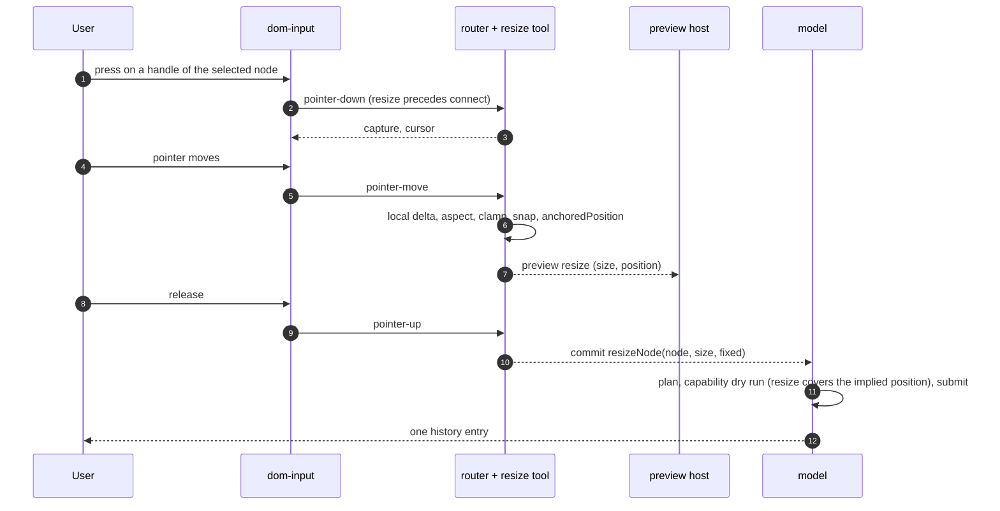
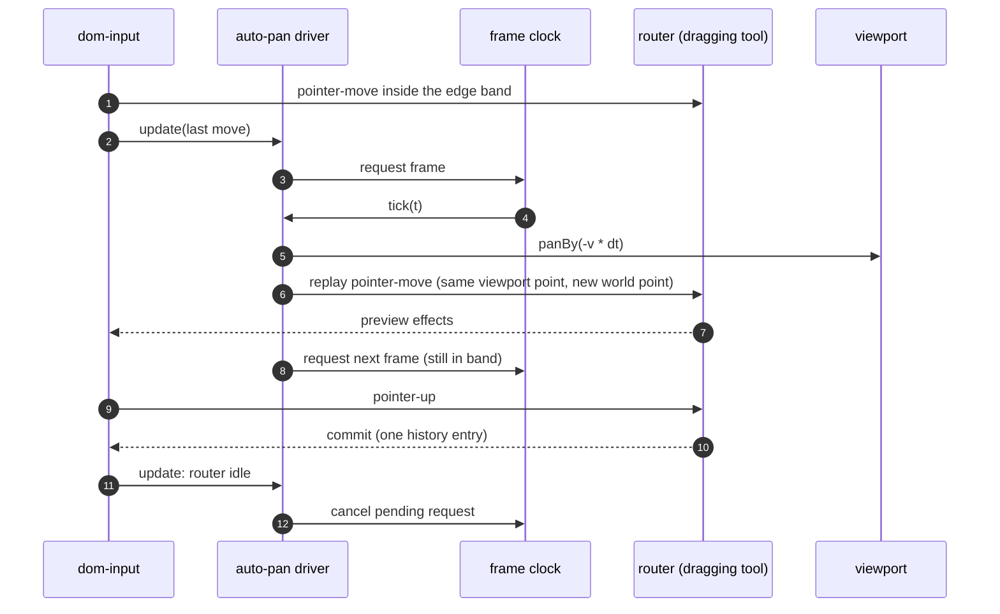

# Design

## Context

See proposal.md for the motivation. These are the parts of today's code this change
builds on:

- **Node frame.** `position` is the world location of the body centre; `size` is the
  unrotated body size. `nodeTransform` (`src/core/space/geometry/node-transform.ts`) is
  `world = T(position) · R(rotation · 90° clockwise) · M(mirrored)`, with mirroring a flip
  of local x applied first. Quarter turns use exact 0/±1 entries.
- **Transform planners.** `src/core/edit/commands/transform-nodes.ts` has `moveNodes`,
  `rotateNodes` (adds `turns` to `rotation`, so rotation is already a screen-space turn),
  `mirrorNodes` (toggles `mirrored` only, which is a flip of the node's *local* x axis and
  therefore a screen-vertical flip for a node at an odd quarter turn) and `reorderNodes`.
  There is no resize command; `updateNode` covers title, status and payload only.
- **Capabilities.** `validator.ts` maps each changed node field to an action in fixed
  order: `position → move`, `size → resize`, `rotation → rotate`, `mirrored → mirror`, and
  refuses the patch on the first denied action. A patch that changes `size` and `position`
  together therefore needs both `resize` and `move` today.
- **Size limits.** None exist: `NodeTypeDefinition` has `defaultSize` only, and nothing
  reads a minimum or maximum. `isFiniteSize` allows zero.
- **Port anchors as a function of size.** Every geometry computes anchors from the body
  box `bodyOf(view)` = the stored size centred on the origin, so a size change moves
  anchors without any extra work, and `scene-update.ts` already rebuilds a node and its
  incident connections when `size` changes (`NODE_GEOMETRY_FIELDS`). Per preset:
  - image-symbol: durable and type-level placements are *fractions* of the body box, and
    unplaced ports are spread evenly along the sides, so all anchors scale with the size
    and a port on an edge stays on that edge;
  - card: ports sit on the left/right (or top/bottom) edges, so x follows the width, but in
    horizontal layout their y is `titleHeight + rowPitch · (i + ½)` from the top, a fixed
    distance that is clamped to the bottom edge when the body is too short. A card shorter
    than its port rows stacks the lower ports on the bottom corner.
- **Tools.** Pure state machines (`Tool<S>`: `idle`, `accepts`, `transition`, `isIdle`)
  in `src/view/interact/tools/`, chosen on press by fixed precedence in
  `default-tools.ts` (pan, connect, select-move, empty-pan, marquee). The router holds one
  gesture; `dom-input.ts` turns DOM events into `ToolInput` and runs effects. Previews are
  `ToolPreview` values painted by `preview-host.ts` on the interaction layer; a move
  preview hides the moved entities from the scene layer and ghosts them with the scene
  painters. `capabilityProbe` answers `move` and `delete` with trial commands and says
  "available" for every other action.
- **Frames.** `createFrameScheduler` requests one animation frame when a layer becomes
  dirty and never loops (PERF-02d). It takes an injectable `FrameClock`.
- **Keymap.** `DEFAULT_KEYMAP` in `keymap.ts`; chords match `key` case-insensitively with
  exact Shift, so `R` and `Shift+R` are distinct. `dom-input.ts` runs no shortcut during a
  gesture and `shouldHandleKey` keeps text fields and IME out (INT-06).
- **Size budget of files.** `dom-input.ts` is 316 lines and `mount-view.ts` 332, both over
  the 300-line convention, so new logic goes into new files.

## Goals / Non-Goals

**Goals:**

- One resize path: the tool, the API and undo all produce or replay a `resizeNode` patch
  that changes `size` and `position` in one node update.
- Preview and commit agree to the unit: both compute the anchored position with the same
  core function.
- Rotate and mirror are ordinary model commands behind editor commands, so shortcut and API
  give identical patches (INT-07).
- Auto-pan never adds a history entry and never leaves a frame request behind.
- Everything except DOM wiring and painting is testable headlessly.

**Non-Goals:**

- Multi-node resize, free rotation, rotation handles, skew.
- Size limits in the document format.
- Smooth (eased) auto-pan acceleration curves or inertia after release.

## Decisions

### D1. Size limits: type declaration plus a host hook, resolved by the model

```ts
interface SizeLimits { readonly min?: Size; readonly max?: Size }   // core/data/node-types
// NodeTypeDefinition gains:  readonly sizeLimits?: SizeLimits;
type SizeLimitPolicy = (node: NodeRecord, fromType: ResolvedSizeLimits) => SizeLimits | undefined;
// GraphModelOptions gains:   readonly sizeLimits?: SizeLimitPolicy;
// GraphModel gains:          sizeLimits(id: NodeId): ResolvedSizeLimits | undefined;
interface ResolvedSizeLimits { readonly min: Size; readonly max: Size }
```

Resolution: library default `min {1, 1}`, `max {∞, ∞}` → the type's `sizeLimits`
(each given bound replaces the default per field) → the host hook's result (same per-field
replacement). The hook sees the record, so a host can derive limits from the payload ("an
image-symbol node never smaller than its picture's intrinsic size"). The registry rejects a
type whose limits are non-finite (except `max` = ∞), negative, or have `min > max`, with
`malformed-record`. A hook result with `min > max` is a host bug: the resolver widens `max`
to `min` and the case is documented, rather than throwing during a gesture.

The default minimum of one world unit exists because a zero-width node can be neither seen
nor picked; a host that wants zero declares `min: { width: 0, height: 0 }`.

Alternatives considered:

- **A `sizeLimits` field on `NodeRecord`.** True per-instance data, but it changes the
  snapshot format, the record validator, the fragment format and undo for no current need;
  the hook covers per-instance rules derived from the payload. Can be added later.
- **Limits in the geometry registration.** Geometry is in `core/space` and is a view-time
  concern; the planner in `core/edit` cannot see it, and the API path must enforce limits
  without a view.

### D2. `resizeNode` command with a fixed point in the node's local frame

```ts
type ResizeFixed = { readonly x: -1 | 0 | 1; readonly y: -1 | 0 | 1 }; // local frame, before rotation and mirror
| { kind: "resizeNode"; node: NodeId; size: Size; fixed?: ResizeFixed }  // default { x: 0, y: 0 } (centre)
```

`fixed` names the point of the unrotated body box that keeps its world position:
`x = -1` is the local left edge, `1` the right edge, `0` the centre line; likewise `y` for
top and bottom. The planner computes the new centre as

```
Δlocal = (−fixed.x · (w′ − w) / 2, −fixed.y · (h′ − h) / 2)
position′ = position + L · Δlocal,   L = R(rotation) · M(mirrored)
```

and emits one node update with `size` and, when it changed, `position`. The quarter-turn
and mirror linear map `L` lives in a new `src/core/data/model/node-frame.ts`
(`frameVector`, `frameVectorInverse`, `anchoredPosition(record, size, fixed)`), because
`core/edit` may not import `core/space`. `node-transform.ts` keeps its own matrix; a test
asserts both agree for all eight rotation/mirror combinations. The tool calls
`anchoredPosition` for its preview, so preview and commit are the same arithmetic.

Validation in order: unknown node → `unknown-entity`; non-finite or negative size →
`non-finite`; outside `ctx.sizeLimits(node)` → `out-of-range` naming the node and the
violated bound; same size → empty plan (no history entry). Label "Resize". A convenience
`model.resizeNode(id, size, fixed?)` joins the existing convenience methods.

Alternatives considered:

- **Generic `updateNode` with `size` and `position`.** Callers would have to do the frame
  arithmetic, and the capability rule (D4) could not tell an anchored resize from a move.
- **Fixed point as a world point.** Ambiguous when it is not on the body; the local
  handle grid is exactly what both the tool and an API caller mean.

### D3. Clamp during the gesture, reject at the API; enforce at plan time only

- **Gesture:** the resize tool clamps every preview to the resolved limits (after the
  aspect-ratio rule, D7), so the fixed side never moves and the committed size is always
  inside the limits. A gesture never ends in a limit rejection.
- **Command / API:** a size outside the limits is rejected with `out-of-range`. A caller
  that asked for 10 and silently got 20 would build on a wrong assumption (and a host
  synchronising with a server would diverge); a Result says exactly what happened, and a
  caller who wants clamping can call `model.sizeLimits(id)` first.
- **Patches, undo, load:** not checked. Undo must always be able to restore the previous
  size, and a document saved before a type tightened its limits must still load (SER-05
  spirit: never lose data). NOD-04a's scenarios are about commands; the spec delta says so.

### D4. Compound field rules in the capability validator

A new `src/core/edit/capabilities/compound-fields.ts` decides which actions an update
needs before `FIELD_ACTIONS` is applied:

- **Resize implies a position change.** When an update changes `size`, its `position`
  change is covered by `resize` if, mapped into the node's local frame with
  `frameVectorInverse`, it is no larger than half the size change on each axis (with a
  1e-9 relative tolerance). Anything larger also needs `move`.
- **Mirror implies a rotation change.** When an update toggles `mirrored`, its `rotation`
  change is covered by `mirror` if the new rotation is one of the two mirror results of
  D5 (`−r` or `2 − r`, mod 4). Any other rotation change also needs `rotate`.

The rules apply to commands, raw patches and undo alike, since all go through the
validator. Undo of a resize or mirror is the same compound change and is judged the same
way.

Alternative considered: **keep checking `move` for every position change.** Then a node
that may resize but not move (a common "locked in place, adjustable" case) could only be
resized about its centre, and the left/top handles would always fail. Rejected; flagged in
Open Questions for confirmation.

### D5. Mirror axes are screen axes

`mirrorNodes` gains `axis?: "horizontal" | "vertical"` (default `horizontal`). With the
transform `R(r) · M(m)`, a flip about the screen's vertical line through the node centre
(`H`, "horizontal mirror": left ↔ right) and about its horizontal line (`V = R(2) · H`,
"vertical mirror": top ↔ bottom) give:

| Command | New `mirrored` | New `rotation` | Why |
| --- | --- | --- | --- |
| mirror horizontal | `!m` | `(4 − r) mod 4` | `H · R(r) = R(−r) · H` |
| mirror vertical | `!m` | `(6 − r) mod 4` | `V = R(2) · H`: horizontal plus a half turn |
| rotate ±1 (unchanged) | `m` | `(r ± 1) mod 4` | screen-clockwise for any `m` |

For `r = 0` the horizontal row is exactly today's behaviour (toggle only). For odd `r`
today's planner flips the node's local x, which on screen is a *vertical* flip; this change
makes M always flip left↔right on screen, matching R (which is already a screen turn) and
what a user sees. Vertical mirror is "horizontal mirror plus a half turn", one update op,
one history entry, no data-format change (user decision). Pending confirmation of the axis
frame: Open Questions 1.

### D6. Port anchors under resize

No geometry change is needed (Context): anchors are functions of the body box. The change
adds evidence: an image-symbol test that edge and fractional placements stay on their edge
after a resize, and a card test documenting the clamp of rows to the bottom edge. Hosts with
card nodes should declare a minimum height covering their port rows; the guide shows how
(`titleHeight + rowPitch · rows`). The connection paths of incident connections follow
through the existing scene rebuild.

### D7. Resize tool

New tool `resize` in `src/view/interact/tools/resize-tool.ts`, inserted in the router
order **before `connect`**: `pan, resize, connect, select-move, empty-pan, marquee`.

```ts
type ResizeState =
  | { kind: "idle" }
  | { kind: "pressed"; pointerId; pointerType; startViewport; node: NodeId; handle: Handle; start: NodeRecord }
  | { kind: "dragging"; pointerId; node; handle; start: NodeRecord; size: Size; position: Vec2 };
type Handle = { x: -1 | 0 | 1; y: -1 | 0 | 1 }   // never { 0, 0 }; the fixed point is its negation
```

- **When handles exist:** exactly one node selected (and no connection), the node is in
  the scene, and `ctx.can("resize", id)` is available. `capabilityProbe` gains `resize`
  (a trial `resizeNode` one unit wider, or narrower when at the maximum; when `min = max`
  on both axes the node reports unavailable with `out-of-range`), `rotate` and `mirror`
  (trial `rotateNodes` / `mirrorNodes`).
- **Handle geometry** (`src/view/render/paint/previews/resize-handles.ts`, shared by the
  painter and the tool, next to `preview-types.ts` for the same reason): the eight points
  `(hx · w/2, hy · h/2)` of the stored size box, mapped by the entry's `toWorld` and then to
  viewport space. Handles are 8 × 8 CSS pixels (`handleSizePx`, GEO-05), drawn centred on
  those points, independent of zoom. Edge-midpoint handles are omitted when that side is
  shorter than 3 handle sizes on screen; corners always show. Picking is geometric: the
  handle whose viewport square contains the press, nearest centre first; no pixel reads.
- **Why handles beat ports:** handles exist only on the one selected node, are small and
  visible, and a port under a handle stays reachable from the rest of its capture circle
  (8 px radius vs. a 4 px handle half-size). Ports winning would make the side handles of
  every two-port symbol (ports at the left and right midpoints) unusable. Open Questions 3.
- **Dragging:** the pointer is mapped into the local frame with the start entry's
  `toLocal`, so rotation and mirroring need no special cases. With local pointer delta `d`,
  `w′ = w + hx · d.x` for `hx ≠ 0`, `h′ = h + hy · d.y` for `hy ≠ 0`. Pure helpers in
  `resize-math.ts`:
  - **Shift (aspect):** corner handles take the scale factor of the axis with the larger
    relative change and apply it to both; edge handles scale the other axis by the same
    factor, symmetric about the fixed edge's midpoint (fixed point `{hx, 0}` becomes
    `{−hx, 0}` on that axis and `0` on the other).
  - **Clamp:** to `ctx.sizeLimits(id)`; with Shift the common factor is clamped so both axes
    stay inside (limits win over the ratio when they cannot both hold).
  - **Snap:** off by default. With `gridStep` set, the moving edge's world coordinate snaps
    to the grid (edges are axis-aligned in world for quarter turns), Alt suppresses, as for
    moves.
  - New position via `anchoredPosition(start, size′, fixed)`.
- **Release:** one `commit` of `{ kind: "resizeNode", node, size, fixed }` if the size
  changed, then `preview: null`. Below the drag threshold nothing is committed and the
  selection is unchanged. `cancel` of any reason and `entities-removed` for the node discard
  the preview (INT-05). Cursor: `nwse-resize`/`nesw-resize`/`ew-resize`/`ns-resize` from the
  handle's *screen* direction (`CursorKind` gains these four).

### D8. Resize preview and handle painting

- `ToolPreview` gains `{ kind: "resize"; node; size; position; fixed }`. The preview host
  hides the node and its incident connections from the scene layer (same mechanism as
  move) and `resize-preview-painter.ts` draws the node at the preview placement plus ghost
  connections. The ghost-connection helper moves from `move-preview-painter.ts` into a
  shared `ghost-entries.ts`.
- The node entry for a hypothetical placement comes from a new core method
  `GeometryScene.project(id, change: { position?, size?, rotation?, mirrored? })`, which
  runs the registered geometry through the existing `buildNodeEntry` without touching the
  index. Painters never compute geometry themselves (NOD-08).
- `resize-handles-painter.ts` is an interaction-layer painter (order 20, above previews)
  fed by a source closure that the mount wiring builds from the selection, the probe and the
  preview: no handles during a move preview, handles at the preview frame during a resize.
  The interaction layer is invalidated when the selection or that node changes.

### D9. Rotate and mirror editor commands and keys

`src/view/interact/commands/transform-commands.ts` registers:

- `nodes.rotate` with args `{ turns: 1 | -1 }` → `rotateNodes` over the selected nodes that
  pass `can("rotate")`; none → unavailable with the first capability reason.
- `nodes.mirror` with args `{ axis: "horizontal" | "vertical" }` → `mirrorNodes` likewise.

Filtering locked nodes and refusing only when none remain follows `nodes.nudge` (INT-03's
"mixed locked selection"). Each node turns or flips about its own centre (Open Questions 2).
`DEFAULT_KEYMAP` gains `R`, `Shift+R`, `M`, `Shift+M`. Single letters are safe because
`shouldHandleKey` already excludes text fields, contentEditable and IME (INT-06), and
`dom-input.ts` runs no shortcut during a gesture.

The plain-js demo listens on `window` for M (move the pump from outside the view); with M
now a library shortcut that key moves to P, and the demo's hint text follows.

### D10. Auto-pan

Three pieces, so each is testable alone:

1. **Opt-in per tool state.** `Tool<S>` gains optional `autoPans?(state): boolean`;
   select-move (`dragging`), connect (`dragging`), marquee (`dragging: true`) and resize
   (`dragging`) return true. Pan tools never do. The router exposes `autoPanning()`.
2. **Velocity (pure, `tools/auto-pan.ts`).** `autoPanVelocity(pointer, viewportSize,
   options)`: per axis, zero outside the edge band, rising linearly from 0 at the band's
   inner boundary to `maxSpeedPxPerSecond` at the view edge, and capped there when the
   pointer is outside the view (capture keeps the gesture alive). Corners pan diagonally.
   **Arming:** a gesture that starts inside the band does not pan until the pointer has
   been outside the band once or moved closer to that edge than where it started, so
   grabbing a node near the edge does not scroll the view.
   `ToolOptions.autoPan: { edgePx: 32; maxSpeedPxPerSecond: 600 } | false`, default on.
3. **Driver (`input/auto-pan-driver.ts`, DOM-free).** Takes a `FrameClock`, the router, the
   viewport size, and `send`. After every routed input it calls `update(lastMove)`: when the
   router is auto-panning and the velocity is non-zero it requests one frame (if none is
   pending); otherwise it cancels any pending request. Each tick: `dt = min(now − last,
   50 ms)` (a throttled tab does not jump), `panBy(−v · dt)` through the normal viewport
   effect, then it re-sends the last pointer-move with the same viewport point and the
   world point recomputed through the new viewport, so the tool's preview follows. Then it
   re-evaluates and requests the next frame only if still needed.

Why it stops "in the same frame": pointer-up, cancel, blur, hidden and dispose all reach the
router synchronously; the driver's `update` runs right after and cancels the pending
request before the browser can deliver it. With nothing requested, the frame scheduler is
idle as before (PERF-02d). History: the driver only changes the viewport (never history)
and replays pointer-moves (never commits), so the gesture still commits exactly once on
release (INT-08).

Alternatives considered:

- **Auto-pan inside each tool.** Tools are pure and timeless; ticking would need a time
  input in every tool and duplicate the logic four times.
- **A loop in the frame scheduler.** The scheduler's guarantee is "no loop"; keeping the
  animation outside it keeps that guarantee simple to test.
- **`setInterval`.** Not frame-aligned, keeps running in hidden tabs.

### D11. Files and layering

| Layer | New or changed file |
| --- | --- |
| core/data | `model/node-frame.ts` (new); `node-types/definition.ts`, `registry.ts` |
| core/edit | `commands/resize-node.ts`, `commands/size-limits.ts`, `capabilities/compound-fields.ts` (new); `commands/types.ts`, `plan.ts`, `transform-nodes.ts`, `api.ts`, `convenience.ts`, `capabilities/validator.ts` |
| core/space | `scene/geometry-scene.ts` (`project`) |
| core/facade | `graph-model.ts`, `index.ts` |
| view/render | `paint/previews/resize-handles.ts`, `resize-handles-painter.ts`, `resize-preview-painter.ts`, `ghost-entries.ts` (new); `preview-types.ts`, `preview-host.ts`, `move-preview-painter.ts` |
| view/interact | `tools/resize-tool.ts`, `resize-math.ts`, `auto-pan.ts`, `input/auto-pan-driver.ts`, `input/pointer-input.ts`, `commands/transform-commands.ts` (new); `tool-types.ts`, `tool-router.ts`, `tool-context.ts`, `thresholds.ts`, `default-tools.ts`, `keymap.ts`, `builtin-commands.ts`, `dom-input.ts` |
| view/mount | `view-editing.ts` (wiring); `view-types.ts` |

`dom-input.ts` first moves `modifiers`, `pointerTypeOf` and the pointer-event-to-input
builder into `input/pointer-input.ts` (a pure refactor, own commit) so the auto-pan hook
keeps it under 300 lines. Wiring goes into `view-editing.ts` (231 lines); if it would pass
300, the gesture wiring moves to a new `src/view/view-gestures.ts`, added deliberately to
the mount row of `src/architecture.test.ts`. `mount-view.ts` gains no logic. No folder is
added to the layer table.

### Flows





## Risks / Trade-offs

- [Mirror semantics change for nodes at odd quarter turns] → Pre-release, no consumers;
  for `r = 0` and `r = 2` the result is unchanged. Undo of mirrors made before the change
  is unaffected (patches carry old and new values). Pending confirmation (Open Questions 1).
- [Compound capability rule could let a raw patch nudge a move-locked node] → Bounded: the
  position change must be no larger than the size change implies, so a "move" disguised as
  a resize also changes the size by at least twice that distance.
- [Card nodes shorter than their port rows stack ports] → Existing behaviour; documented,
  with the minimum height formula in the guide.
- [Handles over ports] → Ports stay reachable around the handle square; the precedence is
  one line in `default-tools.ts` if the answer to Open Questions 3 differs.
- [Auto-pan surprises when a drag starts near the edge] → Arming rule (D10).
- [Auto-pan feeds synthetic moves] → They carry the last real pointer's ID, button and
  modifiers, so tools cannot tell them apart; tools are pure and see only the new world
  point.
- [Limits not enforced on raw patches] → Deliberate (D3); documented in the guide.

## Migration Plan

Additive except for mirror semantics at odd quarter turns. `Command` gains `resizeNode`
and an optional `axis` on `mirrorNodes`: host code with an exhaustive `switch` over
`Command["kind"]` needs one more branch. `NodeTypeDefinition`, `GraphModelOptions`,
`ToolOptions`, `ToolPreview`, `CursorKind` and `Tool` gain optional members or union
members. `GeometryScene` gains `project`. No data migration; the snapshot format is
unchanged.

## Resolved Questions

Answered by the user on 2026-10-31:

- **Scope.** Resize tool with minimum and maximum sizes (NOD-04a), rotate and mirror
  editor commands with default shortcuts (NOD-04), and auto-pan near the viewport edge
  while dragging nodes, connections or the marquee (INT-09, SHOULD). Replace node (EDT-01)
  and alignment guides (VIS-04) are later, separate changes.
- **Resize gesture.** Eight handles (corners and edge midpoints) on a single selected
  resizable node; the opposite side or corner stays fixed; Shift keeps the aspect ratio;
  handles follow the node's rotation and mirroring (resize happens in the node's local
  frame); no resize when several nodes are selected. One completed resize is one history
  entry (INT-08), and the preview during the drag lives in the preview layer like a node
  drag.
- **Shortcuts.** R rotates the selected nodes 90° clockwise, Shift+R counter-clockwise, M
  mirrors horizontally, Shift+M vertically. The model keeps `mirrored: boolean` plus a
  quarter-turn `rotation`; a vertical mirror is a horizontal mirror plus a half turn,
  planned as one command and one history entry, with no data-format change. The plain-js
  demo's own M shortcut moves to another key.

## Open Questions

Each has a recommended answer that the specs, design and tasks already follow; a different
answer changes only the named places.

1. **Mirror in screen axes or in the node's own axes?** Today `mirrorNodes` flips the
   node's local x, which for a node at an odd quarter turn looks like a vertical flip on
   screen. *Recommendation: screen axes* (D5): M always swaps screen-left and
   screen-right, consistent with R being a screen turn. Otherwise: horizontal stays a plain
   toggle, vertical becomes toggle plus `r + 2`; NOD-04's "Mirror a rotated node" scenario,
   D5's table, D4's rotation rule and task 2.2 change.
2. **Rotate/mirror a multi-node selection about each node's own centre, or as one rigid
   group about the selection's centre?** *Recommendation: each about its own centre for
   now* (existing planners, no position changes, no extra capability interplay); a group
   transform can be a later command (`transformSelection`) without changing these keys'
   single-node behaviour. Otherwise: UX-01's "Rotate shortcut" scenario and tasks 2.2 and
   6.1 change.
3. **Where a resize handle overlaps a port, which wins?** *Recommendation: the handle*
   (D7), since ports stay reachable around it and side handles on two-port symbols would
   otherwise be unusable. Otherwise: the router order in task 5.4.
4. **May a node whose move capability is denied be resized from a side other than its
   centre?** *Recommendation: yes* (D4, compound rule), since the implied position change
   is part of the resize. Otherwise: NOD-04a's "Resize without the move capability"
   scenario and task 3.1 change, and such nodes resize about their centre only.
5. **Auto-pan on by default?** *Recommendation: on* (`ToolOptions.autoPan` defaults to
   `{ edgePx: 32, maxSpeedPxPerSecond: 600 }`, `false` disables), unlike snapping, because
   it only acts during a drag that is already at the edge. Otherwise: one default in task
   7.1.
