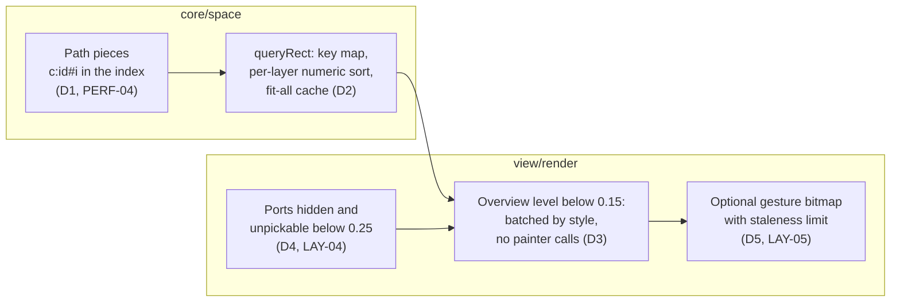

# Results

Closing summary of the change. Measurements, profiles and the history of each step are in
`notes.md`; the recorded baseline is `bench/baseline/2026-10-30-chrome-perf.json` and its
`SUMMARY.md`, and the before/after demo stresses are in `bench/README.md`.

## Why the change was made

The Slice A baseline (2026-10-30) missed three targets on F-LARGE (10k nodes, 20k
connections), and one case was not measured at all:

| Problem | Slice A baseline |
| --- | --- |
| Pick under the pointer while dragging (PERF-02a) | p95 2.7 ms against 2 ms |
| Culled pan at DPR 2 (PERF-02) | p95 16.8 ms, p99 25.0 ms against 16.7 ms |
| Whole graph in view (fit-all) | frames of 167 to 183 ms; no workload or target |
| Fit-all `queryRect` | about 25 to 28 ms per frame |

## What changed

1. Long connections are indexed as up to 12 pieces of about 800 world units (de Casteljau
   split), so a wire is a candidate only where a piece is near the query (the tighter
   IDX-03 test).
2. `queryRect` uses a key-to-entry map and numeric `(z, seq)` sorting per layer, and
   caches the full-view result until the index changes.
3. Ports are neither painted nor pickable below zoom 0.25 (`lodHidePortsBelow`, 0 keeps
   them). Port glyph painters run without per-glyph `save`/`restore`.
4. A fourth detail level, `overview` (`lodOverviewBelow`, 0.15), draws nodes and wires
   batched by resolved style. Selection, diagnostics and endpoints stay visible.
5. `gestureBitmap` (opt-in mount option) reuses a transformed copy of the last exact frame
   during viewport-only gestures with at least 3000 visible entities, within a zoom ratio
   of 1.25 and at most a quarter of the view uncovered, and repaints exactly 120 ms after
   the gesture rests.
6. Benchmarks: `overview-pan` and `overview-zoom` workloads with PERF-02e targets, fit-all
   pick and query cases, a baseline writer that keeps earlier baselines and compares with
   the latest, and a keep-awake wrapper for macOS runs.

## Outcome

Headed baseline, installed Chrome 156, Apple M1 Pro, 120 Hz display, on AC power (p95 /
p99 in ms). Every browser target is met.

| Row | Slice A | Now |
| --- | --- | --- |
| Drag pick, DPR 1 / 2 | 2.7 / 3.5 (missed) | 1.0 / 1.3 and 0.9 / 1.3 |
| Culled pan frame interval, DPR 2 | 16.8 / 25.0 (missed) | 16.6 / 18.1 |
| Zoom frame interval, DPR 2 | 16.6 / 23.9 | 10.1 / 15.5 |
| Overview pan frame interval, DPR 1 and 2 | not measured | 16.8 / 25.1 |
| Overview zoom frame interval, DPR 1 and 2 | not measured | 25.1 / 33.3 |
| Fit-all viewport `queryRect` (headless) | about 25 to 29 | 0.03 / 0.40 |
| View bundle, gzip | 45.2 KiB | 28.3 KiB (restructure, not this change) |

Perf demo stresses, headless Chrome, gesture bitmap off: the zoom sweep through fit-all
went from 40 fps with frames up to 167 ms to 57 fps with frames up to 33 ms on F-LARGE,
and from 35 fps with frames up to 317 ms to 46 to 47 fps with frames up to 67 to 83 ms on
20k nodes. Pan, move and live updates stay at the display rate on both sizes and DPRs.
With the gesture bitmap on, the zoom sweep reaches 58 to 59 fps.

## Costs and trade-offs

- Scene and index build for F-LARGE: p95 156 ms to 264 ms (pieces add index entries);
  within the 1000 ms target.
- The move commit in the perf demo is about 1.5 ms slower (5.3 to 6.6 ms before, 6.9 to
  8.0 ms after); not profiled.
- The gesture bitmap trades sharpness for frame rate: reused frames can be up to 1.25x
  upscaled and look slightly soft until the exact repaint. It stays off by default.
- Port glyph painters no longer get their own `save`/`restore`; a glyph painter must leave
  canvas state as it found it.

## Left open

- The largest remaining cost in dense frames is the per-painter `save`/`restore` around
  node and connection painters (about 18% of frame JavaScript at DPR 2). Removing it is a
  painter contract change for a later change.
- The headless "culling query at fit-all" row queries the bare world box, which bypasses
  the cache by design, and reports p95 20 ms against the 2 ms culling target. Whether that
  diagnostic row should carry a target is not decided.
- Browser benchmark runs on macOS need the display awake; a display turning off drops the
  test runner's connection. `scripts/keep-awake.mjs` handles it.
